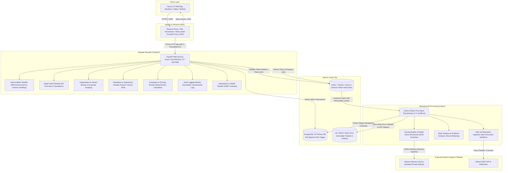
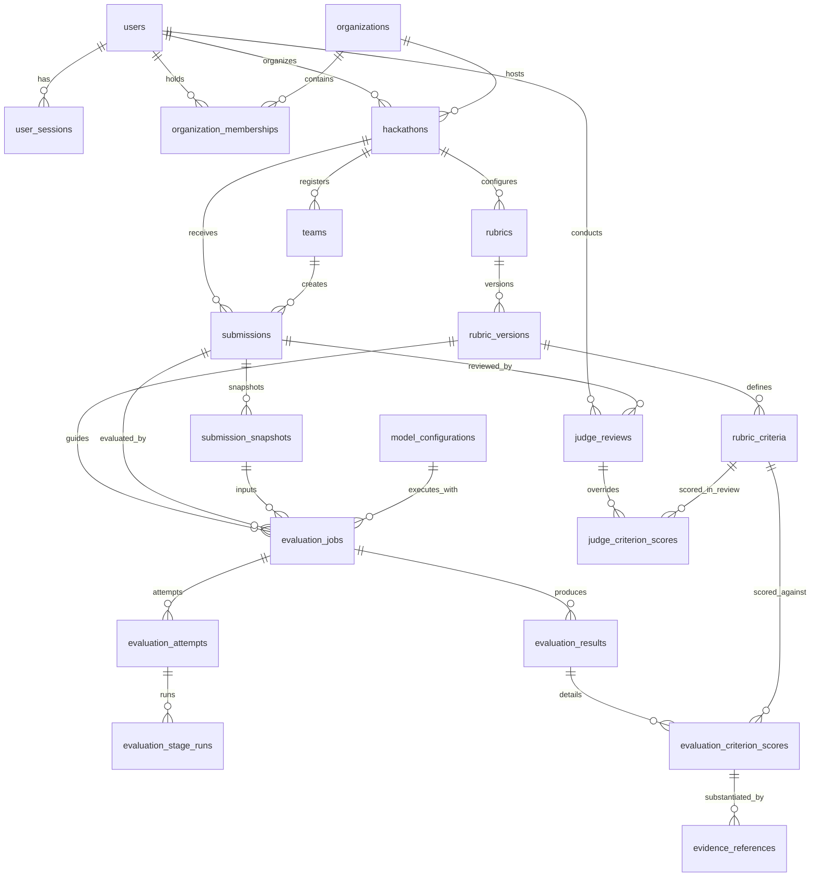

# SCORVA — Platform Technical Architecture

**Document Version:** 2.1  
**Status:** Approved Architectural Blueprint (Focused Corrective Revision)  
**System:** Scorva — AI-Assisted Hackathon Evaluation SaaS Platform  
**Target Scope:** Super Admin Dashboard & Core Platform Foundation  
**Primary Stack:** Next.js 15+ (TypeScript, Tailwind CSS, Lucide React), FastAPI (Pydantic v2, SQLAlchemy 2.0, Alembic), PostgreSQL 16, Redis 7, Celery 5.4, Ollama  

---

## Revision Change Log

| Version | Date | Sections Revised | Summary of Changes |
|---|---|---|---|
| **1.0** | 2026-10-25 | All | Initial architectural specification. |
| **2.0** | 2026-10-25 | All | Introduced dual-plane RBAC, 7-stage pipeline, and basic security models. |
| **2.1** | 2026-10-25 | 1, 3, 4, 5, 6, 7, 8, 9, 10, 11, 12, 13, 15 | **Mandatory corrective revision:**<br/>• **§4 & §12:** Fixed conflict between append-only audit trigger and foreign keys (eliminated cascading updates; audit table decoupled from destructive FK actions; explicit PostgreSQL table permissions).<br/>• **§6:** Redesigned session revocation with PostgreSQL durable source-of-truth, Redis token-hash caching, user-level invalidation timestamp, and circuit-breaker behavior.<br/>• **§9:** Replaced string-prefix archive checks with strict path containment (`Path.is_relative_to`), streaming byte limits, symlink/hardlink rejection, and special file blocks.<br/>• **§8:** Added renewable worker leases (heartbeats), stale-worker fencing tokens, atomic SQL claims, crash reaper, and idempotent result persistence.<br/>• **§11:** Corrected score normalization formula for non-zero minimum scores; defined strict score bounds, weight sum tolerance ($\sum w = 1.0000 \pm 0.0001$), `ROUND_HALF_UP` rounding, and judge override states.<br/>• **§10:** Hardened SSRF defense against DNS rebinding, IPv6, redirects, and private ranges; added IP pinning and strict internal host allowlists.<br/>• **§4 & §11:** Enforced immutable snapshot consistency to frozen commit SHA; embedded prompt/schema hashes directly into `evaluation_results`.<br/>• **§3 & §5:** Resolved error response format to full RFC 7807 / RFC 9457 Problem Details (`application/problem+json`).<br/>• **§4 & §12:** Defined DB permissions, 30-day sensitive code retention, and raw AI response S3 offload (>64KB).<br/>• **§15:** Accurately reflected Phase 1 as "Scaffold Verified" without claiming unrun migrations or unbuilt workers. |

---

## Table of Contents

1. [System Architecture and Component Responsibilities](#1-system-architecture-and-component-responsibilities)
2. [Frontend Architecture (Next.js, TypeScript, Tailwind CSS, Lucide React)](#2-frontend-architecture)
3. [Backend Architecture (FastAPI, Pydantic, SQLAlchemy, Alembic)](#3-backend-architecture)
4. [PostgreSQL Database Design](#4-postgresql-database-design)
5. [API Contracts for P0 Super Admin Features](#5-api-contracts-for-p0-super-admin-features)
6. [Authentication, Sessions, RBAC, and Authorization Enforcement](#6-authentication-sessions-rbac-and-authorization-enforcement)
7. [Organization and Tenant Isolation](#7-organization-and-tenant-isolation)
8. [Background Evaluation Jobs, Redis, Worker Lifecycle, Retries, and Failure Handling](#8-background-evaluation-jobs-redis-worker-lifecycle-retries-and-failure-handling)
9. [GitHub Repository Access, Immutable Submission Commit Snapshots, and Safe Repository Processing](#9-github-repository-access-immutable-submission-commit-snapshots-and-safe-repository-processing)
10. [AI Provider Abstraction, Initial Ollama Integration, Model Configuration, and Versioning](#10-ai-provider-abstraction-initial-ollama-integration-model-configuration-and-versioning)
11. [Evidence-Backed Scoring, Rubric Versions, Judge Review, and Audit History](#11-evidence-backed-scoring-rubric-versions-judge-review-and-audit-history)
12. [Logging, Health Checks, Monitoring, and Secret Management](#12-logging-health-checks-monitoring-and-secret-management)
13. [Testing Strategy, Docker Compose Development Environment, and Migrations](#13-testing-strategy-docker-compose-development-environment-and-migrations)
14. [Proposed Repository Structure](#14-proposed-repository-structure)
15. [Implementation Phases, Dependencies, and Acceptance Criteria](#15-implementation-phases-dependencies-and-acceptance-criteria)
16. [Unresolved Design Decisions](#16-unresolved-design-decisions)

---

## 1. System Architecture and Component Responsibilities

Scorva is designed as a **modular monolith** with an asynchronous worker subsystem. A single shared database houses relational records, while an event-driven task queue handles heavy analysis and inference tasks. This preserves transaction consistency, eliminates distributed microservice overhead, and isolates long-running AI evaluations from HTTP latency boundaries.



### Component Responsibilities

| Component | Priority | Technology | Primary Responsibilities |
|---|---|---|---|
| **Web Frontend** | P0 | Next.js 15+ (App Router), React 19, TypeScript, Tailwind CSS, Lucide React | Server-side rendering, client state management, responsive dark-first UI shell, table pagination/filtering, role-aware navigation, and evaluation inspection views. |
| **API Backend** | P0 | FastAPI, Pydantic v2, SQLAlchemy 2.0 (asyncpg), Uvicorn | Request validation, session verification via SHA-256 token hashing, mandatory MFA enrollment enforcement, dual-plane RBAC enforcement, transactional entity persistence, deterministic score calculation, and transactional audit logging. |
| **Task Queue & Broker** | P0 | Celery 5.4, Redis 7 | Job queuing with priorities (`evaluations.high`, `evaluations.default`, `evaluations.maintenance`), task state tracking, safe distributed lock acquisition with ownership tokens, and sliding session persistence. |
| **Background Workers** | P0 | Celery Workers (Prefork / Solo pool with sync SQLAlchemy) | Sandbox repository extraction, file tree classification, AST-based evidence scanning, prompt assembly, Ollama communication, and schema validation. Zero untrusted code execution. |
| **Primary Database** | P0 | PostgreSQL 16 | ACID-compliant relational persistence, foreign key constraints with `ON DELETE RESTRICT` for historical preservation, JSONB storage for model schemas and evidence trees, and trigger-enforced append-only audit logs. |
| **Artifact Storage** | P0 | S3 API (MinIO for dev, AWS S3 for production) | Storing write-once immutable repository snapshots (`.tar.gz`), extracted file indexes, and raw LLM responses exceeding 64KB threshold. |
| **AI Inference Provider** | P0 | Ollama (Local Daemon or Remote Docker) | Local/on-premise LLM execution (`llama3:8b`, `deepseek-coder:6.7b`), structured output generation via JSON grammar constraints. Network-isolated to prevent SSRF. |
| **External Integration** | P0 | GitHub App / REST API | Authenticated repository metadata retrieval, commit SHA freezing, tarball downloads, and webhook signature verification. |

---

## 2. Frontend Architecture

The frontend is built using Next.js (App Router), TypeScript, Tailwind CSS, and Lucide React icons, adhering strictly to the professional dark-first theme specified in `docs/SUPER_ADMIN_SCREEN_SPEC.md`.

### 2.1 Design Tokens & Theme Configuration

The application uses Tailwind CSS with semantic dark tokens configured in `apps/web/tailwind.config.ts`:

```typescript
// apps/web/tailwind.config.ts
import type { Config } from 'tailwindcss';

const config: Config = {
  darkMode: 'class',
  content: [
    './src/pages/**/*.{js,ts,jsx,tsx,mdx}',
    './src/components/**/*.{js,ts,jsx,tsx,mdx}',
    './src/app/**/*.{js,ts,jsx,tsx,mdx}',
  ],
  theme: {
    extend: {
      colors: {
        background: '#0B1020',
        surface: {
          DEFAULT: '#111827',
          elevated: '#1F2937',
          border: '#374151',
          hover: '#1E293B',
        },
        primary: {
          DEFAULT: '#3B82F6',
          hover: '#2563EB',
          muted: '#1D4ED8',
        },
        text: {
          primary: '#F8FAFC',
          secondary: '#94A3B8',
          muted: '#64748B',
        },
        status: {
          success: '#10B981',
          warning: '#F59E0B',
          error: '#EF4444',
          info: '#3B82F6',
        },
      },
      fontFamily: {
        sans: ['Inter', 'Plus Jakarta Sans', 'system-ui', 'sans-serif'],
      },
      boxShadow: {
        'surface-elevated': '0 4px 20px -2px rgba(0, 0, 0, 0.5)',
      },
    },
  },
  plugins: [],
};

export default config;
```

### 2.2 Client-Side State Management and Data Fetching

1. **Server State:** Managed using `@tanstack/react-query` (TanStack Query v5).
   - Queries are cached with explicit `staleTime` (30s for overview metrics, 10s for running jobs).
   - Optimistic updates are used for non-destructive actions; strict invalidation is used for status mutations.
   - Polling intervals (`refetchInterval`) are enabled only when viewing active evaluation jobs or health screens.
2. **Global UI State:** Managed via `zustand` stores.
   - `useSidebarStore`: Persists collapsed/expanded sidebar state in `localStorage`.
   - `useFilterStore`: Preserves table filters across navigation where specified.
3. **Form Handling:** Managed via `react-hook-form` and `@hookform/resolvers/zod` for type-safe validation mirroring backend Pydantic models.

---

## 3. Backend Architecture

The backend is built as a **FastAPI modular monolith** with explicit separation between async web request handling and synchronous Celery worker database pooling.

### 3.1 Application Structure

```text
apps/api/
├── main.py                        # FastAPI entry point, lifespan, middleware
├── config.py                      # Pydantic BaseSettings loading .env
├── dependencies.py                # Database sessions, Redis clients, auth guards
├── middleware/
│   ├── correlation.py             # Injects X-Correlation-ID into request/response
│   ├── error_handler.py           # Global RFC 7807/RFC 9457 Problem Details interceptor
│   ├── proxy_headers.py          # Trusted proxy IP extractor (X-Forwarded-For)
│   └── csrf_origin.py             # Strict Origin / Referer validation for mutations
├── modules/
│   ├── auth/                      # Login, MFA TOTP, session hashing, guards
│   ├── admin/                     # Super admin overview, platform aggregations
│   ├── organizations/             # Org CRUD, lifecycle, quota management
│   ├── users/                     # User directory, roles, session revocation
│   ├── hackathons/                # Hackathon oversight, submission tracking
│   ├── evaluations/               # Evaluation job dispatch, retry, status
│   ├── ai_models/                 # Model registry, configuration, test pings
│   ├── system_health/             # Real-time health probes, telemetry
│   ├── audit/                     # Audit trail retrieval and search
│   └── integrations/              # GitHub, Ollama, Email service configs
├── core/
│   ├── database.py                # Async SQLAlchemy engine and sessionmaker
│   ├── security.py                # Password hashing, AES-256 secret encryption
│   └── exceptions.py              # Domain exception hierarchy
└── workers/                       # Celery worker application and tasks
    ├── celery_app.py
    ├── db_sync.py                 # Sync SQLAlchemy engine with NullPool for forks
    └── pipeline/                  # 7-stage evaluation pipeline
```

### 3.2 SQLAlchemy 2.0 Dual Pooling Strategy (Async API vs Sync Workers)

1. **FastAPI Web Service:** Uses asynchronous engine with `asyncpg` driver for non-blocking I/O during high-concurrency HTTP queries:
   ```python
   # apps/api/core/database.py
   from sqlalchemy.ext.asyncio import create_async_engine, async_sessionmaker, AsyncSession
   from apps.api.config import settings

   async_engine = create_async_engine(
       settings.DATABASE_URL,
       pool_size=20,
       max_overflow=10,
       pool_pre_ping=True,
       echo=settings.DEBUG,
   )

   AsyncSessionLocal = async_sessionmaker(
       bind=async_engine,
       class_=AsyncSession,
       expire_on_commit=False,
       autoflush=False,
   )

   async def get_db_session() -> AsyncSession:
       async with AsyncSessionLocal() as session:
           try:
               yield session
               await session.commit()
           except Exception:
               await session.rollback()
               raise
           finally:
               await session.close()
   ```

2. **Celery Worker Pool:** Prefork worker processes must **never** share connection pools across forks. Workers use synchronous SQLAlchemy with `NullPool` (opening and closing a dedicated connection per job attempt):
   ```python
   # apps/api/workers/db_sync.py
   from sqlalchemy import create_engine
   from sqlalchemy.orm import sessionmaker, Session
   from sqlalchemy.pool import NullPool
   from apps.api.config import settings

   SYNC_DB_URL = settings.DATABASE_URL.replace("+asyncpg", "")

   sync_engine = create_engine(
       SYNC_DB_URL,
       poolclass=NullPool,  # Prevents cross-process connection pool corruption in Celery prefork
       pool_pre_ping=True,
   )

   SyncSessionLocal = sessionmaker(bind=sync_engine, class_=Session, expire_on_commit=False)

   def get_worker_db_session() -> Session:
       return SyncSessionLocal()
   ```

### 3.3 Standardized Problem Details Error Responses (RFC 7807 / RFC 9457)

All API error responses adhere to standard RFC 7807 / RFC 9457 specifications with `Content-Type: application/problem+json`:

```json
{
  "type": "https://api.scorva.io/errors/resource-suspended",
  "title": "Resource Suspended",
  "status": 403,
  "detail": "Organization 'org_9f8e7d' has been suspended and cannot be modified.",
  "instance": "/api/v1/admin/organizations/7a3e8c14-25b4-4e12-b9e3-82098b1d98fa/status",
  "code": "ORGANIZATION_SUSPENDED",
  "request_id": "9b1deb4d-3b7d-4bad-9bdd-2b0d7b3dcb6d",
  "timestamp": "2026-10-25T11:53:00Z",
  "invalid_params": [
    {
      "field": "status",
      "reason": "Organization is already in SUSPENDED state."
    }
  ]
}
```

---

## 4. PostgreSQL Database Design

The database schema is managed via **Alembic**. It uses PostgreSQL 16 native UUID primary keys, explicit foreign key constraints with `ON DELETE RESTRICT` on historical records to prevent accidental cascading deletion of evaluations, and JSONB for versioned schemas.



### 4.1 Schema Definition & Data Dictionary

#### 1. `users` (P0)
Represents user accounts across platform roles and organizations.
```sql
CREATE TYPE platform_role_enum AS ENUM (
    'platform_owner',
    'platform_ops_admin',
    'ai_ops_admin',
    'security_admin',
    'support_admin',
    'billing_admin'
);

CREATE TABLE users (
    id UUID PRIMARY KEY DEFAULT gen_random_uuid(),
    email VARCHAR(255) NOT NULL UNIQUE,
    full_name VARCHAR(150) NOT NULL,
    hashed_password VARCHAR(255) NOT NULL,
    platform_role platform_role_enum NULL,
    is_active BOOLEAN NOT NULL DEFAULT TRUE,
    is_verified BOOLEAN NOT NULL DEFAULT FALSE,
    mfa_enabled BOOLEAN NOT NULL DEFAULT FALSE,
    encrypted_mfa_secret TEXT NULL,              -- AES-256-GCM encrypted TOTP seed
    sessions_revoked_at TIMESTAMPTZ NULL,        -- Failsafe timestamp: invalidates sessions issued prior
    last_login_at TIMESTAMPTZ NULL,
    created_at TIMESTAMPTZ NOT NULL DEFAULT NOW(),
    updated_at TIMESTAMPTZ NOT NULL DEFAULT NOW(),
    deleted_at TIMESTAMPTZ NULL
);
CREATE INDEX idx_users_platform_role ON users(platform_role) WHERE platform_role IS NOT NULL;
CREATE INDEX idx_users_email_search ON users(email);
```

#### 2. `user_sessions` (P0)
Tracks active sessions using SHA-256 hashed tokens for instantaneous revocation.
```sql
CREATE TABLE user_sessions (
    id UUID PRIMARY KEY DEFAULT gen_random_uuid(),
    user_id UUID NOT NULL REFERENCES users(id) ON DELETE RESTRICT,
    session_token_hash VARCHAR(64) NOT NULL UNIQUE, -- SHA-256 hex hash of client token
    ip_address VARCHAR(45) NOT NULL,                -- Validated client IP from trusted reverse proxy
    user_agent TEXT NOT NULL,
    expires_at TIMESTAMPTZ NOT NULL,
    created_at TIMESTAMPTZ NOT NULL DEFAULT NOW(),
    last_active_at TIMESTAMPTZ NOT NULL DEFAULT NOW(),
    is_revoked BOOLEAN NOT NULL DEFAULT FALSE
);
CREATE INDEX idx_user_sessions_user_active ON user_sessions(user_id, is_revoked, expires_at);
CREATE INDEX idx_user_sessions_hash ON user_sessions(session_token_hash);
```

#### 3. `organizations` (P0)
Platform tenants hosting hackathons.
```sql
CREATE TYPE organization_status_enum AS ENUM ('active', 'pending', 'suspended', 'archived');

CREATE TABLE organizations (
    id UUID PRIMARY KEY DEFAULT gen_random_uuid(),
    name VARCHAR(150) NOT NULL,
    slug VARCHAR(100) NOT NULL UNIQUE,
    owner_id UUID NOT NULL REFERENCES users(id) ON DELETE RESTRICT,
    status organization_status_enum NOT NULL DEFAULT 'active',
    max_hackathons INT NOT NULL DEFAULT 5,
    max_evaluations_per_month INT NOT NULL DEFAULT 500,
    created_at TIMESTAMPTZ NOT NULL DEFAULT NOW(),
    updated_at TIMESTAMPTZ NOT NULL DEFAULT NOW(),
    deleted_at TIMESTAMPTZ NULL
);
CREATE INDEX idx_organizations_status ON organizations(status);
```

#### 4. `organization_memberships` (P0)
Tenant-level role assignments.
```sql
CREATE TYPE org_role_enum AS ENUM ('org_admin', 'organizer', 'judge', 'participant');

CREATE TABLE organization_memberships (
    id UUID PRIMARY KEY DEFAULT gen_random_uuid(),
    organization_id UUID NOT NULL REFERENCES organizations(id) ON DELETE CASCADE,
    user_id UUID NOT NULL REFERENCES users(id) ON DELETE CASCADE,
    role org_role_enum NOT NULL DEFAULT 'participant',
    created_at TIMESTAMPTZ NOT NULL DEFAULT NOW(),
    updated_at TIMESTAMPTZ NOT NULL DEFAULT NOW(),
    CONSTRAINT uq_org_user UNIQUE (organization_id, user_id)
);
CREATE INDEX idx_org_memberships_user ON organization_memberships(user_id);
```

#### 5. `hackathons` (P0)
Hackathon events scoped to organizations. Uses composite unique constraint for tenant key validation.
```sql
CREATE TYPE hackathon_status_enum AS ENUM (
    'draft', 'published', 'registration_open', 'submission_open', 
    'judging', 'completed', 'suspended'
);

CREATE TABLE hackathons (
    id UUID PRIMARY KEY DEFAULT gen_random_uuid(),
    organization_id UUID NOT NULL REFERENCES organizations(id) ON DELETE RESTRICT,
    title VARCHAR(200) NOT NULL,
    slug VARCHAR(150) NOT NULL UNIQUE,
    description TEXT NULL,
    status hackathon_status_enum NOT NULL DEFAULT 'draft',
    start_date TIMESTAMPTZ NOT NULL,
    end_date TIMESTAMPTZ NOT NULL,
    submission_deadline TIMESTAMPTZ NOT NULL,
    judging_deadline TIMESTAMPTZ NOT NULL,
    created_at TIMESTAMPTZ NOT NULL DEFAULT NOW(),
    updated_at TIMESTAMPTZ NOT NULL DEFAULT NOW(),
    deleted_at TIMESTAMPTZ NULL,
    CONSTRAINT uq_hackathon_org_id UNIQUE (organization_id, id) -- Composite key for tenant FK referencing
);
CREATE INDEX idx_hackathons_org_status ON hackathons(organization_id, status);
```

#### 6. `teams` & `submissions` (P0)
Teams and submissions are explicitly scoped to organizations. Historical deletions are RESTRICTED.
```sql
CREATE TABLE teams (
    id UUID PRIMARY KEY DEFAULT gen_random_uuid(),
    organization_id UUID NOT NULL,
    hackathon_id UUID NOT NULL,
    name VARCHAR(150) NOT NULL,
    created_at TIMESTAMPTZ NOT NULL DEFAULT NOW(),
    CONSTRAINT fk_team_hackathon_tenant FOREIGN KEY (organization_id, hackathon_id) 
        REFERENCES hackathons(organization_id, id) ON DELETE RESTRICT,
    CONSTRAINT uq_hackathon_team_name UNIQUE (hackathon_id, name)
);

CREATE TYPE submission_status_enum AS ENUM (
    'submitted', 'evaluating', 'evaluated', 'judge_review', 'finalized', 'disqualified'
);

CREATE TABLE submissions (
    id UUID PRIMARY KEY DEFAULT gen_random_uuid(),
    organization_id UUID NOT NULL,
    hackathon_id UUID NOT NULL,
    team_id UUID NOT NULL REFERENCES teams(id) ON DELETE RESTRICT,
    title VARCHAR(200) NOT NULL,
    description TEXT NULL,
    repo_url VARCHAR(500) NOT NULL,
    branch_name VARCHAR(100) NOT NULL DEFAULT 'main',
    frozen_commit_sha VARCHAR(40) NOT NULL,
    status submission_status_enum NOT NULL DEFAULT 'submitted',
    submitted_at TIMESTAMPTZ NOT NULL DEFAULT NOW(),
    updated_at TIMESTAMPTZ NOT NULL DEFAULT NOW(),
    deleted_at TIMESTAMPTZ NULL,
    CONSTRAINT fk_submission_hackathon_tenant FOREIGN KEY (organization_id, hackathon_id) 
        REFERENCES hackathons(organization_id, id) ON DELETE RESTRICT,
    CONSTRAINT uq_team_submission UNIQUE (hackathon_id, team_id),
    CONSTRAINT uq_submission_frozen_commit UNIQUE (id, frozen_commit_sha) -- Supports FK verification from snapshot
);
CREATE INDEX idx_submissions_hackathon_status ON submissions(hackathon_id, status);
CREATE INDEX idx_submissions_tenant ON submissions(organization_id);
```

#### 7. `submission_snapshots` (P0)
Immutable repository state archives verified by SHA-256 checksums and bound to frozen commit SHA.
```sql
CREATE TABLE submission_snapshots (
    id UUID PRIMARY KEY DEFAULT gen_random_uuid(),
    submission_id UUID NOT NULL,
    commit_sha VARCHAR(40) NOT NULL,
    tree_sha VARCHAR(40) NOT NULL,
    archive_sha256 VARCHAR(64) NOT NULL,           -- Strict SHA-256 digest of tarball
    storage_path VARCHAR(500) NOT NULL,
    total_files INT NOT NULL,
    total_loc INT NOT NULL,
    languages_json JSONB NOT NULL DEFAULT '{}'::jsonb,
    scanned_at TIMESTAMPTZ NOT NULL DEFAULT NOW(),
    CONSTRAINT fk_snapshot_submission_commit FOREIGN KEY (submission_id, commit_sha)
        REFERENCES submissions(id, frozen_commit_sha) ON DELETE RESTRICT,
    CONSTRAINT uq_submission_commit UNIQUE (submission_id, commit_sha)
);
```

#### 8. `rubrics`, `rubric_versions`, & `rubric_criteria` (P0)
Criteria weights must sum to 1.0 (with 4 decimal places of precision).
```sql
CREATE TABLE rubrics (
    id UUID PRIMARY KEY DEFAULT gen_random_uuid(),
    organization_id UUID NOT NULL,
    hackathon_id UUID NOT NULL,
    name VARCHAR(150) NOT NULL,
    description TEXT NULL,
    created_at TIMESTAMPTZ NOT NULL DEFAULT NOW(),
    CONSTRAINT fk_rubric_hackathon_tenant FOREIGN KEY (organization_id, hackathon_id) 
        REFERENCES hackathons(organization_id, id) ON DELETE RESTRICT
);

CREATE TABLE rubric_versions (
    id UUID PRIMARY KEY DEFAULT gen_random_uuid(),
    rubric_id UUID NOT NULL REFERENCES rubrics(id) ON DELETE RESTRICT,
    version_number INT NOT NULL,
    is_published BOOLEAN NOT NULL DEFAULT FALSE,
    created_at TIMESTAMPTZ NOT NULL DEFAULT NOW(),
    CONSTRAINT uq_rubric_version UNIQUE (rubric_id, version_number)
);

CREATE TABLE rubric_criteria (
    id UUID PRIMARY KEY DEFAULT gen_random_uuid(),
    rubric_version_id UUID NOT NULL REFERENCES rubric_versions(id) ON DELETE RESTRICT,
    name VARCHAR(100) NOT NULL,
    description TEXT NOT NULL,
    weight NUMERIC(5, 4) NOT NULL CHECK (weight > 0.0000 AND weight <= 1.0000),
    min_score NUMERIC(5, 2) NOT NULL DEFAULT 0.0,
    max_score NUMERIC(5, 2) NOT NULL DEFAULT 10.0,
    evaluation_instructions TEXT NOT NULL,
    sort_order INT NOT NULL DEFAULT 0,
    CONSTRAINT ck_rubric_criteria_scores CHECK (max_score > min_score AND min_score >= 0.0)
);
CREATE INDEX idx_criteria_rubric_version ON rubric_criteria(rubric_version_id);
```

#### 9. `model_configurations` (P0)
AI provider configurations. Base URLs are validated against SSRF restrictions.
```sql
CREATE TYPE ai_provider_enum AS ENUM ('ollama', 'openai', 'anthropic', 'mock');

CREATE TABLE model_configurations (
    id UUID PRIMARY KEY DEFAULT gen_random_uuid(),
    provider ai_provider_enum NOT NULL DEFAULT 'ollama',
    model_identifier VARCHAR(100) NOT NULL,
    base_url VARCHAR(255) NOT NULL,
    temperature NUMERIC(3, 2) NOT NULL DEFAULT 0.1,
    context_window INT NOT NULL DEFAULT 8192,
    prompt_template_version VARCHAR(50) NOT NULL,
    output_schema_version VARCHAR(50) NOT NULL,
    is_default BOOLEAN NOT NULL DEFAULT FALSE,
    is_active BOOLEAN NOT NULL DEFAULT TRUE,
    created_at TIMESTAMPTZ NOT NULL DEFAULT NOW(),
    updated_at TIMESTAMPTZ NOT NULL DEFAULT NOW()
);
```

#### 10. `evaluation_jobs`, `attempts`, and `stage_runs` (P0)
Execution records with renewable worker fencing tokens and CAS lock versions.
```sql
CREATE TYPE job_status_enum AS ENUM ('queued', 'running', 'completed', 'failed', 'cancelled');
CREATE TYPE pipeline_stage_enum AS ENUM (
    'repo_acquisition', 'repo_inventory', 'doc_analysis', 'tech_analysis',
    'evidence_validation', 'rubric_scoring', 'report_persistence'
);

CREATE TABLE evaluation_jobs (
    id UUID PRIMARY KEY DEFAULT gen_random_uuid(),
    submission_id UUID NOT NULL REFERENCES submissions(id) ON DELETE RESTRICT,
    submission_snapshot_id UUID NOT NULL REFERENCES submission_snapshots(id) ON DELETE RESTRICT,
    rubric_version_id UUID NOT NULL REFERENCES rubric_versions(id) ON DELETE RESTRICT,
    model_configuration_id UUID NOT NULL REFERENCES model_configurations(id) ON DELETE RESTRICT,
    status job_status_enum NOT NULL DEFAULT 'queued',
    current_stage pipeline_stage_enum NOT NULL DEFAULT 'repo_acquisition',
    priority INT NOT NULL DEFAULT 5,
    attempts_count INT NOT NULL DEFAULT 0,
    max_attempts INT NOT NULL DEFAULT 3,
    claim_token UUID NULL,                          -- Stale-worker fencing token
    lock_version INT NOT NULL DEFAULT 1,            -- CAS generation counter for safe worker commits
    last_heartbeat_at TIMESTAMPTZ NULL,             -- Worker lease renewal heartbeat
    error_code VARCHAR(50) NULL,
    error_message TEXT NULL,
    queued_at TIMESTAMPTZ NOT NULL DEFAULT NOW(),
    started_at TIMESTAMPTZ NULL,
    completed_at TIMESTAMPTZ NULL,
    duration_ms INT NULL,
    correlation_id UUID NOT NULL
);
CREATE INDEX idx_eval_jobs_status_queued ON evaluation_jobs(status, queued_at);
CREATE INDEX idx_eval_jobs_submission ON evaluation_jobs(submission_id);
CREATE INDEX idx_eval_jobs_heartbeat ON evaluation_jobs(status, last_heartbeat_at) WHERE status = 'running';

CREATE TABLE evaluation_attempts (
    id UUID PRIMARY KEY DEFAULT gen_random_uuid(),
    job_id UUID NOT NULL REFERENCES evaluation_jobs(id) ON DELETE RESTRICT,
    attempt_number INT NOT NULL,
    worker_id VARCHAR(100) NOT NULL,
    status job_status_enum NOT NULL DEFAULT 'running',
    stage_at_failure pipeline_stage_enum NULL,
    error_details JSONB NULL,
    started_at TIMESTAMPTZ NOT NULL DEFAULT NOW(),
    completed_at TIMESTAMPTZ NULL,
    duration_ms INT NULL,
    CONSTRAINT uq_job_attempt UNIQUE (job_id, attempt_number)
);

CREATE TABLE evaluation_stage_runs (
    id UUID PRIMARY KEY DEFAULT gen_random_uuid(),
    attempt_id UUID NOT NULL REFERENCES evaluation_attempts(id) ON DELETE RESTRICT,
    stage pipeline_stage_enum NOT NULL,
    status job_status_enum NOT NULL DEFAULT 'running',
    input_summary JSONB NULL,
    output_summary JSONB NULL,
    error_message TEXT NULL,
    duration_ms INT NULL,
    started_at TIMESTAMPTZ NOT NULL DEFAULT NOW(),
    completed_at TIMESTAMPTZ NULL
);
CREATE INDEX idx_stage_runs_attempt ON evaluation_stage_runs(attempt_id);
```

#### 11. `evaluation_results`, `criterion_scores`, & `evidence_references` (P0)
Stores immutable execution parameters (prompt hash, schema hash) directly on the result row.
```sql
CREATE TABLE evaluation_results (
    id UUID PRIMARY KEY DEFAULT gen_random_uuid(),
    job_id UUID NOT NULL REFERENCES evaluation_jobs(id) ON DELETE RESTRICT,
    submission_id UUID NOT NULL REFERENCES submissions(id) ON DELETE RESTRICT,
    rubric_version_id UUID NOT NULL REFERENCES rubric_versions(id) ON DELETE RESTRICT,
    model_configuration_id UUID NOT NULL REFERENCES model_configurations(id) ON DELETE RESTRICT,
    
    -- Immutable model snapshot directly attached to result
    model_identifier VARCHAR(100) NOT NULL,
    provider ai_provider_enum NOT NULL,
    temperature NUMERIC(3, 2) NOT NULL,
    context_window INT NOT NULL,
    prompt_template_version VARCHAR(50) NOT NULL,
    prompt_template_sha256 VARCHAR(64) NOT NULL,
    output_schema_version VARCHAR(50) NOT NULL,
    output_schema_sha256 VARCHAR(64) NOT NULL,

    deterministic_total_score NUMERIC(5, 2) NOT NULL,
    normalized_score NUMERIC(5, 2) NOT NULL,
    summary_rationale TEXT NOT NULL,
    limitations TEXT NULL,
    raw_ai_response JSONB NULL,                     -- Inlined if <= 64KB
    raw_ai_response_s3_uri VARCHAR(500) NULL,       -- Offloaded to S3 if > 64KB
    is_active BOOLEAN NOT NULL DEFAULT TRUE,
    generated_at TIMESTAMPTZ NOT NULL DEFAULT NOW()
);

-- Partial unique index: exactly one active result per submission
CREATE UNIQUE INDEX uq_active_eval_result_per_submission 
ON evaluation_results (submission_id) 
WHERE is_active = TRUE;

CREATE TABLE evaluation_criterion_scores (
    id UUID PRIMARY KEY DEFAULT gen_random_uuid(),
    evaluation_result_id UUID NOT NULL REFERENCES evaluation_results(id) ON DELETE RESTRICT,
    rubric_criterion_id UUID NOT NULL REFERENCES rubric_criteria(id) ON DELETE RESTRICT,
    raw_score NUMERIC(5, 2) NOT NULL,
    normalized_score NUMERIC(5, 4) NOT NULL,        -- (raw - min) / (max - min)
    weighted_score NUMERIC(5, 2) NOT NULL,          -- normalized * weight * 100
    rationale TEXT NOT NULL,
    confidence_score NUMERIC(3, 2) NULL,            -- NULL indicates uncalibrated / unknown confidence
    missing_evidence_notes TEXT NULL
);

CREATE TABLE evidence_references (
    id UUID PRIMARY KEY DEFAULT gen_random_uuid(),
    criterion_score_id UUID NOT NULL REFERENCES evaluation_criterion_scores(id) ON DELETE RESTRICT,
    file_path VARCHAR(500) NOT NULL,
    start_line INT NOT NULL,
    end_line INT NOT NULL,
    code_snippet TEXT NOT NULL,                     -- Secrets pre-redacted before persistence
    relevance_explanation TEXT NOT NULL,
    is_verified_by_indexer BOOLEAN NOT NULL DEFAULT FALSE
);
CREATE INDEX idx_evidence_criterion ON evidence_references(criterion_score_id);
```

#### 12. `judge_reviews` & `judge_criterion_scores` (P0)
Complete DDL for human reviews and criterion-level score overrides.
```sql
CREATE TYPE judge_review_status_enum AS ENUM ('draft', 'submitted', 'revised');

CREATE TABLE judge_reviews (
    id UUID PRIMARY KEY DEFAULT gen_random_uuid(),
    submission_id UUID NOT NULL REFERENCES submissions(id) ON DELETE RESTRICT,
    judge_user_id UUID NOT NULL REFERENCES users(id) ON DELETE RESTRICT,
    evaluation_result_id UUID NULL REFERENCES evaluation_results(id) ON DELETE RESTRICT,
    rubric_version_id UUID NOT NULL REFERENCES rubric_versions(id) ON DELETE RESTRICT,
    override_total_score NUMERIC(5, 2) NOT NULL,
    judge_notes TEXT NULL,
    status judge_review_status_enum NOT NULL DEFAULT 'submitted',
    submitted_at TIMESTAMPTZ NOT NULL DEFAULT NOW(),
    updated_at TIMESTAMPTZ NOT NULL DEFAULT NOW(),
    CONSTRAINT uq_submission_judge UNIQUE (submission_id, judge_user_id)
);

CREATE TABLE judge_criterion_scores (
    id UUID PRIMARY KEY DEFAULT gen_random_uuid(),
    judge_review_id UUID NOT NULL REFERENCES judge_reviews(id) ON DELETE RESTRICT,
    rubric_criterion_id UUID NOT NULL REFERENCES rubric_criteria(id) ON DELETE RESTRICT,
    manual_score NUMERIC(5, 2) NOT NULL,
    rationale TEXT NULL,
    created_at TIMESTAMPTZ NOT NULL DEFAULT NOW(),
    CONSTRAINT uq_judge_criterion UNIQUE (judge_review_id, rubric_criterion_id)
);
CREATE INDEX idx_judge_criterion_review ON judge_criterion_scores(judge_review_id);
```

#### 13. `audit_events` (P0 — Decoupled from Foreign-Key Cascades)
Guarantees immutability. Historical UUID references are recorded without cascading triggers.
```sql
CREATE TYPE audit_outcome_enum AS ENUM ('success', 'failure', 'denied');

CREATE TABLE audit_events (
    id UUID PRIMARY KEY DEFAULT gen_random_uuid(),
    timestamp TIMESTAMPTZ NOT NULL DEFAULT NOW(),
    actor_user_id UUID NULL,                         -- Historical UUID reference (NO cascading FK trigger)
    actor_email VARCHAR(255) NOT NULL,
    actor_role VARCHAR(50) NOT NULL,
    action VARCHAR(100) NOT NULL,
    resource_type VARCHAR(50) NOT NULL,
    resource_id VARCHAR(100) NOT NULL,
    organization_id UUID NULL,                       -- Historical UUID reference (NO cascading FK trigger)
    outcome audit_outcome_enum NOT NULL,
    reason TEXT NULL,
    diff_payload JSONB NULL,
    ip_address VARCHAR(45) NOT NULL,
    user_agent TEXT NOT NULL,
    correlation_id UUID NOT NULL
);
CREATE INDEX idx_audit_timestamp ON audit_events(timestamp DESC);
CREATE INDEX idx_audit_resource ON audit_events(resource_type, resource_id);
CREATE INDEX idx_audit_actor ON audit_events(actor_user_id);

-- Enforceable Append-Only Trigger: Blocks UPDATE and DELETE
CREATE OR REPLACE FUNCTION prevent_audit_modification()
RETURNS TRIGGER AS $$
BEGIN
    RAISE EXCEPTION 'audit_events is an immutable, append-only table. UPDATE and DELETE operations are forbidden.';
END;
$$ LANGUAGE plpgsql;

CREATE TRIGGER trg_audit_events_immutable
BEFORE UPDATE OR DELETE ON audit_events
FOR EACH ROW EXECUTE FUNCTION prevent_audit_modification();
```

---

## 5. API Contracts for P0 Super Admin Features

All administrative endpoints are versioned under `/api/v1/admin` and require an authenticated session with a recognized `platform_role`.

> [!NOTE]
> All sample JSON payloads below are illustrative contract examples, not real production telemetry.

### 5.1 Dashboard Overview (P0)

#### `GET /api/v1/admin/dashboard/overview`
Retrieves platform aggregations and dependency health.

- **Headers:** `Cookie: scorva_session=<token>`
- **Response `200 OK` (Illustrative Example):**
```json
{
  "metrics": {
    "total_organizations": 42,
    "active_organizations": 38,
    "total_users": 1250,
    "active_hackathons": 6,
    "total_submissions": 418,
    "evaluations_completed": 395,
    "evaluations_queued_or_running": 5,
    "evaluation_failure_rate": 0.043,
    "system_availability": 0.9995
  },
  "reporting_window": {
    "start_time": "2026-09-25T00:00:00Z",
    "end_time": "2026-10-25T11:53:00Z"
  },
  "freshness_timestamp": "2026-10-25T11:53:02Z"
}
```

### 5.2 Organization Management (P0)

- `GET /api/v1/admin/organizations` — Paginated directory (`page`, `limit`, `status`, `search`).
- `POST /api/v1/admin/organizations` — Create organization.
- `GET /api/v1/admin/organizations/{id}` — Detail profile, quotas, and member summary.
- `PATCH /api/v1/admin/organizations/{id}` — Update metadata.
- `POST /api/v1/admin/organizations/{id}/status` — Suspend or reactivate organization.

### 5.3 Users & Access Management (P0)

- `GET /api/v1/admin/users` — Paginated directory (`page`, `limit`, `role`, `status`, `search`).
- `POST /api/v1/admin/users` — Invite user.
- `GET /api/v1/admin/users/{id}` — Profile, organization memberships, and role assignments.
- `PATCH /api/v1/admin/users/{id}/role` — Change platform role. Invalidates all target user sessions in Redis and DB.
- `POST /api/v1/admin/users/{id}/status` — Activate/suspend user.
- `POST /api/v1/admin/users/{id}/revoke-sessions` — Instantly revokes all active sessions for user.

### 5.4 Hackathons Platform Oversight (P0)

- `GET /api/v1/admin/hackathons` — Platform-wide event directory (`page`, `limit`, `org_id`, `status`).
- `GET /api/v1/admin/hackathons/{id}` — Hackathon configuration, deadline timestamps, submission stats.
- `GET /api/v1/admin/hackathons/{id}/submissions` — Submission directory with frozen commit SHAs.
- `POST /api/v1/admin/hackathons/{id}/status` — Exceptional suspension with required reason and audit event.

### 5.5 AI Operations & Evaluation Inspection (P0)

- `GET /api/v1/admin/ai/jobs` — Job queue directory (`status`, `stage`, `hackathon_id`, `error_code`).
- `GET /api/v1/admin/ai/jobs/{id}` — Full 7-stage pipeline timeline, stage checkpoints, and logs.
- `POST /api/v1/admin/ai/jobs/{id}/retry` — Idempotent manual retry. Increments `attempts_count`, leaves prior attempts intact.
- `POST /api/v1/admin/ai/jobs/{id}/cancel` — Graceful task cancellation.

### 5.6 System Health, Audit, & Settings (P0)

- `GET /api/v1/admin/system/health` — Live dependency status.
- `GET /api/v1/admin/security/audit-events` — Paginated audit log search (`actor`, `resource_type`, `date_range`).
- `GET /api/v1/admin/integrations` — Connectivity status for GitHub App, Ollama, MinIO.
- `POST /api/v1/admin/integrations/{service}/test` — Bounded connectivity check with SSRF filtering.
- `GET /api/v1/admin/settings` & `PATCH /api/v1/admin/settings` — Global platform operational settings.

---

## 6. Authentication, Sessions, RBAC, and Authorization Enforcement

### 6.1 Mandatory MFA Enrollment & Enforcement

Privileged platform access requires multi-factor authentication:

```mermaid
sequenceDiagram
    autonumber
    participant Admin as Platform Administrator
    participant API as FastAPI Backend
    participant Redis as Redis Session Store
    participant DB as PostgreSQL DB

    Admin->>API: POST /api/v1/admin/auth/login (email, password)
    API->>DB: Fetch user by email & verify Argon2id hash
    alt Password invalid
        API-->>Admin: 401 Unauthorized
    else Password valid & MFA not enrolled
        API->>Redis: Create temporary enrollment token (TTL 10m)
        API-->>Admin: 200 OK { "mfa_required": true, "enrolled": false, "enrollment_token": "..." }
        Note over Admin,API: Admin is blocked from all /admin/* routes until MFA is verified
        Admin->>API: POST /api/v1/admin/auth/mfa/setup (enrollment_token)
        API->>API: Generate TOTP secret & encrypt with AES-256-GCM
        API-->>Admin: { "qr_code_uri": "otpauth://...", "secret": "..." }
        Admin->>API: POST /api/v1/admin/auth/mfa/verify (enrollment_token, totp_code)
        API->>DB: UPDATE users SET mfa_enabled=TRUE, encrypted_mfa_secret=...
    else Password valid & MFA enrolled
        API->>Redis: Create temporary mfa_pending token (TTL 5m)
        API-->>Admin: 200 OK { "mfa_required": true, "enrolled": true, "challenge_token": "..." }
        Admin->>API: POST /api/v1/admin/auth/mfa/verify (challenge_token, totp_code)
        API->>DB: Decrypt secret & verify TOTP code (RFC 6238, window=1)
    end
    API->>API: Generate 256-bit CSPRNG token (token_plain)
    API->>API: Compute token_hash = sha256(token_plain)
    API->>Redis: SET session:{token_hash} {user_id, role, ip, created_at} EX 43200
    API->>DB: INSERT INTO user_sessions (session_token_hash, ip, ...)
    API-->>Admin: Set-Cookie: scorva_session=token_plain; HttpOnly; Secure; SameSite=Lax
```

### 6.2 Resilient Dual-Barrier Session Revocation Architecture

To guarantee that Redis crashes, network partitions, or cache flushes can **never** allow a revoked session to be honored:

1. **Durable Source of Truth:** PostgreSQL `user_sessions` is the definitive authority.
2. **Fast-Path Cache:** Redis caches active session metadata at `session:{token_hash}` with TTL matching remaining validity.
3. **Atomic Two-Phase Invalidation:**
   - **Step 1 (DB Transaction):** Update `user_sessions.is_revoked = TRUE` and set `users.sessions_revoked_at = NOW()`.
   - **Step 2 (Redis Purge):** Delete `session:{token_hash}` from Redis.
4. **Failsafe Request Validation Algorithm:**
   - Extract `token_plain` from `scorva_session` cookie; compute `token_hash = sha256(token_plain)`.
   - **Fast Path (Redis Hit):**
     - Fetch cached session. Check if `session.created_at <= user.sessions_revoked_at`. If revoked, delete key and return `401 Unauthorized`.
     - If valid: slide TTL via `PEXPIRE` and proceed.
   - **Slow Path (Redis Miss / Cold Start):**
     - Query PostgreSQL:
       ```sql
       SELECT s.*, u.is_active, u.platform_role, u.sessions_revoked_at
       FROM user_sessions s
       JOIN users u ON s.user_id = u.id
       WHERE s.session_token_hash = :token_hash
         AND s.is_revoked = FALSE
         AND s.expires_at > NOW()
         AND u.is_active = TRUE
         AND (u.sessions_revoked_at IS NULL OR s.created_at > u.sessions_revoked_at);
       ```
     - If found: re-populate Redis cache with remaining TTL.
     - If not found: return `401 Unauthorized`.
   - **Redis Outage Circuit Breaker:** If Redis is offline, requests fall back directly to PostgreSQL. Under no circumstances is an unverified token accepted.

---

## 7. Organization and Tenant Isolation

### 7.1 Defense-in-Depth Tenant Isolation Model

Tenant isolation is enforced through database relationships and backend queries:

1. **Composite Foreign Key Enclosure:** Tables that inherit a tenant scope (`teams`, `submissions`, `rubrics`) hold an `organization_id` foreign key that references `hackathons(organization_id, id)` via a composite key constraint. It is mathematically impossible for a submission to reference a hackathon belonging to another organization.
2. **Query Scoping Mixin:** All tenant queries automatically filter by the tenant context:
   ```python
   # apps/api/modules/hackathons/service.py
   async def list_tenant_submissions(db: AsyncSession, org_id: UUID, hackathon_id: UUID):
       stmt = (
           select(Submission)
           .where(
               Submission.organization_id == org_id,
               Submission.hackathon_id == hackathon_id,
               Submission.deleted_at.is_(None),
           )
       )
       return (await db.scalars(stmt)).all()
   ```
3. **Super Admin Cross-Tenant Scoping:** When a Super Admin queries a resource across tenants via `/api/v1/admin/*`, the action generates an immutable audit record logging `actor_user_id`, `organization_id`, and `reason`.
4. **Automated Cross-Tenant Tests:**
   The test suite includes dedicated negative authorization tests:
   - Attempting to query `GET /api/v1/orgs/org-b/submissions` using a valid token belonging to `org-a` must return `403 Forbidden`.
   - Attempting to submit code to `hackathon_id` of `org-b` with a team created in `org-a` must fail database constraints with `409 Conflict` / `422 Unprocessable Entity`.

---

## 8. Background Evaluation Jobs, Redis, Worker Lifecycle, Retries, and Failure Handling

### 8.1 Renewable Worker Leases, Heartbeats, and Stale-Worker Fencing

To prevent expired locks from releasing another worker's claim or allowing a stalled worker to overwrite fresh results:

```python
# apps/api/workers/locking.py
import uuid
import redis
from contextlib import contextmanager

RENEW_LEASE_LUA = """
if redis.call("get", KEYS[1]) == ARGV[1] then
    return redis.call("pexpire", KEYS[1], ARGV[2])
else
    return 0
end
"""

RELEASE_LOCK_LUA = """
if redis.call("get", KEYS[1]) == ARGV[1] then
    return redis.call("del", KEYS[1])
else
    return 0
end
"""

@contextmanager
def renewable_worker_lease(redis_client: redis.Redis, job_id: str, lease_ms: int = 60000):
    lock_key = f"lock:evaluation:{job_id}"
    claim_token = str(uuid.uuid4())
    
    acquired = redis_client.set(lock_key, claim_token, nx=True, px=lease_ms)
    if not acquired:
        raise LockAcquisitionError(f"Job {job_id} is already claimed by another active worker.")

    try:
        yield claim_token
    finally:
        redis_client.eval(RELEASE_LOCK_LUA, 1, lock_key, claim_token)
```

### 8.2 Atomic Claims, Fencing Verification, and Reaper Task

1. **Atomic Claim Query:**
   ```sql
   UPDATE evaluation_jobs
   SET status = 'running', 
       started_at = NOW(), 
       last_heartbeat_at = NOW(),
       claim_token = :claim_token,
       lock_version = lock_version + 1,
       current_stage = 'repo_acquisition'
   WHERE id = :job_id AND status = 'queued'
   RETURNING id, attempts_count, max_attempts, lock_version;
   ```
2. **Stale-Worker Fencing Check:** Before writing ANY stage result or final score, the worker verifies both its Redis lease and CAS database generation counter:
   ```sql
   UPDATE evaluation_jobs
   SET current_stage = :next_stage, last_heartbeat_at = NOW()
   WHERE id = :job_id AND claim_token = :my_claim_token AND lock_version = :my_lock_version;
   ```
   If 0 rows are updated, the worker has been fenced. It aborts immediately and does not persist results.
3. **Crash Recovery Reaper:** A Celery beat task runs every 60s, querying running jobs with `last_heartbeat_at < NOW() - INTERVAL '3 minutes'`. If attempts remain, it resets status to `queued`; otherwise, it transitions the job to `failed` with error code `WORKER_HEARTBEAT_TIMEOUT`.

---

## 9. GitHub Repository Access, Immutable Submission Commit Snapshots, and Safe Repository Processing

### 9.1 Zero-Code-Execution Sandbox & Robust Path Containment

Hackathon submissions contain untrusted code. Scorva enforces strict static analysis guardrails with **robust path containment** (`Path.is_relative_to`), streaming byte limits, and complete rejection of symlinks and hardlinks:

```python
# apps/api/workers/pipeline/safe_extraction.py
import tarfile
from pathlib import Path

MAX_ARCHIVE_BYTES = 50 * 1024 * 1024       # 50 MB compressed
MAX_UNCOMPRESSED_BYTES = 250 * 1024 * 1024 # 250 MB total uncompressed
MAX_FILES = 2000
MAX_SINGLE_FILE_BYTES = 10 * 1024 * 1024    # 10 MB per file
MAX_PATH_LENGTH = 255
MAX_DIRECTORY_DEPTH = 10

def safe_extract_tarball(tar_path: Path, target_dir: Path) -> None:
    resolved_target = target_dir.resolve()
    total_uncompressed = 0
    file_count = 0

    with tarfile.open(tar_path, "r:*") as tar:
        for member in tar.getmembers():
            file_count += 1
            if file_count > MAX_FILES:
                raise SecurityViolationError("Archive exceeds maximum file count limit (2000).")

            # Block symlinks, hardlinks, special files, devices, and FIFOs
            if member.issym() or member.islnk():
                raise SecurityViolationError(f"Symlinks and hardlinks are strictly prohibited: {member.name}")
            if not (member.isreg() or member.isdir()):
                raise SecurityViolationError(f"Special files (devices, FIFOs) are prohibited: {member.name}")

            # Enforce path containment validation
            member_path = (target_dir / member.name).resolve()
            if not member_path.is_relative_to(resolved_target):
                raise SecurityViolationError(f"Path traversal detected: {member.name}")

            # Path length and nesting depth validation
            relative_parts = member_path.relative_to(resolved_target).parts
            if len(relative_parts) > MAX_DIRECTORY_DEPTH:
                raise SecurityViolationError(f"Nesting depth exceeded: {member.name}")
            if len(member.name) > MAX_PATH_LENGTH:
                raise SecurityViolationError(f"Path length exceeds 255 characters: {member.name}")

            # Streaming uncompressed size limit
            total_uncompressed += member.size
            if total_uncompressed > MAX_UNCOMPRESSED_BYTES:
                raise SecurityViolationError("Archive exceeds maximum uncompressed size (250MB).")
            if member.size > MAX_SINGLE_FILE_BYTES:
                raise SecurityViolationError(f"File {member.name} exceeds single file limit (10MB).")

        # Extract regular files and directories safely
        tar.extractall(path=target_dir, filter="data")
```

---

## 10. AI Provider Abstraction, Initial Ollama Integration, Model Configuration, and Versioning

### 10.1 Hardened Multi-Layer SSRF Defense

To prevent model-provider configurations from targeting internal services or cloud metadata endpoints, provider URLs undergo multi-layer validation with DNS rebinding protection and IP pinning:

```python
# apps/api/core/ai/ssrf_guard.py
import ipaddress
import socket
from urllib.parse import urlparse

FORBIDDEN_NETWORKS = [
    ipaddress.ip_network("0.0.0.0/8"),
    ipaddress.ip_network("10.0.0.0/8"),
    ipaddress.ip_network("100.64.0.0/10"),
    ipaddress.ip_network("127.0.0.0/8"),
    ipaddress.ip_network("169.254.0.0/16"),     # Cloud metadata
    ipaddress.ip_network("172.16.0.0/12"),
    ipaddress.ip_network("192.168.0.0/16"),
    ipaddress.ip_network("::1/128"),            # IPv6 loopback
    ipaddress.ip_network("fc00::/7"),           # IPv6 unique local
    ipaddress.ip_network("fe80::/10"),          # IPv6 link-local
    ipaddress.ip_network("::ffff:0:0/96"),      # IPv4-mapped IPv6
]

ALLOWED_INTERNAL_HOSTS = {"ollama", "localhost", "127.0.0.1"}

def validate_and_pin_provider_url(url: str, allowed_hosts: set = ALLOWED_INTERNAL_HOSTS) -> str:
    parsed = urlparse(url)
    if parsed.scheme not in ("http", "https"):
        raise SSRFValidationError("Provider URL must use HTTP or HTTPS.")

    hostname = parsed.hostname
    if not hostname:
        raise SSRFValidationError("Missing hostname in provider URL.")

    if hostname in allowed_hosts:
        return url

    # Resolve all IPv4 and IPv6 addresses
    addr_info = socket.getaddrinfo(hostname, parsed.port or (443 if parsed.scheme == "https" else 80))
    resolved_ips = [ipaddress.ip_address(info[4][0]) for info in addr_info]

    for ip in resolved_ips:
        for net in FORBIDDEN_NETWORKS:
            if ip in net:
                raise SSRFValidationError(f"Target IP {ip} falls within prohibited internal network {net}.")

    # Returns validated URL; client connections pin resolved IP to eliminate DNS rebinding
    return url
```

---

## 11. Evidence-Backed Scoring, Rubric Versions, Judge Review, and Audit History

### 11.1 Non-Zero Minimum Score Normalization Formula

For criterion $i$ with awarded score $S_i \in [\text{min\_score}_i, \text{max\_score}_i]$ where $\text{max\_score}_i > \text{min\_score}_i \ge 0.0$:

$$\text{Normalized Score}_i = \frac{S_i - \text{min\_score}_i}{\text{max\_score}_i - \text{min\_score}_i}$$

Weighted criterion score:

$$\text{Weighted Score}_i = \text{Normalized Score}_i \times \text{Weight}_i \times 100$$

Final deterministic total score:

$$\text{Final Total Score} = \text{round}\left(\sum_{i=1}^{N} \text{Weighted Score}_i, 2\right)$$

- **Weight Validation:** When a rubric version is published, the backend asserts $|\sum_{i=1}^{N} \text{Weight}_i - 1.0000| \le 0.0001$.
- **Rounding Rule:** Uses Python `decimal.Decimal` with `ROUND_HALF_UP` to 2 decimal places.
- **Judge Review Overrides:** Human judges submit reviews (`judge_reviews` and `judge_criterion_scores`). The override total score uses the exact same deterministic normalization formula. The original AI score is permanently preserved.

---

## 12. Logging, Health Checks, Monitoring, and Secret Management

### 12.1 Database Permissions & Secret Redaction

1. **Database-Enforced Immutability:**
   ```sql
   -- Dedicated application role
   GRANT SELECT, INSERT ON audit_events TO scorva_app;
   REVOKE UPDATE, DELETE, TRUNCATE ON audit_events FROM scorva_app;
   ```
2. **Sensitive Code & Secret Retention:**
   - Pre-screen regex redacts secrets (`sk-...`, AWS keys, `.env`) before persistence.
   - Code snippet evidence is retained for the event duration + 30 days audit retention window.
   - Raw Ollama responses $> 64\text{KB}$ are offloaded to S3 at `s3://scorva-artifacts/raw_ai/{result_id}.json`.

---

## 13. Testing Strategy, Docker Compose Development Environment, and Migrations

### 13.1 Testing Matrix

| Level | Scope | Tools | Acceptance Target |
|---|---|---|---|
| **Unit Tests** | Scoring arithmetic, safe tarball containment, SSRF URL guard, Pydantic schemas, password/TOTP crypto | `pytest` | 100% pass, execution < 2s |
| **Integration Tests** | FastAPI endpoints, DB session rollback, Redis token hashing, Celery job lifecycle, cross-tenant access rejection | `pytest`, `httpx`, `asyncpg`, Testcontainers | 100% pass, verifies 403 Forbidden on cross-tenant access |
| **E2E Tests** | Super Admin MFA login, organization suspension, user role change, failed job retry inspection | Playwright | All core user flows pass in headless browser |

---

## 14. Proposed Repository Structure

```text
scorva/
├── apps/
│   ├── web/                           # Next.js 15+ Frontend (TypeScript, Tailwind CSS, Lucide React)
│   │   ├── src/app/admin/             # Super Admin dashboard routes
│   │   ├── src/components/admin/      # Reusable UI shell, badges, indicators
│   │   ├── src/lib/                   # Typed API client
│   │   └── src/types/                 # TypeScript interfaces
│   └── api/                           # FastAPI Backend Modular Monolith
│       ├── core/                      # Config, logging, security, exceptions, DB
│       ├── modules/                   # auth, admin, organizations, users, hackathons,
│       │                              # evaluations, ai_models, system_health, audit
│       ├── workers/                   # Celery worker, sync DB pool, 7-stage pipeline
│       └── alembic/                   # Database migrations
├── docker/                            # Docker Compose & multi-stage Dockerfiles
├── docs/                              # PRD, Screen Spec, Architecture
└── tests/                             # Unit, integration, and E2E Playwright tests
```

---

## 15. Implementation Phases, Dependencies, and Acceptance Criteria

### Phase 1 — Project Foundation (Completed & Verified)
- **Status:** **Completed & Verified**
- **Verified Scope:** Next.js 15 application shell, dark design tokens, responsive sidebar/header, routing placeholders (`apps/web`). FastAPI backend factory with lifespan, CORS, correlation middleware, RFC 7807/RFC 9457 Problem Details error handling, async PostgreSQL connection pool (`apps/api/core/database.py`), Alembic migration framework initialized (`alembic/`), and `/api/v1/health` probes reporting live PostgreSQL latency. Docker Compose configuration. Automated pytest test suite (11 passed), Next.js production build verification (16/16 routes pre-rendered), and live curl validation against running PostgreSQL container passed.
- **Explicit Exclusions:** Domain entity tables, Redis stateful sessions, Celery workers, and Ollama models are NOT in Phase 1 (staged for subsequent phases).

### Phase 2 — Authentication, Sessions, Mandatory MFA, & Dual-Plane RBAC (Completed & Security Verified)
- **Status:** **Completed & Security Verified**
- **Dependencies:** Phase 1.
- **Scope:** PostgreSQL schema migration for `users`, `user_sessions`, and `audit_events`. Redis stateful session store using SHA-256 token hashing with multi-worker PostgreSQL fallback tables (`rate_limit_buckets`, `totp_replay_prevention`, `mfa_pending_tokens`). Mandatory TOTP MFA enrollment and AES-256-GCM secret encryption. Append-only database trigger on `audit_events`. Production security startup guards and proxy header IP extraction.
- **Acceptance Criteria:**
  - Administrative accounts without MFA are redirected to mandatory enrollment before accessing `/admin/*`.
  - Modifying a user's role or suspending an account immediately invalidates active sessions in Redis and PostgreSQL.
  - SQL `UPDATE` or `DELETE` on `audit_events` raises a database exception.
  - 57 backend automated tests passing with zero failures.

### Phase 3 — Core Administration & Tenant Isolation (Completed & Verified)
- **Status:** **Completed & Verified**
- **Dependencies:** Phase 2.
- **Scope:**
  - Milestone 1: Foundational database schema, models, enums, constraints, and migration `de1a35a5cc94`.
  - Milestone 2: Server-side tenant isolation (`get_tenant_context`), dual-plane RBAC, organization administration APIs.
  - Milestone 3: Hackathon lifecycle management APIs, timeline constraints, administrative overrides.
  - Milestone 4: Next.js Super Admin UI integration for `/admin/organizations` and `/admin/hackathons`, tenant workspace portal, and targeted verification fixes (removal of unsupported tenant roles, render-phase state clearing against navigation race conditions, honest audit 403 access-denied display).
- **Verification:** 125/125 backend tests passing, 7 frontend unit & race tests passing, 0 TypeScript errors, clean production build.

### Phase 4 — AI-Powered Hackathon Evaluation Engine (Planned)
- **Status:** **Planning Complete — Ready for Milestone 1 Implementation**
- **Detailed Planning Documents:**
  - Configuration & Permissions Catalog: [`docs/CONFIGURATION_AND_PERMISSIONS_CATALOG.md`](file:///home/shubh/scorva/docs/CONFIGURATION_AND_PERMISSIONS_CATALOG.md)
  - Plan & Milestones: [`docs/PHASE_4_PLAN.md`](file:///home/shubh/scorva/docs/PHASE_4_PLAN.md)
  - Technical Architecture: [`docs/PHASE_4_ARCHITECTURE.md`](file:///home/shubh/scorva/docs/PHASE_4_ARCHITECTURE.md)
  - Security Threat Model: [`docs/PHASE_4_SECURITY_THREAT_MODEL.md`](file:///home/shubh/scorva/docs/PHASE_4_SECURITY_THREAT_MODEL.md)
  - Quality & Test Plan: [`docs/PHASE_4_TEST_PLAN.md`](file:///home/shubh/scorva/docs/PHASE_4_TEST_PLAN.md)
  - Architecture Decision Records: [`docs/PHASE_4_DECISIONS.md`](file:///home/shubh/scorva/docs/PHASE_4_DECISIONS.md)
- **Scope Summary (7-Milestone Roadmap):**
  - Milestone 1: Centralized Configuration & Dynamic RBAC Foundation (Schema Subsystems A & B: 9 durable tables including `authz_policy_versions` and transactional `authz_invalidation_outbox` branching from verified head `de1a35a5cc94`, typed Pydantic models with two-phase limit validation, dual-path resolution, bounded cache invalidation with monotonic version check, and serialized last platform owner lockout protection).
  - Milestone 2: Domain Evaluation Data Foundation & Scoring Arithmetic (Schema Subsystem C: 15 tables including participant teams, Alembic migration `0004_phase4_evaluation_schema`, deterministic `Decimal` calculator, rubric versioning).
  - Milestone 3: Safe GitHub Repository Ingestion & Multi-Tenant Credential Store (SSRF Profile A, streaming extraction quota guards, AST tree classification, AES-256-GCM tokens).
  - Milestone 4: Provider-Neutral AI Engine & Structured Output Validation (SSRF Profile B, Ollama/Mock adapters, structural XML fencing, JSON Schema enforcement, prompt injection defense).
  - Milestone 5: Celery Evaluation Orchestrator, Worker Leases & Fault Tolerance (renewable Redis leases, CAS fencing tokens, crash reaper).
  - Milestone 6: Tenant & Participant Lifecycle APIs, Granular Authorization & Judge Overrides (Participant registration/team/submission routes with deadline enforcement, judge score adjustments with $\ge 20$ char justification, evaluation audit events).
  - Milestone 7: Frontend Integration, Super Admin Dashboards & Judge Workspace (Next.js admin interfaces for Configuration `/admin/configuration`, Dynamic Roles `/admin/roles`, AI Operations `/admin/ai-operations`, and Judge Evaluation review).

### Phase 5 — Reliability Controls, Retries, Health Telemetry, & Settings (P0/P1)
- **Status:** **Planned**
- **Dependencies:** Phase 4.
- **Scope:** Renewable worker leases with ownership tokens and Lua script releases. Atomic database job claim query. Non-destructive job retry and cancellation endpoints. Live readiness health probes. SSRF validation on model provider URLs.
- **Acceptance Criteria:**
  - Retrying a failed job preserves prior attempts in `evaluation_attempts`.
  - Stale worker fencing prevents partitioned workers from overwriting results.
  - Outbound calls to private/internal IPs via custom provider settings are blocked.

### Phase 6 — E2E Playwright Suite, Security Hardening, & Packaging (P0)
- **Status:** **Planned**
- **Dependencies:** Phase 5.
- **Scope:** Full Playwright E2E test suite covering Super Admin flows. OWASP Top 10 security review. Production multi-stage Docker images. Disaster recovery runbooks.
- **Acceptance Criteria:**
  - Playwright E2E suite passes in headless CI with $\ge 85\%$ backend domain code coverage.
  - Production container images run as non-root users.

---

## 16. Unresolved Design Decisions

1. **GitHub App Private Repository Installation Scope vs Participant Personal Access Tokens:**
   - *Current Default:* Platform-level GitHub App installation scoped to the hackathon organizer organization.
   - *Open Decision:* If individual hackathon participants submit private repositories hosted on personal GitHub accounts, should Scorva support short-lived fine-grained GitHub OAuth tokens, or mandate repository transfer to the host organization?
2. **SSRF Allowlist Resolution in Cloud Kubernetes Environments:**
   - *Current Default:* Environment variable `ALLOWED_INTERNAL_AI_HOSTS="ollama:11434"`.
   - *Open Decision:* In production Kubernetes clusters where Ollama runs behind internal cluster DNS (e.g. `ollama.ai-workers.svc.cluster.local`), should the SSRF guard support Kubernetes namespace-scoped allowlists?
3. **Audit Log Long-Term Cold Archive Format:**
   - *Current Default:* Retained in PostgreSQL indefinitely with append-only trigger.
   - *Open Decision:* For enterprise compliance (SOC 2 / ISO 27001), should audit logs older than 365 days be exported to immutable AWS S3 Glacier buckets with Object Lock (WORM storage)?
