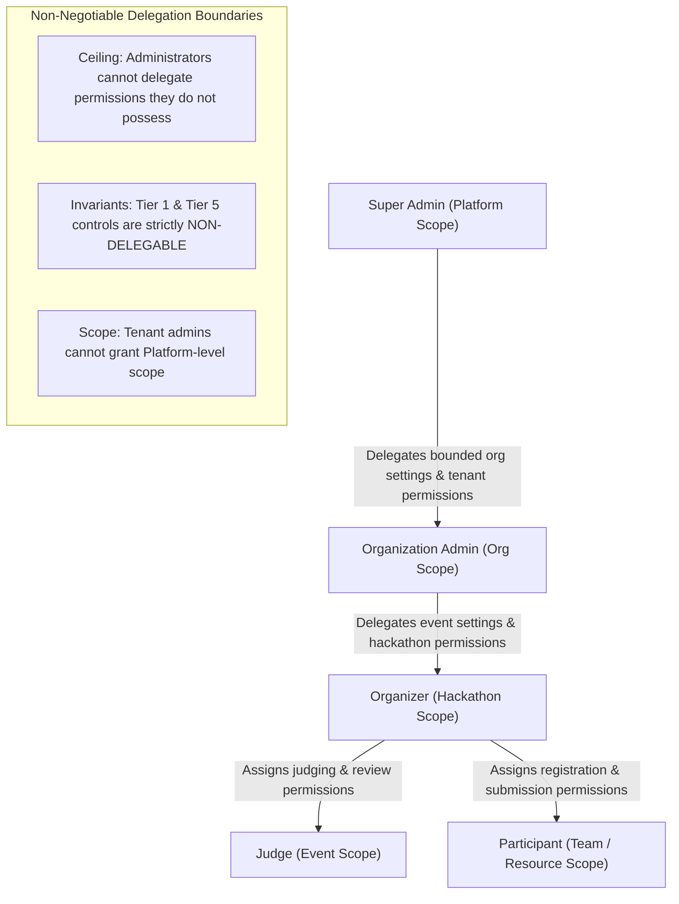
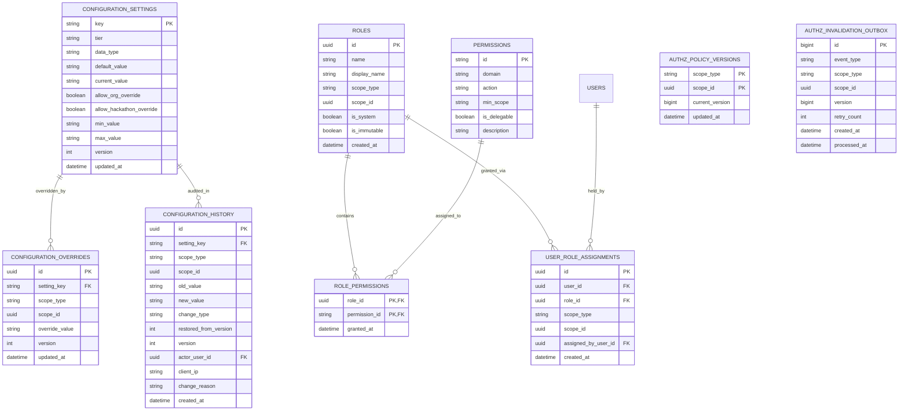
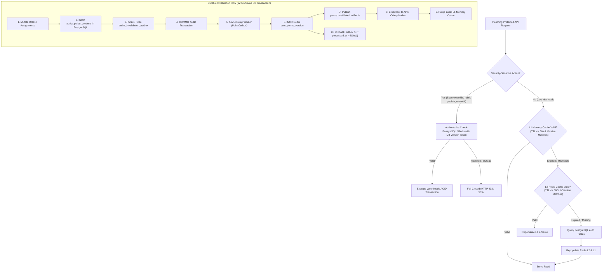

# Scorva — Configuration & Granular Permission Catalog
## Phase 4 Architectural Reference Specification

**Document Version:** 2.0  
**Date:** October 26, 2026  
**Status:** **APPROVED REFERENCE CATALOG (REVISED ARCHITECTURAL SPECIFICATION)**  
**Author:** Principal Software Architect, Senior Application Security Reviewer  
**Scope:** Authoritative registry of typed configuration settings, tier classifications, delegation policies, rollback semantics, cache invalidation guarantees, participant roles, and granular permissions for Scorva.

---

## 1. Dual-Path Resolution Engine: Separating Configuration Reproducibility from Live Authorization

Scorva enforces a fundamental architectural separation between **Evaluation Configuration Resolution** (for historical reproducibility and scoring mechanics) and **Live Authorization Enforcement** (for real-time security, access control, and identity).

```mermaid
flowchart TD
    subgraph PathA ["Path A: Evaluation Configuration Resolution (Reproducibility & Mechanics)"]
        A1["1. System Safe Defaults (Pydantic / Hardcoded Fail-Safe)"]
        A2["2. Platform Settings (Super Admin Controlled in DB)"]
        A3["3. Organization Overrides (Bounded Tenant Settings)"]
        A4["4. Hackathon Overrides (Bounded Event Settings)"]
        A5["5. Evaluation Snapshot (Frozen Point-in-Time Binding)"]
        A1 --> A2 --> A3 --> A4 --> A5
        A5 --> A6["Worker Engine (Executes Rubric, Prompts, Weights)"]
    end

    subgraph PathB ["Path B: Live Authorization & Security Enforcement (Real-Time Access Control)"]
        B1["Protected Operation Request (API / Worker / WebSocket)"]
        B2["Mandatory Tier 5 Invariants (Zero-Code, Tenant Isolation, MFA)"]
        B3["Live User Identity & Tenant Context Scoping"]
        B4["Current Permissions (Redis L2 / Monotonic Version Check)"]
        B5{"Permission Granted & Valid Assignment?"}
        B6["Allow Action"]
        B7["Deny Action (HTTP 403 / Reject Write)"]
        B1 --> B2 --> B3 --> B4 --> B5
        B5 -- Yes --> B6
        B5 -- No --> B7
    end
```



### 1.1 Path A: Evaluation Configuration Resolution (Execution Mechanics)

When evaluating a hackathon submission, deterministic scoring arithmetic, prompt templates, token limits, and evidence extraction rules must be 100% reproducible:

1. **Safe Default Resolution:** Pydantic models define baseline fail-safe settings (e.g. `eval.scoring_mode = 'offset_normalized'`, `ai.temperature = 0.00`).
2. **Cascading Parameter Resolution:**
   $$\text{Queued Evaluation Config} = \text{Hackathon Override} \succ \text{Organization Override} \succ \text{Platform Setting} \succ \text{Safe Default}$$
3. **Point-in-Time Snapshot Binding:** When an evaluation job is queued, the resolved evaluation parameters are permanently serialized into `submission_snapshots.configuration_snapshot` (JSONB).
4. **Deterministic Worker Execution:** Worker nodes execute evaluations strictly against this frozen snapshot. Future modifications to platform or hackathon settings **never alter or recalculate** completed or in-flight evaluations.

### 1.2 Path B: Live Authorization & Security Enforcement (Access Control)

Authorization is dynamic, real-time, and live. **An evaluation snapshot NEVER grants permissions, never authorizes API access, and never overrides a current permission denial.**

$$\text{Live Permission Check} = \text{Tenant Query Scoping} \land \text{Tier 5 Invariants} \land \text{Active Dynamic Permissions (Live)} \land \text{Active Scope Assignment}$$

1. **Achievable Consistency Guarantees:**
   - **Low-Risk Read Operations (Browsing public hackathons, reading published rubrics, viewing own submission):** Eventual consistency served from L1 process memory (TTL: 30 seconds) and L2 Redis (TTL: 300 seconds). Staleness is strictly bounded by a 30-second maximum upper limit under total Redis Pub/Sub delivery failure.
   - **Security-Sensitive / High-Risk Operations (Publishing rubrics, submitting judge score adjustments, triggering evaluations, accessing repository credentials, updating platform configuration, modifying roles/permissions):** **Authoritative Current Permission Check**. Bypasses L1 process memory entirely. Verified synchronously against the primary PostgreSQL database or durable database version token within the ACID transaction (`READ COMMITTED` snapshot isolation).
2. **Fail-Closed Behavior During Authorization Outages:**
   - If Redis is degraded or unreachable, sensitive operations query PostgreSQL authoritatively.
   - If PostgreSQL or the authorization service is unreachable or degraded, the system **fails closed**: rejects the protected operation immediately with `HTTP 503 Service Unavailable` or `HTTP 403 Forbidden` (`AUTHZ_SERVICE_UNAVAILABLE`). The system **NEVER fails open** or permits an action based on an expired or unverified claim.
3. **Concurrency Semantics: Revocation vs. In-Progress Protected Write:**
   - When User A begins a sensitive write (e.g., submitting a judge score override) while Administrator B concurrently revokes User A's judging permission:
     - The write transaction acquires row-level locks or rechecks permission inside its commit block.
     - If Admin B's revocation commits *before* User A's transaction executes its commit-phase authorization check: User A's check detects the revocation (or incremented version) and aborts the transaction with `HTTP 403 Forbidden` (`PERMISSION_REVOKED`).
     - If User A's transaction commits *before* Admin B's revocation commits: User A's write was legitimate under their held authority at commit time; subsequent requests by User A are immediately denied.
     - Row-level or advisory locks ensure write-revocation race conditions are serialized deterministically without torn authorization states.
4. **Job Lifecycle Authorization Rechecks:**
   - **At Queue Time:** Web API verifies the requesting user holds `evaluation.trigger` for the hackathon.
   - **At Worker Dequeue Time:** Worker verifies the hackathon and organization are still in an `active` / `published` state (not suspended or archived) and the submission has not been withdrawn.
   - **At Judge Override Submission:** When a judge submits an adjusted score, the system performs a live verification of `judge.score_override` AND verifies active assignment in `hackathon_judges`. If the judge was unassigned or deactivated while the evaluation was running, the override is rejected with `HTTP 403 Forbidden` (`JUDGE_ASSIGNMENT_REVOKED`).
   - **At Result Exposure:** Privileged diagnostic data (raw model completions, prompt logs) is exposed only if the viewing user holds `evaluation.view_raw_model` at the moment of the request.
5. **Behavior on Mid-Job Role Revocation:**
   - Evaluation jobs are asynchronous platform workloads bound to the *hackathon*, not the individual user who clicked "Evaluate".
   - If the organizer who triggered the job is revoked while the worker is running, the job completes execution and persists results under hackathon ownership, emitting an audit log. However, the revoked user is immediately blocked from viewing or managing the results.

---

## 2. Super Admin Delegation Policy & Boundaries

Super Admin retains ultimate authority over what configuration settings and permissions may be delegated down the tenant hierarchy.



### 2.1 Setting Delegation Controls
For every typed setting in the platform catalog, Super Admin configures:
1. `allow_org_override` (Boolean): Whether Organization Administrators can define tenant-level overrides.
2. `allow_hackathon_override` (Boolean): Whether Organizers can define hackathon-level overrides.
3. `min_value` / `max_value` Envelope: The permissible boundary within which tenant overrides are valid. Any override exceeding this envelope is rejected with `HTTP 422 Unprocessable Entity`.

### 2.2 Granular Permission Delegation Controls
Permissions in the database catalog carry an explicit `is_delegable` flag:
1. **Non-Delegable Permissions (`is_delegable = False`):**
   - All Tier 1 platform controls (`platform.settings.*`, `platform.roles.manage`, `platform.maintenance.toggle`).
   - Cross-tenant audit logs (`platform.audit.read`).
   - Cross-tenant AI operations (`ai_ops.queue.view`, `ai_ops.job.cancel`).
   - Organization suspension and activation (`org.status.update`).
   - All Tier 5 security invariants.
2. **Delegable Permissions (`is_delegable = True`):**
   - Tenant-scoped operations (`hackathon.create`, `submission.view`, `rubric.create`, `judge.assign`).
   - Participant self-service operations (`participant.*`).
3. **Delegation Ceiling Rule (Least Privilege Enclosure):**
   - An administrator cannot create a role or assign a permission that they themselves do not currently possess within that scope.
   - An Organization Admin cannot delegate permissions outside their organization ID.
   - An Organizer cannot delegate permissions outside their assigned hackathon ID.

### 2.3 Two-Phase Validation: Configurable Limits vs. Immutable Safeguards
Scorva strictly separates adjustable operational limits from non-overridable security safeguards across two independent phases:
1. **Phase 1: Configuration-Update Validation (Pydantic & API Layer):**
   - Configurable limits (Tier 2/3) have hard architectural ceilings defined in typed Pydantic models (e.g. `extract.max_compressed_bytes` clamped between 10MB and 100MB; `extract.max_file_count` clamped between 200 and 5,000 files).
   - Tier 5 Security Invariants have `is_configurable = FALSE`. Configuration APIs unconditionally reject any payload targeting a Tier 5 key with `HTTP 403 Forbidden` (`SECURITY_INVARIANT_IMMUTABLE`).
2. **Phase 2: Hardcoded Absolute Runtime Ceilings (Defense-in-Depth at Ingestion & Extraction Time):**
   - In `safe_extractor.py` and `github_client.py`, runtime code evaluates:
     `effective_limit = min(configured_limit, ABSOLUTE_HARDCODED_CEILING)`
     where `ABSOLUTE_MAX_COMPRESSED_BYTES = 104_857_600` (100MB) and `ABSOLUTE_MAX_UNCOMPRESSED_BYTES = 524_288_000` (500MB).
   - Path traversal protection (`Path.is_relative_to`), symlink rejection (`issym()`), special device rejection (`ischr()`, `isblk()`, `isfifo()`), zero-code execution, and tenant query scoping are **hardcoded algorithmic controls**, NOT toggleable parameters. There are NO configuration keys or boolean toggles in the platform to disable them. Super Admin has NO toggle or API to weaken traversal protection, unsafe-file rejection, zero-code execution, or tenant isolation.

---

## 3. Correct Rollback Semantics

Configuration rollbacks are **append-only updates** that create new audit history and preserve historical evaluations.

### 3.1 Immutable Rollback Mechanics
1. **New Version Generation:** Rolling back a setting to a prior state does NOT delete history or rewrite version numbers. If the current version is `v3` and the administrator rolls back to `v1`, the system creates `v4`, recording `restored_from_version = 1`.
2. **Current Schema & Bounds Validation:** Before a historical value is restored, it MUST be re-validated against the **current** schema validation rules and permissible bounds. If platform policy tightened bounds between `v1` and `v3`, an out-of-bounds `v1` value is rejected.
3. **Optimistic Concurrency Protection:** Rollback requests MUST supply the current `version`. If another administrator updated the setting concurrently, the rollback request fails with `HTTP 409 Conflict`.
4. **Effect Timing Clarity:**
   - Settings marked `immediate` apply to all subsequent HTTP requests and cache reads.
   - Settings marked `next_job` apply to the next queued evaluation task.
   - Settings marked `new_hackathon_only` apply only to hackathons created after the rollback.
5. **Zero Mutation of Historical Snapshots:** Rollbacks NEVER retroactively modify the frozen `configuration_snapshot` of existing or historical evaluations.
6. **RBAC Rollback Parity:** Role-permission and user-assignment mutations follow identical rules: every change is an append-only audit event with version tracking; "undoing" an assignment creates a new revocation event.

---

## 4. Complete Configuration Catalog

### 4.1 Judge Policy Settings

| Setting Identifier | Type | Default Value | Permitted Range | Tier | Super Admin Delegable? | Org Overridable? | Hackathon Overridable? | Min Auth | Effect Timing | Audit Event |
|---|:---:|:---:|:---:|:---:|:---:|:---:|:---:|:---:|:---:|---|
| `judge.rationale_min_length` | Integer | `20` | `10` to `500` chars | Tier 3 | Yes | Yes | Yes | `org_admin` | `immediate` | `CONFIG_SETTING_UPDATED` |
| `judge.rationale_max_length` | Integer | `2000` | `500` to `10000` chars| Tier 3 | Yes | Yes | Yes | `org_admin` | `immediate` | `CONFIG_SETTING_UPDATED` |
| `judge.rationale_mandatory` | Boolean | `true` | `[true, false]` | Tier 3 | Yes | Yes (Ceiling: true)| Yes | `org_admin` | `immediate` | `CONFIG_SETTING_UPDATED` |
| `judge.score_adjustment_limit` | Decimal | `25.00` | `5.00` to `100.00` % | Tier 3 | Yes | Yes | Yes | `org_admin` | `immediate` | `CONFIG_SETTING_UPDATED` |
| `judge.can_override_ai_scores` | Boolean | `true` | `[true, false]` | Tier 3 | Yes | Yes | Yes | `org_admin` | `immediate` | `CONFIG_SETTING_UPDATED` |
| `judge.assignment_required` | Boolean | `true` | `[true]` (**Invariant**) | Tier 5 | No | No | No | None (Immutable) | Permanent | None |

### 4.2 Evaluation Policy Settings

| Setting Identifier | Type | Default Value | Permitted Range | Tier | Super Admin Delegable? | Org Overridable? | Hackathon Overridable? | Min Auth | Effect Timing | Audit Event |
|---|:---:|:---:|:---:|:---:|:---:|:---:|:---:|:---:|:---:|---|
| `eval.default_scoring_mode` | Enum | `offset_normalized`| `['offset_normalized', 'raw_proportional']` | Tier 3 | Yes | Yes | Yes | `org_admin` | `new_hackathon_only` | `CONFIG_SETTING_UPDATED` |
| `eval.max_active_jobs_per_org`| Integer | `3` | `1` to `10` jobs | Tier 2 | No | No | No | `platform_ops_admin`| `immediate` | `CONFIG_SETTING_UPDATED` |
| `eval.job_retry_limit` | Integer | `3` | `1` to `5` attempts | Tier 2 | No | No | No | `platform_ops_admin`| `next_job` | `CONFIG_SETTING_UPDATED` |
| `eval.job_execution_timeout_seconds` | Integer | `300` | `60` to `900` s | Tier 2 | No | No | No | `platform_ops_admin`| `next_job` | `CONFIG_SETTING_UPDATED` |
| `eval.manual_review_score_threshold` | Decimal | `15.00` | `5.00` to `50.00` pts | Tier 2 | No | Yes | Yes | `org_admin` | `next_job` | `CONFIG_SETTING_UPDATED` |
| `eval.participant_view_scores` | Boolean | `false` | `[true, false]` | Tier 3 | Yes | Yes | Yes | `organizer` | `immediate` | `CONFIG_SETTING_UPDATED` |
| `eval.raw_ai_score_preservation` | Boolean | `true` | `[true]` (**Invariant**) | Tier 5 | No | No | No | None (Immutable) | Permanent | None |

### 4.3 Submission Processing Settings

| Setting Identifier | Type | Default Value | Permitted Range | Tier | Super Admin Delegable? | Org Overridable? | Hackathon Overridable? | Min Auth | Effect Timing | Audit Event |
|---|:---:|:---:|:---:|:---:|:---:|:---:|:---:|:---:|:---:|---|
| `extract.max_compressed_bytes` | BigInt | `52428800` (50MB) | `10MB` to `100MB` | Tier 2 | No | No | No | `platform_ops_admin`| `next_job` | `CONFIG_SETTING_UPDATED` |
| `extract.max_uncompressed_bytes`| BigInt | `262144000` (250MB)| `50MB` to `500MB` | Tier 2 | No | No | No | `platform_ops_admin`| `next_job` | `CONFIG_SETTING_UPDATED` |
| `extract.max_single_file_bytes` | BigInt | `10485760` (10MB) | `1MB` to `25MB` | Tier 2 | No | No | No | `platform_ops_admin`| `next_job` | `CONFIG_SETTING_UPDATED` |
| `extract.max_file_count` | Integer | `2000` | `200` to `5000` | Tier 2 | No | No | No | `platform_ops_admin`| `next_job` | `CONFIG_SETTING_UPDATED` |
| `extract.max_directory_depth` | Integer | `10` | `3` to `15` levels | Tier 2 | No | No | No | `platform_ops_admin`| `next_job` | `CONFIG_SETTING_UPDATED` |
| `extract.max_path_length` | Integer | `255` | `100` to `500` chars | Tier 2 | No | No | No | `platform_ops_admin`| `next_job` | `CONFIG_SETTING_UPDATED` |
| `extract.zero_code_execution` | Boolean | `true` | `[true]` (**Invariant**) | Tier 5 | No | No | No | None (Immutable) | Permanent | None |

### 4.4 AI Operations Settings

| Setting Identifier | Type | Default Value | Permitted Range | Tier | Super Admin Delegable? | Org Overridable? | Hackathon Overridable? | Min Auth | Effect Timing | Audit Event |
|---|:---:|:---:|:---:|:---:|:---:|:---:|:---:|:---:|:---:|---|
| `ai.default_provider` | Enum | `ollama` | `['ollama', 'mock']` | Tier 1 | No | No | No | `platform_owner` | `next_job` | `CONFIG_SETTING_UPDATED` |
| `ai.default_model` | String | `llama3:8b` | Approved Model Registry | Tier 2 | No | No | No | `platform_ops_admin`| `next_job` | `CONFIG_SETTING_UPDATED` |
| `ai.inference_timeout_seconds` | Integer | `120` | `30` to `300` s | Tier 2 | No | No | No | `platform_ops_admin`| `next_job` | `CONFIG_SETTING_UPDATED` |
| `ai.max_provider_retries` | Integer | `1` | `0` to `3` | Tier 2 | No | No | No | `platform_ops_admin`| `next_job` | `CONFIG_SETTING_UPDATED` |
| `ai.temperature` | Decimal | `0.00` | `0.00` to `0.50` | Tier 2 | No | No | No | `platform_ops_admin`| `next_job` | `CONFIG_SETTING_UPDATED` |
| `ai.max_context_window_tokens` | Integer | `8192` | `2048` to `32768` | Tier 2 | No | No | No | `platform_ops_admin`| `next_job` | `CONFIG_SETTING_UPDATED` |
| `ai.ssrf_segmented_egress` | Boolean | `true` | `[true]` (**Invariant**) | Tier 5 | No | No | No | None (Immutable) | Permanent | None |

### 4.5 Platform Operations Settings

| Setting Identifier | Type | Default Value | Permitted Range | Tier | Super Admin Delegable? | Org Overridable? | Hackathon Overridable? | Min Auth | Effect Timing | Audit Event |
|---|:---:|:---:|:---:|:---:|:---:|:---:|:---:|:---:|:---:|---|
| `platform.maintenance_mode` | Boolean | `false` | `[true, false]` | Tier 1 | No | No | No | `platform_owner` | `immediate` | `MAINTENANCE_MODE_TOGGLED` |
| `platform.audit_log_retention_days`| Integer | `365` | `90` to `2555` days | Tier 1 | No | No | No | `platform_owner` | `immediate` | `CONFIG_SETTING_UPDATED` |
| `platform.session_ttl_minutes` | Integer | `1440` (24h)| `60` to `10080` mins | Tier 1 | No | No | No | `platform_owner` | `immediate` | `CONFIG_SETTING_UPDATED` |
| `platform.rate_limit_anon_per_min` | Integer | `60` | `10` to `300` req/min | Tier 2 | No | No | No | `platform_ops_admin`| `immediate` | `CONFIG_SETTING_UPDATED` |
| `platform.rate_limit_auth_per_min` | Integer | `300` | `50` to `1000` req/min | Tier 2 | No | No | No | `platform_ops_admin`| `immediate` | `CONFIG_SETTING_UPDATED` |
| `platform.tenant_isolation_filter` | Boolean | `true` | `[true]` (**Invariant**) | Tier 5 | No | No | No | None (Immutable) | Permanent | None |

---

## 5. Granular RBAC Catalog & Participant Identity Architecture

### 5.1 Scopes & Identity Association
1. **Platform Scope (`ScopeType.PLATFORM`):** Global actions spanning all organizations, infrastructure, and settings (`scope_id = NULL`).
2. **Organization Scope (`ScopeType.ORGANIZATION`):** Tenant-scoped actions within an organization (`scope_id = organization_id`).
3. **Hackathon Scope (`ScopeType.HACKATHON`):** Event-scoped actions within a specific hackathon (`scope_id = hackathon_id`).
4. **Resource Scope (`ScopeType.RESOURCE`):** Object-level ownership (e.g. participant team accessing their own submission: `scope_id = team_id` or `submission_id`).

### 5.2 Participant Identity, Team Association & Privacy Boundary
- **Participant Identity:** A user registered for a hackathon holds the `participant` role scoped to that `hackathon_id`.
- **Team Ownership:** Participants belong to exactly one team per hackathon (`teams` and `team_members` relationship).
- **Strict Submission Isolation:**
  - Participants hold `submission.view_own` strictly for submissions where `submission.team_id` matches their registered team.
  - Participants are **strictly denied access** to other teams' private repository URLs, commit snapshots, extraction files, prompt payloads, raw AI completions, and unreleased evaluation reports.
  - Evaluation feedback is masked until the organizer enables `eval.participant_view_scores` and the hackathon transitions to `winners_announced` or `completed`.
- **Deadline Enforcement:** All participant write actions (`participant.submission.create`, `participant.submission.update`) are blocked server-side once `now() > hackathon.submission_deadline` with `HTTP 400 Bad Request` (`SUBMISSION_DEADLINE_PASSED`).

### 5.3 Complete Granular Permission Catalog (Including Participants)

| Domain | Permission Identifier | Description | Min Required Scope | Delegable? | Built-in Default Roles |
|---|---|---|:---:|:---:|---|
| **Platform** | `platform.settings.read` | View platform-wide configuration | Platform | No | `platform_owner`, `platform_ops_admin` |
| | `platform.settings.write` | Modify platform-wide configuration | Platform | No | `platform_owner`, `platform_ops_admin` (bounded) |
| | `platform.roles.manage` | Configure dynamic role-permission mappings | Platform | No | `platform_owner` |
| | `platform.audit.read` | Read cross-tenant global audit logs | Platform | No | `platform_owner`, `security_admin` |
| | `platform.maintenance.toggle` | Toggle platform maintenance mode | Platform | No | `platform_owner` |
| **Organizations**| `org.view` | View organization profile and public metadata | Organization | Yes | `org_owner`, `org_admin`, `organizer`, `judge` |
| | `org.profile.update` | Update organization name, slug, description | Organization | Yes | `org_owner`, `org_admin` |
| | `org.status.update` | Suspend, reactivate, or archive organization | Platform | No | `platform_owner`, `platform_ops_admin` |
| | `org.member.invite` | Invite new members to the organization | Organization | Yes | `org_owner`, `org_admin` |
| | `org.member.update_role` | Change member role within organization | Organization | Yes | `org_owner`, `org_admin` |
| | `org.member.remove` | Remove a member from the organization | Organization | Yes | `org_owner`, `org_admin` |
| | `org.config.update` | Update tenant-level configuration overrides | Organization | Yes | `org_owner`, `org_admin` |
| **Hackathons** | `hackathon.create` | Create a new hackathon under organization | Organization | Yes | `org_owner`, `org_admin`, `organizer` |
| | `hackathon.view` | View hackathon details, timeline, and rules | Hackathon | Yes | `org_owner`, `org_admin`, `organizer`, `judge`, `participant` |
| | `hackathon.update` | Edit hackathon metadata and description | Hackathon | Yes | `org_owner`, `org_admin`, `organizer` |
| | `hackathon.publish` | Transition hackathon status to `published` | Hackathon | Yes | `org_owner`, `org_admin` |
| | `hackathon.archive` | Archive completed hackathon | Hackathon | Yes | `org_owner`, `org_admin` |
| | `hackathon.override` | Administrative status/timeline override | Platform | No | `platform_owner`, `platform_ops_admin` |
| | `hackathon.config.update` | Update event-level configuration overrides | Hackathon | Yes | `org_owner`, `org_admin` |
| **Participants**| `participant.register` | Register for an open hackathon | Hackathon | Yes | `participant` |
| | `participant.team.create` | Create a new participant team for the event | Hackathon | Yes | `participant` |
| | `participant.team.join` | Join an existing team via invite/join code | Hackathon | Yes | `participant` |
| | `participant.team.manage` | Add/remove team members (team leader) | Resource | Yes | `participant` (team leader) |
| | `participant.submission.create`| Submit project repository URL / upload | Resource | Yes | `participant` (team member) |
| | `participant.submission.update`| Update submission before deadline | Resource | Yes | `participant` (team member) |
| | `participant.submission.withdraw`| Withdraw submission before deadline | Resource | Yes | `participant` (team leader) |
| | `participant.submission.view_own`| View own team's submission details & status| Resource | Yes | `participant` (team member) |
| | `participant.feedback.view` | View scores/feedback once released to public | Hackathon | Yes | `participant` (when scores released) |
| | `participant.appeal.submit` | Submit scoring appeal/inquiry to organizers | Resource | Yes | `participant` (team leader) |
| **Rubrics** | `rubric.create` | Create a new rubric draft | Hackathon | Yes | `org_owner`, `org_admin`, `organizer` |
| | `rubric.view` | View rubric criteria and weights | Hackathon | Yes | `org_owner`, `org_admin`, `organizer`, `judge` |
| | `rubric.update` | Edit criteria and weights in draft rubric | Hackathon | Yes | `org_owner`, `org_admin`, `organizer` |
| | `rubric.publish` | Freeze rubric version as published (immutable)| Hackathon | Yes | `org_owner`, `org_admin` |
| **Evaluations** | `evaluation.trigger` | Queue AI evaluation job for submission | Hackathon | Yes | `org_owner`, `org_admin`, `organizer`, `platform_ops_admin` |
| | `evaluation.view` | View evaluation results, scores, and citations| Hackathon | Yes | `org_owner`, `org_admin`, `organizer`, `judge` |
| | `evaluation.view_raw_model`| View raw LLM completion diagnostics | Hackathon | No | `org_owner`, `org_admin`, `ai_ops_admin` |
| | `evaluation.cancel` | Cancel an in-flight evaluation job | Hackathon | Yes | `org_owner`, `org_admin`, `platform_ops_admin` |
| | `evaluation.retry` | Retry a failed evaluation job | Hackathon | Yes | `org_owner`, `org_admin`, `organizer`, `platform_ops_admin` |
| **Judging** | `judge.assign` | Assign a user as judge to a hackathon | Hackathon | Yes | `org_owner`, `org_admin`, `organizer` |
| | `judge.view_assigned` | View evaluation queue for assigned events | Hackathon | Yes | `judge` (assigned event only) |
| | `judge.review` | Accept, reject, or comment on evaluation | Hackathon | Yes | `org_owner`, `org_admin`, `organizer`, `judge` |
| | `judge.score_override` | Override AI criterion score with rationale | Hackathon | Yes | `org_owner`, `org_admin`, `organizer`, `judge` |
| | `judge.finalize` | Finalize event scoring and lock leaderboard | Hackathon | Yes | `org_owner`, `org_admin` |
| **Integrations** | `integration.github.configure`| Add encrypted GitHub PAT/App credentials | Organization | Yes | `org_owner`, `org_admin` |
| | `integration.github.view` | View masked token previews (`ghp_****1234`)| Organization | Yes | `org_owner`, `org_admin` |
| | `integration.github.revoke` | Revoke GitHub integration credential | Organization | Yes | `org_owner`, `org_admin` |
| **AI Operations**| `ai_ops.queue.view` | View cross-tenant Celery evaluation queue | Platform | No | `platform_owner`, `platform_ops_admin`, `ai_ops_admin` |
| | `ai_ops.job.cancel` | Cross-tenant administrative job cancel | Platform | No | `platform_owner`, `platform_ops_admin` |
| | `ai_ops.worker.telemetry`| View worker pool heartbeats & queue health | Platform | No | `platform_owner`, `platform_ops_admin`, `ai_ops_admin` |
| | `ai_ops.model.manage` | Add or update approved LLM model registry | Platform | No | `platform_owner`, `platform_ops_admin` |
| **Audit** | `audit.tenant.read` | View organization-specific audit activity | Organization | Yes | `org_owner`, `org_admin` |

---

## 6. Streamlined Database Architecture for Configuration & RBAC

To avoid unnecessary database bloat, synchronization drift, and race conditions, the configuration and RBAC subsystems are streamlined into 7 cleanly normalized tables:



### 6.1 Architectural Simplifications & Rationale
1. **Elimination of `user_effective_permissions` Table:**
   - A persistent database table for effective permissions introduces severe risks of database drift, stale authorization, and complex synchronization logic.
   - **Approved Solution:** Effective permissions are computed on-demand via an optimized single-query SQL join across `user_role_assignments` $\rightarrow$ `role_permissions` $\rightarrow$ `permissions`. The resolved permission set is cached in Redis (`user_perms:{user_id}:{scope_type}:{scope_id}`) with a 300-second TTL and immediate eviction on role/assignment updates.
2. **Elimination of `configuration_rollbacks` Table:**
   - A separate rollbacks table duplicates history.
   - **Approved Solution:** `configuration_history` tracks all updates, rollbacks, and overrides via `change_type` (`'update'`, `'rollback'`, `'override'`) and `restored_from_version`.
3. **Elimination of `configuration_locks` Table:**
   - Optimistic concurrency is handled natively via `version` matching (`UPDATE ... WHERE version = :version`). Database row locking uses `SELECT ... FOR UPDATE` when necessary.
4. **Platform Role Protection:**
   - System roles have `is_system = TRUE` and cannot be deleted or renamed.
   - Modifying permissions on system roles requires `platform_owner` role + active MFA session.
5. **Last Platform Owner Lockout Prevention (Serialized Concurrency Protection):**
   - Aggregate `COUNT(*) ... FOR UPDATE` is invalid SQL in PostgreSQL. To guarantee serialized concurrent safety without deadlocks or race conditions:
     ```sql
     -- Step 1: Explicitly serialize across concurrent administrative transactions
     SELECT pg_advisory_xact_lock(hashtext('scorva:platform_owner_mutex'));
     
     -- Step 2: Lock the platform_owner role row to serialize all owner role mutations
     SELECT id FROM roles WHERE name = 'platform_owner' FOR UPDATE;
     
     -- Step 3: Count surviving active platform owners
     SELECT count(*) 
     FROM user_role_assignments ura
     JOIN users u ON ura.user_id = u.id
     WHERE ura.role_id = (SELECT id FROM roles WHERE name = 'platform_owner')
       AND u.is_active = TRUE 
       AND u.deleted_at IS NULL;
     ```
     If the surviving count $\le 1$ when deleting, revoking, or deactivating a platform owner, the transaction aborts with `LAST_PLATFORM_OWNER_LOCKOUT` (`HTTP 400 Bad Request`). This strictly serializes concurrent attempts.
6. **Alembic Revision Graph & Migration Compatibility:**
   - The verified database head is `de1a35a5cc94` (`create_organizations_and_hackathons`).
   - Milestone 1 migration branches directly from `de1a35a5cc94` (`down_revision = 'de1a35a5cc94'`).
   - Dynamic roles and permissions use string-backed columns with check constraints, ensuring 100% transactional DDL safety without PostgreSQL enum locking issues.
7. **Durable Attributable Audit History:**
   - Every role grant, permission update, role revocation, and configuration rollback inserts a durable record into `audit_events` and `configuration_history` within the same database transaction.
   - Records actor ID, email, role, IP address, user agent, action, resource, before/after diff payload, and correlation ID, protected by PostgreSQL trigger `trg_audit_events_immutable`.

---

## 7. Multi-Layer Authorization Cache Invalidation & Durable Outbox Architecture

Redis Pub/Sub is inherently fire-and-forget; network blips or worker restarts must not cause permissions to remain stale. Scorva implements a durable database-backed invalidation engine:



### 7.1 Durable Propagation & Recovery Mechanics
1. **PostgreSQL as Sole Durable Authority:**
   - Policy and user permission versions are stored durably in `authz_policy_versions`.
   - Any mutation writes an event to `authz_invalidation_outbox` in the same transaction.
2. **Reliable Outbox Relay:**
   - A dedicated loop reads unprocessed outbox events, updates Redis, and broadcasts invalidations.
   - On Redis connection failure, retries with exponential backoff; outbox events remain safely persisted in PostgreSQL.
3. **Bounded Staleness for Low-Risk Reads:**
   - L1 process memory: 30-second TTL.
   - L2 Redis cache: 300-second TTL.
   - Even on a total Pub/Sub delivery failure, staleness cannot exceed **30 seconds** because the L1 cache expires, forcing a recheck against the durable version.
4. **Disconnected Worker Recovery:**
   - When an API process or worker reconnects to Redis after network interruption, it unconditionally purges its entire local L1 cache (`cache.clear()`).
5. **WebSocket & Long-Running Task Invalidation:**
   - WebSocket connections re-verify the user's `authz_version` on every inbound frame and before streaming privileged data. If incremented, permissions are reloaded; if access is revoked, the connection is closed with `4403 Forbidden`.

---

## 8. Immutable Security Invariants (Tier 5)

The following 8 invariants are permanently embedded into the platform kernel, database triggers, and network drivers. **No user, Super Admin, API endpoint, or configuration override can ever disable or weaken them:**

1. **Zero Dynamic Code Execution:** Hackathon submissions are analyzed strictly via static AST, file tree classification, documentation reading, and generative AI review. Build steps, compilation, package installation (`npm install`, `pip install`), and binary execution are unconditionally blocked.
2. **Server-Side Tenant Query Isolation:** SQL queries on tenant resources MUST include `WHERE organization_id = :tenant_id` and `hackathon_id = :hackathon_id`. Tenant isolation cannot be bypassed via headers or parameters.
3. **Mandatory Administrative MFA:** Users holding platform administrative roles (`platform_owner`, `platform_ops_admin`, `ai_ops_admin`, `security_admin`) MUST complete TOTP MFA before accessing privileged APIs or web paths.
4. **Append-Only Immutable Audit Trail:** The PostgreSQL trigger prohibiting `UPDATE` or `DELETE` on `audit_events` cannot be dropped or bypassed.
5. **Public Egress Validation (SSRF Defense):** Outbound connections for GitHub tarball downloads must resolve to global public unicast IP addresses. RFC 1918, RFC 3927 (`169.254.169.254`), loopbacks, and non-GitHub redirects are unconditionally blocked.
6. **Archive Extraction Security Quotas:** Extraction aborts immediately upon detecting symlinks, hardlinks, character/block devices, FIFOs, directory traversal sequences (`..`), or exceeding size/count thresholds.
7. **Judge Event Assignment Enforcement:** A user holding the `judge` role cannot access or review submissions for a hackathon unless an explicit mapping exists in `hackathon_judges`.
8. **Last Platform Owner Lockout Protection:** The system unconditionally prohibits demoting, suspending, or deleting the final active `platform_owner` account.
