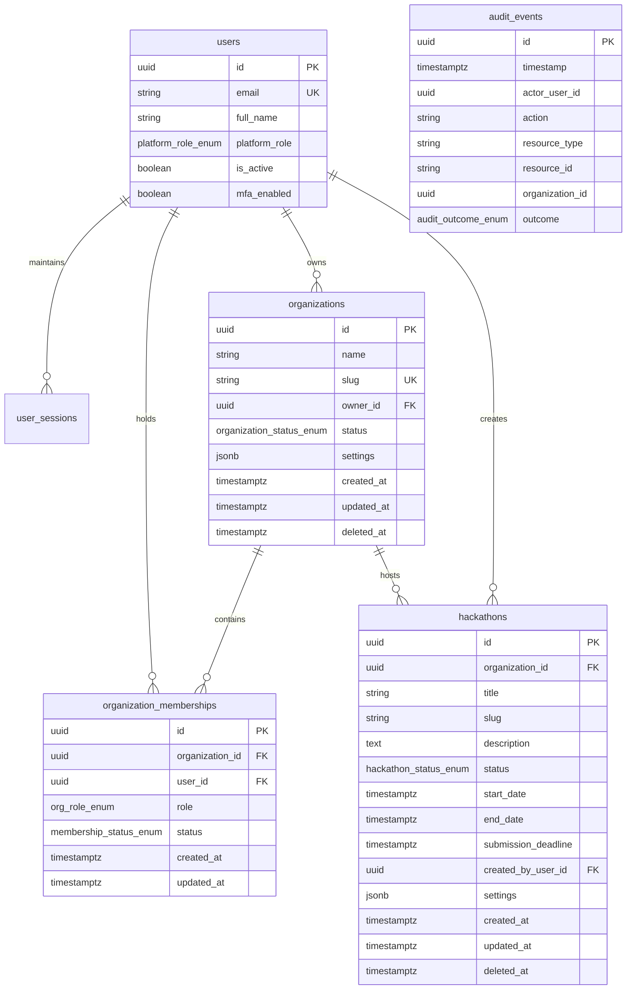
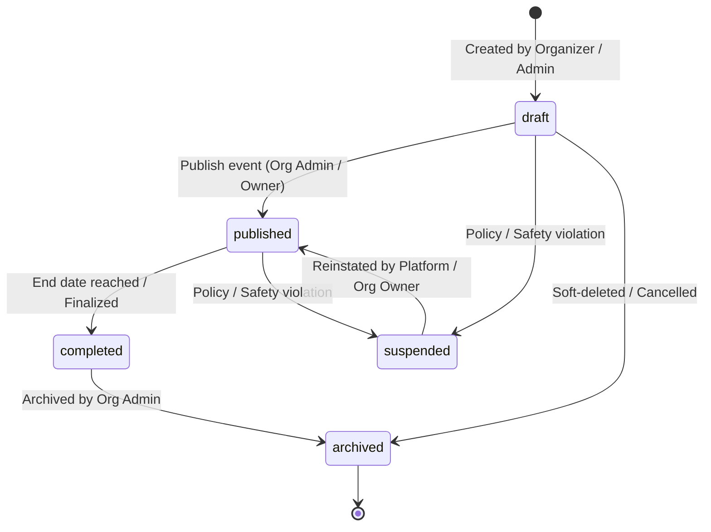
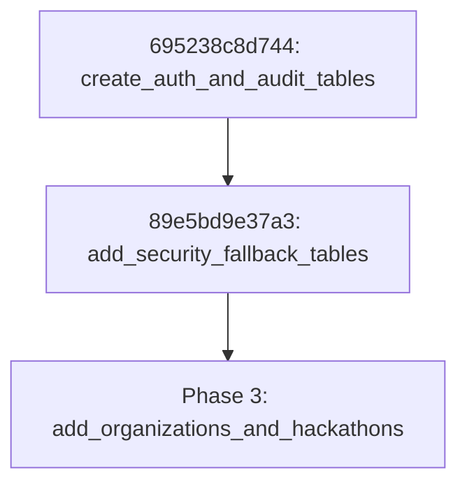

# Scorva — Phase 3 Architectural Plan: Core Administration & Tenant Isolation

**Document Version:** 1.0  
**Date:** October 25, 2026  
**Status:** **APPROVED ARCHITECTURAL PLAN — MILESTONE 1 COMPLETED & VERIFIED**  
**Author:** Lead Software Architect  
**Scope:** Phase 3 — Organization Management, Dual-Plane Tenant Isolation, Organization Membership & Scoped Roles, Hackathon Administration, and Super Admin UI Integration

---

## 1. Executive Summary & Objectives

### 1.1 Objective
Phase 3 establishes the multi-tenant core of Scorva. It allows multiple independent organizations (tenants) to configure profiles, manage staff rosters, and administer hackathons within strictly isolated boundaries, while providing authorized Super Administrators with centralized platform oversight, operational telemetry, and auditable governance.

### 1.2 Core Pillars
1. **Dual-Plane Authorization:** Strict separation between **Platform Roles** (`PlatformRole`: platform owner, operations admin, etc.) and **Organization Roles** (`OrgRole`: organization owner, org admin, organizer). Platform roles never bleed into tenant roles, and tenant roles cannot access platform resources.
2. **Server-Side Tenant Isolation:** Enforced unconditionally in the backend via FastAPI dependency injection and query scoping. Client-supplied tenant identifiers in request payloads are rejected; access is verified against authenticated session state and membership rosters.
3. **Auditability & Traceability:** Every tenant-level administrative action (organization creation, status change, membership modification, ownership transfer, hackathon lifecycle change) transactionally emits an immutable audit record to the `audit_events` table with the associated `organization_id`.
4. **Resilient Data Modeling:** Clean relational models in PostgreSQL with foreign-key referential integrity (`RESTRICT` on owners to prevent orphaned records; `CASCADE` on memberships; soft-delete on organizations and hackathons).
5. **Operational Super Admin UI:** Real-time, responsive Next.js administrative screens for Organizations and Hackathons complying with the dark-first design system (`#0B1020`), featuring search, filters, pagination, empty states, and error handling.

### 1.3 Scope & Non-Goals
- **In Scope for Phase 3:**
  - `organizations` table, lifecycle (`active`, `suspended`, `archived`), and administration.
  - `organization_memberships` table, uniqueness constraints, and organization-scoped roles (`org_owner`, `org_admin`, `organizer`).
  - `hackathons` table, lifecycle (`draft`, `published`, `completed`, `suspended`, `archived`), and date sequence validation.
  - Platform Admin APIs (`/api/v1/admin/organizations/...`, `/api/v1/admin/hackathons/...`).
  - Tenant Organization APIs (`/api/v1/organizations/{org_id}/...`).
  - Super Admin UI screens: `/admin/organizations`, `/admin/organizations/[organizationId]`, `/admin/hackathons`, `/admin/hackathons/[hackathonId]`.
  - Reversible Alembic migration `add_organizations_and_hackathons`.
  - Multi-tenant isolation test suite with at least two organizations and multiple user personas.
- **Explicit Non-Goals (Deferred to Phase 4+):**
  - Teams, submissions, and repository ingestion (Phase 4).
  - Frozen commit SHA verification and source sandbox extraction (Phase 4).
  - Celery worker evaluation queues and Ollama LLM integration (Phase 4).
  - Judging workflows, rubrics grading, and score aggregation (Phase 5).
  - Public participant leaderboards and external competitor portals (Phase 5).
  - Stripe billing integration, subscriptions, and payment webhooks (Phase 6).

### 1.4 Milestone 1 Delivery & Verification Status (COMPLETE)
Milestone 1 delivered the foundational database schema, models, enums, constraints, and migrations:
- **Models Implemented:**
  - `Organization`, `OrganizationMembership`, `OrganizationStatus`, `OrgRole`, `MembershipStatus` in [`apps/api/modules/organizations/models.py`](file:///home/shubh/scorva/apps/api/modules/organizations/models.py).
  - `Hackathon`, `HackathonStatus` in [`apps/api/modules/hackathons/models.py`](file:///home/shubh/scorva/apps/api/modules/hackathons/models.py).
  - Relationships wired into [`apps/api/modules/users/models.py`](file:///home/shubh/scorva/apps/api/modules/users/models.py) (`owned_organizations`, `memberships`, `created_hackathons`).
- **Alembic Migration:**
  - Migration revision [`de1a35a5cc94_create_organizations_and_hackathons.py`](file:///home/shubh/scorva/apps/api/alembic/versions/de1a35a5cc94_create_organizations_and_hackathons.py) branching from head `89e5bd9e37a3`.
  - Reversibility verified: clean upgrade cycle, clean downgrade cycle (dropping enums and tables).
- **Constraints Enforced:**
  - `chk_hackathon_timeline`: `CHECK (start_date < submission_deadline AND submission_deadline <= end_date)`.
  - `uq_hackathons_org_slug`: `UNIQUE (organization_id, slug)`.
  - `uq_organization_user`: `UNIQUE (organization_id, user_id)`.
  - `ix_organizations_slug`: `UNIQUE (slug)`.
  - `RESTRICT` on owners and creators; `CASCADE` on memberships; unconstrained UUID on `audit_events.organization_id` to preserve append-only immutability.
- **Verification:**
  - 9 automated model and constraint tests in `apps/api/tests/test_organization_hackathon_models.py` passing.
  - 4 migration tests in `apps/api/tests/test_migrations.py` passing.
  - 67/67 total API tests passing with 0 failures.
  - Scope boundaries respected: zero API endpoints, zero frontend screens, and zero Phase 4+ features built in Milestone 1.

### 1.5 Milestone 2 Delivery & Verification Status (COMPLETE)
Milestone 2 delivered server-side tenant isolation, dual-plane authorization guards, and organization management APIs:
- **Tenant Context & Authorization Dependencies:**
  - `TenantContext` and `get_tenant_context` in [`apps/api/dependencies.py`](file:///home/shubh/scorva/apps/api/dependencies.py).
  - Role requirement factories: `require_org_role`, `require_org_member`, `require_org_admin`, `require_org_owner`.
  - Dual-barrier validation: server-side session authentication (`get_current_user`), path-scope resolution, active membership verification, suspended/archived tenant checks, and fail-closed state evaluation.
- **Schemas & Request Guards:**
  - Pydantic v2 schemas in [`apps/api/modules/organizations/schemas.py`](file:///home/shubh/scorva/apps/api/modules/organizations/schemas.py) strictly enforcing `extra="forbid"` to block request body ID injection attacks.
- **Platform Administration Plane (`/api/v1/admin/organizations`):**
  - Implemented in [`apps/api/modules/organizations/admin_router.py`](file:///home/shubh/scorva/apps/api/modules/organizations/admin_router.py).
  - Directory listing with search, pagination, status filtering, and sorting (`GET /api/v1/admin/organizations`).
  - Tenant provisioning (`POST /api/v1/admin/organizations`).
  - Tenant inspection (`GET /api/v1/admin/organizations/{id}`).
  - Admin metadata updates (`PATCH /api/v1/admin/organizations/{id}`).
  - Lifecycle management (`POST /api/v1/admin/organizations/{id}/status`).
  - Ownership transfer (`POST /api/v1/admin/organizations/{id}/transfer-ownership`).
  - Admin member management (`GET`, `POST`, `PATCH`, `DELETE` on `/api/v1/admin/organizations/{id}/members`).
- **Tenant Scoped Plane (`/api/v1/organizations/{org_id}`):**
  - Implemented in [`apps/api/modules/organizations/router.py`](file:///home/shubh/scorva/apps/api/modules/organizations/router.py).
  - Profile inspection (`GET /api/v1/organizations/{org_id}`).
  - Metadata updates (`PATCH /api/v1/organizations/{org_id}`).
  - Member roster inspection (`GET /api/v1/organizations/{org_id}/members`).
  - Member invitation / addition (`POST /api/v1/organizations/{org_id}/members`).
  - Member role management (`PATCH /api/v1/organizations/{org_id}/members/{user_id}`).
  - Member removal with role hierarchy & owner protections (`DELETE /api/v1/organizations/{org_id}/members/{user_id}`).
  - Tenant ownership transfer (`POST /api/v1/organizations/{org_id}/transfer-ownership`).
- **Audit Logging & Transaction Safety:**
  - Every platform intervention and tenant state change transactionally writes to `audit_events` with `organization_id` via [`apps/api/modules/organizations/service.py`](file:///home/shubh/scorva/apps/api/modules/organizations/service.py).
  - Immutability trigger `trg_audit_events_immutable` verified against UPDATE and DELETE attempts.
- **Verification:**
  - 12 automated unit & integration tests in `apps/api/tests/test_organizations.py` passing (ORG-01 to ORG-08, MEM-01 to MEM-08).
  - 15 automated tenant isolation tests in `apps/api/tests/test_tenant_isolation.py` passing (ISO-01, ISO-04, ISO-05, ISO-06, ISO-07, ISO-08, ISO-09, ISO-10, DUAL-02, DUAL-03).
  - 8 automated platform RBAC tests in `apps/api/tests/test_rbac_authorization.py` passing (including DUAL-01).
  - 95/95 total backend test suite passing with 0 failures.
  - Scope boundaries respected: zero hackathon endpoints, zero frontend screens, and zero Phase 4+ features built in Milestone 2.

### 1.6 Milestone 3 Delivery & Verification Status (COMPLETE)
Milestone 3 delivered hackathon lifecycle APIs, platform oversight and administrative override, strict timeline and immutability invariants, and cross-tenant scoping:
- **Tenant-Scoped Plane (`/api/v1/organizations/{org_id}/hackathons`):**
  - Hackathon directory with pagination, multi-word search, status filtering, and sorting (`GET /api/v1/organizations/{org_id}/hackathons`).
  - Draft hackathon creation with timeline validation and quota verification (`POST /api/v1/organizations/{org_id}/hackathons`).
  - Hackathon detail lookup scoped strictly by `organization_id` (`GET /api/v1/organizations/{org_id}/hackathons/{hackathon_id}`).
  - Metadata updates with organizer ownership check and slug/org immutability (`PATCH /api/v1/organizations/{org_id}/hackathons/{hackathon_id}`).
  - Publish event workflow with prerequisites check (`POST /api/v1/organizations/{org_id}/hackathons/{hackathon_id}/publish`).
  - Finalize / complete event workflow (`POST /api/v1/organizations/{org_id}/hackathons/{hackathon_id}/complete`).
  - Archive event workflow (`POST /api/v1/organizations/{org_id}/hackathons/{hackathon_id}/archive`).
  - Tenant status update (suspend / reinstate) for Org Owner (`POST /api/v1/organizations/{org_id}/hackathons/{hackathon_id}/status`).
- **Platform Administration Plane (`/api/v1/admin/hackathons`):**
  - Cross-tenant directory with pagination, search, status and organization filtering (`GET /api/v1/admin/hackathons`).
  - Cross-tenant hackathon detail lookup (`GET /api/v1/admin/hackathons/{hackathon_id}`).
  - Administrative status override with mandatory trimmed justification (`POST /api/v1/admin/hackathons/{hackathon_id}/status`).
- **Timeline and Immutability Invariants:**
  - Strict validation of `start_date < submission_deadline <= end_date` on both creation and partial updates.
  - Published and completed hackathons enforce slug immutability (`PUBLISHED_SLUG_IMMUTABLE`).
  - Organization ID is strictly immutable and cannot be injected via request bodies (`extra="forbid"`).
  - Tenant-scoped slug uniqueness (`uq_hackathons_org_slug`) enforced at application and database engine levels.
- **Verification:**
  - 14 automated unit & integration tests in `apps/api/tests/test_hackathons.py` passing (HACK-01 to HACK-09, lifecycle transitions, immutability, least privilege).
  - 19 automated tenant isolation tests in `apps/api/tests/test_tenant_isolation.py` passing (including ISO-02, ISO-03, ISO-04).
  - 24 automated organization tests in `apps/api/tests/test_organizations.py` passing.
  - 125/125 total backend test suite passing with 0 failures.
  - Alembic head verified at `de1a35a5cc94`.
  - Frontend typecheck (0 errors) and Next.js production build (17/17 routes pre-rendered) passing.

### 1.7 Milestone 4 Delivery & Verification Status (COMPLETE)
Milestone 4 delivered the complete Super Admin interface, multi-tenant frontend integration, tenant portal screens, lifecycle state machine workflows, and role-aware navigation:
- **Platform Administration UI (`/admin/...`):**
  - **Organizations Directory (`/admin/organizations`):** Real-time metrics (Total Tenants, Active, Suspended, Archived), debounced search, status filtering, sort controls, high-density table with owner and counter badges, pagination, Provision Organization Modal (name, slug with auto-slug generator, owner email), and Update Organization Status Modal with mandatory trimmed justification reason.
  - **Organization Details (`/admin/organizations/[organizationId]`):** Header with copyable UUID, status badge, timestamps, and edit metadata modal; Tabbed interface for Overview (metadata, settings JSON, owner card), Members Roster (table with role dropdown, Add Member modal, and Remove Member confirmation modal), Hackathons (list of hosted events with status badges), and Tenant Audit Activity (audit events scoped specifically to `organization_id`); Ownership Transfer Modal with member destination validation and confirmation.
  - **Hackathons Oversight (`/admin/hackathons`):** Cross-tenant directory with summary metrics (Total, Draft, Published, Completed, Suspended), search, status and organization filtering, sorting, pagination, and Administrative Status Override Modal with mandatory operational justification.
  - **Hackathon Detail (`/admin/hackathons/[hackathonId]`):** Event banner with status and live timeline progress indicator, copyable UUID, owning organization link, UTC timeline constraint visualizer, markdown rules/description, settings viewer, and administrative override modal.
- **Tenant-Scoped Portal Plane (`/organizations/{org_id}/...`):**
  - **Tenant Layout & Navigation:** Dedicated tenant application shell separating tenant plane from platform admin plane, displaying organization name, slug, status, authenticated user role chip, and quick jump back to platform admin for authorized administrators.
  - **Organization Profile (`/organizations/{org_id}`):** Displays tenant status, role permissions, custom settings, and permitted display name editing for `ORG_ADMIN` / `ORG_OWNER`.
  - **Hackathon Directory (`/organizations/{org_id}/hackathons`):** Scoped directory with status filters, search, and direct link to creation form.
  - **Hackathon Creation (`/organizations/{org_id}/hackathons/new`):** Event provisioning form with auto-slug generation, markdown description, and client-side timeline validation enforcing `start_date < submission_deadline <= end_date`.
  - **Hackathon Detail & Lifecycle Actions (`/organizations/{org_id}/hackathons/[hackathonId]`):** Full state-machine transitions:
    - `draft -> published` ("Publish Event" locking slug and tenant boundaries)
    - `published -> completed` ("Complete Event" finalizing submissions)
    - `completed -> archived` ("Archive to Cold Storage")
    - `published -> suspended` / `suspended -> published` ("Suspend" / "Reactivate")
- **Frontend Architecture & Verification:**
  - Typed API client in `apps/web/src/lib/api-client.ts` implementing complete contracts for organizations, hackathons, and audit filtering.
  - Full TypeScript type definitions in `apps/web/src/types/api.ts`.
  - Dark-first styling adhering strictly to `#0B1020` tokens in `tailwind.config.ts`.
  - Zero warnings or errors in `npm run typecheck --prefix apps/web`.
  - 100% successful Next.js production build (`npm run build --prefix apps/web`) generating all static and dynamic routes.
  - 125/125 backend tests passing in `apps/api/tests`.


---

## 2. Current Repository Findings & Verification

An exhaustive inspection of the existing codebase was conducted to establish ground truth:

| Component | Repository State (Verified) | Implications for Phase 3 |
|---|---|---|
| **PostgreSQL Schema** | Migrations `695238c8d744` and `89e5bd9e37a3` are applied. Tables exist for `users`, `user_sessions`, `audit_events`, `rate_limit_buckets`, `totp_replay_prevention`, and `mfa_pending_tokens`. | Phase 3 migration will branch from head `89e5bd9e37a3` without modifying existing tables destructively. |
| **`users` Table** | Contains `id (UUID)`, `email`, `full_name`, `hashed_password`, `platform_role` (`platform_role_enum`), `is_active`, `is_verified`, `mfa_enabled`, `encrypted_mfa_secret`, `sessions_revoked_at`. | `organizations.owner_id`, `organization_memberships.user_id`, and `hackathons.created_by_user_id` will reference `users.id`. Standard non-platform users have `platform_role = NULL`. |
| **`audit_events` Table** | Immutable append-only table guarded by PostgreSQL trigger `trg_audit_events_immutable`. Has existing column `organization_id UUID NULL`. | Phase 3 will populate `organization_id` on all organization and hackathon audit records. Zero schema changes needed for `audit_events`. |
| **Authentication & Sessions** | Dual-barrier session validation (Redis fast-path cache with PostgreSQL durable fallback). Cookie-based session (`scorva_session`) with `HttpOnly`, `SameSite=Lax`. | Tenant authorization dependencies will build directly on `get_current_user` from `apps/api/dependencies.py`. No new auth or session mechanism will be introduced. |
| **Frontend Web App** | Next.js 15 (App Router), React 19, Tailwind CSS, Lucide React. UI shell has `AdminSidebar` and `AdminHeader`. | `/admin/organizations` and `/admin/hackathons` currently mount `ModulePlaceholder`. They will be replaced with operational management interfaces. |
| **Shared UI Components** | `PageHeader`, `StatusBadge`, `HealthIndicator` exist. `StatusBadge` already supports `'active' \| 'pending' \| 'suspended' \| 'archived'`. | Organizations and Hackathons screens will directly reuse `StatusBadge` and `PageHeader` for visual and token consistency. |

---

## 3. Architecture & Data Model

### 3.1 Relational Entity Model



### 3.2 Detailed Data Dictionary

#### 1. `organizations`
Represents customer organizations / institutional tenants on Scorva.
- **`id`**: `UUID`, Primary Key, `server_default=gen_random_uuid()`.
- **`name`**: `VARCHAR(150)`, `nullable=False`. Display name of the organization.
- **`slug`**: `VARCHAR(100)`, `nullable=False`, `unique=True`, indexed. URL-safe identifier (`^[a-z0-9]+(-[a-z0-9]+)*$`).
- **`owner_id`**: `UUID`, `nullable=False`, Foreign Key to `users.id` with `ON DELETE RESTRICT`. Ensures an organization cannot be orphaned by user deletion without explicit transfer of ownership.
- **`status`**: `ENUM('active', 'suspended', 'archived')`, `nullable=False`, default `'active'`, indexed.
- **`settings`**: `JSONB`, `nullable=False`, default `'{}'::jsonb`. Contains tenant-level parameters:
  - `max_hackathons`: integer quota (default 10).
  - `allowed_domains`: list of email domains allowed for auto-join (optional).
  - `timezone`: default reporting timezone (default `"UTC"`).
- **`created_at`**: `TIMESTAMPTZ`, `nullable=False`, `server_default=now()`.
- **`updated_at`**: `TIMESTAMPTZ`, `nullable=False`, `server_default=now()`, auto-updated on modification.
- **`deleted_at`**: `TIMESTAMPTZ`, `nullable=True`. Soft-deletion timestamp. When set, tenant is excluded from active listings.

#### 2. `organization_memberships`
Explicitly binds users to organizations with role and status scoping.
- **`id`**: `UUID`, Primary Key, `server_default=gen_random_uuid()`.
- **`organization_id`**: `UUID`, `nullable=False`, Foreign Key to `organizations.id` with `ON DELETE CASCADE`. If an organization record is purged, its memberships drop cleanly.
- **`user_id`**: `UUID`, `nullable=False`, Foreign Key to `users.id` with `ON DELETE CASCADE`.
- **`role`**: `ENUM('org_owner', 'org_admin', 'organizer')`, `nullable=False`, default `'organizer'`.
- **`status`**: `ENUM('active', 'suspended')`, `nullable=False`, default `'active'`.
- **`created_at`**: `TIMESTAMPTZ`, `nullable=False`, `server_default=now()`.
- **`updated_at`**: `TIMESTAMPTZ`, `nullable=False`, `server_default=now()`.
- **Constraints & Indexes:**
  - `CONSTRAINT uq_organization_user UNIQUE (organization_id, user_id)`: Guarantees a user holds exactly one membership per organization.
  - `idx_org_memberships_user`: Index on `(user_id)`.
  - `idx_org_memberships_org_role_status`: Composite index on `(organization_id, role, status)`.

#### 3. `hackathons`
Events hosted under an authorized organization.
- **`id`**: `UUID`, Primary Key, `server_default=gen_random_uuid()`.
- **`organization_id`**: `UUID`, `nullable=False`, Foreign Key to `organizations.id` with `ON DELETE RESTRICT`. Protects historical events from accidental cascade deletion if an organization is removed.
- **`title`**: `VARCHAR(200)`, `nullable=False`.
- **`slug`**: `VARCHAR(150)`, `nullable=False`. URL identifier.
- **`description`**: `TEXT`, `nullable=True`.
- **`status`**: `ENUM('draft', 'published', 'completed', 'suspended', 'archived')`, `nullable=False`, default `'draft'`, indexed.
- **`start_date`**: `TIMESTAMPTZ`, `nullable=False`. Event commencement.
- **`end_date`**: `TIMESTAMPTZ`, `nullable=False`. Event termination.
- **`submission_deadline`**: `TIMESTAMPTZ`, `nullable=False`. Final submission acceptance timestamp.
- **`created_by_user_id`**: `UUID`, `nullable=False`, Foreign Key to `users.id` with `ON DELETE RESTRICT`.
- **`settings`**: `JSONB`, `nullable=False`, default `'{}'::jsonb`. Event rules and submission restrictions.
- **`created_at`**: `TIMESTAMPTZ`, `nullable=False`, `server_default=now()`.
- **`updated_at`**: `TIMESTAMPTZ`, `nullable=False`, `server_default=now()`.
- **`deleted_at`**: `TIMESTAMPTZ`, `nullable=True`. Soft-deletion timestamp.
- **Constraints & Indexes:**
  - `CONSTRAINT uq_hackathons_org_slug UNIQUE (organization_id, slug)`: Slugs are unique per organization tenant.
  - `CONSTRAINT chk_hackathon_timeline CHECK (start_date < submission_deadline AND submission_deadline <= end_date)`: Strictly guarantees date sanity at the database engine level.
  - `idx_hackathons_org_status`: Composite index on `(organization_id, status)`.

---

## 4. Tenant Isolation Architecture (Critical Requirement)

### 4.1 Threat Model & Isolation Boundaries

```
[ Inbound HTTP Request ]
          │
          ▼
┌────────────────────────────────────────────────────────┐
│ 1. Session Verification Layer                          │
│    • Cookie 'scorva_session' extracted & SHA-256 hashed│
│    • Validated against Redis fast-path / PostgreSQL    │
│    • Inactive, revoked, or suspended user -> 401/403   │
└────────────────────────────────────────────────────────┘
          │
          ▼
┌────────────────────────────────────────────────────────┐
│ 2. Dual-Plane Route Dispatching                        │
│                                                        │
│  A. Platform Admin Plane       B. Tenant Scoped Plane  │
│     (/api/v1/admin/...)           (/api/v1/orgs/{id}/..)│
│     Requires PlatformRole         Requires TenantContext│
└────────────────────────────────────────────────────────┘
          │                                  │
          ▼                                  ▼
┌───────────────────────────┐      ┌───────────────────────────┐
│ Platform RBAC Guard       │      │ Tenant Membership Guard   │
│ • Requires platform_owner │      │ • Verify user in org      │
│   or platform_ops_admin   │      │ • Verify org not suspended│
│ • Explicit, audited cross-│      │ • Verify org role perm    │
│   tenant inspection       │      │ • Derive tenant context   │
└───────────────────────────┘      └───────────────────────────┘
          │                                  │
          ▼                                  ▼
┌────────────────────────────────────────────────────────┐
│ 3. Strict Application Query Scoping                    │
│    • Tenant queries ALWAYS inject WHERE org_id = :id   │
│    • ID injection in request bodies rejected/ignored   │
│    • Mismatched UUIDs in nested routes return 404/403  │
└────────────────────────────────────────────────────────┘
```

### 4.2 Step-by-Step Tenant Authorization Algorithm

For all organization-scoped endpoints (`/api/v1/organizations/{organization_id}/...`):

1. **Extract Identity:** The backend extracts the session token from the `scorva_session` cookie and resolves the active `User` using `get_current_user`.
2. **Verify Account Status:** If `user.is_active is False` or `user.deleted_at is not None`, abort immediately with `HTTP 401 Unauthorized` (`ACCOUNT_SUSPENDED`).
3. **Parse Path Scope:** The target `organization_id` is parsed from the URL path.
4. **Inspect Organization State:**
   - Query `organizations` table where `id == organization_id` and `deleted_at IS NULL`.
   - If not found: return `HTTP 404 Not Found` (`ORGANIZATION_NOT_FOUND`).
   - If `status == 'archived'`: return `HTTP 403 Forbidden` (`ORGANIZATION_ARCHIVED`).
   - If `status == 'suspended'`:
     - If the HTTP request is state-mutating (`POST`, `PATCH`, `PUT`, `DELETE`): return `HTTP 403 Forbidden` (`ORGANIZATION_SUSPENDED`).
     - If safe (`GET`): return read-only metadata to authorized members with suspension indicators.
5. **Verify Organization Membership:**
   - Query `organization_memberships` table for `(organization_id, user_id)`.
   - If no record exists: return `HTTP 403 Forbidden` (`TENANT_ACCESS_DENIED`).
   - If membership `status == 'suspended'`: return `HTTP 403 Forbidden` (`MEMBERSHIP_SUSPENDED`).
6. **Enforce Role Permissions:**
   - Evaluate `membership.role` against the minimum required role for the specific endpoint.
   - If insufficient: return `HTTP 403 Forbidden` (`FORBIDDEN_INSUFFICIENT_ORG_ROLE`).
7. **Construct Tenant Context:**
   - Yield a `TenantContext(organization=org, membership=member, user=user)` to the route handler.
   - All subsequent database queries MUST bind `organization_id = TenantContext.organization.id`.
8. **Prevent Body ID Spoofing:**
   - Any request body attempting to supply `organization_id` is rejected by Pydantic schema validation (`extra="forbid"`) or overridden unconditionally with `tenant_context.organization.id`.

### 4.3 Platform Admin Cross-Tenant Access Policy
In compliance with PRD §2.2 & §4.4:
- Platform administrators do **not** automatically bypass tenant boundaries or gain stealth access.
- When a `PLATFORM_OWNER` or `PLATFORM_OPS_ADMIN` inspects or manages an organization via `/api/v1/admin/organizations/{id}`:
  1. The action is evaluated by `require_platform_role(...)`.
  2. The action is explicitly marked as administrative intervention.
  3. An immutable audit record is recorded with `actor_role="platform_ops_admin"`, `resource_type="organization"`, `organization_id=org_id`, and `reason="Administrative support / oversight"`.
  4. Platform admins cannot silently edit hackathon evaluations or scores.

### 4.4 PostgreSQL Row-Level Security (RLS) Evaluation

We evaluated whether to implement PostgreSQL Row-Level Security (`ALTER TABLE ... ENABLE ROW LEVEL SECURITY`) in Phase 3:

| Criterion | Application-Level Scoping (Recommended) | PostgreSQL Row-Level Security (RLS) |
|---|---|---|
| **Primary Isolation Boundary** | FastAPI dependency injection + explicit SQLAlchemy query filters. | PostgreSQL database engine security policies (`current_setting('app.current_tenant_id')`). |
| **Connection Pooling Compatibility** | Fully compatible with SQLAlchemy `asyncpg` connection pool. Stateless between queries. | **Risk of Context Leakage:** In async connection pools, setting session variables (`SET LOCAL`) must be strictly bounded within active transaction blocks; failure to reset on pool return risks cross-tenant context bleeding. |
| **Superuser Connection Behavior** | Explicit role guards protect against unauthorized access. | PostgreSQL superuser connections (standard in many dev/staging setups) bypass RLS by default unless `FORCE ROW LEVEL SECURITY` is applied. |
| **Background & Migration Compatibility** | Seamless. Background jobs and migrations run standard queries. | Maintenance scripts, Alembic migrations, and cross-tenant platform rollups fail if tenant GUCs are not populated. |
| **Observability & Auditability** | High: Every check failure generates RFC 7807 problem details and correlation-tracked audit logs. | Low: Database query fails with generic SQL error or empty result set without rich application context. |

> [!IMPORTANT]
> **Architectural Recommendation on RLS:**
> Phase 3 will implement **strict Application-Level Query Scoping and Dual-Plane Dependency Injection** as the primary security barrier. RLS is acknowledged as a viable defense-in-depth layer, but will not be used as a substitute for application authorization due to async connection pool context hazards and migration friction.

---

## 5. Organization Roles & Permission Matrix

### 5.1 Role Definitions
- **`ORG_OWNER`**: The primary institutional authority. Owns the billing relationship, can delete/archive the organization, transfer ownership, manage settings, and manage all member roles. Exactly one owner per organization.
- **`ORG_ADMIN`**: Operational administrator. Can edit organization metadata, manage hackathons, invite organizers, and manage memberships (except modifying or removing the `ORG_OWNER`).
- **`ORGANIZER`**: Event manager. Can create draft hackathons, configure event timelines, view organizational rosters, and manage assigned events.

### 5.2 Permission Matrix

| Operation / Capability | Platform Owner | Platform Ops Admin | Org Owner | Org Admin | Organizer | Unaffiliated User |
|---|:---:|:---:|:---:|:---:|:---:|:---:|
| **Create Organization** | ✔ | ✔ | ✖ | ✖ | ✖ | ✖ |
| **Suspend / Reactivate Org** | ✔ | ✔ | ✖ | ✖ | ✖ | ✖ |
| **Archive Organization** | ✔ | ✖ | ✔ | ✖ | ✖ | ✖ |
| **Edit Organization Profile** | ✔ | ✔ | ✔ | ✔ | ✖ | ✖ |
| **Transfer Org Ownership** | ✔ | ✖ | ✔ | ✖ | ✖ | ✖ |
| **Invite / Add Member** | ✔ | ✔ | ✔ | ✔ | ✖ | ✖ |
| **Promote to Org Admin** | ✔ | ✖ | ✔ | ✖ | ✖ | ✖ |
| **Remove Org Member** | ✔ | ✔ | ✔ (any except self) | ✔ (organizers only) | ✖ | ✖ |
| **View Member Roster** | ✔ | ✔ | ✔ | ✔ | ✔ | ✖ |
| **Create Hackathon (Draft)** | ✔ | ✖ | ✔ | ✔ | ✔ | ✖ |
| **Edit Hackathon Details** | ✔ | ✖ | ✔ | ✔ | ✔ (own created) | ✖ |
| **Publish Hackathon** | ✔ | ✖ | ✔ | ✔ | ✖ | ✖ |
| **Suspend Hackathon** | ✔ | ✔ | ✔ | ✖ | ✖ | ✖ |
| **Archive Hackathon** | ✔ | ✖ | ✔ | ✔ | ✖ | ✖ |
| **View Tenant Hackathons** | ✔ | ✔ | ✔ | ✔ | ✔ | ✖ |

---

## 6. Hackathon Lifecycle & Business Logic

### 6.1 State Machine



### 6.2 Lifecycle Validation Rules
1. **Creation:**
   - Any active `ORG_OWNER`, `ORG_ADMIN`, or `ORGANIZER` can create a hackathon.
   - Initial status is unconditionally `'draft'`.
   - `start_date`, `submission_deadline`, and `end_date` must satisfy:
     $$\text{start\_date} < \text{submission\_deadline} \le \text{end\_date}$$
   - `start_date` must not be in the past for new events.
2. **Publication:**
   - Only `ORG_OWNER` or `ORG_ADMIN` can transition an event from `'draft'` to `'published'`.
   - Prerequisites for publication:
     - Title and description must be non-empty.
     - `end_date` must be strictly in the future.
     - Owning organization must be `'active'`.
   - **Immutability Guard:** Once published, `organization_id` and `slug` are strictly immutable to preserve external links and submission references.
3. **Suspension:**
   - Can be triggered by `PLATFORM_OWNER`, `PLATFORM_OPS_ADMIN`, or `ORG_OWNER`.
   - Requires an explicit, non-empty `reason` string that is recorded in `audit_events`.
   - While suspended, no hackathon details can be updated.
4. **Slug Scoping Decision:**
   - Slugs are unique per organization: `UNIQUE (organization_id, slug)`.
   - **Rationale:** Organizations frequently use common identifiers like `ai-hackathon-2026` or `internal-spring-codefest`. Scoping slugs to the organization prevents tenant namespace collisions while allowing clean organizational routing (`/orgs/acme/hackathons/ai-hackathon-2026`).

---

## 7. Super Admin UI Integration Plan

### 7.1 Screen 02 — Organizations Directory (`/admin/organizations`)
Replaces `ModulePlaceholder` with an operational data interface:
- **Header:** Title "Organizations", description, "Create Organization" button (opens modal for authorized Platform Admins).
- **Metric Cards (4x):**
  1. *Total Organizations* (Live database count).
  2. *Active Tenants* (Count with `status = 'active'`).
  3. *Suspended Tenants* (Count with `status = 'suspended'`).
  4. *Created This Month* (Filtered count).
- **Filter Controls:**
  - Search input (debounced by name or slug).
  - Status dropdown (`All Statuses`, `Active`, `Suspended`, `Archived`).
  - Sort dropdown (`Newest First`, `Name (A-Z)`, `Most Members`).
- **Data Table:**
  - Columns: Organization (Name & Slug), Owner (Email & Name), Members Count, Hackathons Count, Status (`StatusBadge`), Created Date, Actions Dropdown.
  - Actions: "View Details", "Manage Status" (Suspend/Reactivate dialog), "Edit Metadata".
- **Interaction States:**
  - Loading skeleton rows.
  - Meaningful zero-data empty state with clear call to action.
  - Error state with "Retry" action.

### 7.2 Screen 02 Detail — Organization Profile (`/admin/organizations/[organizationId]`)
- **Header & Breadcrumbs:** `Admin / Organizations / [Organization Name]`, Status badge, Action button ("Suspend Organization" / "Reactivate").
- **Tabbed Interface:**
  - **Tab 1: Overview:**
    - Profile card: Display Name, Slug, Unique ID, Status, Created Date, Last Updated.
    - Owner card: Owner Name, Email, Platform Role, Ownership Transfer action.
    - Resource Quotas: Max Hackathons limit, Allowed domains, Timezone.
  - **Tab 2: Members:**
    - Table of current organization members: User Email, Full Name, Organization Role (`OrgRole`), Membership Status, Join Date, Actions (Role Change, Remove Member).
    - "Add Member" button launching modal.
  - **Tab 3: Hackathons:**
    - Table of hackathons hosted by this tenant: Title, Slug, Lifecycle Status, Start/End Dates, Actions.
  - **Tab 4: Audit Activity:**
    - Security and operational audit log filtered by `organization_id == organizationId`.
    - Columns: Timestamp, Actor, Action, Resource Type, Outcome, Reason.

### 7.3 Screen 04 — Hackathons Oversight (`/admin/hackathons`)
Replaces `ModulePlaceholder` with a cross-tenant directory:
- **Header:** Title "Hackathon Oversight", supporting text.
- **Metric Cards (4x):** Total Hackathons, Active / Live Events, Upcoming Events, Completed Events.
- **Filter Controls:**
  - Search input (title or slug).
  - Organization filter dropdown.
  - Status filter (`All`, `Draft`, `Published`, `Completed`, `Suspended`).
- **Data Table:**
  - Columns: Hackathon Title, Owning Organization, Created By, Status (`StatusBadge`), Timeline (Start - End), Created Date, Actions.
  - Actions: "View Details", "Administrative Suspension".

### 7.4 Screen 04 Detail — Hackathon Overview (`/admin/hackathons/[hackathonId]`)
- **Header & Breadcrumbs:** `Admin / Hackathons / [Hackathon Title]`, Status badge, Lifecycle indicators.
- **Event Overview:** Title, Slug, Owning Organization (clickable link), Created By, Description, Dates (Start, Submission Deadline, End).
- **Administrative Interventions:**
  - Suspension dialog requiring documented operational reason.
  - Phase 4 Staging Notice: Teams, Repositories, and AI Evaluations will populate in Phase 4.

---

## 8. Complete API Design & Endpoint Inventory

All endpoints strictly implement RFC 7807 problem details and request correlation tracking (`X-Correlation-ID`).

### 8.1 Platform Admin Endpoints (Prefix: `/api/v1/admin`)

| Method | Path | Auth Required | Permission | Operation & Audit Event |
|---|---|---|---|---|
| `GET` | `/organizations` | Cookie Session | `require_super_admin` | List organizations with pagination (`page`, `limit`), search, status filter. |
| `POST` | `/organizations` | Cookie Session | `require_super_admin` | Create tenant. Generates `audit_events(action='organization_created')`. |
| `GET` | `/organizations/{id}` | Cookie Session | `require_super_admin` | Retrieve detailed tenant profile, quotas, and member summary. |
| `PATCH` | `/organizations/{id}` | Cookie Session | `require_super_admin` | Update name, slug, or settings. Emits `organization_updated`. |
| `POST` | `/organizations/{id}/status` | Cookie Session | `require_super_admin` | Suspend or reactivate organization. Emits `organization_status_changed`. |
| `POST` | `/organizations/{id}/transfer-ownership` | Cookie Session | `require_super_admin` | Reassign `owner_id`. Emits `organization_ownership_transferred`. |
| `GET` | `/organizations/{id}/members` | Cookie Session | `require_super_admin` | List roster of users in organization. |
| `POST` | `/organizations/{id}/members` | Cookie Session | `require_super_admin` | Add user to organization. Emits `org_member_added`. |
| `PATCH` | `/organizations/{id}/members/{user_id}` | Cookie Session | `require_super_admin` | Update member role. Emits `org_member_role_updated`. |
| `DELETE` | `/organizations/{id}/members/{user_id}` | Cookie Session | `require_super_admin` | Remove user from organization. Emits `org_member_removed`. |
| `GET` | `/hackathons` | Cookie Session | `require_super_admin` | Cross-tenant hackathon directory with filters. |
| `GET` | `/hackathons/{id}` | Cookie Session | `require_super_admin` | Retrieve hackathon details and operational status. |
| `POST` | `/hackathons/{id}/status` | Cookie Session | `require_super_admin` | Override status (e.g. suspend). Emits `hackathon_status_overridden`. |

### 8.2 Tenant-Scoped Endpoints (Prefix: `/api/v1/organizations/{org_id}`)

| Method | Path | Auth Required | Org Role | Operation & Audit Event |
|---|---|---|---|---|
| `GET` | `/` | Cookie Session | `ORGANIZER`+ | Retrieve tenant profile for authorized member. |
| `PATCH` | `/` | Cookie Session | `ORG_ADMIN`+ | Update organization display name / settings. Emits `org_profile_updated`. |
| `GET` | `/members` | Cookie Session | `ORGANIZER`+ | List organization members. |
| `POST` | `/members` | Cookie Session | `ORG_ADMIN`+ | Invite / add member. Emits `org_member_invited`. |
| `PATCH` | `/members/{user_id}` | Cookie Session | `ORG_OWNER` | Modify member role. Emits `org_member_role_changed`. |
| `DELETE` | `/members/{user_id}` | Cookie Session | `ORG_ADMIN`+ | Remove member (cannot remove owner). Emits `org_member_removed`. |
| `GET` | `/hackathons` | Cookie Session | `ORGANIZER`+ | List hackathons owned strictly by this tenant. |
| `POST` | `/hackathons` | Cookie Session | `ORGANIZER`+ | Create draft hackathon. Emits `hackathon_created`. |
| `GET` | `/hackathons/{hackathon_id}` | Cookie Session | `ORGANIZER`+ | Retrieve hackathon detail. Query scoped by `org_id`. |
| `PATCH` | `/hackathons/{hackathon_id}` | Cookie Session | `ORGANIZER`+ | Update hackathon. Creator or Org Admin. Emits `hackathon_updated`. |
| `POST` | `/hackathons/{hackathon_id}/publish` | Cookie Session | `ORG_ADMIN`+ | Validate dates and publish event. Emits `hackathon_published`. |
| `POST` | `/hackathons/{hackathon_id}/archive` | Cookie Session | `ORG_ADMIN`+ | Archive hackathon. Emits `hackathon_archived`. |

---

## 9. Migration & Schema Dependency Plan

### 9.1 Migration Sequence & Safety
The migration will be created via Alembic as:
`xxxx_add_organizations_and_hackathons.py` branching directly from `89e5bd9e37a3`.



### 9.2 Upgrade Ordering
1. Create PostgreSQL native enum types:
   - `organization_status_enum` (`'active'`, `'suspended'`, `'archived'`)
   - `org_role_enum` (`'org_owner'`, `'org_admin'`, `'organizer'`)
   - `membership_status_enum` (`'active'`, `'suspended'`)
   - `hackathon_status_enum` (`'draft'`, `'published'`, `'completed'`, `'suspended'`, `'archived'`)
2. Create table `organizations` with foreign key referencing `users(id)` `ON DELETE RESTRICT`.
3. Create table `organization_memberships` with foreign keys referencing `organizations(id)` and `users(id)` `ON DELETE CASCADE`.
4. Create unique constraint `uq_organization_user` on `organization_memberships(organization_id, user_id)`.
5. Create table `hackathons` with foreign key referencing `organizations(id)` `ON DELETE RESTRICT` and `users(id)` `ON DELETE RESTRICT`.
6. Create unique constraint `uq_hackathons_org_slug` on `hackathons(organization_id, slug)`.
7. Create check constraint `chk_hackathon_timeline` on `hackathons`.
8. Create performance indexes on foreign keys, status columns, and lookup slugs.

### 9.3 Downgrade Ordering
1. Drop `hackathons` table and constraints.
2. Drop `organization_memberships` table and constraints.
3. Drop `organizations` table and constraints.
4. Drop enum types `hackathon_status_enum`, `membership_status_enum`, `org_role_enum`, `organization_status_enum`.

---

## 10. Security & Failure Handling

| Threat / Failure Scenario | Defense / Mitigation Architecture |
|---|---|
| **Cross-Tenant ID Guessing (IDOR)** | Route parameters `/organizations/{org_id}/hackathons/{hackathon_id}` strictly check both `organization_id == org_id` AND user membership. If `hackathon_id` belongs to another tenant, the backend returns `404 Not Found`, denying resource enumeration. |
| **Request Payload ID Injection** | Pydantic schemas for hackathons omit `organization_id`. The route handler injects `organization_id` strictly from the validated `TenantContext`. |
| **Suspended Tenant Tampering** | When an organization is suspended, all state-mutating requests return `403 Forbidden` (`ORGANIZATION_SUSPENDED`). |
| **Removed Member Session Reuse** | Membership lookup verifies active membership directly against PostgreSQL or real-time cache on every tenant-scoped request. Removing a member immediately cuts off access to that tenant. |
| **Last Owner Removal Attack** | Route logic explicitly blocks removing or demoting the last `ORG_OWNER` without prior ownership transfer. |
| **Cascading Audit Loss** | `audit_events` references `organization_id` as a decoupled UUID column without foreign key cascades, guaranteeing audit trails remain intact even if an organization is purged. |

---

## 11. Measurable Acceptance Criteria

1. **Organization Lifecycle:**
   - Platform administrators can create, inspect, update, and suspend organizations.
   - Duplicate organization slugs are rejected with `HTTP 409 Conflict`.
   - Suspending an organization immediately blocks all state-mutating actions across its hackathons.
2. **Membership & Scoped Roles:**
   - A user can belong to multiple organizations with different roles (e.g. `ORG_OWNER` in Org A, `ORGANIZER` in Org B).
   - Duplicate memberships for the same user in the same organization are rejected with `409 Conflict`.
   - Removing a member immediately revokes their ability to perform actions in that organization.
3. **Tenant Isolation:**
   - Automated tests confirm that a user in Organization A attempting to read, update, or delete Organization B's hackathons receives `HTTP 404 Not Found` or `HTTP 403 Forbidden`.
   - Body injection attacks attempting to assign a hackathon to another tenant are rejected.
4. **Hackathon Lifecycle:**
   - Hackathons cannot be published with invalid dates ($\text{start} \ge \text{submission\_deadline}$ or $\text{submission\_deadline} > \text{end}$).
   - Published hackathons cannot change their slug or owning organization.
5. **Super Admin UI:**
   - `/admin/organizations` renders live counts, search, filtering, and detail navigation with 0 mock data.
   - `/admin/hackathons` renders platform-wide hackathon oversight.
   - `npm run typecheck` and `npm run build` succeed with 0 errors.
6. **Regression Assurance:**
   - All 57 existing Phase 1 and Phase 2 backend tests continue to pass with 100% success.
   - Clean Alembic migration upgrade and downgrade cycle verified on a fresh database.

---

## 12. Risks & Unresolved Decisions

1. **Self-Service Organization Sign-Up vs Administrative Provisioning:**
   - *Current Decision for Phase 3:* Organizations are provisioned by Platform Administrators or via invitation to maintain high security in the initial multi-tenant release.
   - *Future Consideration:* Public self-service onboarding will be addressed in Phase 6 with billing tiers.
2. **Public Event Discovery vs Private Hackathons:**
   - *Decision:* All hackathons are tenant-owned. In Phase 3, public landing pages are not yet implemented; hackathons are managed internally by organizers and platform admins.
3. **PostgreSQL RLS Timeline:**
   - *Decision:* Phase 3 relies on application-level dependency scoping. If compliance demands database-level RLS, a dedicated connection pool with strict tenant context initialization can be added in a future phase.
