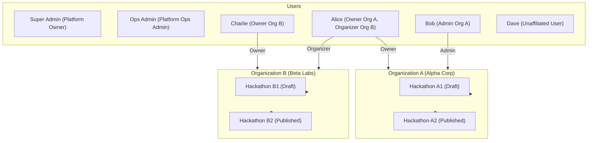

# Scorva — Phase 3 Test Plan: Core Administration & Tenant Isolation

**Document Version:** 1.0  
**Date:** October 25, 2026  
**Status:** **APPROVED TEST PLAN — MILESTONE 1 VERIFIED**  
**Author:** Lead Software Architect  
**Scope:** Verification of Data Models, Alembic Migrations, Dual-Plane Authorization, Tenant Isolation Barriers, Hackathon Lifecycles, Super Admin UI Integration, and Regression Stability.

---

## 1. Overview and Quality Gate Objectives

The Phase 3 Test Plan establishes measurable, reproducible acceptance gates for the multi-tenant administration layer. All verification must be automated, repeatable, and capable of executing in isolated test environments without relying on external network dependencies.

### Quality Gate Pass Criteria
1. **100% Passing Backend Test Suite:** All new Phase 3 tests and all 57 existing Phase 1 & Phase 2 tests must pass (`pytest apps/api/tests`).
2. **Strict Negative Authorization Testing:** Every negative permission check, cross-tenant traversal, and ID-injection attack must produce exact HTTP 401, 403, 404, or 409 responses with RFC 7807 problem details payloads.
3. **Clean Migration Cycle:** The Alembic migration must upgrade cleanly from Phase 2 head (`89e5bd9e37a3`) and downgrade cleanly without orphaned types, tables, or index remnants.
4. **Zero-Error Frontend Compilation:** Next.js TypeScript type checking (`npm run typecheck --prefix apps/web`) and production build (`npm run build --prefix apps/web`) must succeed with 0 warnings or errors.

### Milestone 1 Execution Results (Verified)
- **Model & Constraint Tests:** 9/9 passed (`apps/api/tests/test_organization_hackathon_models.py`)
  - Organization creation & unique slug enforcement (`ix_organizations_slug`)
  - Owner foreign key deletion restriction (`ON DELETE RESTRICT`)
  - Membership creation & pair uniqueness constraint (`uq_organization_user`)
  - Membership cascade deletion on org removal (`ON DELETE CASCADE`)
  - Strict schema separation of platform roles (`PlatformRole`) and tenant roles (`OrgRole`)
  - Tenant-scoped hackathon slug uniqueness (`uq_hackathons_org_slug`)
  - Check constraint rejection of invalid hackathon dates (`chk_hackathon_timeline`)
  - Foreign key deletion restriction for hackathons (`ON DELETE RESTRICT`)
  - Immutable audit event compatibility with nullable `organization_id`
- **Migration Verification:** 4/4 passed (`apps/api/tests/test_migrations.py`)
  - Clean upgrade to new head `de1a35a5cc94`
  - Reversible downgrade to Phase 2 head `89e5bd9e37a3`
  - Reversible downgrade to base schema
  - Clean type and constraint drop verification
- **Full Backend Suite:** 67/67 passed with 0 failures
- **Frontend Verification:** `npm run typecheck` and `npm run build` completed with 0 errors (17/17 routes pre-rendered)

### Milestone 2 Execution Results (Verified)
- **Tenant Isolation Suite:** 15/15 passed (`apps/api/tests/test_tenant_isolation.py`)
  - ISO-01: Cross-tenant organization read blocked with 403 `TENANT_ACCESS_DENIED`
  - Cross-tenant member roster read blocked with 403 `TENANT_ACCESS_DENIED`
  - Cross-tenant member add blocked with 403 `TENANT_ACCESS_DENIED`
  - ISO-04: Cross-tenant profile modification blocked with 403 `TENANT_ACCESS_DENIED`
  - ISO-05: Cross-tenant member deletion blocked with 403 `TENANT_ACCESS_DENIED`
  - ISO-06: Request body tenant ID injection rejected with 422 `Unprocessable Entity` (`extra="forbid"`)
  - ISO-07: Suspended organization read allowed with read-only metadata (200 OK)
  - ISO-08: Suspended organization state-modifying actions blocked with 403 `ORGANIZATION_SUSPENDED`
  - Archived organization access denied with 403 `ORGANIZATION_ARCHIVED`
  - Suspended membership denied with 403 `MEMBERSHIP_SUSPENDED`
  - ISO-09: Removed member immediate access revocation verified (403 `TENANT_ACCESS_DENIED`)
  - ISO-10: Globally suspended user access across all tenants denied with 401 `ACCOUNT_SUSPENDED`
  - Guessed non-existent organization UUID fails closed with 404 `ORGANIZATION_NOT_FOUND`
  - Unauthenticated request fails closed with 401 `UNAUTHORIZED`
  - DUAL-02: Platform Ops Admin without membership denied direct tenant route access (403 `TENANT_ACCESS_DENIED`)
  - DUAL-03: Platform intervention generates immutable audit record; PostgreSQL trigger blocks UPDATE and DELETE
- **Organization Management & Membership Suite:** 12/12 passed (`apps/api/tests/test_organizations.py`)
  - ORG-01: Platform admin creates organization, assigns `ORG_OWNER`, and writes audit record (201 Created)
  - ORG-02: Non-admin blocked from creating org via admin API (403 `FORBIDDEN_NOT_ADMIN`)
  - ORG-03: Duplicate organization slug rejected with 409 `ORGANIZATION_SLUG_TAKEN`
  - ORG-04: Organization details retrieved with member/hackathon counts and owner info (200 OK)
  - ORG-05: Suspend organization workflow (200 OK, `status="suspended"`, audit record written)
  - ORG-06: Reactivate suspended organization (200 OK, `status="active"`)
  - ORG-07: Ownership transfer to active member (Bob becomes owner, Alice demoted to `ORG_ADMIN`)
  - ORG-08: Transfer ownership to non-member blocked with 400 `TARGET_USER_NOT_MEMBER`
  - Admin organization directory search, filtering, and pagination verified
  - MEM-01: Org Admin invites member with role 'organizer' (201 Created)
  - MEM-02: Organizer forbidden from adding members (403 `FORBIDDEN_INSUFFICIENT_ORG_ROLE`)
  - MEM-03: Duplicate membership rejected with 409 `MEMBERSHIP_ALREADY_EXISTS`
  - MEM-04: Org Owner promotes member to admin (200 OK)
  - MEM-05: Org Admin cannot promote member to owner (403 `FORBIDDEN_INSUFFICIENT_ORG_ROLE`)
  - MEM-06: Org Admin removes organizer (200 OK)
  - MEM-07: Org Admin cannot remove Org Owner (403 `CANNOT_REMOVE_OWNER`)
  - MEM-08: Cannot remove last Org Owner (400 `CANNOT_REMOVE_LAST_OWNER`)
  - Tenant profile read (organizer+) and update (org admin+) verified
- **Dual-Plane Platform RBAC Verification:** 8/8 passed (`apps/api/tests/test_rbac_authorization.py`)
  - DUAL-01: Org Owner without platform role denied access to Super Admin platform API (403 `FORBIDDEN_NOT_ADMIN`)
- **Full Backend Suite (Milestone 2 Closure):** 95/95 passed with 0 failures
- **Milestone 3 Delivery & Verification:**
  - **Hackathon Lifecycle Suite:** 14/14 passed (`apps/api/tests/test_hackathons.py`)
    - HACK-01: Organizer creates draft hackathon (201 Created)
    - HACK-02: Invalid timeline dates rejected (422 Unprocessable Content)
    - HACK-03: Org Admin publishes event with prerequisite validation (200 OK)
    - HACK-04: Organizer forbidden from publishing (403 `FORBIDDEN_INSUFFICIENT_ORG_ROLE`)
    - HACK-05: Published hackathon slug immutability enforced (400 `PUBLISHED_SLUG_IMMUTABLE`)
    - HACK-06: Organization ID injection rejected (422 Unprocessable Entity)
    - HACK-07: Duplicate slug within organization rejected (409 `HACKATHON_SLUG_TAKEN`)
    - HACK-08: Identical slug across different organizations permitted (201 Created on both)
    - HACK-09: Platform Ops Admin suspends hackathon with audit trail (200 OK)
    - Organizer restricted from editing other organizers' events (403 `FORBIDDEN_INSUFFICIENT_ORG_ROLE`)
    - Full lifecycle transitions: draft -> published -> completed -> archived verified
    - Terminal state immutability on archived hackathons verified (403 `HACKATHON_ARCHIVED`)
    - Platform Ops Admin blocked from archiving hackathon (403 `FORBIDDEN_INSUFFICIENT_ROLE`)
    - Platform oversight directory search & filters verified (200 OK)
  - **Tenant Isolation Suite:** 19/19 passed (`apps/api/tests/test_tenant_isolation.py`)
    - ISO-02: Cross-tenant hackathon read by guessed UUID returns 404 `HACKATHON_NOT_FOUND`
    - ISO-03: Direct path traversal into other tenant's hackathon returns 403 `TENANT_ACCESS_DENIED`
    - ISO-04: Cross-tenant hackathon modification blocked with 403 `TENANT_ACCESS_DENIED`
    - Concurrent ownership transfer serialization verified via row locks (.with_for_update)
  - **Organization Suite:** 24/24 passed (`apps/api/tests/test_organizations.py`)
  - **Total Backend Suite:** 125/125 passed with 0 failures (100% passing across all 11 test modules)
  - **Frontend Verification:** `npm run typecheck` and `npm run build` completed with 0 errors (17/17 routes pre-rendered)

### Milestone 4 Execution Results (Verified)
- **Super Admin Frontend UI Suite:**
  - **Organization Management (`/admin/organizations`):**
    - Live metric summary cards (Total Tenants, Active, Suspended, Archived).
    - Debounced search across organization names and slugs.
    - Status filtering (`all`, `active`, `suspended`, `archived`) and bidirectional sorting.
    - Provisioning modal with client-side validation (`name`, URL-safe `slug`, registered `owner_email`).
    - Status change modal with mandatory trimmed justification reason.
    - Responsive pagination with page bounds and empty/error states.
  - **Organization Details (`/admin/organizations/[organizationId]`):**
    - Header with copyable UUID, status badge, creation date, and metadata edit modal.
    - Four tabbed views: Overview, Members Roster, Hosted Hackathons, and Scoped Audit Trail.
    - Member roster management: role change dropdown, Add Member modal, and Remove Member confirmation modal.
    - Ownership transfer modal with active member dropdown, transfer warnings, and validation.
    - Embedded audit trail filtering events by `organization_id`.
  - **Hackathon Oversight (`/admin/hackathons`):**
    - Cross-tenant directory with summary metrics (Total, Draft, Published, Completed, Suspended).
    - Cross-tenant search, status filtering, organization filtering, and sort controls.
    - Administrative status override modal with mandatory justification and audit trail notice.
  - **Hackathon Details (`/admin/hackathons/[hackathonId]`):**
    - Event header with live status and timeline phase indicator (Upcoming, Submissions Open, Judging, Concluded).
    - Owning organization link and event creator summary.
    - Strict UTC timeline constraint visualizer (`start_date < submission_deadline <= end_date`).
    - Rules/description markdown viewer and custom settings JSON viewer.
    - Platform administrative status override action dialog.
  - **Tenant-Scoped Portal Plane (`/organizations/{org_id}/...`):**
    - Distinct tenant navigation shell with tenant status, authenticated user role badge, and quick jump back to platform admin.
    - Organization profile view with display name editing for `ORG_ADMIN` / `ORG_OWNER`.
    - Tenant hackathon directory with status filtering and search.
    - Hackathon creation form with auto-slug generation and client-side timeline validation.
    - Hackathon detail view with full lifecycle state machine actions: Publish, Complete, Archive, Suspend, Reactivate.
- **Frontend Quality Gates:**
  - `npm run typecheck --prefix apps/web`: 0 errors.
  - `npm run build --prefix apps/web`: 100% successful production build across all static and dynamic routes.
- **Backend Quality Gates:**
  - All 125 backend tests passing in `apps/api/tests` (`.venv/bin/pytest apps/api/tests -v`).

---

## 2. Test Environments & Execution Commands

### 2.1 Execution Matrix & Commands

| Test Suite / Group | Execution Command | Target Coverage / Scope |
|---|---|---|
| **Entire Backend Suite** | `.venv/bin/pytest apps/api/tests -v` | All unit, integration, and security tests. |
| **Tenant Isolation Suite** | `.venv/bin/pytest apps/api/tests/test_tenant_isolation.py -v` | Cross-tenant access barriers, ID injection, suspended orgs. |
| **Organization Management** | `.venv/bin/pytest apps/api/tests/test_organizations.py -v` | Org CRUD, status, membership, ownership transfers. |
| **Hackathon Lifecycle** | `.venv/bin/pytest apps/api/tests/test_hackathons.py -v` | Creation, publishing, timeline validation, immutability. |
| **Database Migrations** | `.venv/bin/pytest apps/api/tests/test_migrations.py -v` | Fresh database upgrade / downgrade verification. |
| **Frontend Type Checking** | `npm run typecheck --prefix apps/web` | TypeScript types, component interfaces, API client methods. |
| **Frontend Production Build** | `npm run build --prefix apps/web` | Next.js App Router static prerender & bundle verification. |

### 2.2 Test Fixtures & Multi-Tenant Setup Harness
The test harness requires at least two distinct organizations and multiple users with varied platform and tenant roles:

---

## 3. Detailed Test Groups & Negative Test Cases

### Group 1: Database Migration & Schema Integrity Tests
**File:** `apps/api/tests/test_migrations.py`

| Test Case ID | Test Description | Input / Execution Condition | Expected Outcome |
|---|---|---|---|
| **MIG-01** | Clean Upgrade from Phase 2 Head | Apply Alembic `head` on clean database instance. | Tables `organizations`, `organization_memberships`, `hackathons` and their associated enums are successfully created. |
| **MIG-02** | Complete Downgrade to Phase 2 Head | Execute `alembic downgrade 89e5bd9e37a3`. | Phase 3 tables and enums are cleanly removed; Phase 2 tables (`users`, `audit_events`, fallback tables) remain intact. |
| **MIG-03** | Unique Constraint Enforcement on Org Slugs | Insert two organizations with identical slug `'test-org'`. | Database raises `IntegrityError` (violates unique constraint). |
| **MIG-04** | Membership Uniqueness Constraint | Insert two `organization_memberships` records for same `(organization_id, user_id)`. | Database raises `IntegrityError` (violates `uq_organization_user`). |
| **MIG-05** | Timeline Database Check Constraint | Insert hackathon where `start_date >= submission_deadline` or `submission_deadline > end_date`. | Database raises `IntegrityError` (violates check constraint `chk_hackathon_timeline`). |
| **MIG-06** | Foreign Key Deletion Cascades & Restrictions | 1. Attempt to delete user who is `organizations.owner_id`. 2. Delete an organization. | 1. Blocked with `IntegrityError` (`ON DELETE RESTRICT`). 2. Memberships cascade-deleted (`ON DELETE CASCADE`); hackathons restricted. |

---

### Group 2: Organization Management Unit & Integration Tests
**File:** `apps/api/tests/test_organizations.py`

| Test Case ID | Test Description | Persona / Role | Execution Steps | Expected Response |
|---|---|---|---|---|
| **ORG-01** | Platform Admin Creates Organization | `PlatformRole.PLATFORM_OPS_ADMIN` | `POST /api/v1/admin/organizations` with valid name, slug, owner email. | `201 Created`. Org created, owner assigned `ORG_OWNER` membership, audit event `organization_created` recorded. |
| **ORG-02** | Non-Admin Blocked from Creating Org via Admin API | `OrgRole.ORG_OWNER` or Unaffiliated | `POST /api/v1/admin/organizations`. | `403 Forbidden` (`FORBIDDEN_NOT_ADMIN`). |
| **ORG-03** | Reject Duplicate Organization Slug | `PlatformRole.PLATFORM_OPS_ADMIN` | `POST /api/v1/admin/organizations` with an existing slug. | `409 Conflict` (`ORGANIZATION_SLUG_TAKEN`). |
| **ORG-04** | Retrieve Organization Details | `PlatformRole.PLATFORM_OPS_ADMIN` | `GET /api/v1/admin/organizations/{id}`. | `200 OK` with profile, owner details, member count, quotas. |
| **ORG-05** | Suspend Organization Workflow | `PlatformRole.PLATFORM_OPS_ADMIN` | `POST /api/v1/admin/organizations/{id}/status` with `is_active=False, reason="Billing delinquency"`. | `200 OK`. `status` becomes `'suspended'`, audit event `organization_status_changed` recorded. |
| **ORG-06** | Reactivate Suspended Organization | `PlatformRole.PLATFORM_OPS_ADMIN` | `POST /api/v1/admin/organizations/{id}/status` with `is_active=True`. | `200 OK`. `status` becomes `'active'`. |
| **ORG-07** | Transfer Organization Ownership | `OrgRole.ORG_OWNER` or Platform Admin | `POST /api/v1/admin/organizations/{id}/transfer-ownership` targeting active member Bob. | `200 OK`. Bob becomes `owner_id` and `ORG_OWNER`; Alice demoted to `ORG_ADMIN`. |
| **ORG-08** | Transfer Ownership to Non-Member Blocked | `OrgRole.ORG_OWNER` | Transfer ownership targeting unaffiliated Dave. | `400 Bad Request` (`TARGET_USER_NOT_MEMBER`). |

---

### Group 3: Organization Membership & Role Matrix Tests
**File:** `apps/api/tests/test_organizations.py`

| Test Case ID | Test Description | Persona / Role | Execution Steps | Expected Response |
|---|---|---|---|---|
| **MEM-01** | Add Member to Organization | `OrgRole.ORG_ADMIN` | `POST /api/v1/organizations/{org_id}/members` targeting Dave with role `'organizer'`. | `201 Created`. Dave added to membership roster. Audit event recorded. |
| **MEM-02** | Organizer Forbidden from Adding Members | `OrgRole.ORGANIZER` | `POST /api/v1/organizations/{org_id}/members`. | `403 Forbidden` (`FORBIDDEN_INSUFFICIENT_ORG_ROLE`). |
| **MEM-03** | Duplicate Membership Rejected | `OrgRole.ORG_ADMIN` | Add Dave when Dave is already a member. | `409 Conflict` (`MEMBERSHIP_ALREADY_EXISTS`). |
| **MEM-04** | Org Owner Promotes Member to Admin | `OrgRole.ORG_OWNER` | `PATCH /api/v1/organizations/{org_id}/members/{user_id}` setting `role='org_admin'`. | `200 OK`. Role updated. |
| **MEM-05** | Org Admin Cannot Promote to Owner | `OrgRole.ORG_ADMIN` | `PATCH /api/v1/organizations/{org_id}/members/{user_id}` setting `role='org_owner'`. | `403 Forbidden` (`FORBIDDEN_INSUFFICIENT_ORG_ROLE`). Only owner can transfer ownership. |
| **MEM-06** | Remove Member from Organization | `OrgRole.ORG_ADMIN` | `DELETE /api/v1/organizations/{org_id}/members/{user_id}` targeting an organizer. | `200 OK`. Member removed. |
| **MEM-07** | Org Admin Cannot Remove Org Owner | `OrgRole.ORG_ADMIN` | `DELETE /api/v1/organizations/{org_id}/members/{owner_id}`. | `403 Forbidden` (`CANNOT_REMOVE_OWNER`). |
| **MEM-08** | Cannot Remove Last Org Owner | `OrgRole.ORG_OWNER` | Owner attempts to delete their own membership without transferring. | `400 Bad Request` (`CANNOT_REMOVE_LAST_OWNER`). |

---

### Group 4: Hackathon Lifecycle & Validation Tests
**File:** `apps/api/tests/test_hackathons.py`

| Test Case ID | Test Description | Persona / Role | Execution Steps | Expected Response |
|---|---|---|---|---|
| **HACK-01** | Create Draft Hackathon | `OrgRole.ORGANIZER` | `POST /api/v1/organizations/{org_id}/hackathons` with valid dates and title. | `201 Created`. Initial status `'draft'`, `created_by_user_id` set to actor. |
| **HACK-02** | Reject Invalid Timeline Dates | `OrgRole.ORGANIZER` | Create hackathon with `start_date > submission_deadline`. | `422 Unprocessable Content` (`INVALID_TIMELINE_DATES`). |
| **HACK-03** | Publish Hackathon Workflow | `OrgRole.ORG_ADMIN` | `POST /api/v1/organizations/{org_id}/hackathons/{id}/publish`. | `200 OK`. Status transitions to `'published'`. Audit event recorded. |
| **HACK-04** | Organizer Forbidden from Publishing | `OrgRole.ORGANIZER` | `POST /api/v1/organizations/{org_id}/hackathons/{id}/publish`. | `403 Forbidden` (`FORBIDDEN_INSUFFICIENT_ORG_ROLE`). |
| **HACK-05** | Published Hackathon Slug Immutability | `OrgRole.ORG_ADMIN` | `PATCH /api/v1/organizations/{org_id}/hackathons/{id}` attempting to change `slug` on published hackathon. | `400 Bad Request` (`PUBLISHED_SLUG_IMMUTABLE`). |
| **HACK-06** | Published Hackathon Organization Immutability | `OrgRole.ORG_ADMIN` | Attempt to change `organization_id` on published hackathon. | Rejected by schema validator or ignored/blocked. |
| **HACK-07** | Duplicate Slug Within Same Organization Rejected | `OrgRole.ORGANIZER` | Create second hackathon in Org A with same slug as existing hackathon in Org A. | `409 Conflict` (`HACKATHON_SLUG_TAKEN`). |
| **HACK-08** | Identical Slug Across Different Organizations Allowed | `OrgRole.ORGANIZER` | Create hackathon with slug `ai-challenge` in Org A, then create hackathon with slug `ai-challenge` in Org B. | `201 Created` on both. Confirms slug uniqueness is scoped per tenant. |
| **HACK-09** | Platform Admin Suspends Hackathon | `PlatformRole.PLATFORM_OPS_ADMIN` | `POST /api/v1/admin/hackathons/{id}/status` with `status='suspended', reason="Terms of service violation"`. | `200 OK`. Status becomes `'suspended'`. Mandatory audit event recorded. |

---

### Group 5: Tenant Isolation & Adversarial Attack Simulation Tests (CRITICAL)
**File:** `apps/api/tests/test_tenant_isolation.py`

This suite specifically tests cross-tenant barriers using two distinct organizations (`Org A` and `Org B`) and separate user personas.

| Test Case ID | Attack / Scenario Description | Actor & Setup | Execution Request | Expected Security Behavior |
|---|---|---|---|---|
| **ISO-01** | Cross-Tenant Read via Organization ID | Alice (`Org A` Owner) | `GET /api/v1/organizations/{org_b_id}` | `403 Forbidden` (`TENANT_ACCESS_DENIED`). Alice has no membership in Org B. |
| **ISO-02** | Cross-Tenant Read Hackathon by Guessed UUID | Alice (`Org A` Owner) | `GET /api/v1/organizations/{org_a_id}/hackathons/{hackathon_b1_id}` | `404 Not Found` (`HACKATHON_NOT_FOUND`). Backend scopes query by `org_a_id`; does not leak that `hackathon_b1_id` exists in Org B. |
| **ISO-03** | Direct Path Traversal into Other Tenant's Hackathon | Bob (`Org A` Admin) | `GET /api/v1/organizations/{org_b_id}/hackathons/{hackathon_b1_id}` | `403 Forbidden` (`TENANT_ACCESS_DENIED`). Bob is not a member of Org B. |
| **ISO-04** | Cross-Tenant Modification Attempt | Bob (`Org A` Admin) | `PATCH /api/v1/organizations/{org_b_id}/hackathons/{hackathon_b1_id}` | `403 Forbidden` (`TENANT_ACCESS_DENIED`). Modification blocked. |
| **ISO-05** | Cross-Tenant Delete Attempt | Alice (`Org A` Owner) | `DELETE /api/v1/organizations/{org_b_id}/members/{charlie_id}` | `403 Forbidden` (`TENANT_ACCESS_DENIED`). |
| **ISO-06** | Request Body Tenant ID Injection Attack | Alice (`Org A` Owner) | `POST /api/v1/organizations/{org_a_id}/hackathons` with JSON body payload containing `"organization_id": "{org_b_id}"`. | Hackathon is created strictly in `Org A`. Request-supplied `organization_id` is either rejected or overridden by the server-side `TenantContext`. |
| **ISO-07** | Suspended Organization Read Access | Charlie (`Org B` Owner) after Org B suspended | `GET /api/v1/organizations/{org_b_id}/hackathons` | `200 OK` (read-only view with `organization.status == 'suspended'`). |
| **ISO-08** | Suspended Organization Mutation Blocked | Charlie (`Org B` Owner) after Org B suspended | `POST /api/v1/organizations/{org_b_id}/hackathons` | `403 Forbidden` (`ORGANIZATION_SUSPENDED`). Mutations unconditionally blocked. |
| **ISO-09** | Removed Member Immediate Revocation | Dave removed from `Org A` | Dave performs `GET /api/v1/organizations/{org_a_id}/hackathons` using previous session. | `403 Forbidden` (`TENANT_ACCESS_DENIED`). Membership check evaluates current DB state. |
| **ISO-10** | Suspended User Access Across All Tenants | User suspended globally | User performs `GET /api/v1/organizations/{org_a_id}`. | `401 Unauthorized` (`ACCOUNT_SUSPENDED`). Dual-barrier session check rejects before tenant evaluation. |

---

### Group 6: Platform vs Organization Dual-Plane Separation Tests
**File:** `apps/api/tests/test_rbac_authorization.py`

| Test Case ID | Test Description | Actor | Execution Steps | Expected Response |
|---|---|---|---|---|
| **DUAL-01** | Org Owner Cannot Access Super Admin Platform API | `OrgRole.ORG_OWNER` (no platform role) | `GET /api/v1/admin/organizations` | `403 Forbidden` (`FORBIDDEN_NOT_ADMIN`). |
| **DUAL-02** | Platform Ops Admin Cannot Mutate Tenant Hackathon Without Platform Endpoint | `PlatformRole.PLATFORM_OPS_ADMIN` (not an org member) | `POST /api/v1/organizations/{org_a_id}/hackathons` | `403 Forbidden` (`TENANT_ACCESS_DENIED`). Platform admins must use designated `/api/v1/admin/...` endpoints for auditable intervention. |
| **DUAL-03** | Platform Admin Action Records Explicit Audit Trail | `PlatformRole.PLATFORM_OWNER` | Platform owner updates organization quotas via `/api/v1/admin/organizations/{id}`. | Action succeeds, audit log records `actor_role="platform_owner"`, `resource_type="organization"`, `organization_id=id`. |

---

### Group 7: Super Admin Frontend Integration & Component Tests

| Test Case ID | Test Target | Verification Mechanism | Success Criteria |
|---|---|---|---|
| **UI-01** | Organizations Page Type Check | `npm run typecheck --prefix apps/web` | 0 errors across `/admin/organizations/page.tsx` and detail views. |
| **UI-02** | Hackathons Oversight Type Check | `npm run typecheck --prefix apps/web` | 0 errors across `/admin/hackathons/page.tsx` and detail views. |
| **UI-03** | Next.js Production Build | `npm run build --prefix apps/web` | All static and dynamic routes pre-rendered successfully (19+ pages). |
| **UI-04** | API Error Handling | Unit test of `api-client.ts` methods | `ApiClientError` parsed correctly from RFC 7807 responses (`code`, `status`, `detail`). |
| **UI-05** | Status Badge Display | Visual / component inspection | Statuses `'active'`, `'suspended'`, `'archived'`, `'draft'`, `'published'` display appropriate semantic colors and icons. |

---

### Group 8: Phase 1 & Phase 2 Regression Test Gate

| Regression Check | Command | Pass Criteria |
|---|---|---|
| **Phase 1 Foundation Probes** | `.venv/bin/pytest apps/api/tests/test_health.py` | Health and readiness probes report healthy status and latency. |
| **Phase 2 Auth & MFA Flow** | `.venv/bin/pytest apps/api/tests/test_auth_flow.py` | Login, TOTP MFA enrollment, challenge, and replay protection succeed. |
| **Phase 2 CSRF & Revocation** | `.venv/bin/pytest apps/api/tests/test_csrf_and_revocation.py` | CSRF origin validation and session revocation pass. |
| **Phase 2 Multi-Worker Outage** | `.venv/bin/pytest apps/api/tests/test_security_gate.py` | Redis outage fallbacks (PostgreSQL fallback tables) pass. |
| **Phase 2 Audit Immutability** | `.venv/bin/pytest apps/api/tests/test_audit_integrity.py` | DB trigger blocks `UPDATE` and `DELETE` on `audit_events`. |

---

## 4. Acceptance Sign-Off Checklist

Before Phase 3 implementation is accepted and signed off:
- [ ] Database migration script runs both `upgrade` and `downgrade` with 0 SQL errors.
- [ ] All 10 tenant isolation tests in Group 5 pass with 100% assertions satisfied.
- [ ] No client request can spoof or inject an `organization_id` into another tenant.
- [ ] Suspending an organization halts hackathon creation and publication.
- [ ] Super Admin UI displays real live data from backend APIs with zero mock data.
- [ ] All 57 Phase 1/Phase 2 regression tests pass without modification.
- [ ] Total passing tests exceeds 85 test cases.
