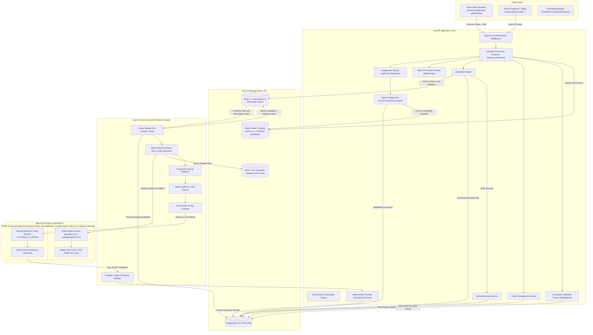
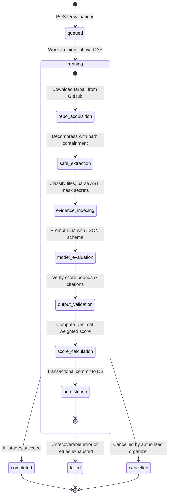
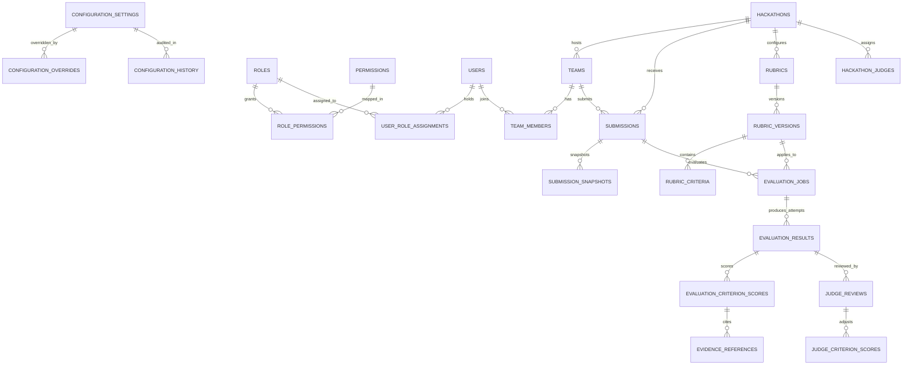
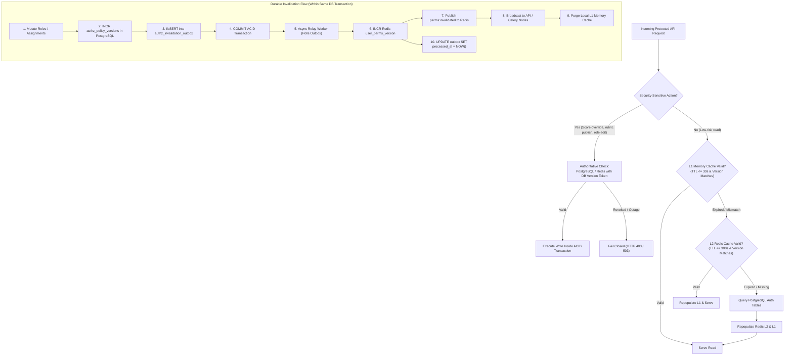

# Scorva — Phase 4 Technical Architecture
## AI-Powered Hackathon Evaluation Engine

**Document Version:** 1.0  
**Date:** October 26, 2026  
**Status:** **APPROVED ARCHITECTURAL SPECIFICATION**  
**Author:** Lead Software Architect & AI Systems Engineer  

---

## 1. System Architecture & Component Topology

Scorva's evaluation subsystem extends the existing **modular monolith** with an asynchronous worker pipeline. HTTP request handling is strictly decoupled from resource-intensive repository ingestion, static analysis, and LLM inference.



### 1.1 Dual-Path Resolution Architecture: Separating Reproducibility from Live Authorization

A core architectural tenet of Phase 4 is the strict separation between **Evaluation Configuration Resolution** (for execution reproducibility) and **Live Authorization Enforcement** (for real-time access control):

```mermaid
flowchart TD
    subgraph PathA ["Path A: Evaluation Configuration Resolution (Reproducibility & Execution Mechanics)"]
        A1["1. System Safe Defaults (Pydantic / Hardcoded Fail-Safe)"]
        A2["2. Platform Settings (Super Admin Controlled in DB)"]
        A3["3. Organization Overrides (Bounded Tenant Settings)"]
        A4["4. Hackathon Overrides (Bounded Event Settings)"]
        A5["5. Evaluation Snapshot (Frozen Point-in-Time Binding in DB)"]
        A1 --> A2 --> A3 --> A4 --> A5
        A5 --> A6["Worker Engine (Executes Rubric, Prompts, Weights)"]
    end

    subgraph PathB ["Path B: Live Authorization & Security Enforcement (Real-Time Access Control)"]
        B1["Protected Operation Request (API / Worker / WebSocket)"]
        B2["Mandatory Tier 5 Invariants (Zero-Code, Tenant Isolation, MFA)"]
        B3["Live User Identity & Tenant Context Scoping"]
        B4["Current Permissions (Redis L2 / Monotonic Version Check)"]
        B5{"Permission Granted & Valid Assignment?"}
        B6["Allow Action"]
        B7["Deny Action (HTTP 403 / Reject Write)"]
        B1 --> B2 --> B3 --> B4 --> B5
        B5 -- Yes --> B6
        B5 -- No --> B7
    end
```



- **Path A (Evaluation Configuration Mechanics):** Resolves Hackathon -> Organization -> Platform -> System Safe Default. When a job is queued, the validated configuration is frozen into `submission_snapshots.configuration_snapshot` (JSONB). Workers execute against this snapshot to ensure 100% reproducible scoring arithmetic and rubric weights.
- **Path B (Live Authorization & Security):** Evaluates real-time permissions for every protected action. **An evaluation snapshot NEVER grants permissions, never authorizes API access, and never overrides a current permission denial.** If a judge's event assignment or an organizer's role is revoked, they are immediately blocked from performing overrides or viewing private evaluations, regardless of historical snapshot data.
- **Job Lifecycle Authorization Rechecks:**
  1. *Queue Time:* Recheck `evaluation.trigger` permission on caller.
  2. *Worker Dequeue Time:* Recheck hackathon/org status (not suspended) and submission status (not withdrawn).
  3. *Judge Override Submission:* Recheck `judge.score_override` permission AND active assignment in `hackathon_judges`. If revoked mid-job, reject with `HTTP 403 Forbidden` (`JUDGE_ASSIGNMENT_REVOKED`).
  4. *Diagnostic Exposure:* Recheck `evaluation.view_raw_model` at the moment of request. If caller revoked, block access immediately.
- **Behavior on Mid-Job Role Revocation:** If the organizer who triggered the job is revoked while the worker is running, the job completes execution and persists results under hackathon ownership, emitting an audit log. However, the revoked user is immediately blocked from viewing or managing the results.

---

## 2. Component Trust & Boundary Matrix

| Component | Sync/Async | Inputs | Outputs | Trusted Components | Untrusted Components | Auth / Access Enforcement | Failure & Crash Handling |
|---|---|---|---|---|---|---|---|
| **API Backend** | Sync (asyncpg) | HTTP requests, session cookies | JSON responses, RFC 7807 errors | PostgreSQL, Redis, Internal Workers | Browser clients, request payloads, URL parameters | Granular RBAC (`require_permission`), MFA session | Returns 4xx/5xx RFC 7807 details; logs to audit trail. |
| **Configuration Service** | Sync/Cached | Setting key, scope, proposed value | Effective typed setting, validated overrides | Pydantic Schemas, PostgreSQL, Redis | User-submitted overrides | Tier 1-3 bounds check, `platform.settings.write` | Fails safe to System Safe Defaults if DB/cache down. |
| **Permission Evaluator** | Sync/Cached | User ID, target scope, permission ID | Boolean allow/deny decision | Redis permission cache, PostgreSQL roles | Client claim tokens, route parameters | Deny-by-default, scope context isolation | Fails closed (HTTP 403) on missing or invalid policy. |
| **Credential Manager** | Sync | GitHub PATs, App tokens | Encrypted bytea, masked preview | `ENCRYPTION_MASTER_KEY`, PostgreSQL | User-submitted tokens | Restricts to `integration.github.configure` | Validates token format; never writes plaintext to logs or disk. |
| **Celery Worker** | Async | Task payloads (`job_id`, `submission_id`) | Database state updates, log events | PostgreSQL, Redis, MinIO | Untrusted repo code, external LLM outputs | Redis claim tokens, CAS database generation counter | Renewable leases, heartbeats, periodic reaper task. |
| **Public Egress Guard (Profile A)** | Sync | GitHub repo URL, commit SHA | Validated public connection | DNS resolver, socket layer | Target URLs, HTTP redirect locations | Allowlist (`api.github.com`, `codeload.github.com`), public IP assert | Aborts with `SSRF_VALIDATION_ERROR` or `INVALID_REDIRECT`. |
| **Safe Extractor** | Async | Tarball stream from GitHub | Clean directory of regular files | Local filesystem target directory | Tarball headers, paths, archive contents | Path containment (`Path.is_relative_to`), size/depth quotas | Discards archive, aborts job with `EXTRACT_VIOLATION`. |
| **Secret Masker** | Async | Raw file contents | Sanitized text buffers | Regex masking dictionary | High-entropy strings, source code files | Internal worker sandbox boundary | Fail-safe: if masking fails, file content is omitted. |
| **Prompt Compiler** | Async | Rubric criteria, sanitized evidence | Structured prompt messages | Static rubric templates, system schemas | Repository text, READMEs, commit messages | Strict structural delimiter fencing (`<UNTRUSTED_REPOSITORY_EVIDENCE>`) | Clamps token lengths; truncates oversized evidence. |
| **Internal Inference Guard (Profile B)** | Sync | Configured provider base URL | Validated internal connection | Environment settings (`OLLAMA_BASE_URL`) | Dynamic user URLs (disallowed) | Pinned host allowlist (`ALLOWED_INTERNAL_AI_HOSTS`), `follow_redirects=False` | Aborts with `AI_PROVIDER_ERROR` if redirected or disallowed host. |
| **AI Provider Client** | Async | Structured prompt, JSON Schema | Raw JSON model output | Ollama endpoint, JSON grammar | Model-generated text strings | Network boundary, isolated docker bridge network | Retries up to 1 time with temp 0.0; 120s timeout. |
| **Output Validator** | Sync | Raw JSON model output | Validated Pydantic payload | Pydantic v2 schema, frozen criteria IDs | Unstructured model text, hallucinated IDs | Criteria ID presence check, bounds validation | Rejects malformed output; sets status to `FAILED`. |
| **Scoring Calculator** | Sync | Validated criterion scores | Total weighted score (0-100) | Frozen rubric weights, Pydantic score models | Raw LLM output | Internal Python library boundary | Rejects sum $\ne 1.0$; Decimal calculation with `ROUND_HALF_UP`. |

---

## 3. Asynchronous Pipeline Stages

Each evaluation job progresses through a strictly sequential 7-stage state machine:



### Stage Execution Details

1. **`repo_acquisition`:**
   - Worker queries `submissions` and `submission_snapshots` to resolve target repository URL and frozen commit SHA.
   - Credential resolution: If private repo, worker queries `organization_integrations` for tenant's encrypted token, decrypting it in memory using `decrypt_value(record.encrypted_token)` via `ENCRYPTION_MASTER_KEY`. Public repos utilize platform anonymous or pooled tokens.
   - Profile A Egress Validation:
     - Target hostname must match `api.github.com` or `codeload.github.com`.
     - Synchronous DNS pre-resolution: Verifies every resolved IP address is a public unicast IP address (`ip.is_global and not ip.is_private and not ip.is_loopback and not ip.is_link_local and not ip.is_reserved`).
     - Redirect handling: Intercepts HTTP 302 redirects (GitHub API redirects to `codeload.github.com`). Max 3 redirects. Re-validates destination scheme (`https`), hostname (`codeload.github.com`), and re-resolves destination IP to assert public status before connecting. Authorization headers are stripped if redirected across domains.
     - IP Pinning: Socket connects directly to the pre-validated IP address to eliminate DNS rebinding TOCTOU windows.
   - Enforces 50MB (`MAX_COMPRESSED_BYTES = 52_428_800`) download stream cap and 60-second transfer timeout.

2. **`safe_extraction`:**
   - Decompresses archive into isolated ephemeral worker directory (`/tmp/scorva/eval_{job_id}/`).
   - Validates path containment on every tar member using `member_path.is_relative_to(resolved_target)`.
   - Rejects symlinks (`issym()`), hardlinks (`islnk()`), character/block devices (`ischr()`, `isblk()`), and FIFOs (`isfifo()`).
   - Enforces deterministic quotas:
     - Cumulative uncompressed bytes $\le 262,144,000$ (250MB).
     - Single file size $\le 10,485,760$ (10MB).
     - File count $\le 2000$.
     - Directory nesting depth $\le 10$.
     - File path character length $\le 255$.
   - Any violation immediately aborts extraction, deletes scratch directory, and transitions job to `failed` with `EXTRACT_VIOLATION`.

3. **`evidence_indexing`:**
   - Classifies files into taxonomies: Documentation (`README.md`, `ARCHITECTURE.md`), Build Config (`package.json`, `Cargo.toml`), Test Suites (`test_*.py`, `*.spec.ts`), Source Code.
   - File exclusion: Automatically skips secret-bearing files: `.env*`, `*.pem`, `*.key`, `id_rsa`, `*.p12`, `credentials.json`, and `.git/`.
   - Extracts structural metadata: total lines of code, language breakdown, presence of automated tests.
   - Executes regex secret masker stripping API keys, AWS tokens, JWTs, and passwords from extracted snippets before prompt assembly.

4. **`model_evaluation`:**
   - Compiles prompt combining frozen rubric criteria (trusted) and indexed evidence snippets (untrusted).
   - Untrusted repository text is framed inside strict XML structural delimiters:
     ```markdown
     <UNTRUSTED_REPOSITORY_EVIDENCE origin="submission_snapshot" commit="a1b2c3d">
     File: README.md
     ---
     [Untrusted file content]
     ---
     </UNTRUSTED_REPOSITORY_EVIDENCE>
     ```
   - Profile B Egress: Invokes Ollama client via administrator-configured `settings.OLLAMA_BASE_URL` with host matching `ALLOWED_INTERNAL_AI_HOSTS`. Redirects are strictly disabled (`follow_redirects=False`).
   - Enforces 120-second per-model inference timeout and strict JSON Schema grammar constraints.

5. **`output_validation`:**
   - Validates JSON output against Pydantic schema `AIEvaluationOutputPayload`.
   - Asserts that every criterion in the frozen rubric version received an assessment.
   - Asserts that all awarded scores $S_i$ satisfy $\text{min\_score}_i \le S_i \le \text{max\_score}_i$.
   - Validates evidence citations: verifies that cited `file_path` exists in the repository manifest and `start_line <= end_line <= total_lines(file_path)`. If invalid, citation is flagged as `is_verified_in_repo = False`.
   - Missing Evidence Handling: If repository lacks evidence for a criterion (e.g. no unit tests), the system sets `evidence_status = 'missing'`, score clamped to `min_score`, and reason set to `"NO_VERIFIABLE_EVIDENCE: Repository contains no automated tests or test configurations."` Score is never hallucinated.
   - Output Failure Fallback: If output fails Pydantic schema validation, worker retries once with temperature 0.0. If second attempt also fails, job transitions to `failed` with `AI_OUTPUT_VALIDATION_FAILED`. Malformed scores are never persisted.

6. **`score_calculation`:**
   - Deterministic mathematical scoring executed in Python using `decimal.Decimal` and `ROUND_HALF_UP`.
   - Configurable Scoring Modes on Rubric:
     - **Mode A: Offset-Normalized (Default for Non-Zero Minimums):**
       $$\text{Normalized Score}_i = \frac{S_i - \text{min\_score}_i}{\text{max\_score}_i - \text{min\_score}_i}$$
       $$\text{Weighted Score}_i = \text{Normalized Score}_i \times \text{Weight}_i \times 100$$
       $$\text{Total Score} = \text{round}\left(\sum_{i=1}^N \text{Weighted Score}_i, 2\right)$$
     - **Mode B: Raw Proportional:**
       $$\text{Proportional Score}_i = \frac{S_i}{\text{max\_score}_i}$$
       $$\text{Weighted Score}_i = \text{Proportional Score}_i \times \text{Weight}_i \times 100$$
       $$\text{Total Score} = \text{round}\left(\sum_{i=1}^N \text{Weighted Score}_i, 2\right)$$
   - **Worked Scoring Example:**
     Consider a rubric with 3 criteria:
     1. Code Quality ($w_1 = 0.4000$, range $[1.00, 5.00]$, awarded $S_1 = 4.00$)
     2. Innovation ($w_2 = 0.3500$, range $[0.00, 10.00]$, awarded $S_2 = 8.00$)
     3. Documentation ($w_3 = 0.2500$, range $[0.00, 100.00]$, awarded $S_3 = 90.00$)
     - *Mode A (Offset-Normalized):*
       - Criterion 1: $\frac{4.00 - 1.00}{5.00 - 1.00} = \frac{3.00}{4.00} = 0.7500 \implies 0.7500 \times 0.4000 \times 100 = 30.00$
       - Criterion 2: $\frac{8.00 - 0.00}{10.00 - 0.00} = 0.8000 \implies 0.8000 \times 0.3500 \times 100 = 28.00$
       - Criterion 3: $\frac{90.00 - 0.00}{100.00 - 0.00} = 0.9000 \implies 0.9000 \times 0.2500 \times 100 = 22.50$
       - **Total Score Mode A:** $30.00 + 28.00 + 22.50 = \mathbf{80.50}$
     - *Mode B (Raw Proportional):*
       - Criterion 1: $\frac{4.00}{5.00} = 0.8000 \implies 0.8000 \times 0.4000 \times 100 = 32.00$
       - Criterion 2: $\frac{8.00}{10.00} = 0.8000 \implies 0.8000 \times 0.3500 \times 100 = 28.00$
       - Criterion 3: $\frac{90.00}{100.00} = 0.9000 \implies 0.9000 \times 0.2500 \times 100 = 22.50$
       - **Total Score Mode B:** $32.00 + 28.00 + 22.50 = \mathbf{82.50}$
     - *Product Note:* Mode A ensures minimum possible score yields $0\%$ and maximum yields $100\%$. Mode B awards proportional points. The rubric configures `scoring_mode` with Mode A as default when non-zero minimums exist.

7. **`persistence`:**
   - Transactionally inserts `evaluation_results`, `evaluation_criterion_scores`, and `evidence_references`.
   - Preserves historical attempts: `evaluation_results.attempt_number` records the attempt sequence.
   - Updates `evaluation_jobs.current_result_id` and sets `status = 'completed'`.
   - Releases Redis lease and wipes local ephemeral scratch directories.

---

## 4. Streamlined Database Architecture (Milestones 1 & 2 Target)

The database schema is partitioned into three decoupled relational subsystems across Milestones 1 and 2, streamlined to eliminate unnecessary tables and synchronization drift:
- **Subsystem A (Milestone 1):** Configuration Management Entities (Tables 1–3).
- **Subsystem B (Milestone 1):** Granular RBAC & Role Policy Entities (Tables 4–7).
- **Subsystem C (Milestone 2):** Participant Teams, Submissions, Rubrics, Evaluation & Credential Entities (Tables 8–22).



### Table Definitions

#### Subsystem A: Configuration Management Entities (Milestone 1)

##### 1. `configuration_settings`
Authoritative platform settings combining definition metadata, current platform value, permitted bounds, and optimistic concurrency.
- `key` (VARCHAR(100), PK) — e.g. `'judge.rationale_min_length'`
- `tier` (SMALLINT, NOT NULL) — 1 (Super Admin), 2 (Super Admin Bounded), 3 (Tenant), 4 (Infra), 5 (Invariant)
- `data_type` (VARCHAR(20), NOT NULL) — `'integer'`, `'decimal'`, `'boolean'`, `'string'`, `'enum'`
- `default_value` (JSONB, NOT NULL)
- `current_value` (JSONB, NOT NULL)
- `allow_org_override` (BOOLEAN, NOT NULL DEFAULT FALSE) — Super Admin delegation control
- `allow_hackathon_override` (BOOLEAN, NOT NULL DEFAULT FALSE) — Super Admin delegation control
- `min_value` (JSONB, NULL) — Bounding envelope minimum
- `max_value` (JSONB, NULL) — Bounding envelope maximum
- `effect_timing` (VARCHAR(20), NOT NULL) — `'immediate'`, `'next_job'`, `'new_hackathon_only'`
- `version` (INTEGER, NOT NULL DEFAULT 1) — Optimistic concurrency counter
- `description` (TEXT, NOT NULL)
- `updated_at` (TIMESTAMPTZ, NOT NULL DEFAULT NOW())

##### 2. `configuration_overrides`
Unified tenant- and event-level configuration overrides strictly bounded by platform policy.
- `id` (UUID, PK)
- `setting_key` (VARCHAR(100), FK -> configuration_settings.key, ON DELETE RESTRICT)
- `scope_type` (VARCHAR(20), NOT NULL) — `'organization'` or `'hackathon'`
- `scope_id` (UUID, NOT NULL) — `organization_id` or `hackathon_id`
- `override_value` (JSONB, NOT NULL)
- `version` (INTEGER, NOT NULL DEFAULT 1)
- `updated_by_user_id` (UUID, FK -> users.id, ON DELETE SET NULL)
- `updated_at` (TIMESTAMPTZ, NOT NULL DEFAULT NOW())
- **Constraints:** `UNIQUE(setting_key, scope_type, scope_id)`.

##### 3. `configuration_history`
Append-only audit trail recording every configuration mutation, rollback, previous state, actor, and rationale.
- `id` (UUID, PK)
- `setting_key` (VARCHAR(100), NOT NULL)
- `scope_type` (VARCHAR(20), NOT NULL)
- `scope_id` (UUID, NULL)
- `old_value` (JSONB, NOT NULL)
- `new_value` (JSONB, NOT NULL)
- `change_type` (VARCHAR(20), NOT NULL) — `'update'`, `'rollback'`, `'override'`
- `restored_from_version` (INTEGER, NULL) — Explicit pointer when change is a rollback
- `version` (INTEGER, NOT NULL)
- `actor_user_id` (UUID, FK -> users.id, ON DELETE SET NULL)
- `client_ip` (VARCHAR(45), NOT NULL)
- `change_reason` (TEXT, NOT NULL)
- `created_at` (TIMESTAMPTZ, NOT NULL DEFAULT NOW())
- **Immutability:** Protected by PostgreSQL append-only trigger.

---

#### Subsystem B: Granular RBAC & Role Policy Entities (Milestone 1)

##### 4. `permissions`
Stable granular permission registry with delegation ceiling metadata.
- `id` (VARCHAR(100), PK) — e.g. `'rubric.publish'`, `'participant.submission.create'`
- `domain` (VARCHAR(50), NOT NULL) — e.g. `'rubrics'`, `'participants'`, `'evaluations'`
- `action` (VARCHAR(50), NOT NULL) — e.g. `'publish'`, `'create'`
- `min_scope` (VARCHAR(20), NOT NULL) — `'platform'`, `'organization'`, `'hackathon'`, `'resource'`
- `is_delegable` (BOOLEAN, NOT NULL DEFAULT FALSE) — If FALSE, lower admins cannot grant this permission
- `description` (TEXT, NOT NULL)
- `created_at` (TIMESTAMPTZ, NOT NULL DEFAULT NOW())

##### 5. `roles`
Role definitions spanning platform, tenant, and participant scopes.
- `id` (UUID, PK)
- `name` (VARCHAR(50), NOT NULL) — e.g. `'platform_owner'`, `'org_admin'`, `'judge'`, `'participant'`
- `display_name` (VARCHAR(100), NOT NULL)
- `scope_type` (VARCHAR(20), NOT NULL) — `'platform'`, `'organization'`, `'hackathon'`
- `scope_id` (UUID, NULL) — NULL for platform roles; tenant or event ID for custom roles
- `is_system` (BOOLEAN, NOT NULL DEFAULT FALSE) — Built-in roles cannot be deleted
- `is_immutable` (BOOLEAN, NOT NULL DEFAULT FALSE) — Non-configurable roles (e.g. platform owner core permissions)
- `description` (TEXT)
- `created_at`, `updated_at` (TIMESTAMPTZ, NOT NULL DEFAULT NOW())
- **Constraints:** `UNIQUE(name, scope_type, scope_id)`.

##### 6. `role_permissions`
Dynamic mapping between roles and permitted granular capabilities.
- `role_id` (UUID, FK -> roles.id, ON DELETE CASCADE)
- `permission_id` (VARCHAR(100), FK -> permissions.id, ON DELETE RESTRICT)
- `granted_at` (TIMESTAMPTZ, NOT NULL DEFAULT NOW())
- **Constraints:** `PRIMARY KEY (role_id, permission_id)`.

##### 7. `user_role_assignments`
Unified scoped role assignments binding users to roles across specific scopes.
- `id` (UUID, PK)
- `user_id` (UUID, FK -> users.id, ON DELETE CASCADE)
- `role_id` (UUID, FK -> roles.id, ON DELETE RESTRICT)
- `scope_type` (VARCHAR(20), NOT NULL) — `'platform'`, `'organization'`, `'hackathon'`, `'resource'`
- `scope_id` (UUID, NULL) — NULL for platform scope; organization_id, hackathon_id, or team_id
- `assigned_by_user_id` (UUID, FK -> users.id, ON DELETE SET NULL)
- `created_at` (TIMESTAMPTZ, NOT NULL DEFAULT NOW())
- **Constraints:** `UNIQUE(user_id, role_id, scope_type, scope_id)`.

##### 8. `authz_policy_versions`
Durable database source of truth for authorization versioning across scopes.
- `scope_type` (VARCHAR(20), NOT NULL) — `'platform'`, `'organization'`, `'user'`
- `scope_id` (UUID, NULL) — NULL for platform; organization_id or user_id
- `current_version` (BIGINT, NOT NULL DEFAULT 1) — Monotonically increasing version counter
- `updated_at` (TIMESTAMPTZ, NOT NULL DEFAULT NOW())
- **Constraints:** `PRIMARY KEY (scope_type, scope_id)`.

##### 9. `authz_invalidation_outbox`
Transactional outbox ensuring committed mutations reliably propagate to Redis and worker nodes.
- `id` (BIGSERIAL, PK)
- `event_type` (VARCHAR(50), NOT NULL) — e.g. `'role_revoked'`, `'permission_updated'`
- `scope_type` (VARCHAR(20), NOT NULL)
- `scope_id` (UUID, NULL)
- `version` (BIGINT, NOT NULL)
- `retry_count` (INTEGER, NOT NULL DEFAULT 0)
- `created_at` (TIMESTAMPTZ, NOT NULL DEFAULT NOW())
- `processed_at` (TIMESTAMPTZ, NULL)

*Architectural Simplification & Durability Note:*
- `user_effective_permissions` is intentionally omitted as a persistent table. Persisting computed permissions creates database drift and cache-invalidation race conditions. Instead, permissions are computed dynamically via an indexed SQL join across `user_role_assignments` -> `role_permissions` -> `permissions` and cached in Redis with a 300s TTL.
- `configuration_rollbacks` and `configuration_locks` are intentionally omitted. Rollbacks are tracked natively in `configuration_history` via `change_type = 'rollback'` and `restored_from_version`, and concurrency is managed via `configuration_settings.version`.
- **Last Platform Owner Lockout Prevention (Serialized Concurrency Protection):** Aggregate `COUNT(*) ... FOR UPDATE` is invalid SQL in PostgreSQL. To guarantee serialized concurrent safety without deadlocks or race conditions:
  ```sql
  -- Step 1: Explicitly serialize across concurrent administrative transactions
  SELECT pg_advisory_xact_lock(hashtext('scorva:platform_owner_mutex'));
  
  -- Step 2: Lock the platform_owner role row to serialize all owner role mutations
  SELECT id FROM roles WHERE name = 'platform_owner' FOR UPDATE;
  
  -- Step 3: Count surviving active platform owners
  SELECT count(*) 
  FROM user_role_assignments ura
  JOIN users u ON ura.user_id = u.id
  WHERE ura.role_id = (SELECT id FROM roles WHERE name = 'platform_owner')
    AND u.is_active = TRUE 
    AND u.deleted_at IS NULL;
  ```
  If surviving count $\le 1$ when deleting, revoking, or deactivating a platform owner, the transaction aborts with `LAST_PLATFORM_OWNER_LOCKOUT` (`HTTP 400 Bad Request`).
- **Alembic Revision Graph & Migration Compatibility:**
  - The verified database head is `de1a35a5cc94` (`create_organizations_and_hackathons`).
  - Milestone 1 migration branches directly from `de1a35a5cc94` (`down_revision = 'de1a35a5cc94'`).
  - Dynamic roles and permissions use string-backed columns with check constraints, ensuring 100% transactional DDL safety without PostgreSQL enum locking issues.
- **Durable Attributable Audit History:**
  - Every role grant, permission update, role revocation, and configuration rollback inserts a durable record into `audit_events` and `configuration_history` within the same database transaction, protected by PostgreSQL trigger `trg_audit_events_immutable`.

---

#### Subsystem C: Participant Teams, Submissions, Rubrics, Evaluations & Security (Milestone 2)

##### 10. `teams`
Participant teams registered within a hackathon.
- `id` (UUID, PK)
- `organization_id` (UUID, FK -> organizations.id, ON DELETE RESTRICT)
- `hackathon_id` (UUID, FK -> hackathons.id, ON DELETE RESTRICT)
- `name` (VARCHAR(150), NOT NULL)
- `join_code` (VARCHAR(32), UNIQUE, NOT NULL) — Invite code for team joining
- `created_by_user_id` (UUID, FK -> users.id, ON DELETE RESTRICT)
- `created_at` (TIMESTAMPTZ, NOT NULL DEFAULT NOW())
- **Constraints:** `UNIQUE(hackathon_id, name)`.

##### 9. `team_members`
Association linking individual participants to a team.
- `id` (UUID, PK)
- `team_id` (UUID, FK -> teams.id, ON DELETE CASCADE)
- `user_id` (UUID, FK -> users.id, ON DELETE CASCADE)
- `role_in_team` (VARCHAR(20), NOT NULL DEFAULT 'member') — `'leader'` or `'member'`
- `joined_at` (TIMESTAMPTZ, NOT NULL DEFAULT NOW())
- **Constraints:** `UNIQUE(team_id, user_id)`.

##### 10. `submissions`
Tracks project submissions submitted to a hackathon by participating teams.
- `id` (UUID, PK)
- `organization_id` (UUID, FK -> organizations.id, ON DELETE RESTRICT)
- `hackathon_id` (UUID, FK -> hackathons.id, ON DELETE RESTRICT)
- `team_id` (UUID, FK -> teams.id, ON DELETE RESTRICT) — Links submission to participant team
- `team_name` (VARCHAR(150), NOT NULL)
- `repository_url` (VARCHAR(500), NOT NULL)
- `target_branch` (VARCHAR(100), NOT NULL DEFAULT 'main')
- `title` (VARCHAR(200), NOT NULL)
- `description` (TEXT)
- `status` (ENUM: 'pending', 'evaluated', 'flagged', 'withdrawn', NOT NULL DEFAULT 'pending')
- `created_at`, `updated_at`, `deleted_at` (TIMESTAMPTZ)
- **Constraints:** `UNIQUE(hackathon_id, repository_url)` where `deleted_at IS NULL`.
- **Indexes:** `idx_submissions_hackathon_status (hackathon_id, status)`, `idx_submissions_team (team_id)`.

##### 12. `submission_snapshots`
Represents an immutable frozen commit SHA captured at evaluation time. Evaluations are permanently bound to a snapshot and its effective configuration.
- `id` (UUID, PK)
- `organization_id` (UUID, FK -> organizations.id, ON DELETE RESTRICT)
- `submission_id` (UUID, FK -> submissions.id, ON DELETE RESTRICT)
- `commit_sha` (VARCHAR(40), NOT NULL) — 40-character hex SHA
- `tree_sha` (VARCHAR(40), NULL)
- `snapshot_tarball_url` (VARCHAR(500), NULL)
- `file_count` (INTEGER, NOT NULL)
- `total_bytes` (BIGINT, NOT NULL)
- `configuration_snapshot` (JSONB, NOT NULL) — Frozen effective configuration at queue time (guarantees 100% reproducibility)
- `metadata` (JSONB, NOT NULL DEFAULT '{}')
- `captured_at` (TIMESTAMPTZ, NOT NULL DEFAULT NOW())
- **Immutability Enforcement:** PostgreSQL trigger `trg_submission_snapshots_immutable` blocks any modification to `configuration_snapshot`, `organization_id`, `submission_id`, or `commit_sha`. Ingestion lifecycle fields (`snapshot_tarball_url`, `tree_sha`, `file_count`, `total_bytes`, `metadata`) remain updatable. Deletion of snapshots referenced by evaluations is strictly prohibited.
- **Constraints:** `UNIQUE(submission_id, commit_sha)`.

##### 13. `rubrics`
Parent rubric configuration for a hackathon.
- `id` (UUID, PK)
- `organization_id` (UUID, FK -> organizations.id, ON DELETE RESTRICT)
- `hackathon_id` (UUID, FK -> hackathons.id, ON DELETE RESTRICT)
- `name` (VARCHAR(150), NOT NULL)
- `description` (TEXT)
- `scoring_mode` (ENUM: 'offset_normalized', 'raw_proportional', NOT NULL DEFAULT 'offset_normalized')
- `created_at`, `updated_at` (TIMESTAMPTZ)
- **Constraints:** `UNIQUE(hackathon_id, name)`.

##### 14. `rubric_versions`
Immutable frozen snapshot of criteria and weights used for evaluation runs.
- `id` (UUID, PK)
- `organization_id` (UUID, FK -> organizations.id, ON DELETE RESTRICT)
- `rubric_id` (UUID, FK -> rubrics.id, ON DELETE RESTRICT)
- `version_number` (INTEGER, NOT NULL)
- `status` (ENUM: 'draft', 'published', 'archived', NOT NULL DEFAULT 'draft')
- `published_at` (TIMESTAMPTZ, NULL)
- `created_at` (TIMESTAMPTZ, NOT NULL DEFAULT NOW())
- **Immutability Enforcement:** PostgreSQL trigger `trg_rubric_versions_protect` prevents deletion of published or archived rubric versions and forbids reverting status from `'published'` back to `'draft'`.
- **Constraints:** `UNIQUE(rubric_id, version_number)`.

##### 15. `rubric_criteria`
Individual assessment criterion belonging to a rubric version.
- `id` (UUID, PK)
- `rubric_version_id` (UUID, FK -> rubric_versions.id, ON DELETE CASCADE)
- `title` (VARCHAR(150), NOT NULL)
- `description` (TEXT, NOT NULL)
- `weight` (NUMERIC(5, 4), NOT NULL) — e.g. 0.2500, with $\sum w_i = 1.0000 \pm 0.0001$
- `min_score` (NUMERIC(5, 2), NOT NULL DEFAULT 0.00)
- `max_score` (NUMERIC(5, 2), NOT NULL DEFAULT 10.00)
- `evidence_requirements` (TEXT, NOT NULL)
- `order_index` (INTEGER, NOT NULL DEFAULT 0)
- **Immutability Enforcement:** PostgreSQL trigger `trg_rubric_criteria_immutable` (`check_rubric_version_immutability`) inspects both `OLD` and `NEW` rubric version status, blocking any INSERT, UPDATE, DELETE, or reparenting between draft and published versions.
- **Constraints:** `CHECK(min_score < max_score)`, `CHECK(weight > 0.0000 AND weight <= 1.0000)`.

##### 16. `evaluation_jobs`
Asynchronous job tracking evaluation orchestration and worker leasing.
- `id` (UUID, PK)
- `organization_id` (UUID, FK -> organizations.id, ON DELETE RESTRICT)
- `hackathon_id` (UUID, FK -> hackathons.id, ON DELETE RESTRICT)
- `submission_id` (UUID, FK -> submissions.id, ON DELETE RESTRICT)
- `snapshot_id` (UUID, FK -> submission_snapshots.id, ON DELETE RESTRICT)
- `rubric_version_id` (UUID, FK -> rubric_versions.id, ON DELETE RESTRICT)
- `current_result_id` (UUID, FK -> evaluation_results.id, ON DELETE SET NULL, NULL) — Points to latest evaluation result via PostgreSQL constraint `fk_evaluation_jobs_current_result_id`
- `status` (ENUM: 'queued', 'running', 'completed', 'failed', 'cancelled', NOT NULL DEFAULT 'queued')
- `current_stage` (ENUM: 'repo_acquisition', 'safe_extraction', 'evidence_indexing', 'model_evaluation', 'output_validation', 'score_calculation', 'persistence', NULL)
- `attempts_count` (INTEGER, NOT NULL DEFAULT 0)
- `max_attempts` (INTEGER, NOT NULL DEFAULT 3)
- `claim_token` (VARCHAR(64), NULL)
- `lock_version` (INTEGER, NOT NULL DEFAULT 0)
- `last_heartbeat_at` (TIMESTAMPTZ, NULL)
- `error_code` (VARCHAR(100), NULL)
- `error_message` (TEXT, NULL)
- `started_at`, `completed_at` (TIMESTAMPTZ, NULL)
- `created_at`, `updated_at` (TIMESTAMPTZ, NOT NULL DEFAULT NOW())
- **Indexes:** `idx_eval_jobs_status_heartbeat (status, last_heartbeat_at)`, `idx_eval_jobs_org_hack (organization_id, hackathon_id)`.

##### 17. `evaluation_results`
Authoritative output of an evaluation attempt. Preserves full retry history across attempts.
- `id` (UUID, PK)
- `organization_id` (UUID, FK -> organizations.id, ON DELETE RESTRICT)
- `hackathon_id` (UUID, FK -> hackathons.id, ON DELETE RESTRICT)
- `submission_id` (UUID, FK -> submissions.id, ON DELETE RESTRICT)
- `rubric_version_id` (UUID, FK -> rubric_versions.id, ON DELETE RESTRICT)
- `job_id` (UUID, FK -> evaluation_jobs.id, ON DELETE RESTRICT)
- `snapshot_id` (UUID, FK -> submission_snapshots.id, ON DELETE RESTRICT)
- `attempt_number` (INTEGER, NOT NULL DEFAULT 1) — Tracks retry sequence (1, 2, 3...)
- `model_provider` (VARCHAR(50), NOT NULL) — e.g. 'ollama'
- `model_name` (VARCHAR(100), NOT NULL) — e.g. 'llama3:8b'
- `prompt_version` (VARCHAR(50), NOT NULL)
- `raw_score` (NUMERIC(6, 2), NOT NULL)
- `normalized_score` (NUMERIC(5, 2), NOT NULL) — 0.00 to 100.00
- `summary_assessment` (TEXT, NOT NULL)
- `has_insufficient_evidence` (BOOLEAN, NOT NULL DEFAULT FALSE)
- `created_at` (TIMESTAMPTZ, NOT NULL DEFAULT NOW())
- **Constraints:** `UNIQUE(job_id, attempt_number)`.

##### 18. `evaluation_criterion_scores`
Criterion-level score and rationale awarded by model for a specific result attempt.
- `id` (UUID, PK)
- `evaluation_result_id` (UUID, FK -> evaluation_results.id, ON DELETE CASCADE)
- `criterion_id` (UUID, FK -> rubric_criteria.id, ON DELETE RESTRICT)
- `awarded_score` (NUMERIC(5, 2), NOT NULL)
- `normalized_criterion_score` (NUMERIC(5, 4), NOT NULL) — 0.0000 to 1.0000
- `confidence_score` (NUMERIC(3, 2), NOT NULL DEFAULT 1.00)
- `rationale` (TEXT, NOT NULL)
- `evidence_status` (ENUM: 'verified', 'partial', 'missing', NOT NULL)

##### 19. `evidence_references`
Verifiable line-level citations grounding the score in the snapshot.
- `id` (UUID, PK)
- `criterion_score_id` (UUID, FK -> evaluation_criterion_scores.id, ON DELETE CASCADE)
- `file_path` (VARCHAR(500), NOT NULL)
- `start_line` (INTEGER, NULL)
- `end_line` (INTEGER, NULL)
- `snippet` (TEXT, NOT NULL)
- `is_verified_in_repo` (BOOLEAN, NOT NULL DEFAULT TRUE)
- `verification_failure_reason` (VARCHAR(100), NULL)

##### 20. `judge_reviews`
Human judge override and decision record.
- `id` (UUID, PK)
- `organization_id` (UUID, FK -> organizations.id, ON DELETE RESTRICT)
- `evaluation_result_id` (UUID, FK -> evaluation_results.id, ON DELETE RESTRICT)
- `judge_user_id` (UUID, FK -> users.id, ON DELETE RESTRICT)
- `original_score` (NUMERIC(5, 2), NOT NULL)
- `adjusted_score` (NUMERIC(5, 2), NOT NULL)
- `overall_feedback` (TEXT, NOT NULL)
- `decision` (ENUM: 'accepted', 'adjusted', 'rejected', NOT NULL)
- `created_at`, `updated_at` (TIMESTAMPTZ, NOT NULL DEFAULT NOW())

##### 21. `judge_criterion_scores`
Criterion-level adjustments by human judge with mandatory written rationale.
- `id` (UUID, PK)
- `judge_review_id` (UUID, FK -> judge_reviews.id, ON DELETE CASCADE)
- `criterion_id` (UUID, FK -> rubric_criteria.id, ON DELETE RESTRICT)
- `original_awarded_score` (NUMERIC(5, 2), NOT NULL)
- `adjusted_awarded_score` (NUMERIC(5, 2), NOT NULL)
- `judge_notes` (TEXT, NOT NULL) — Mandatory explanation ($\ge \text{judge.rationale_min_length}$)

##### 22. `organization_integrations`
Encrypted credential vault storing GitHub tokens and App installations per tenant.
- `id` (UUID, PK)
- `organization_id` (UUID, FK -> organizations.id, ON DELETE CASCADE)
- `provider` (VARCHAR(50), NOT NULL DEFAULT 'github')
- `credential_type` (ENUM: 'pat', 'github_app', NOT NULL DEFAULT 'pat')
- `encrypted_token` (BYTEA, NOT NULL) — Encrypted via AES-256-GCM using `ENCRYPTION_MASTER_KEY`
- `key_id` (VARCHAR(50), NOT NULL DEFAULT 'master_v1')
- `token_preview` (VARCHAR(20), NOT NULL) — Masked preview (e.g. 'ghp_****1234')
- `scopes` (JSONB, NOT NULL DEFAULT '["contents:read", "metadata:read"]')
- `created_by_user_id` (UUID, FK -> users.id, ON DELETE SET NULL)
- `expires_at` (TIMESTAMPTZ, NULL)
- `revoked_at` (TIMESTAMPTZ, NULL)
- `last_used_at` (TIMESTAMPTZ, NULL)
- `created_at`, `updated_at` (TIMESTAMPTZ, NOT NULL DEFAULT NOW())
- **Constraints:** `UNIQUE(organization_id, provider)` where `revoked_at IS NULL`.

##### 23. `hackathon_judges`
Event-scoped judge assignments mapping users to specific hackathons.
- `id` (UUID, PK)
- `hackathon_id` (UUID, FK -> hackathons.id, ON DELETE CASCADE)
- `user_id` (UUID, FK -> users.id, ON DELETE CASCADE)
- `assigned_by_user_id` (UUID, FK -> users.id, ON DELETE SET NULL)
- `created_at` (TIMESTAMPTZ, NOT NULL DEFAULT NOW())
- **Constraints:** `UNIQUE(hackathon_id, user_id)`.

---

## 5. API Contracts & Authorization Permissions

### 5.1 Super Admin Configuration APIs (`/api/v1/admin/configuration/...`)

All configuration management endpoints require permission `platform.settings.write` or `platform.settings.read`.

- `GET /` — List all configuration settings with metadata, effective values, defaults, allowed ranges, and override counts.
- `GET /{key}` — Inspect a specific setting: definitions, platform value, organization overrides, and change history.
- `PATCH /` — Update one or more platform settings.
  - Body: `[{"key": "judge.rationale_min_length", "value": 30, "change_rationale": "Enforce deeper reasoning"}]`
  - Validation: Validates data type, permitted range, and tier authority. Rejects modification of Tier 4 or Tier 5 settings.
  - Concurrency: Checks `version` counter against database. If stale, returns `HTTP 409 Conflict`.
  - Invalidation: Broadcasts Redis pub/sub invalidation message `config:invalidated`.
- `POST /rollback` — Roll back a setting to a specific historical version.
  - Body: `{"key": "judge.rationale_min_length", "target_version": 1, "change_rationale": "Reverting policy", "current_version": 3}`
  - Semantics: Creates a **NEW** version `v4` in `configuration_settings` and appends to `configuration_history` with `restored_from_version = 1`. Validates restored value against current schema bounds. Enforces optimistic concurrency (`current_version = 3`). Never mutates historical evaluation snapshots.
- `GET /history` — Paginated audit log of configuration modifications across all scopes.

### 5.2 Super Admin Role & Permission Management APIs (`/api/v1/admin/roles/...`)

All role/permission endpoints require permission `platform.roles.manage` and mandatory MFA.

- `GET /permissions` — List complete permission registry grouped by domain with invariant indicators.
- `GET /roles` — List all platform and tenant roles with active user counts.
- `GET /matrix` — Return complete 2D matrix of Roles vs. Permissions with delegation metadata.
- `POST /preview` — Preview impact of changing role permissions (e.g. number of active users affected across scopes).
- `PUT /{role_id}/permissions` — Update permissions assigned to a role.
  - Body: `{"granted_permissions": ["evaluation.trigger", "judge.review"], "revoked_permissions": ["rubric.publish"], "change_rationale": "Adjusting judge scope"}`
  - Validation: Asserts that mandatory invariant permissions cannot be revoked from required roles; asserts that non-configurable permissions cannot be modified.
  - Lockout Protection: Unconditionally rejects revoking `platform.roles.manage` from the sole `platform_owner`.
  - Invalidation: Increments `user_perms_version` for affected users and broadcasts `perms:invalidated`.
- `POST /{role_id}/rollback` — Roll back role permissions to a previous version from audit history.

### 5.3 Tenant Configuration APIs (`/api/v1/organizations/{org_id}/...`)

- `GET /configuration` — List tenant effective settings, displaying whether each value is inherited from platform or overridden (`require_permission("org.view")`).
- `PATCH /configuration` — Update tenant-level overrides (`require_permission("org.config.update")`).
  - Validation: Only permits keys categorized as Tier 3 where `allow_org_override = TRUE`. Values must fall strictly within platform-defined bounds `[min_value, max_value]`.
- `GET /hackathons/{hackathon_id}/configuration` — List event effective settings (`require_permission("hackathon.view")`).
- `PATCH /hackathons/{hackathon_id}/configuration` — Update event overrides (`require_permission("hackathon.config.update")`).
  - Validation: Only permits keys where `allow_hackathon_override = TRUE`.

### 5.4 Participant & Team APIs (`/api/v1/organizations/{org_id}/hackathons/{hackathon_id}/...`)

- `POST /participants/register` — Register current user as participant for hackathon (`require_permission("participant.register")`).
- `POST /teams` — Create a new participant team (`require_permission("participant.team.create")`). Generates secure join code.
- `POST /teams/join` — Join existing team via code (`require_permission("participant.team.join")`).
- `GET /teams/mine` — View own team details and members (`require_permission("participant.team.manage")`).
- `POST /submissions` — Submit project repository for team (`require_permission("participant.submission.create")`).
  - Validation: Blocked server-side if `now() > hackathon.submission_deadline` (`SUBMISSION_DEADLINE_PASSED`).
- `PUT /submissions/{id}` — Update submission before deadline (`require_permission("participant.submission.update")`).
- `POST /submissions/{id}/withdraw` — Withdraw submission before deadline (`require_permission("participant.submission.withdraw")`).
- `GET /submissions/mine` — View own team submission details (`require_permission("participant.submission.view_own")`).
  - Privacy Enforcement: Query strictly filtered by team ID (`WHERE team_id = :user_team_id`). Cannot view other teams' submissions.

### 5.5 Tenant Domain APIs (Guarded by Granular Permissions)

- `GET /rubrics` — Guarded by `rubric.view`.
- `POST /rubrics` — Guarded by `rubric.create`.
- `POST /rubrics/{id}/versions/{v}/publish` — Guarded by `rubric.publish`.
- `GET /submissions` — Guarded by `submission.view` (organizers and judges).
- `POST /submissions/{id}/evaluations` — Guarded by `evaluation.trigger`.
- `GET /evaluations/{job_id}/results` — Guarded by `evaluation.view`.
- `POST /evaluations/{id}/judge-review` — Guarded by `judge.score_override` (validates `judge_notes` against `judge.rationale_min_length`).
- `POST /integrations/github` — Guarded by `integration.github.configure`.
- `POST /hackathons/{id}/judges` — Guarded by `judge.assign`.

---

## 6. Multi-Layer Authorization Cache Invalidation & Durable Outbox Architecture

Redis Pub/Sub is inherently fire-and-forget; network blips or worker restarts must not cause permissions to remain stale. Scorva implements a durable database-backed invalidation engine:



### 6.1 Authoritative Consistency & Achievable Staleness Bounds
1. **Low-Risk Read Operations:** Eventual consistency served from L1 process memory (TTL: 30 seconds) and L2 Redis (TTL: 300 seconds). Staleness is strictly bounded by a 30-second maximum upper limit even under complete Redis Pub/Sub packet loss.
2. **Security-Sensitive / High-Risk Operations:** **Authoritative Current Permission Check**. Bypasses L1 process memory entirely. Verified synchronously against the primary PostgreSQL database or durable database version token within the ACID transaction (`READ COMMITTED` snapshot isolation).
3. **Fail-Closed Behavior During Authorization Outages:**
   - If Redis is degraded or unreachable, sensitive operations query PostgreSQL authoritatively.
   - If PostgreSQL or the authorization service is unreachable or degraded, the system **fails closed**: rejects the protected operation immediately with `HTTP 503 Service Unavailable` or `HTTP 403 Forbidden` (`AUTHZ_SERVICE_UNAVAILABLE`). The system **NEVER fails open** or permits an action based on an expired or unverified claim.

### 6.2 Durable Permission Versioning & Transactional Outbox
1. **PostgreSQL as Sole Durable Authority:**
   - Policy and user permission versions are stored durably in `authz_policy_versions`.
   - Any mutation writes an event to `authz_invalidation_outbox` within the same database transaction.
2. **Reliable Outbox Relay:**
   - A dedicated loop reads unprocessed outbox events, updates Redis, and broadcasts invalidations.
   - On Redis connection failure, retries with exponential backoff; outbox events remain safely persisted in PostgreSQL.

### 6.3 Concurrency Semantics: Revocation vs. In-Progress Protected Write
- When User A begins a sensitive write (e.g., submitting a judge score override) while Administrator B concurrently revokes User A's judging permission:
  - The write transaction rechecks permissions or verifies version tokens inside its commit block.
  - If Admin B's revocation commits *before* User A's transaction executes its commit-phase authorization check: User A's check detects the revocation and aborts the transaction with `HTTP 403 Forbidden` (`PERMISSION_REVOKED`).
  - If User A's transaction commits *before* Admin B's revocation commits: User A's write was legitimate under their held authority at commit time; subsequent requests by User A are immediately denied.
  - Row-level and advisory locks eliminate torn authorization states.

### 6.4 Disconnected Worker Recovery & WebSocket Invalidation
- **Disconnected Worker Recovery:** When an API process or Celery worker reconnects to Redis after network interruption, it unconditionally executes `cache.clear()` on its local L1 memory store.
- **WebSocket & Streaming Invalidation:** WebSocket connections re-verify the user's `authz_version` on every inbound frame and before streaming privileged data. If incremented, permissions are reloaded; if access is revoked, the connection is closed with `4403 Forbidden`.
