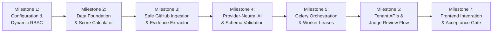

# Scorva — Phase 4 Architectural & Execution Plan
## AI-Powered Hackathon Evaluation Engine

**Document Version:** 1.0  
**Date:** October 26, 2026  
**Status:** **APPROVED ARCHITECTURAL PLAN — PLANNING PHASE**  
**Author:** Lead Software Architect & AI Systems Engineer  
**Scope:** Phase 4 — Submissions, Safe Repository Evidence Extraction, Configurable Rubrics, Provider-Neutral AI Evaluation Engine, Celery Orchestration, Human Judge Review, and AI Operations UI.

---

## 1. Executive Summary & Vision

### 1.1 Product Mission
Scorva is a multi-tenant hackathon management and evaluation platform operating on the core principle:

> **“AI evaluates the evidence. Judges make the decisions. Scorva makes the process transparent.”**

Phase 4 establishes the core value proposition of Scorva: an automated, evidence-backed evaluation engine that ingests project repositories, extracts structured static evidence, evaluates code against frozen multi-criteria rubrics using local or hosted LLMs, produces deterministic scores with verifiable line-level citations, and provides human judges with auditable tools to review, adjust, and approve scores.

### 1.2 Architectural Principles
1. **Evidence-Backed Transparency:** AI is an evidence gatherer and initial evaluator, not an infallible judge. Every score awarded by the model must cite verifiable repository artifacts (file path, commit SHA, line range, or explicit "insufficient evidence" designation).
2. **Deterministic Mathematical Scoring:** LLMs never compute final weighted scores. The model only awards raw criterion scores in bounded ranges. Authoritative weights ($|\sum w_i - 1.0000| \le 0.0001$), normalization formulas, and total score calculations are computed deterministically by the backend using Python `Decimal` and `ROUND_HALF_UP`.
3. **Zero Code Execution Sandbox:** Hackathon submissions contain untrusted, potentially malicious code. Scorva enforces a strict **Zero-Code-Execution** policy in Phase 4. Repositories are analyzed statically via tarball AST parsing, file classification, documentation parsing, and regex pattern matching. Untrusted build scripts (`npm build`, `make`, `cargo build`) and test suites are never executed on Scorva infrastructure.
4. **Immutable Rubric & Commit Snapshots:** Evaluations are bound to an immutable frozen `rubric_version_id` and a frozen git commit SHA. Subsequent edits to hackathon rubrics or repository branches can never silently rewrite historical evaluation results.
5. **Prompt Injection & Adversarial Resilience:** Untrusted repository contents (README files, comments, commit messages, variable names) are isolated in discrete data blocks and never concatenated into system instructions. LLM outputs are validated against strict JSON Schemas; outputs violating schema or score bounds fail closed.
6. **Lease-Fenced Worker Fault Tolerance:** Asynchronous evaluation jobs running on Celery workers are protected by renewable Redis leases, atomic CAS database claims, and fencing tokens. Stalled or crashed workers cannot corrupt database state or overwrite fresh results.
7. **Strict Multi-Tenant Isolation:** Every submission, rubric, evaluation job, evidence record, and judge review is strictly scoped to an `organization_id` and `hackathon_id`. Cross-tenant queries are blocked server-side by the `get_tenant_context` dependency.

---

## 2. Scope Definition & Phase Boundaries

### 2.1 In Scope for Phase 4

| Domain | Key Capabilities Included in Phase 4 |
|---|---|
| **Centralized Configuration** | Typed, schema-validated configuration service with cascading inheritance (Platform -> Org -> Hackathon -> Evaluation Snapshot); 5-tier classification; safe defaults; Redis cache with pub/sub invalidation and monotonic version check; versioned history & rollback; Super Admin dashboard. |
| **Dynamic Granular RBAC** | Granular permission registry (`domain.action`); declarative backend dependency (`require_permission`); multi-tier scoping (Platform, Org, Hackathon, Resource); Super Admin role-permission management UI; least-privilege delegation; prompt Redis cache invalidation with monotonic version fallback. |
| **Participant Identity & Submissions** | Participant role and team association; scoped permissions (`participant.register`, `team.create/join`, `submission.create/update/withdraw`); strict team isolation (cannot read other teams' private repositories or unreleased feedback); server-side deadline enforcement. |
| **Secure GitHub Ingestion** | Public repos via platform token pool; private repos via encrypted credentials in `organization_integrations` (AES-256-GCM); tarball streaming with deterministic quotas (50MB compressed / 250MB uncompressed / 10MB per file / 2000 files max / depth $\le 10$ / path $\le 255$); strict path containment (`Path.is_relative_to`); prohibition of symlinks, hardlinks, FIFOs, and special devices; public IP validation & redirect pinning. |
| **Evidence Extraction & Redaction** | File tree taxonomy classification; documentation parsing; static AST code inspection; test suite presence detection; automated regex-based secret and credential redaction before prompt assembly. |
| **Rubrics & Scoring Engine** | Relational rubric data model with criteria, descriptions, weights, score ranges ($[\text{min\_score}_i, \text{max\_score}_i]$), and evidence requirements; weight sum validation ($|\sum w_i - 1.0000| \le 0.0001$); frozen immutable versions; configurable score normalization (`offset_normalized` vs `raw_proportional`) with Python `Decimal` and `ROUND_HALF_UP`. |
| **AI Provider Abstraction** | Provider-neutral interface (`AIProviderClient` protocol); local Ollama integration; segmented SSRF policy (Profile A public GitHub downloads vs Profile B pinned internal Ollama inference with zero redirects); strict JSON Schema grammar enforcement. |
| **Celery Asynchronous Orchestration** | Celery worker pool with Redis broker; job state machine (`queued`, `running`, `completed`, `failed`, `cancelled`); renewable Redis leases; atomic CAS claims; fencing tokens; crash recovery reaper task; tenant concurrency throttling. |
| **Judge Review & Decision Recording** | Human judge review workflows; criterion-level score adjustments with mandatory rationale ($\ge 20$ chars); audit logging of overrides; permanent preservation of raw AI output alongside human adjustments. |
| **APIs & Frontend Surfaces** | Platform Super Admin Configuration UI (`/admin/settings`), Role & Permission Matrix UI (`/admin/roles-permissions`), and AI Operations UI (`/admin/ai-operations`); Tenant Hackathon evaluation screens (rubric builder, submission table, evaluation report viewer, judge review drawer). |

### 2.2 Explicit Non-Goals (Deferred to Phase 5+)

- **Dynamic Sandboxed Code Execution:** Running untrusted code inside microVMs (Firecracker / gVisor), automated build testing, or execution-based security sandboxes is deferred to Phase 5+.
- **Participant Community & Social Features:** Rich community chat, live team-matching algorithms, and social profiles are deferred to Phase 5+. (Core participant registration, team management, and secure submission intake APIs are fully included in Phase 4).
- **Public Leaderboards & Audience Voting:** Live public leaderboards, public scorecards, and external audience voting portals are deferred to Phase 5.
- **Cross-Submission Plagiarism / Vector Similarity Indexing:** Embedding-based code similarity indexing across all historical submissions is deferred to Phase 5.
- **Stripe Billing & Monetization:** Commercial subscription tiers, evaluation credit purchasing, and payment webhooks remain deferred to Phase 6.

---

## 3. Existing Repository State & Compatibility Assurances

### 3.1 Repository Inventory & Fact-Checking

| Subsystem | Current Codebase Status | Phase 4 Plan & Compatibility Strategy |
|---|---|---|
| **Database Schema** | Head migration `de1a35a5cc94` defines `users`, `user_sessions`, `organizations`, `hackathons`, `organization_memberships`, `audit_events`, and security fallback tables. `org_role_enum` contains `org_owner`, `org_admin`, `organizer`. | Milestone 1 introduces migration `ff171550944b` establishing configuration, granular permissions, dynamic roles, and durable outbox tables without modifying legacy enums. Milestone 2 introduces `0004_phase4_evaluation_schema` for domain evaluation tables. Existing data remains untouched. |
| **FastAPI Backend** | Fully operational on Python 3.14 / 3.11+ with Pydantic v2, SQLAlchemy 2.0 asyncpg, Argon2id, pyotp. | Phase 4 adds `apps/api/modules/configuration`, `permissions`, `rubrics`, `submissions`, `evaluations`, `integrations`, and `workers` following the exact modular architecture. |
| **Authorization Engine** | Hardcoded role guards (`require_platform_role`, `require_org_role`) in `dependencies.py`. | Milestone 1 introduces declarative `require_permission(permission_id, scope)` resolving dynamic role-permission mappings cached in Redis with pub/sub invalidation. |
| **Tenant Isolation** | `get_tenant_context` in `apps/api/dependencies.py` enforces dual-plane authorization and composite queries. | Preserved as an immutable security invariant across all configuration, submission, and evaluation endpoints. |
| **Redis & Broker** | Redis 7 running via Docker; `apps/api/core/redis.py` provides resilient client with Postgres fallback. | Redis serves as configuration/permission cache with pub/sub invalidation, Celery task broker (`redis://localhost:6379/1`), and distributed lease manager. |
| **Ollama Service** | Configured in `docker-compose.yml` (`http://localhost:11434`); health check stub in `apps/api/modules/health/router.py`. | Phase 4 activates live Ollama connectivity via provider abstraction with segmented SSRF validation (Profile B internal pinned access). |
| **Celery Workers** | Planned in `ARCHITECTURE.md` §8; not yet present in codebase or `docker-compose.yml`. | Phase 4 introduces Celery configuration, worker CLI runner, and Docker worker service container. |
| **Next.js Frontend** | Next.js 15 App Router running with dark-first theme, Lucide React, and typed `api-client.ts`. | Phase 4 delivers `/admin/settings` (configuration editor), `/admin/roles-permissions` (permission matrix UI), `/admin/ai-operations`, and tenant evaluation portals. |

### 3.2 Backward-Compatibility Commitments
1. **Database Head Integrity:** The current Alembic head `de1a35a5cc94` is strictly respected. Milestone 1 migration branches cleanly from `de1a35a5cc94` and is fully reversible down to `de1a35a5cc94`.
2. **Enum Evolution Safety:** PostgreSQL allows adding enum values (`ALTER TYPE org_role_enum ADD VALUE 'judge'`) inside transactions in Postgres 12+. Downgrade notes and migration reversibility are tested.
3. **Zero Invalidation of Audit Trail:** Audit events emitted by Phase 4 operations continue writing append-only records to `audit_events`.
4. **No Breaking API Changes:** All existing Phase 2 authentication and Phase 3 organization/hackathon endpoints remain 100% contract-compatible.
5. **Tenant Security Boundaries:** Platform administrators cannot perform tenant-scoped operations without explicit platform role authorization (`PLATFORM_OWNER`, `PLATFORM_OPS_ADMIN`, or `AI_OPS_ADMIN`). Tenant judges cannot access organization administrative actions.

---

## 4. Phase 4 Milestone Roadmap

Phase 4 is broken into **7 small, reviewable, testable milestones** that establish the configuration and dynamic permission infrastructure before domain evaluations are executed:

---

### Milestone 1: Centralized Configuration Engine & Dynamic RBAC Foundation

- **Objective:** Establish the typed configuration service, schema tables, inheritance and precedence engine, granular permission registry, dynamic role-to-permission mappings, and Super Admin configuration/permission management APIs.
- **Non-Goals:** No GitHub ingestion; no LLM evaluation calls; no Celery workers; no submission intake.
- **Deliverables:**
  - Database Schema & Reversible Migration branching cleanly from `de1a35a5cc94`:
    - **Subsystem A (Configuration):** `configuration_settings`, `configuration_overrides`, `configuration_history`.
    - **Subsystem B (Dynamic RBAC & Durable Invalidation):** `permissions`, `roles`, `role_permissions`, `user_role_assignments`, `authz_policy_versions`, `authz_invalidation_outbox`.
    - *PostgreSQL Revision Graph Integrity:* Generates a real Alembic revision branching directly from verified head `de1a35a5cc94` (`down_revision = 'de1a35a5cc94'`).
    - *Architectural Simplifications:* Eliminates `user_effective_permissions` as a persistent table (computed dynamically via indexed SQL join + Redis cached) to prevent drift; eliminates `configuration_rollbacks` (tracked directly in `configuration_history` via `change_type = 'rollback'` and `restored_from_version`); eliminates `configuration_locks` (handled natively via optimistic concurrency `version`).
    - *DDL Safety:* Uses string-backed columns with check constraints for dynamic roles/permissions, preserving atomic transactional rollbacks across all PostgreSQL versions.
  - Dual-Path Resolution Engine (`apps/api/modules/configuration/`):
    - **Path A (Evaluation Configuration Mechanics):** Resolves Hackathon -> Organization -> Platform -> System Safe Default; captures validated snapshot into `submission_snapshots.configuration_snapshot` at job creation for 100% scoring reproducibility.
    - **Path B (Live Authorization & Security):** Real-time enforcement using current user identity, tenant query scoping, active roles, and Tier 5 invariants. Snapshots NEVER grant permissions or override access denials.
  - Authoritative Consistency & Fail-Closed Outage Semantics:
    - Low-risk read operations: Eventual consistency with maximum 30-second bounded staleness.
    - Security-sensitive operations: Authoritative current permission check executed inside the ACID transaction against primary PostgreSQL (`READ COMMITTED` snapshot isolation).
    - Authorization outages: System strictly fails closed (`HTTP 503` or `HTTP 403`), never failing open.
    - Concurrency semantics: Revocation vs. in-progress protected write serialized deterministically without torn states.
  - Two-Phase Limits vs. Immutable Safeguards:
    - Phase 1 (Config-Update Time): Pydantic schemas enforce architectural ceilings; Tier 5 invariants have `is_configurable = FALSE`.
    - Phase 2 (Runtime Execution Time): Ingestion/extraction code enforces hardcoded constants (`ABSOLUTE_MAX_COMPRESSED_BYTES = 100MB`, `ABSOLUTE_MAX_UNCOMPRESSED_BYTES = 500MB`). Path traversal protection (`Path.is_relative_to`), symlink rejection, zero-code execution, and tenant query scoping are hardcoded algorithmic controls with zero toggle flags.
  - Super Admin Delegation Policies & Ceilings:
    - Super Admin controls `allow_org_override`, `allow_hackathon_override`, and permissible `[min_value, max_value]` bounds.
    - Enforces least-privilege delegation boundary: administrators can only delegate permissions they currently hold within their scope (`is_delegable = True`).
  - Immutable Rollback Semantics:
    - Restoring a prior configuration creates a **NEW** version in `configuration_settings` and appends to `configuration_history` with `restored_from_version`.
    - Restored value is strictly re-validated against current schema bounds and security rules.
    - Enforces optimistic concurrency (`version` match) and never mutates historical evaluation snapshots.
  - Durable Versioning & Transactional Outbox:
    - PostgreSQL is the sole durable authority (`authz_policy_versions`).
    - Changes atomically insert into `authz_invalidation_outbox` in the same transaction. An asynchronous relay worker polls outbox events, updates Redis, and broadcasts invalidations with retries.
    - Disconnected worker recovery (L1 flushed on reconnect); WebSocket per-frame re-verification.
  - Serialized Last Platform Owner Lockout Protection:
    - System roles (`is_system = True`) protected from deletion or renaming.
    - Acquired transactional advisory lock (`pg_advisory_xact_lock`) and exclusive row lock (`SELECT id FROM roles WHERE name = 'platform_owner' FOR UPDATE`) strictly serialize concurrent removal/demotion/deactivation attempts, blocking any action that leaves active platform owners $< 1$ with `LAST_PLATFORM_OWNER_LOCKOUT` (`HTTP 400 Bad Request`).
  - Durable Attributable Audit History:
    - Every role grant, permission update, role revocation, and configuration rollback inserts a durable record into `audit_events` and `configuration_history` within the same transaction, protected by PostgreSQL trigger `trg_audit_events_immutable`.
  - Granular RBAC Catalog & Participant Support:
    - Seeds default roles (`platform_owner`, `platform_admin`, `org_owner`, `org_admin`, `organizer`, `judge`, `mentor`, `participant`).
    - Includes complete Participant domain permissions (`participant.register`, `team.create/join`, `submission.create/update/withdraw`, `view_own`).
  - Super Admin Configuration & Permission APIs:
    - `/api/v1/admin/configuration`: List, inspect effective values, update, history, rollback.
    - `/api/v1/admin/roles`: List roles, get permission matrix, update role permissions, history, preview impact.
- **Verification Commands:**
  - `.venv/bin/pytest apps/api/tests/test_configuration_service.py -v`
  - `.venv/bin/pytest apps/api/tests/test_dynamic_rbac_service.py -v`
  - `.venv/bin/pytest apps/api/tests/test_phase4_migrations.py -v`
- **Stop Condition:** Migration upgrades from `de1a35a5cc94` and downgrades cleanly; configuration inheritance resolves correctly; boundary violations fail closed; role permission edits take effect immediately via durable outbox; concurrent owner demotion tests pass.

---

### Milestone 2: Submissions, Rubrics & Deterministic Evaluation Data Foundation (COMPLETED)

- **Objective:** Establish the complete evaluation relational data model, SQLAlchemy domain entities, Alembic migration, secure credential storage entity, and deterministic score normalization engine bound to configuration snapshots.
- **Status:** **Completed & Verified**
- **Non-Goals (Enforced):** Zero network calls to GitHub or Ollama; zero worker execution; zero UI screens.
- **Deliverables:**
  - Database entities (15 relational entities in `apps/api/modules/evaluations/models.py`):
    1. `teams`: Participant teams registered within a hackathon with unique `(hackathon_id, name)` and secure join code.
    2. `team_members`: Individual participant memberships within a team with leader/member roles.
    3. `submissions`: Repository submission records, branch, team metadata, and active uniqueness constraint.
    4. `submission_snapshots`: Immutable frozen git commit SHA, tree SHA, archive metadata, and `configuration_snapshot` JSONB.
    5. `rubrics`: Hackathon-level rubric container with configurable scoring mode.
    6. `rubric_versions`: Immutable frozen version with status (`draft`, `published`, `archived`).
    7. `rubric_criteria`: Criteria with weights, bounds ($[\text{min}, \text{max}]$), and evidence requirements.
    8. `evaluation_jobs`: Asynchronous worker job orchestration, leases, fencing tokens, status.
    9. `evaluation_results`: Authoritative attempt evaluation output, summary assessment, total score.
    10. `evaluation_criterion_scores`: Raw score per criterion, evidence status, and model reasoning.
    11. `evidence_references`: Line-level citation linking scores to file paths and line ranges.
    12. `judge_reviews`: Human judge review records, decision (`accepted`, `adjusted`, `rejected`), overall feedback.
    13. `judge_criterion_scores`: Criterion-level human score adjustments with mandatory rationale.
    14. `organization_integrations`: Dedicated encrypted credential store (AES-256-GCM) for GitHub tokens/App credentials.
    15. `hackathon_judges`: Event-scoped judge assignment mapping `(hackathon_id, user_id)`.
  - Reversible Alembic migration `c053567b0586` (`create_phase4_evaluation_schema`) and remediation migration `d630cee07d82` (`remedy_m2_evaluation_schema_constraints`):
    - Creates the 15 domain tables with strict foreign keys (`ON DELETE RESTRICT` for history, `CASCADE` for child criteria/citations) and composite tenant indexes.
    - Adds foreign key constraint `fk_evaluation_jobs_current_result_id` (`evaluation_jobs.current_result_id` -> `evaluation_results.id`, `ON DELETE SET NULL`).
    - Implements PostgreSQL trigger `trg_rubric_criteria_immutable` executing `check_rubric_version_immutability()` to block INSERT, UPDATE, reparenting, or DELETE of `rubric_criteria` once `rubric_versions.status == 'published'` or `'archived'`.
    - Implements PostgreSQL trigger `trg_rubric_versions_protect` executing `check_rubric_version_lifecycle()` to block deletion or reverting of published rubric versions.
    - Implements PostgreSQL trigger `trg_submission_snapshots_immutable` executing `check_submission_snapshot_immutability()` to freeze `configuration_snapshot`, `organization_id`, `submission_id`, and `commit_sha` against unauthorized mutation.
  - Deterministic score normalization calculator (`apps/api/modules/evaluations/scoring_calculator.py`):
    - Implements configurable scoring modes driven by configuration: Mode A (`offset_normalized`) and Mode B (`raw_proportional`).
    - All arithmetic executed via Python `decimal.Decimal` with explicit `ROUND_HALF_UP` to 2 decimal places; binary `float` strictly prohibited with `TypeError`.
    - Rubric weight sum validator asserting $|\sum w_i - 1.0000| \le 0.0001$ and detecting duplicate criterion IDs.
  - Concurrency hardening:
    - Row-level locking (`SELECT ... FOR UPDATE`) in `publish_rubric_version` on both `RubricVersion` and criteria to prevent weight sum race conditions.
    - Row-level locking and tenant scoping in `add_rubric_criterion`.
- **Verification Commands:**
  - `.venv/bin/pytest apps/api/tests/test_scoring_calculator.py -v`
  - `.venv/bin/pytest apps/api/tests/test_rubric_validation.py -v`
  - `.venv/bin/pytest apps/api/tests/test_evaluation_db_constraints.py -v`
  - `.venv/bin/pytest apps/api/tests/test_evaluation_migrations.py -v`
  - `.venv/bin/pytest apps/api/tests/test_m2_integrity_remediation.py -v`
- **Stop Condition:** Models, calculator, and remediation tests pass all unit, integration, and concurrency tests with zero schema or precision errors; migration chain upgrades cleanly and downgrades without orphan objects. (Verified: 34/34 passing).

---

### Milestone 3: Safe GitHub Repository Ingestion & Evidence Extractor (COMPLETED)

- **Objective:** Implement secure GitHub repository retrieval, commit SHA freezing, encrypted credential management, tarball streaming with strict limits, path containment validation, static AST analysis, and secret redaction.
- **Status:** **Completed & Verified**
- **Non-Goals (Enforced):** Zero code execution; zero test running; zero LLM evaluation calls; zero worker execution.
- **Deliverables:**
  - Secure Credential Architecture (`apps/api/modules/integrations/service.py` & `apps/api/core/security.py`):
    - Rejects raw credential storage in `organizations.settings` JSON via `assert_settings_does_not_contain_credentials`.
    - AES-256-GCM encryption of GitHub PATs / tokens using `ENCRYPTION_MASTER_KEY` via `encrypt_value` and `decrypt_value` with 12-byte random nonces and tag verification.
    - Encrypted at rest in `organization_integrations`, never logged, masked preview (`ghp_****1234`), restricted to `org_owner` and `org_admin`.
    - Transactional audit logging for integration lifecycle (`INTEGRATION_CONFIGURED`, `INTEGRATION_TOKEN_ROTATED`, `INTEGRATION_REVOKED`).
  - GitHub Ingress Download Security & SSRF Protection (`apps/api/core/ssrf_guard.py` & `apps/api/modules/evaluations/github_client.py`):
    - Strict hostname allowlist: ONLY `api.github.com` and `codeload.github.com`.
    - Synchronous DNS pre-resolution (`resolve_and_validate_hostname`): Verifies every resolved IP is a global public unicast IP address (`is_public_unicast_ip`). Rejects RFC 1918, loopbacks, link-local, carrier-grade NAT, and cloud metadata (`169.254.169.254`).
    - Redirect validation: Maximum 3 redirects allowed. Every redirect target MUST have scheme `https://`, host matching `codeload.github.com` or `api.github.com`, destination IP pre-validated as public before connection, and authorization headers stripped across different hosts.
    - IP Pinning: `PinnedAsyncHTTPTransport` wraps `httpcore` to connect sockets directly to pre-resolved public IPs, completely eliminating DNS-rebinding TOCTOU windows while preserving SNI and TLS certificate validation.
    - Resolves and freezes immutable commit SHAs.
  - Safe Extraction Engine (`apps/api/modules/evaluations/safe_extractor.py`):
    - Streaming extraction enforcing deterministic limits:
      - `MAX_COMPRESSED_BYTES = 52_428_800` (50MB)
      - `MAX_UNCOMPRESSED_BYTES = 262_144_000` (250MB)
      - `MAX_SINGLE_FILE_BYTES = 10_485_760` (10MB)
      - `MAX_FILES = 2000`
      - `MAX_DIRECTORY_DEPTH = 10`
      - `MAX_PATH_LENGTH = 255`
    - Path containment verification using `member_path.is_relative_to(target_directory)` blocking all ZipSlip traversal attempts.
    - Complete rejection of symlinks, hardlinks, FIFOs, and character/block devices with `SecurityViolationError`.
    - Scratch isolation with auto-cleanup context manager `ephemeral_extracted_repository`.
  - Evidence Extractor & Secret Masker (`apps/api/modules/evaluations/evidence_indexer.py`):
    - File classifier identifying Documentation, Build Config, Test Suites, and Source Code.
    - Sensitive file exclusion (`.env*`, `*.pem`, `*.key`, `id_rsa*`, `credentials.json`, `.git/`, `node_modules/`, `venv/`).
    - Static extraction of file trees and line-indexed snippets with zero host execution.
    - High-entropy regex secret masking (GitHub tokens, AWS keys, OpenAI/provider API keys, JWTs, password assignments) in code snippets.
    - Secure XML framing (`<UNTRUSTED_REPOSITORY_EVIDENCE>`) isolating untrusted content.
- **Verification Commands:**
  - `.venv/bin/pytest apps/api/tests/test_ssrf_guard.py -v` (4/4 passed)
  - `.venv/bin/pytest apps/api/tests/test_safe_extraction.py -v` (18/18 passed)
  - `.venv/bin/pytest apps/api/tests/test_secret_redaction.py -v` (4/4 passed)
  - `.venv/bin/pytest apps/api/tests/test_integrations_service.py -v` (5/5 passed)
  - `.venv/bin/pytest apps/api/tests/test_github_client.py -v` (6/6 passed)
- **Stop Condition:** Ingestion sandbox demonstrably terminates and discards archives violating any numerical quota or safety rule with zero host filesystem escape. (Verified: 37/37 passing).

---

### Milestone 4: Provider-Neutral AI Engine & Structured Output Validation (COMPLETED)

- **Objective:** Implement a provider-agnostic LLM interface, local Ollama client, hardened segmented SSRF defense, adversarial prompt assembly, and strict JSON Schema output validation.
- **Status:** **Completed & Verified**
- **Non-Goals (Enforced):** No Celery task queue wiring; no human judge overrides.
- **Deliverables:**
  - `AIProviderClient` protocol and `OllamaProviderClient` adapter (`apps/api/modules/evaluations/ai_provider.py`).
  - `MockAIProviderClient` for deterministic, zero-cost CI test suite execution.
  - Segmented SSRF Defense Architecture (`apps/api/core/ssrf_guard.py`):
    - **Profile A (Public Web Egress — GitHub Archive Downloads):** Enforces public IP resolution, blocks all private/loopback/link-local/metadata CIDRs (`169.254.169.254`), pins IPs, enforces port 443 strictly, and re-validates redirects.
    - **Profile B (Internal Inference Egress — AI Providers):** Bound strictly to administrator-configured endpoints (`settings.OLLAMA_BASE_URL`). Validates against explicit internal allowlist (`ALLOWED_INTERNAL_AI_HOSTS = {"ollama", "localhost", "127.0.0.1"}`). Disallows arbitrary user-supplied endpoints. Enforces allowed ports (`11434`, `443`), forbids internal infrastructure ports (5432, 6379, 22, 8000), enforces `follow_redirects=False` with immediate rejection of 3xx redirect status via `ProfileBAsyncHTTPTransport`.
  - Adversarial Prompt Compiler (`apps/api/modules/evaluations/prompt_compiler.py`):
    - Strict structural XML fencing (`<UNTRUSTED_REPOSITORY_EVIDENCE>`) isolating repository files from system instructions with ElementTree escaping.
    - System prompt priming instructing model to ignore embedded instructions.
  - Structured Output Validator (`apps/api/modules/evaluations/output_validator.py`):
    - Validates model output against Pydantic schema `AIEvaluationOutputPayload`.
    - Bounds checking: Asserts awarded scores satisfy $min_i \le S_i \le max_i$. Rejects NaN and Infinity.
    - Criterion presence: Asserts all criteria from frozen rubric version are assessed with zero duplicates or unknown criteria.
    - Citation verification: Cross-checks cited `file_path` and line numbers against evaluated evidence index.
    - Validation failure handling: If model output is malformed, retries once with temperature 0.0; if retry fails, marks evaluation failed with `EVAL_PARSE_ERROR` without accepting partial or hallucinated scores.
    - Missing evidence handling: If evidence is absent, assigns `min_score`, sets `evidence_status = 'missing'`, and outputs explicit reason `"NO_VERIFIABLE_EVIDENCE"`.
- **Verification Commands:**
  - `.venv/bin/pytest apps/api/tests/test_ssrf_guard.py -v` (6/6 passed)
  - `.venv/bin/pytest apps/api/tests/test_ai_provider.py -v` (12/12 passed)
  - `.venv/bin/pytest apps/api/tests/test_prompt_injection_resilience.py -v` (24/24 passed)
- **Stop Condition:** Provider abstraction handles timeouts, malformed outputs, and adversarial injection attempts cleanly without crashing or executing injected instructions. (Verified: 42/42 passing).

---

### Milestone 5: Celery Evaluation Orchestrator, Worker Leases & Fault Tolerance

- **Objective:** Build the background worker orchestration engine using Celery and Redis, with renewable distributed leases, CAS fencing tokens, atomic SQL claims, crash reaper tasks, and tenant concurrency throttles.
- **Non-Goals:** No tenant API exposure; no frontend integration.
- **Deliverables:**
  - Celery application instance (`apps/api/workers/celery_app.py`) with Redis broker (`redis://localhost:6379/1`).
  - Dedicated synchronous SQLAlchemy 2.0 engine for worker processes to eliminate asyncpg event loop conflicts.
  - Pipeline orchestrator executing stages: `repo_acquisition` -> `safe_extraction` -> `evidence_indexing` -> `model_evaluation` -> `output_validation` -> `score_calculation` -> `persistence`.
  - Distributed Lock & Fencing Manager:
    - Renewable Redis lease with 60s TTL and background heartbeat thread renewing every 15s.
    - Atomic database CAS updates verifying `claim_token` and `lock_version`. If another worker updated `lock_version`, 0 rows match and the fenced worker aborts.
  - Crash Recovery Reaper Task (`reap_stalled_evaluation_jobs`):
    - Celery Beat periodic task scanning for jobs in `running` status with heartbeat older than 3 minutes.
    - Requeues jobs with remaining attempts, or transitions to `failed` with `WORKER_HEARTBEAT_TIMEOUT`.
  - Task Deduplication & Idempotency:
    - Uses Redis idempotency keys (`eval:job:{submission_id}:{rubric_version_id}`) preventing duplicate active runs.
  - Tenant concurrency throttling: Enforces max 3 concurrent evaluations per organization.
- **Verification Commands:**
  - `.venv/bin/pytest apps/api/tests/test_worker_leases.py -v` (simulating worker pauses, lease expiry, CAS fencing)
  - `.venv/bin/pytest apps/api/tests/test_evaluation_orchestration.py -v`
  - `.venv/bin/pytest apps/api/tests/test_reaper_task.py -v`
- **Stop Condition:** Simulated worker crashes and network partitions release stale claims without duplicate official evaluations or corrupted state.

---

### Milestone 6: Tenant APIs, Evaluation Lifecycles & Judge Review Workflows

- **Objective:** Expose secure, organization-scoped endpoints for submissions, rubrics, evaluation dispatch, evidence inspection, and judge review decisions, protected by declarative granular permissions.
- **Non-Goals:** No frontend UI changes.
- **Deliverables:**
  - Declarative Permission Enforcement: All tenant endpoints migrate from hardcoded role checks to `require_permission(permission_id, scope)` using the dynamic permission registry.
  - Tenant Rubric APIs: `GET`, `POST`, `PATCH` on `/api/v1/organizations/{org_id}/hackathons/{hackathon_id}/rubrics` (guarded by `rubric.create`, `rubric.update`, `rubric.publish`).
  - Participant & Submission APIs:
    - Participant Registration & Teams: `POST .../participants/register`, `POST .../teams`, `POST .../teams/join` (guarded by `participant.register`, `participant.team.*`).
    - Submission Intake: `POST .../submissions` (guarded by `participant.submission.create` or organizer `submission.create`).
    - Submission Updates: `PUT .../submissions/{id}`, `POST .../submissions/{id}/withdraw` (guarded by `participant.submission.update/withdraw`).
    - Strict Isolation & Deadline Enforcement: Rejects edits if `now() > hackathon.submission_deadline` (`SUBMISSION_DEADLINE_PASSED`); query filters strictly block participants from viewing other teams' submissions (`WHERE team_id = :user_team_id`).
  - Tenant Evaluation APIs: Trigger evaluation (`POST .../evaluations`), view status and results (`GET .../evaluations/{id}`), cancel in-flight evaluation (`POST .../evaluations/{id}/cancel`), retry failed evaluation (`POST .../evaluations/{id}/retry`).
  - Judge Review APIs: Submit review adjustments (`POST .../evaluations/{id}/judge-review`) guarded by `judge.score_override` with configuration-driven mandatory rationale length checks.
  - Integration APIs: Manage encrypted credentials (`POST /integrations/github`, `DELETE /integrations/github/{id}`) guarded by `integration.github.configure`.
  - Audit logging: Transactional emission of `RUBRIC_PUBLISHED`, `EVALUATION_DISPATCHED`, `EVALUATION_CANCELLED`, `JUDGE_REVIEW_SUBMITTED`, `SCORE_OVERRIDDEN`, `INTEGRATION_CONFIGURED`.
- **Verification Commands:**
  - `.venv/bin/pytest apps/api/tests/test_evaluation_tenant_apis.py -v`
  - `.venv/bin/pytest apps/api/tests/test_judge_reviews.py -v`
  - `.venv/bin/pytest apps/api/tests/test_evaluation_tenant_isolation.py -v`
  - `.venv/bin/pytest apps/api/tests/test_judge_permissions.py -v`
- **Stop Condition:** Cross-tenant access is blocked with HTTP 403/404; permissions enforced dynamically from registry; judge overrides preserve raw AI scores alongside adjustments.

---

### Milestone 7: Frontend Integration, Super Admin Dashboards & End-to-End Acceptance

- **Objective:** Deliver the Super Admin Configuration Editor (`/admin/settings`), Roles & Permissions Management Matrix (`/admin/roles-permissions`), AI Operations UI (`/admin/ai-operations`), tenant evaluation views, judge adjustment drawer, and complete end-to-end acceptance verification.
- **Deliverables:**
  - Super Admin Configuration Dashboard (`/admin/settings`):
    - Category filtering, search, current effective value vs default value.
    - Safe inline editing with range validation, impact preview, confirmation modal, and rollback button.
    - Inheritance visualizer showing whether value is platform-defined or tenant-overridden.
  - Super Admin Roles & Permission Matrix UI (`/admin/roles-permissions`):
    - Full matrix grid of roles vs. granular permissions.
    - Toggles for configurable permissions with clear indicators for mandatory security invariants.
    - Role creation, permission preview, impact confirmation, and policy rollback.
  - Super Admin AI Operations screen (`/admin/ai-operations`): live job queue, worker pool telemetry, failure inspection, and retry modal.
  - Tenant evaluation interface: rubric builder, submission list with evaluation status badges, full evidence citation inspector (code viewer with line highlights), and judge review drawer.
  - Frontend TypeScript contracts updated with configuration schemas, permission catalogs, and evaluation response models.
  - End-to-end regression test suite verifying the complete flow from configuration edit to submission evaluation to judge signoff.
- **Verification Commands:**
  - `npm run typecheck --prefix apps/web`
  - `npm run build --prefix apps/web`
  - `npm test --prefix apps/web`
  - `.venv/bin/pytest apps/api/tests -v` (Full platform suite)
- **Stop Condition:** 100% backend regression and frontend quality gates pass with zero console errors or TypeScript defects.

---

## 5. Risk Assessment, Explicit Bounds & Residual Risks

| Risk Scenario | Deterministic Threshold / Limit | Mitigation Strategy | Residual Risk & Human Defense |
|---|:---:|---|---|
| **Archive Decompression Bomb** | 50MB compressed / 250MB uncompressed / 10MB single file / 2000 files | Streaming byte counter aborts download/extraction immediately upon threshold breach. | Zero disk space exhaustion. Residual risk: Extremely large valid repositories cannot be evaluated automatically (requires manual judge review). |
| **Path Traversal & Symlink Escapes** | Path length $\le 255$, depth $\le 10$, zero symlinks/devices | `Path.is_relative_to` verification on every member; POSIX tar header flag checks. | Zero filesystem escape. Residual risk: None for filesystem integrity. |
| **Server-Side Request Forgery (SSRF)** | Pinned public IPs (GitHub) / Pinned internal allowlist (Ollama) | Profile A blocks all private/cloud metadata IPs and verifies redirects; Profile B disallows redirects entirely. | Zero metadata credential theft. Residual risk: Third-party GitHub CDN IP changes handled via re-resolution before pinning. |
| **Prompt Injection via Repository Text** | Structural XML fencing & strict JSON Schema grammar | Untrusted text fenced in `<UNTRUSTED_REPOSITORY_EVIDENCE>`; LLM cannot output freeform text or alter criteria. | **Residual Risk:** Complex adversarial phrasing may influence subjective scoring nuance. Mitigated by score bounds clamping, line citation verification, and mandatory human judge signoff. |
| **Credential & Secret Leakage** | Regex redactor & file blacklist | Sanitizes tokens (`ghp_`, `AKIA`, JWTs) and excludes `.env`/`.pem` files; evidence snippets capped at 500 chars. | **Residual Risk:** Non-standard high-entropy secrets not matching known regex patterns could appear in snippets. Mitigated by restricting snippet visibility to authorized tenant judges. |
| **Worker Crash & Race Conditions** | 60s lease TTL, 15s heartbeat, 3m reaper timeout | Atomic CAS database updates on `(claim_token, lock_version)`; fenced workers abort with 0 rows updated. | Zero duplicate evaluation records or overwritten results. |
| **Model Hallucination of Citations** | File existence and line range checks | Backend verifies that cited files and lines exist in the evaluated snapshot commit tree. | Invalid citations marked `UNVERIFIED_EVIDENCE`; score clamped or flagged for human review. |
