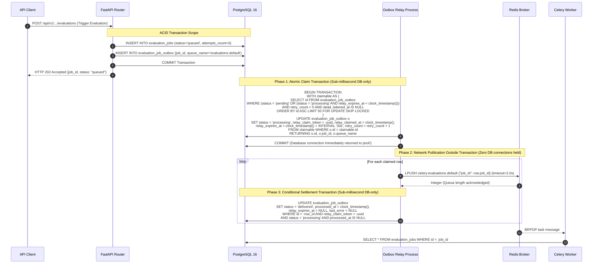
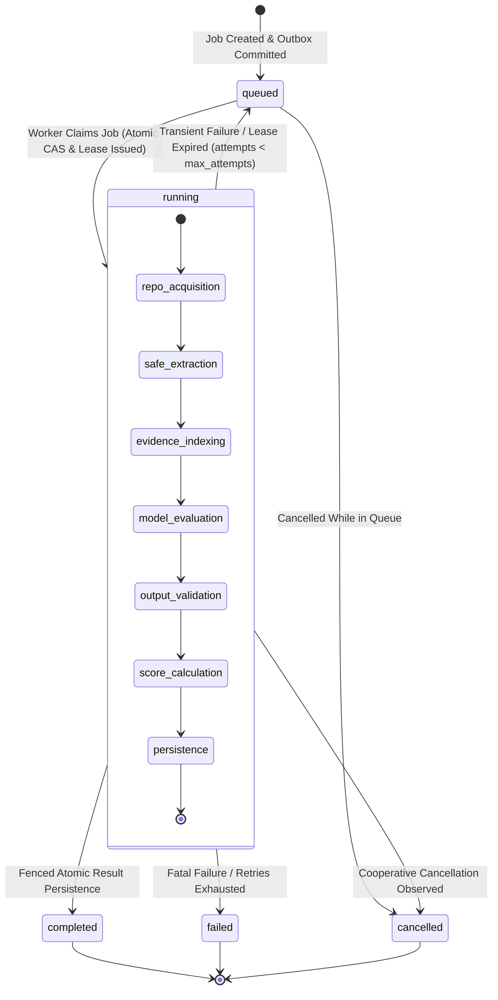
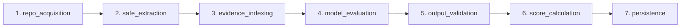

# Scorva Phase 4 Milestone 5 — Architecture Specification
## Celery Evaluation Orchestrator, Worker Leases & Fault Tolerance

**Document Version:** 1.0  
**Date:** October 26, 2026  
**Status:** **PLANNING ONLY — STRICTLY AUTHORIZED FOR PLANNING & THREAT MODELING**  
**Milestone 5 Implementation Status:** **BLOCKED & UNAUTHORIZED**  
**Author:** Lead Software Architect & Distributed Systems Engineer  
**Reference Invariants:** `docs/PHASE_4_ARCHITECTURE.md`, `docs/PHASE_4_M4_POST_REMEDIATION_READ_ONLY_AUDIT.md`

---

## 1. System Topology & Architectural Overview

Milestone 5 establishes an asynchronous, horizontally scalable worker tier decoupled from the synchronous HTTP request/response cycle. It bridges the FastAPI monolith and the compute-heavy static analysis and AI evaluation pipeline.

### 1.1 Physical & Process Architecture

```mermaid
flowchart TD
    subgraph ClientPlane ["Client Plane"]
        Client["Browser / API Client"]
    end

    subgraph APIPlane ["API Server Process (FastAPI / asyncpg)"]
        Router["Evaluation Dispatch Router"]
        DBAsync["Async SQLAlchemy Session (asyncpg)"]
        OutboxRelay["Evaluation Outbox Relay (Background Loop)"]
    end

    subgraph DataPlane ["Persistence & Message Broker Tier"]
        Postgres[("PostgreSQL 16 Primary DB<br/>• evaluation_jobs<br/>• evaluation_job_outbox<br/>• evaluation_results<br/>• audit_events")]
        RedisBroker[("Redis 7 Instance<br/>• Celery Queues<br/>• Tenant Semaphores<br/>• Pub/Sub Invalidation")]
    end

    subgraph WorkerPlane ["Background Worker Plane (Celery / Sync SQLAlchemy)"]
        CeleryWorker["Celery Worker Process (Prefork / Solo)"]
        LeaseManager["Worker Lease & Heartbeat Manager"]
        SyncDB["Sync SQLAlchemy Session (psycopg2 / NullPool)"]
        Pipeline["Evaluation Pipeline Orchestrator"]
        SSRFProfileB["SSRF Guard (Profile B Pinned Transport)"]
        SafeExtractor["Static Archive Extractor (Zero-Code-Exec)"]
    end

    subgraph InferencePlane ["Inference & Egress Tier"]
        OllamaNode["Ollama Server (Local Docker Network)"]
        GitHubEgress["GitHub API / Tarball Download (Profile A)"]
    end

    Client -->|POST /evaluations| Router
    Router -->|1. Insert Job & Outbox Record| DBAsync
    DBAsync -->|2. COMMIT Transaction| Postgres
    OutboxRelay -->|3. Read Pending Outbox Rows| Postgres
    OutboxRelay -->|4. LPUSH Celery Task Message| RedisBroker
    RedisBroker -->|5. BRPOP Task Message (job_id)| CeleryWorker
    CeleryWorker -->|6. Atomic Claim & Lease| SyncDB
    SyncDB --> Postgres
    LeaseManager -->|7. Heartbeat Renewal| SyncDB
    Pipeline --> SafeExtractor
    SafeExtractor --> GitHubEgress
    Pipeline --> SSRFProfileB
    SSRFProfileB --> OllamaNode
    Pipeline -->|8. Atomic Fenced Result Commit| SyncDB
```

---

## 2. Task Orchestration & Dual-Write Elimination

### 2.1 The Distributed Dual-Write Dilemma
In distributed architectures, coordinating a database write with a message broker dispatch is inherently vulnerable to partial failures:
- **Case 1 (Commit First, Publish Second):** The API server commits the `evaluation_jobs` record to PostgreSQL, but crashes, loses power, or suffers a network timeout before publishing the task to Redis. The job remains permanently stuck in `queued` status.
- **Case 2 (Publish First, Commit Second):** The API server publishes the task to Redis, but the database transaction rolls back (e.g., serialization failure or constraint violation). The worker consumes the task, queries PostgreSQL for `job_id`, finds nothing, and fails with an orphan error.

### 2.2 Transactional Outbox Pattern for Evaluations (Approach 2: Two-Phase Persisted Lease)
Scorva eliminates dual writes by adapting its proven transactional outbox architecture (operating in [`apps/api/modules/rbac/outbox.py`](file:///home/shubh/scorva/apps/api/modules/rbac/outbox.py)) to evaluation job dispatch, enhanced with the **Two-Phase Persisted Relay Lease Protocol (Approach 2)**.

To completely prevent PostgreSQL connection pool starvation and long-held row locks, **network publication to Redis is decoupled from database transactions**:



#### Proposed `evaluation_job_outbox` Table Definition
```sql
CREATE TABLE evaluation_job_outbox (
    id BIGSERIAL PRIMARY KEY,
    job_id UUID NOT NULL REFERENCES evaluation_jobs(id) ON DELETE CASCADE,
    organization_id UUID NOT NULL REFERENCES organizations(id) ON DELETE RESTRICT,
    queue_name VARCHAR(50) NOT NULL DEFAULT 'evaluations.default',
    routing_key VARCHAR(50) NOT NULL DEFAULT 'evaluations.default',
    payload JSONB NOT NULL DEFAULT '{}',
    status VARCHAR(20) NOT NULL DEFAULT 'pending',
    relay_claim_token UUID NULL,
    relay_claimed_at TIMESTAMPTZ NULL,
    relay_expires_at TIMESTAMPTZ NULL,
    retry_count INTEGER NOT NULL DEFAULT 0,
    claim_count INTEGER NOT NULL DEFAULT 0,
    publish_attempts INTEGER NOT NULL DEFAULT 0,
    dispatch_generation INTEGER NOT NULL DEFAULT 1,
    last_error TEXT NULL,
    dead_lettered_at TIMESTAMPTZ NULL,
    dead_letter_reason VARCHAR(100) NULL,
    created_at TIMESTAMPTZ NOT NULL DEFAULT clock_timestamp(),
    processed_at TIMESTAMPTZ NULL,
    
    CONSTRAINT chk_outbox_status 
        CHECK (status IN ('pending', 'processing', 'delivered', 'dead_lettered'))
);

-- Partial unique index guaranteeing at most ONE active dispatch per job
CREATE UNIQUE INDEX uq_eval_job_outbox_active_dispatch
ON evaluation_job_outbox (job_id)
WHERE status IN ('pending', 'processing');

-- Partial index covering claimable rows (pending or expired processing)
CREATE INDEX ix_eval_job_outbox_claimable 
ON evaluation_job_outbox (status, claim_count, relay_expires_at, id) 
WHERE dead_lettered_at IS NULL AND processed_at IS NULL;

-- Index for clean cascading deletes and job lookups
CREATE INDEX ix_eval_job_outbox_job_id 
ON evaluation_job_outbox (job_id);
```

### 2.3 Zero-Trust Task Payloads
Celery task messages are intentionally **lean**. The task payload contains only:
```json
{
  "job_id": "a1b2c3d4-e5f6-7890-abcd-ef1234567890",
  "dispatched_at": "2026-10-26T17:00:00Z"
}
```
**Security Principle:** Workers **never** trust the message payload for tenant context, repository URLs, rubric versions, or configuration overrides. Upon receiving `job_id`, the worker executes a tenant-scoped SQL query to rehydrate authoritative immutable state from PostgreSQL:
- `submission_snapshot_id` $\rightarrow$ frozen commit SHA, frozen repo URL.
- `rubric_version_id` $\rightarrow$ frozen criteria, weights, score ranges.
- `configuration_snapshot` $\rightarrow$ frozen execution settings.

---

## 3. Evaluation-Job State Machine

### 3.1 State Definitions
The evaluation job progresses through a strictly validated lifecycle:



### 3.2 State Transition Matrix & Transition Guards

| Current State | Target State | Trigger / Event | Transition Guard & Validation Rule |
| :--- | :--- | :--- | :--- |
| **`[INITIAL]`** | `queued` | API Job Dispatch | DB commit of `evaluation_jobs` + `evaluation_job_outbox` in same transaction. |
| `queued` | `running` | Worker Claim | `UPDATE evaluation_jobs SET status = 'running', claim_token = :token, lock_version = lock_version + 1, started_at = clock_timestamp(), last_heartbeat_at = clock_timestamp(), lease_expires_at = clock_timestamp() + INTERVAL '60s', attempts_count = attempts_count + 1 WHERE id = :job_id AND status = 'queued'`. Must match 1 row. |
| `queued` | `cancelled` | User Cancellation | `UPDATE evaluation_jobs SET status = 'cancelled', completed_at = clock_timestamp() WHERE id = :job_id AND status = 'queued'`. |
| `running` | `running` | Stage Checkpoint / Heartbeat | Worker holds valid `claim_token` AND current `lock_version`. Updates `last_heartbeat_at = clock_timestamp(), lease_expires_at = clock_timestamp() + INTERVAL '60s'`. |
| `running` | `completed` | Pipeline Succeeded | Step 2 pessimistic `SELECT ... FOR UPDATE` acquires row lock, Step 3 verifies status, claim_token, lock_version, and `lease_expires_at > clock_timestamp()`, followed by atomic child insertions and `status = 'completed', completed_at = clock_timestamp()`. |
| `running` | `queued` | Transient Failure / Stale Reaper | `attempts_count < max_attempts`. Reaper resets `status = 'queued', claim_token = NULL, lease_expires_at = NULL, lock_version = lock_version + 1`, and atomically inserts a new `evaluation_job_outbox` record in the same transaction to trigger Redis re-dispatch. |
| `running` | `failed` | Fatal Failure / Exhaustion | Security violation (SSRF, path traversal) OR `attempts_count >= max_attempts`. Sets `status = 'failed', completed_at = clock_timestamp(), error_code = :code`. |
| `running` | `cancelled` | Cooperative Cancel | In-flight worker detects cancellation flag or DB status `cancelled` at stage boundary; worker aborts without persisting results. |
| **`completed`** | *ANY* | *Disallowed* | **Terminal state.** PostgreSQL check constraint & application logic prohibit reopening completed evaluations. |
| **`failed`** | *ANY* | *Disallowed* | **Terminal state.** Retrying a failed evaluation creates a **NEW** `evaluation_jobs` row; history remains immutable. |
| **`cancelled`** | *ANY* | *Disallowed* | **Terminal state.** Cancelled evaluations are immutable. |

---

## 4. Renewable Distributed Leases & Monotonic Fencing Tokens

### 4.1 The Fundamental Flaw of Pure Distributed Locks
In his seminal work on distributed systems, Martin Kleppmann demonstrated that **distributed locks alone (e.g. Redis Redlock or simple TTL keys) cannot guarantee mutual exclusion in asynchronous systems**. 

Consider the "Zombie Worker" failure scenario:
1. Worker 1 acquires a 60-second lease to evaluate Job A.
2. Worker 1 experiences an unexpected 70-second pause (garbage collection pause, memory paging, CPU starvation, or network partition).
3. The lease expires in Redis and PostgreSQL.
4. The Reaper task notices the expired lease and requeues Job A.
5. Worker 2 claims Job A, runs inference, and writes results to PostgreSQL.
6. Worker 1 suddenly wakes up from its pause. Unaware that its lease expired, Worker 1 writes its stale result to PostgreSQL, overwriting Worker 2's authoritative result.

### 4.2 Fencing Token Protocol Specification
Scorva solves this fundamentally by pairing **renewable leases** with **storage-enforced monotonic fencing tokens**:

```mermaid
sequenceDiagram
    autonumber
    participant W1 as Worker 1 (Stale)
    participant DB as PostgreSQL 16
    participant Reaper as Celery Beat Reaper
    participant W2 as Worker 2 (Replacement)

    Note over W1,DB: Worker 1 Claims Job A
    W1->>DB: UPDATE evaluation_jobs SET status='running', lock_version=1, claim_token='W1_UUID',<br/>lease_expires_at = clock_timestamp() + INTERVAL '60s'<br/>WHERE id=Job_A AND status='queued'
    DB-->>W1: 1 Row Updated (Assigned lock_version = 1)
    
    Note over W1: Worker 1 enters severe process pause / network partition (75s)...<br/>Heartbeat thread fails to renew lease.

    Note over Reaper,DB: Lease Expired (60s TTL elapsed)
    Reaper->>DB: SELECT id FROM evaluation_jobs WHERE status='running' AND lease_expires_at < clock_timestamp() FOR UPDATE SKIP LOCKED
    DB-->>Reaper: Job_A identified as stale
    Note over Reaper,DB: Atomic Requeue Transaction
    Reaper->>DB: UPDATE evaluation_jobs SET status='queued', lock_version=2, claim_token=NULL, lease_expires_at=NULL<br/>WHERE id=Job_A AND lock_version=1 AND status='running'
    Reaper->>DB: INSERT INTO evaluation_job_outbox (job_id, queue_name, status='pending')
    Reaper->>DB: COMMIT Transaction (Both job requeue and outbox row committed atomically)
    DB-->>Reaper: 1 Job Requeued & Outbox Row Inserted (lock_version incremented to 2)

    Note over DB,W2: Outbox Relay publishes to Redis; Worker 2 consumes from Redis
    Note over W2,DB: Worker 2 Claims Job A
    W2->>DB: UPDATE evaluation_jobs SET status='running', lock_version=3, claim_token='W2_UUID',<br/>lease_expires_at = clock_timestamp() + INTERVAL '60s'<br/>WHERE id=Job_A AND status='queued'
    DB-->>W2: 1 Row Updated (Assigned lock_version = 3)
    W2->>DB: [Atomic Commit Protocol]<br/>1. SELECT ... FOR UPDATE (Acquires row lock)<br/>2. Verify in-lock guards (passes)<br/>3. INSERT results + UPDATE evaluation_jobs status='completed', lock_version=4
    DB-->>W2: Success! Results Committed.

    Note over W1,DB: Worker 1 Resumes & Attempts Commit
    W1->>DB: BEGIN TRANSACTION<br/>SELECT id, status, lock_version FROM evaluation_jobs WHERE id=Job_A FOR UPDATE
    DB-->>W1: Row returned: status='completed', lock_version=4
    Note over W1: GUARD CHECK FAILS: Status is 'completed' and lock_version is 4 (expected 1)!
    W1->>DB: ROLLBACK
    Note over W1: Worker 1 terminates cleanly with zero side-effects.
```

### 4.3 Database-Authoritative Time
To prevent local worker clock drift or frozen transaction-start timestamps from invalidating leases:
- Workers **never** evaluate lease expiration against `time.time()` or local system clocks.
- All lease deadlines and comparisons use PostgreSQL's instantaneous server clock:
  `lease_expires_at = clock_timestamp() + INTERVAL ':ttl_seconds seconds'`
- Lease expiry checks strictly compare:
  `WHERE lease_expires_at < clock_timestamp()`
- In contrast to `CURRENT_TIMESTAMP` (which freezes at transaction start time), `clock_timestamp()` reflects real-time CPU clock execution, ensuring that transactions paused or delayed mid-execution never evaluate stale timestamps.

---

## 5. Idempotency & Atomic Multi-Table Result Persistence

### 5.1 Request Idempotency vs. Intentional Re-Evaluation

Scorva formally decouples **HTTP Request Idempotency** from **Intentional Submission Re-Evaluation**:

#### 1. Client Request Idempotency (`idempotency_key`)
- **Purpose:** Protects against duplicated API requests caused by network retries, double-clicks, or connection resets.
- **Scope & Constraint:** Enforced via a global unique index on `evaluation_jobs` across **all job states**:
  ```sql
  CREATE UNIQUE INDEX uq_eval_jobs_organization_idempotency_key
  ON evaluation_jobs (organization_id, idempotency_key)
  WHERE idempotency_key IS NOT NULL;
  ```
- **Retrying a Request:**
  - While the job is `queued` or `running`: The API returns `HTTP 200 OK` (or `202 Accepted`) with the existing in-flight `job_id`.
  - After the job reaches a terminal state (`completed`, `failed`, `cancelled`): The API returns `HTTP 200 OK` with the original `job_id`, established outcome, final scores, and header `Idempotent-Replay: true`. It **never** spawns a duplicate evaluation.
- **Normalization:** Client `Idempotency-Key` headers are normalized (`client:<value>`). Requests without headers receive a unique tracking token (`server:<uuid>`) so one-off calls never collide.

#### 2. Intentional Submission Re-Evaluation
- **Purpose:** Allows organizers to intentionally re-evaluate a submission (e.g. after updating an evaluation rubric or manual re-scoring).
- **Mechanism:** Explicit API endpoint:
  `POST /api/v1/organizations/{org_id}/submissions/{submission_id}/reevaluate`
- **Behavior:**
  1. Resolves the latest completed evaluation for `submission_id` (Job 1).
  2. Creates a **new `evaluation_jobs` record** (Job 2) with a fresh `job_id`.
  3. Sets `reevaluation_of_job_id = Job_1.id`.
  4. Assigns a fresh idempotency key (client-provided or `reeval:Job_1.id:<uuid>`).
  5. Inserts a new outbox record and commits in the same transaction.
  6. Job 1 remains completely immutable with its historical criterion scores and citations.

### 5.2 The Authoritative 7-Step Result-Commit Protocol
When the evaluation pipeline reaches the `persistence` stage, all child entities and the job state mutation are committed in a **single ACID transaction** governed by pessimistic row locking (`SELECT ... FOR UPDATE`):

```python
async def persist_evaluation_result_atomic(
    session: AsyncSession,
    job_id: uuid.UUID,
    claim_token: str,
    expected_lock_version: int,
    result_data: EvaluationResultInput,
) -> uuid.UUID:
    """
    Authoritative 7-step atomic result commitment protocol.
    Guarantees that a stale, expired, or cancelled worker never commits any partial
    result, and serializes cleanly against concurrent Reaper or cancellation transactions.
    """
    async with session.begin():
        # Step 1 & 2: Acquire exclusive pessimistic row lock on evaluation_jobs
        stmt_lock = (
            select(EvaluationJob)
            .where(EvaluationJob.id == job_id)
            .with_for_update()
        )
        job = (await session.execute(stmt_lock)).scalar_one_or_none()
        if not job:
            raise EvaluationJobNotFoundException(f"Job {job_id} does not exist.")

        # Step 3: In-lock guard verification against instantaneous database clock
        now_clock = await session.scalar(select(func.clock_timestamp()))
        if job.status != "running":
            raise StaleWorkerFencedException(f"Job {job_id} is not running (status: {job.status}).")
        if job.claim_token != claim_token:
            raise StaleWorkerFencedException(f"Claim token mismatch for job {job_id}.")
        if job.lock_version != expected_lock_version:
            raise StaleWorkerFencedException(
                f"Fencing token mismatch for job {job_id}: DB={job.lock_version}, expected={expected_lock_version}."
            )
        if getattr(job, "cancellation_requested", False):
            raise EvaluationCancelledException(f"Job {job_id} cancellation was requested.")
        if job.lease_expires_at is not None and job.lease_expires_at <= now_clock:
            raise LeaseExpiredException(
                f"Worker lease expired: deadline={job.lease_expires_at}, clock={now_clock}."
            )

        # Step 4: Insert parent evaluation_results row
        result = EvaluationResult(
            job_id=job_id,
            organization_id=result_data.organization_id,
            hackathon_id=result_data.hackathon_id,
            submission_id=result_data.submission_id,
            snapshot_id=result_data.snapshot_id,
            rubric_version_id=result_data.rubric_version_id,
            attempt_number=job.attempts_count,
            model_provider=result_data.model_provider,
            model_name=result_data.model_name,
            prompt_version=result_data.prompt_version,
            raw_score=result_data.raw_score,
            normalized_score=result_data.normalized_score,
            summary_assessment=result_data.summary_assessment,
            has_insufficient_evidence=result_data.has_insufficient_evidence,
        )
        session.add(result)
        await session.flush()

        # Step 5: Insert child criterion scores and evidence references
        for c in result_data.criterion_scores:
            score_row = EvaluationCriterionScore(
                evaluation_result_id=result.id,
                criterion_id=c.criterion_id,
                awarded_score=c.awarded_score,
                normalized_criterion_score=c.normalized_criterion_score,
                confidence_score=c.confidence_score,
                rationale=c.rationale,
                evidence_status=c.evidence_status,
            )
            session.add(score_row)
            await session.flush()

            for ref in c.evidence_references:
                ref_row = EvidenceReference(
                    criterion_score_id=score_row.id,
                    file_path=ref.file_path,
                    start_line=ref.start_line,
                    end_line=ref.end_line,
                    snippet=ref.snippet,
                    is_verified_in_repo=ref.is_verified,
                )
                session.add(ref_row)

        # Step 6: Mutate job status, link current result, and increment fencing token
        job.status = "completed"
        job.current_result_id = result.id
        job.current_stage = "persistence"
        job.completed_at = now_clock
        job.lock_version = expected_lock_version + 1

        # Insert audit log event
        audit_entry = AuditEvent(
            organization_id=result_data.organization_id,
            action="evaluation.completed",
            entity_type="evaluation_job",
            entity_id=str(job_id),
            details={"result_id": str(result.id), "raw_score": str(result_data.raw_score)},
        )
        session.add(audit_entry)

        # Step 7: Transaction commits atomically when context manager exits cleanly.
        # If any exception occurs before this point, session.begin() executes ROLLBACK.

    return result.id
```

---

## 6. Pipeline Execution Stages & Worker Isolation

The worker executes 7 discrete stages sequentially. Each stage boundary checks for cancellation:



1. **`repo_acquisition`:** Invokes [`github_client.py`](file:///home/shubh/scorva/apps/api/modules/evaluations/github_client.py) using Profile A SSRF guard to stream repository tarball into worker local memory/scratch storage.
2. **`safe_extraction`:** Invokes [`safe_extractor.py`](file:///home/shubh/scorva/apps/api/modules/evaluations/safe_extractor.py) enforcing path containment, quota checks (max 1000 files, max 50MB compressed / 250MB uncompressed), symlink rejection, and zero code execution.
3. **`evidence_indexing`:** Invokes [`evidence_indexer.py`](file:///home/shubh/scorva/apps/api/modules/evaluations/evidence_indexer.py) to catalog files, classify taxonomy, and format XML evidence tags with control character sanitization.
4. **`model_evaluation`:** Invokes [`ai_provider.py`](file:///home/shubh/scorva/apps/api/modules/evaluations/ai_provider.py) (`OllamaProviderClient`) over Profile B SSRF-guarded pinned transport with JSON Schema grammar constraints and incremental chunk streaming.
5. **`output_validation`:** Invokes [`output_validator.py`](file:///home/shubh/scorva/apps/api/modules/evaluations/output_validator.py) asserting Pydantic schema adherence, score bounds, missing evidence enforcement, and line citation verification against indexed repository files.
6. **`score_calculation`:** Invokes [`scoring_calculator.py`](file:///home/shubh/scorva/apps/api/modules/evaluations/scoring_calculator.py) to compute weighted criteria scores and total final score using exact Python `decimal.Decimal` arithmetic.
7. **`persistence`:** Executes atomic multi-table transaction committing `evaluation_results` and updating `evaluation_jobs` status to `completed` with CAS fencing token verification.

---

## 7. Retry Classification & Failure Taxonomy

Failures are partitioned into distinct classes with explicit ownership and backoff policies:

| Failure Class | Example Exception | Layer Owner | Retryable? | Max Attempts | Backoff & Jitter Policy |
| :--- | :--- | :---: | :---: | :---: | :--- |
| **Model Schema Parse** | `AIProviderFormatError` | In-Worker (M4) | **YES** | 1 (Separate) | Immediate single retry with schema-correction prompt. |
| **Provider Timeout** | `AIProviderTimeoutError` | Task Orchestrator | **YES** | 3 | Exponential: $T = 15 \times 2^{\text{attempt}} \pm \text{jitter}$ (15s, 30s, 60s). |
| **Network / Connection** | `AIProviderConnectionError`, `RedisConnectionError` | Task Orchestrator | **YES** | 3 | Exponential with full jitter: $T = 5 \times 2^{\text{attempt}} + \text{rand}(0, 5)$. |
| **Ollama Service 503** | `HTTPStatusError(503)` | Task Orchestrator | **YES** | 3 | Exponential backoff (30s, 60s, 120s). |
| **Worker Lease Expiry** | `WorkerLeaseExpiredException` | Reaper Task | **YES** | 3 | Requeued by reaper when heartbeat expires; backoff = 0. |
| **DB Concurrency Conflict**| `DBAPIError` (Serialization/Deadlock) | Task Orchestrator | **YES** | 3 | Immediate retry with jitter: $\text{rand}(1, 5)\text{s}$. |
| **SSRF Policy Violation** | `SSRFViolationError` | Task Orchestrator | **NO** | 0 | **TERMINAL FAILURE.** Marks `failed` (`SSRF_VIOLATION`). |
| **Archive Bomb / Symlink**| `ArchiveExtractionViolation` | Task Orchestrator | **NO** | 0 | **TERMINAL FAILURE.** Marks `failed` (`EXTRACT_VIOLATION`). |
| **Oversized Response** | `AIProviderResponseSizeError`| Task Orchestrator | **NO** | 0 | **TERMINAL FAILURE.** Marks `failed` (`RESPONSE_TOO_LARGE`). |
| **Configuration Error** | `AIProviderConfigError` | Task Orchestrator | **NO** | 0 | **TERMINAL FAILURE.** Marks `failed` (`INVALID_CONFIG`). |
| **Stale Fenced Worker** | `StaleWorkerFencedException` | Worker | **NO** | 0 | **TERMINAL ABORT.** Worker exits cleanly; replacement worker handles job. |

---

## 8. Cancellation & Shutdown Protocol

### 8.1 Cooperative Cancellation Semantics
1. When an organizer or administrator requests cancellation (`POST /evaluations/{id}/cancel`):
   - If the job is `queued`, its status is immediately updated to `cancelled` in PostgreSQL.
   - If the job is `running`, its status is updated to `cancel_requested` (or `cancelled`).
2. Workers execute cooperative cancellation checks at every pipeline stage boundary and every heartbeat cycle:
   ```python
   if await is_cancellation_requested(job_id):
       logger.info("Evaluation %s cancelled by user. Terminating pipeline.", job_id)
       await cleanup_scratch_files(scratch_dir)
       return
   ```
3. If an inference request to Ollama is actively in flight across the network and cannot be terminated immediately, the worker discards the response upon arrival because the subsequent CAS result commit will check `status = 'running'` and fail.

### 8.2 Graceful Worker Shutdown (SIGTERM / SIGINT)
- When Celery receives `SIGTERM`, it enters warm shutdown: stops consuming new tasks from Redis and allows active tasks to complete within `eval.task_soft_time_limit_seconds` (300s).
- If the hard limit `eval.task_time_limit_seconds` (360s) is reached, Celery terminates the task process. The lease in PostgreSQL expires after 60s, and the Reaper task safely recovers the job.

---

## 9. Observability, Logging & Secret Redaction

### 9.1 Structured Logging Context
Every worker log line automatically injects standard correlation fields via a custom logging filter:
```json
{
  "timestamp": "2026-10-26T17:15:30.123Z",
  "level": "INFO",
  "logger": "scorva.evaluations.worker",
  "message": "Model evaluation output validated successfully",
  "context": {
    "job_id": "a1b2c3d4-e5f6-7890-abcd-ef1234567890",
    "organization_id": "b2c3d4e5-f6a7-8901-bcde-f12345678901",
    "hackathon_id": "c3d4e5f6-a7b8-9012-cdef-123456789012",
    "attempt": 1,
    "lock_version": 1,
    "stage": "output_validation",
    "model": "llama3.3:70b"
  }
}
```

### 9.2 Secret Redaction Policy
To prevent credential exfiltration in logs:
- `secret_redaction` filter strips GitHub PATs (`ghp_...`), AWS keys, private tokens, and passwords from all exception messages and log arguments.
- Untrusted repository source code snippets and full AI prompts are **never** logged at INFO or WARN levels; only file counts, token counts, and execution durations are recorded.
