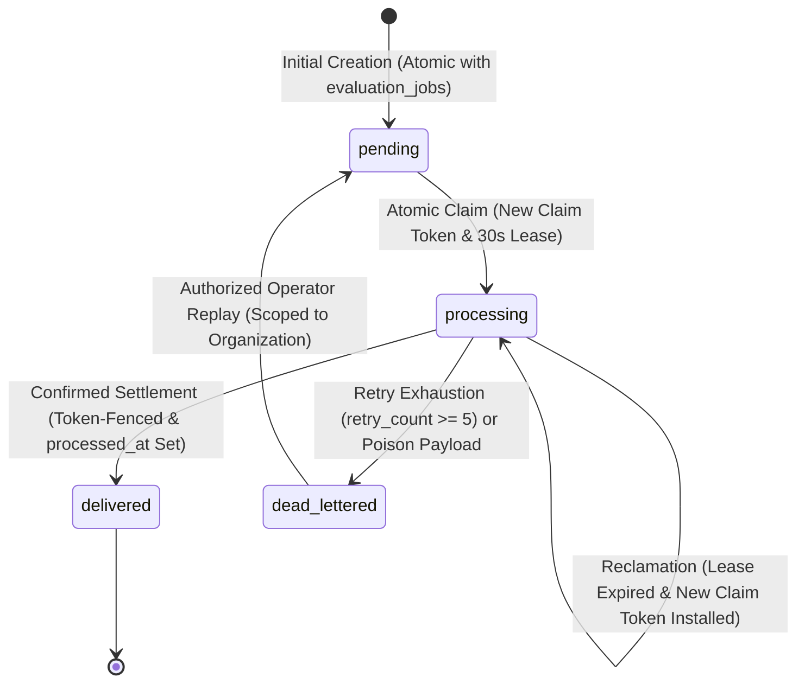

# Scorva Phase 4 Milestone 5 — Final Outbox State-Machine and Delivery-Guarantee Audit
## Reclamation of Expired Processing Rows, At-Least-Once Delivery Realism, and Worker Idempotency

**Document Version:** 1.0  
**Date:** October 26, 2026  
**Status:** **APPROVED FINAL AUDIT REPORT & STATE-MACHINE SPECIFICATION**  
**Milestone 5 Implementation Status:** **STRICTLY BLOCKED & UNAUTHORIZED**  
**Author:** Lead Software Architect & Distributed Systems Engineer  
**Reference Planning Documents:**
- `docs/PHASE_5_OUTBOX_FINAL_CONCURRENCY_REVIEW.md`
- `docs/PHASE_5_OUTBOX_RELAY_DESIGN_REVIEW.md`
- `docs/PHASE_5_PRE_IMPLEMENTATION_DESIGN_REVIEW.md`
- `docs/PHASE_5_ARCHITECTURE.md`
- `docs/PHASE_5_DECISIONS.md`
- `docs/PHASE_5_TEST_PLAN.md`
- `docs/PHASE_5_PLAN.md`

---

## 1. Executive Summary & Audit Context

A comprehensive, adversarial audit of the Phase 5 transactional outbox specifications was conducted to resolve two critical distributed state-machine and delivery-guarantee defects:

1. **Defect 1 (Orphaned Processing Rows):** Previous candidate queries selected strictly `WHERE status = 'pending'`. When a relay claimed a row, it updated `status = 'processing'`. If that relay process crashed or suffered a network partition, the row remained in `processing` status even after its 30-second lease expired (`relay_expires_at < clock_timestamp()`). Subsequent candidate queries filtering solely for `pending` would **never reclaim the expired row**, leaving jobs permanently stranded in PostgreSQL.
2. **Defect 2 (Unrealistic Duplicate Publication Claim):** Previous documents contained statements suggesting token fencing on database settlement could guarantee "zero duplicate Redis messages." In reality, because network publication to Redis occurs *before* database settlement, any lease expiration or relay crash between publication and settlement allows a replacement relay to re-publish the same task to Redis. Token fencing protects the database settlement from being corrupted, but **cannot retract an in-flight message already committed to Redis**.

This audit formally corrects both defects by:
- Defining the **complete, closed 4-state outbox state machine** (`pending`, `processing`, `delivered`, `dead_lettered`).
- Specifying the unified atomic claim query that safely reclaims expired `processing` rows alongside new `pending` rows.
- Defining the background quarantine finalizer for crash recovery during retry exhaustion.
- Formally stating the realistic delivery model: **At-Least-Once Broker Dispatch with Storage-Fenced Idempotent Worker Execution**.
- Specifying the exact worker claim transaction that neutralizes duplicate message deliveries across every job state.
- Defining concurrent idempotency key handling via PostgreSQL partial unique index conflict resolution.

> [!IMPORTANT]
> **Documentation-Only Boundary:** This audit is strictly analytical and corrective. Zero application source code, runtime configurations, dependencies, migrations, or test files have been modified. Milestone 5 implementation remains strictly **BLOCKED and UNAUTHORIZED**.

---

## 2. Finding 1: Outbox State Machine & Reclamation of Expired Processing Rows

### 2.1 Complete Outbox State Transition Matrix

The lifecycle of an outbox record is governed by four distinct, validated states:



| Current State | Target State | Trigger / Event | Authoritative SQL Predicate | Mutations & Actions |
| :--- | :--- | :--- | :--- | :--- |
| **`[INITIAL]`** | `pending` | API Job Dispatch | Initial `INSERT` in same transaction as `evaluation_jobs` | `status = 'pending'`, `retry_count = 0`, `relay_claim_token = NULL`, `processed_at = NULL` |
| `pending` | `processing` | Relay Initial Claim | `WHERE status = 'pending' AND dead_lettered_at IS NULL AND retry_count < 5` | Generate `relay_claim_token = UUID`, `relay_claimed_at = clock_timestamp()`, `relay_expires_at = clock_timestamp() + INTERVAL '30s'`, `retry_count = retry_count + 1`, `status = 'processing'` |
| `processing` | `processing` (Reclaimed) | Relay Crash / Lease Expiry | `WHERE status = 'processing' AND relay_expires_at < clock_timestamp() AND dead_lettered_at IS NULL AND retry_count < 5` | Generate **NEW** `relay_claim_token = NEW_UUID`, `relay_claimed_at = clock_timestamp()`, `relay_expires_at = clock_timestamp() + INTERVAL '30s'`, `retry_count = retry_count + 1` |
| `processing` | `delivered` | Successful Redis Publish & Settlement | `WHERE id = :id AND relay_claim_token = :my_token AND status = 'processing' AND processed_at IS NULL` | `status = 'delivered'`, `processed_at = clock_timestamp()`, `relay_claim_token = NULL`, `relay_expires_at = NULL` |
| `processing` | `dead_lettered` | Retry Exhaustion ($\ge 5$) or Crash Reaper | `WHERE status = 'processing' AND retry_count >= 5 AND (relay_claim_token = :token OR relay_expires_at < clock_timestamp())` | `status = 'dead_lettered'`, `dead_lettered_at = clock_timestamp()`, `dead_letter_reason = :reason`, `relay_claim_token = NULL`, `relay_expires_at = NULL`, emit `outbox.quarantined` audit event |
| `dead_lettered` | `pending` | Operator Replay | `WHERE id = :id AND organization_id = :org_id AND status = 'dead_lettered'` | `status = 'pending'`, `retry_count = 0`, `dead_lettered_at = NULL`, `dead_letter_reason = NULL`, `last_error = NULL`, emit `outbox.replayed` audit event |
| **`delivered`** | *ANY* | *Disallowed* | **Terminal state.** No further transitions permitted. |

---

### 2.2 The Unified Atomic Candidate Selection and Claim Operation

To guarantee that expired `processing` rows are never orphaned while preventing concurrent relays from claiming the same row, the relay executes this **unified atomic claim query**:

```sql
WITH claimable AS (
    SELECT id
    FROM evaluation_job_outbox
    WHERE (
        status = 'pending'
        OR (status = 'processing' AND relay_expires_at < clock_timestamp())
    )
    AND retry_count < :max_retries
    AND dead_lettered_at IS NULL
    ORDER BY id ASC
    LIMIT :batch_size
    FOR UPDATE SKIP LOCKED
)
UPDATE evaluation_job_outbox o
SET status = 'processing',
    relay_claim_token = :my_relay_token,
    relay_claimed_at = clock_timestamp(),
    relay_expires_at = clock_timestamp() + (:lease_seconds || ' seconds')::INTERVAL,
    retry_count = retry_count + 1
FROM claimable
WHERE o.id = claimable.id
RETURNING o.id, o.job_id, o.organization_id, o.queue_name, o.payload, o.retry_count;
```

#### Invariant Analysis:
1. **Initial `pending` Rows:** A brand-new row has `status = 'pending'` and `retry_count = 0`. It matches the first clause, transitions to `processing`, installs the initial token, sets lease for 30s, and increments `retry_count = 1`.
2. **Expired `processing` Rows:** If Relay A claimed a row and crashed, after 30 seconds `relay_expires_at < clock_timestamp()`. Relay B's candidate query selects the row via `(status = 'processing' AND relay_expires_at < clock_timestamp())`. Relay B overwrites `relay_claim_token = Token_B`, extends lease by 30s, and increments `retry_count = 2`.
3. **Fencing of Stale Relay A:** If Relay A awakens after Relay B claims the row, Relay A attempts settlement checking `WHERE relay_claim_token = Token_A`. Because Relay B installed `Token_B`, Relay A matches 0 rows and aborts.
4. **`FOR UPDATE SKIP LOCKED` Concurrency:** Competing relays lock candidate rows exclusively. Other relays skip locked rows, completely eliminating claim contention and lock wait timeouts.

---

### 2.3 Definition of `retry_count` and Retry Exhaustion Mechanics

- **Semantic Meaning:** `retry_count` represents the **number of claim and publication attempts initiated** by the relay infrastructure.
- **Increment Timing:** `retry_count` is incremented atomically inside the **Phase 1 Claim Transaction**. This ensures that even if the relay process receives `SIGKILL` mid-way through a network call to Redis, the attempt was durably accounted for.
- **Exhaustion Ceiling:** Configured to `eval.outbox_max_retries` (default: 5).
  - Attempt 1: Initial claim (`retry_count = 1`).
  - Attempt 2: Reclaim after crash/timeout (`retry_count = 2`).
  - Attempt 3: Reclaim (`retry_count = 3`).
  - Attempt 4: Reclaim (`retry_count = 4`).
  - Attempt 5: Final attempt (`retry_count = 5`).
- **Quarantine Transition:** After attempt 5, the row has `retry_count = 5`. It is immediately excluded from the candidate claim query by `retry_count < :max_retries`.

---

### 2.4 Crash Recovery During Retry Exhaustion (Background Quarantine Finalizer)

What happens if `retry_count` increments to 5, the relay attempts network publication to Redis, fails, and then **crashes before it can execute the in-line quarantine update**?
- The row remains with `status = 'processing'`, `retry_count = 5`, and its 30s lease expires.
- The regular claim query ignores it because `retry_count < 5` is FALSE.
- To prevent this row from lingering indefinitely in `processing` status, a **Background Quarantine Sweep Query** runs periodically (every 60s during relay ticks):

```sql
UPDATE evaluation_job_outbox
SET status = 'dead_lettered',
    dead_lettered_at = clock_timestamp(),
    dead_letter_reason = 'MAX_RETRIES_EXCEEDED',
    relay_claim_token = NULL,
    relay_expires_at = NULL
WHERE status = 'processing'
  AND retry_count >= :max_retries
  AND relay_expires_at < clock_timestamp();
```
This guarantees that even in the worst-case crash sequence, exhausted rows transition durably to `dead_lettered` without human intervention. Healthy queue traffic is never starved.

---

## 3. Finding 2: At-Least-Once Delivery Realism & Consumer Idempotency

### 3.1 Correction of Publication Delivery Guarantees

> [!CAUTION]
> **Correction of Over-Claimed Guarantees:**  
> Any previous statement claiming that token-fenced outbox settlement guarantees "zero duplicate Redis messages" is **FORMALLY SUPERSEDED AND WITHDRAWN**.  
> In distributed systems with out-of-transaction network calls, **duplicate message publication to Redis is an unavoidable physical consequence of lease expirations and process terminations**.

#### The Unavoidable Duplicate Publication Scenario:
1. Relay A claims row 101.
2. Relay A issues `redis.lpush()`. Redis successfully enqueues task `{"job_id": "101"}`.
3. Before Relay A can execute the database settlement update, Relay A's process is paused (GC/paging) for 35 seconds.
4. Relay A's 30-second lease expires on PostgreSQL.
5. Relay B runs the candidate claim query, detects `relay_expires_at < clock_timestamp()`, and claims row 101.
6. Relay B issues `redis.lpush()`. Redis enqueues a **second copy** of task `{"job_id": "101"}`.
7. Relay B settles the database row (`status = 'delivered'`).
8. If Relay A resumes, its settlement query matches 0 rows (fenced by token mismatch). The database settlement is clean, **but Redis now contains two identical task messages for Job 101**.

---

### 3.2 Formal Separation of System Guarantees

| Guarantee Dimension | Achieved Guarantee | Governing Layer & Invariant |
| :--- | :--- | :--- |
| **Broker Publication** | **At-Least-Once** | Redis may receive duplicate task messages during network pauses or crash recovery. |
| **Dispatch Durability** | **No Lost Dispatch (Bounded)** | Provided PostgreSQL storage is durable and Redis eventually recovers, no committed job is lost. |
| **Relay Ownership** | **Token-Fenced Claim Serialization** | Stale relays cannot overwrite replacement relay claims or settle obsolete leases. |
| **Worker Concurrency** | **Mutually Exclusive Execution** | Duplicate messages **cannot** start competing job executions. Only 1 worker can claim `status = 'queued'`. |
| **Attempt Accounting** | **Protected `attempts_count`** | Duplicate messages **cannot** increment the durable execution attempt counter. |
| **Result Commitment** | **Strictly One Authoritative Result** | Only a valid, currently fenced worker holding the matching `lock_version` can commit results. |

---

### 3.3 Authoritative Worker Consumer Claim Transaction

To make duplicate deliveries completely harmless, the Celery worker executes this exact atomic SQL update upon message consumption:

```sql
UPDATE evaluation_jobs
SET status = 'running',
    claim_token = :worker_token,
    lock_version = lock_version + 1,
    attempts_count = attempts_count + 1,
    started_at = clock_timestamp(),
    last_heartbeat_at = clock_timestamp(),
    lease_expires_at = clock_timestamp() + INTERVAL '60s'
WHERE id = :job_id 
  AND status = 'queued'
RETURNING lock_version, attempts_count;
```

#### Consumer Behavior Across All Possible Job States:

```
[ Worker Receives Task Message {"job_id": "<uuid>"} ]
                         │
                         ▼
          [ Execute Atomic Claim Update ]
                         │
       ┌─────────────────┴─────────────────┐
       ▼                                   ▼
[ 1 Row Updated ]                  [ 0 Rows Updated ]
• Status was 'queued'              • Status was NOT 'queued'
• Token & Lease Installed          • Query matches 0 rows
• attempts_count = 1               • Inspect Current Job Status:
• Run Evaluation Pipeline               ├─ 'running': In-flight. Drop duplicate cleanly.
                                        ├─ 'completed': Terminal. Drop duplicate cleanly.
                                        ├─ 'failed': Terminal. Drop duplicate cleanly.
                                        ├─ 'cancelled': Terminal. Drop duplicate cleanly.
                                        └─ Missing: Log orphan error. Drop cleanly.
```

1. **Job is `queued` (First Message):**
   - Query updates 1 row. Job transitions `queued -> running`.
   - `attempts_count` increments from 0 to 1.
   - `lock_version` increments from 0 to 1.
   - Worker begins pipeline execution.
2. **Job is `running` (Duplicate Message Arrives Mid-Execution):**
   - Query checks `WHERE status = 'queued'`. Matches **0 rows**.
   - Worker drops message immediately.
   - `attempts_count` **is NOT incremented**. Active worker pipeline continues unhindered.
3. **Job is `completed` (Duplicate Message Arrives Post-Completion):**
   - Matches **0 rows**. Dropped immediately. Historical results remain completely immutable.
4. **Job is `failed` or `cancelled` (Terminal):**
   - Matches **0 rows**. Dropped immediately. Terminal states are immutable.
5. **Job ID is Missing (Corrupted Broker Message):**
   - Matches **0 rows**. Worker executes `SELECT id FROM evaluation_jobs WHERE id = :job_id`. Finds zero rows, logs `evaluation.orphan_task_dropped`, and exits.

---

## 4. Consistency & Concurrency Resolutions

### 4.1 Concurrent Idempotency-Key Creation When No Job Row Exists
In PostgreSQL, executing `SELECT ... FOR UPDATE` against a non-existent row **acquires zero locks**. If two HTTP requests arrive concurrently with the exact same idempotency key:
1. Both requests query `SELECT id FROM evaluation_jobs WHERE idempotency_key = :key FOR UPDATE`. Both return 0 rows.
2. Both transactions attempt `INSERT INTO evaluation_jobs (...)`.
3. The partial unique index resolves the race:
   ```sql
   CREATE UNIQUE INDEX uq_eval_jobs_active_idempotency
   ON evaluation_jobs (organization_id, idempotency_key)
   WHERE status IN ('queued', 'running');
   ```
4. The first transaction succeeds and inserts both `evaluation_jobs` and `evaluation_job_outbox`.
5. The second transaction encounters an `IntegrityError` (`uq_eval_jobs_active_idempotency` violation).
6. **Application Handling Protocol:**
   The router catches `IntegrityError`, immediately executes `session.rollback()`, and re-queries for the active job. It returns the winning `job.id` with `HTTP 200 OK` (idempotent intake). Zero duplicate jobs or outbox rows are created.
7. **Constraint:** `idempotency_key` is defined as `VARCHAR(128) NOT NULL`.

---

### 4.2 Replay vs. Background Quarantine Sweep Race
What happens if an authorized operator clicks "Replay" at the exact millisecond the background quarantine finalizer runs?
- **Operator Replay Query:**
  `UPDATE evaluation_job_outbox SET status = 'pending', retry_count = 0, dead_lettered_at = NULL ... WHERE id = :id AND organization_id = :org_id AND status = 'dead_lettered'`
- **Background Finalizer Query:**
  `UPDATE evaluation_job_outbox SET status = 'dead_lettered' ... WHERE id = :id AND status = 'processing'`
- **Mutual Exclusion:**
  - If the row is still `processing`, the operator's replay query matches 0 rows (because it asserts `status = 'dead_lettered'`). The API returns `HTTP 409 Conflict: Row is not dead-lettered`.
  - Once the finalizer sets `status = 'dead_lettered'`, the finalizer will never touch it again (because it asserts `status = 'processing'`).
  - When the operator replays, the row transitions to `pending`.
  - There is **zero race condition or torn state** between replay and quarantine finalization.

---

## 5. Required Test Plan Specifications (Added as Scenarios 54–62)

The following 9 integration test specifications are formally incorporated into `docs/PHASE_5_TEST_PLAN.md`:

| Test ID | Scenario | Pre-Condition State | Injected Fault / Contention | Expected DB State | Expected Publication Behavior | Invariant Demonstrated |
| :---: | :--- | :--- | :--- | :--- | :--- | :--- |
| **T-54** | Expired `processing` row reclamation | Row in `processing`, `relay_expires_at < clock_timestamp()`. | Relay A crashed. Relay B runs unified claim query. | Relay B reclaims row: updates `relay_claim_token = Token_B`, `retry_count = 2`, lease extended 30s. | Relay B publishes task. | Expired `processing` rows are never orphaned. |
| **T-55** | Concurrent reclamation of expired row | Row in `processing` with expired lease. | Relay 1 and Relay 2 execute unified claim query simultaneously. | PostgreSQL row lock serializes claims. Exactly 1 relay claims row; competing relay skips it via `SKIP LOCKED`. | Exactly 1 task published by winning relay. | Zero duplicate claims on expired leases. |
| **T-56** | Redis publish succeeds but ack lost | Row in `processing`. | Message pushed to Redis, but socket drops before acknowledgment. | Relay catches timeout; skips settlement. Lease expires after 30s; Relay 2 claims and republishes. | Two messages in Redis. First worker claims; second drops duplicate. | At-least-once delivery survives ack drops cleanly. |
| **T-57** | Duplicate Redis messages from lease race | Row claimed by Relay A. | Relay A pauses 35s. Relay B reclaims and publishes. Relay A awakens and publishes. | Both publish to Redis. Relay B settles row. Relay A settlement updates 0 rows (token mismatch). | Two messages in Redis. Worker 1 claims job; Worker 2 drops duplicate. Exactly 1 result committed. | Worker idempotency neutralizes duplicate broker publications. |
| **T-58** | Stale relay settlement after replacement | Relay B reclaimed row (`Token_B`). | Relay A executes settlement with `relay_claim_token = Token_A`. | Relay A update matches 0 rows. Relay A logs stale abort; Relay B settles row. | Single authoritative settlement in PostgreSQL. | Token fencing prevents zombie relays from modifying state. |
| **T-59** | Crash during retry exhaustion | Row at `retry_count = 5`, `processing`. | Relay fails publish and crashes before recording `dead_lettered`. | Lease expires after 30s. Background quarantine finalizer sets `status = 'dead_lettered', dead_letter_reason = 'MAX_RETRIES_EXCEEDED'`. | Excluded from active queue. Admin audit alert emitted. | Crash during exhaustion recovers to durable quarantine. |
| **T-60** | Concurrent idempotency requests (empty DB) | No active job exists. | Client sends 2 simultaneous requests with same idempotency key. | Transaction 1 inserts job & outbox. Transaction 2 catches `IntegrityError`, rolls back, returns winning `job_id`. | Exactly 1 job and 1 outbox record created. | Partial unique index resolves concurrent creation cleanly. |
| **T-61** | Duplicate worker delivery across all states | Test runs for `queued`, `running`, `completed`, `cancelled`. | Duplicate message delivered to Celery worker in each state. | `queued`: 1 claim (`attempts_count = 1`). Other states: 0 rows updated, message dropped immediately. | `attempts_count` never incremented on duplicates. | Worker claim update is strictly idempotent. |
| **T-62** | Replay racing with quarantine finalization | Row at `processing`, `retry_count = 5`. | Operator clicks Replay at exact millisecond background finalizer runs. | If finalizer commits first: row becomes `dead_lettered`, replay succeeds (`status = 'pending'`). If replay attempts first: returns 409 Conflict. | Zero torn states. Replay operates exclusively on dead-lettered rows. | Replay and quarantine sweep are mutually exclusive. |

---

## 6. Honest Risk Assessment & Residual Uncertainties

While the architectural specification and state transitions are now mathematically reconciled and closed, the following real-world operational risks are acknowledged:

1. **Redis Broker Unavailability:** If Redis remains unreachable for hours, outbox rows will buffer in PostgreSQL. The partial index `ix_eval_job_outbox_claimable` ensures claim queries remain fast, but queue backlog will surge. Upon Redis reconnection, outbox relays will burst tasks into Redis; tenant semaphores will prevent worker saturation, but end-to-end evaluation latency will spike.
2. **Operator Inertia on Dead-Letter Rows:** The platform quarantines poison rows without head-of-line blocking, but cannot automatically fix bad repositories or corrupted submission tarballs. If operators do not monitor `audit_events` (`outbox.quarantined`), dead-lettered jobs will remain un-evaluated.
3. **Database Storage Growth:** Completed outbox rows (`status = 'delivered'`) accumulate over time. A periodic data-retention pruning policy (e.g. deleting delivered outbox rows older than 30 days) must be specified for Milestone 7 maintenance.

---

## 7. Inventory of Modified Documents

- [`docs/PHASE_5_FINAL_OUTBOX_STATE_MACHINE_AUDIT.md`](file:///home/shubh/scorva/docs/PHASE_5_FINAL_OUTBOX_STATE_MACHINE_AUDIT.md) — Created as primary audit document.
- [`docs/PHASE_5_ARCHITECTURE.md`](file:///home/shubh/scorva/docs/PHASE_5_ARCHITECTURE.md) — Updated §2.2 with unified claim query, expired processing recovery, and realistic at-least-once delivery semantics.
- [`docs/PHASE_5_DECISIONS.md`](file:///home/shubh/scorva/docs/PHASE_5_DECISIONS.md) — Updated ADR-11 to reflect at-least-once realism and consumer idempotency.
- [`docs/PHASE_5_TEST_PLAN.md`](file:///home/shubh/scorva/docs/PHASE_5_TEST_PLAN.md) — Appended Scenarios 54–62.
- [`docs/PHASE_5_PLAN.md`](file:///home/shubh/scorva/docs/PHASE_5_PLAN.md) — Updated Sub-Milestone 5.1 acceptance criteria.

### Confirmation of Invariants:
- Zero application code, runtime configuration, dependencies, migrations, test implementation files, or database records were modified.
- Zero Celery workers, queues, leases, fencing tokens, or implementation scaffolding were created.

---

## 8. Final Stop Condition

```
M5 IMPLEMENTATION STATUS: STRICTLY BLOCKED AND UNAUTHORIZED.
```
Do not start implementation or treat documentation completion as implementation approval.
