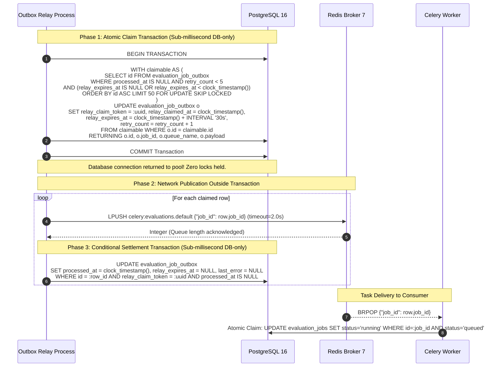

# Scorva Phase 4 Milestone 5 — Transactional Outbox Relay Final Design Review
## Decoupling Network I/O from PostgreSQL Row Locks in Background Task Publication

**Document Version:** 1.0  
**Date:** October 26, 2026  
**Status:** **APPROVED DESIGN REVIEW & OUTBOX ARCHITECTURAL SPECIFICATION**  
**Milestone 5 Implementation Status:** **STRICTLY BLOCKED & UNAUTHORIZED**  
**Author:** Lead Software Architect & Distributed Systems Engineer  
**Reference Planning Documents:**
- `docs/PHASE_5_PRE_IMPLEMENTATION_DESIGN_REVIEW.md`
- `docs/PHASE_5_ARCHITECTURE.md`
- `docs/PHASE_5_DECISIONS.md`
- `docs/PHASE_5_TEST_PLAN.md`
- `docs/PHASE_5_PLAN.md`

---

## 1. Executive Summary & Design Scope

This review addresses a critical concurrency and availability vulnerability in naive transactional outbox implementations: **holding database transactions and row locks open across network socket operations to message brokers**.

In high-throughput or fault-prone distributed systems, performing network I/O (`redis.lpush()`) inside an open PostgreSQL transaction (`async with db.begin():`) leads to:
1. **Database Connection Pool Starvation:** When the message broker is slow or experiencing latency spikes, database connections are held open, rapidly exhausting the API and worker connection pools.
2. **MVCC Table Bloat & Deadlocks:** Long-running active transactions prevent PostgreSQL from vacuuming dead tuples and increase lock contention.
3. **Cascading Failure Blast Radius:** A broker network partition causes database queries across unrelated HTTP endpoints to block and fail.

To eliminate this vulnerability before Sub-Milestone 5.1 is authorized, this document evaluates competing outbox relay architectures, formally defines the **Two-Phase Persisted Relay Lease Protocol (Approach 2)**, details crash recovery and poison message handling, and establishes the real-world delivery guarantees.

> [!IMPORTANT]
> **Documentation-Only Boundary:** This is an architectural review. Zero application code, tests, migrations, runtime configurations, or database records have been modified. Milestone 5 implementation remains strictly **BLOCKED**.

---

## 2. Comparative Evaluation of Outbox Relay Architectures

### Approach 1: Synchronous Network I/O Inside Long-Held Database Transaction
```python
# ANTI-PATTERN: Network call held inside open DB transaction
async with session.begin():
    rows = await session.execute("SELECT ... FOR UPDATE SKIP LOCKED LIMIT 50")
    for row in rows:
        await redis.lpush(row.queue_name, payload)  # <--- UNBOUNDED NETWORK I/O
        row.processed_at = clock_timestamp()
```
- **Evaluation:**
  - *Pros:* Simple procedural code; if network fails, the DB transaction rolls back automatically.
  - *Fatal Flaws:* 
    - Database connection held for the entire duration of the batch's network round-trips.
    - If Redis network timeout is 2.0s and 50 rows are published, the DB transaction can stay open for up to 100 seconds!
    - Completely unviable in multi-tenant production.

---

### Approach 2: Two-Phase Persisted Relay Lease & Out-of-Transaction Publication — **SELECTED**
```
[ Phase 1: Atomic Claim (DB-Only) ] ──▶ COMMIT ──▶ [ Phase 2: Network Publish ] ──▶ [ Phase 3: Settle (DB-Only) ]
  • SELECT ... FOR UPDATE SKIP LOCKED                • redis.lpush() outside tx       • UPDATE ... WHERE claim_token = :tok
  • Set relay_claim_token & expiry                   • Bounded socket timeout         • Immediate sub-millisecond commit
  • Immediate sub-millisecond commit                 • Zero DB connections held
```
- **Evaluation:**
  - *Pros:* 
    - Database transactions are sub-millisecond (pure SQL reads and indexed updates). Zero database connections are held during Redis network socket calls.
    - If Redis hangs or times out, zero database row locks or connections are blocked.
    - Complete crash recovery: if a relay crashes mid-batch, its lease expires (`relay_expires_at < clock_timestamp()`), and a competing relay automatically re-claims and publishes.
    - Stale relays fenced: if a relay experiences a severe process pause and resumes, its settlement update verifies `relay_claim_token = :token`. If expired and replaced, 0 rows update, preventing torn settlements.
  - *Trade-offs:* Requires persistent lease columns on `evaluation_job_outbox` and a two-step database lifecycle.

---

### Approach 3: Change Data Capture (CDC / Debezium)
- **Evaluation:**
  - Tails the PostgreSQL Write-Ahead Log (WAL) and streams changes to Kafka/Redis.
  - *Fatal Flaws:* Introduces massive operational overhead (Kafka cluster, Kafka Connect, Debezium daemon, ZooKeeper/KRaft) disproportionate to Scorva's single-repository architecture.

---

## 3. The Authoritative Outbox Relay Protocol (Approach 2)



---

## 4. Detailed Specification of the Selected Protocol

### 4.1 Schema Definition & Required Indexes
To support atomic leasing, lease expiry recovery, and poison row filtering, the `evaluation_job_outbox` table is specified with the following columns and constraints:

```sql
CREATE TABLE evaluation_job_outbox (
    id BIGSERIAL PRIMARY KEY,
    job_id UUID NOT NULL REFERENCES evaluation_jobs(id) ON DELETE CASCADE,
    organization_id UUID NOT NULL REFERENCES organizations(id) ON DELETE RESTRICT,
    queue_name VARCHAR(50) NOT NULL DEFAULT 'evaluations.default',
    routing_key VARCHAR(50) NOT NULL DEFAULT 'evaluations.default',
    payload JSONB NOT NULL DEFAULT '{}',
    relay_claim_token UUID NULL,
    relay_claimed_at TIMESTAMPTZ NULL,
    relay_expires_at TIMESTAMPTZ NULL,
    retry_count INTEGER NOT NULL DEFAULT 0,
    last_error TEXT NULL,
    created_at TIMESTAMPTZ NOT NULL DEFAULT clock_timestamp(),
    processed_at TIMESTAMPTZ NULL
);

-- Partial index covering un-processed rows eligible for claim
CREATE INDEX ix_eval_job_outbox_claimable 
ON evaluation_job_outbox (retry_count, relay_expires_at, id) 
WHERE processed_at IS NULL;

-- Index for clean cascading deletes and job lookups
CREATE INDEX ix_eval_job_outbox_job_id 
ON evaluation_job_outbox (job_id);
```

### 4.2 Phase 1: Atomic Claim Transaction (SQL & Pseudocode)
The relay process executes an atomic claim query that identifies claimable rows and sets the lease token in a single statement:

```python
async def claim_outbox_batch(
    session: AsyncSession,
    relay_token: uuid.UUID,
    batch_size: int = 50,
    lease_seconds: int = 30,
    max_retries: int = 5,
) -> list[OutboxRow]:
    claim_sql = text("""
        WITH claimable AS (
            SELECT id 
            FROM evaluation_job_outbox
            WHERE processed_at IS NULL 
              AND retry_count < :max_retries
              AND (relay_expires_at IS NULL OR relay_expires_at < clock_timestamp())
            ORDER BY id ASC
            LIMIT :batch_size
            FOR UPDATE SKIP LOCKED
        )
        UPDATE evaluation_job_outbox o
        SET relay_claim_token = :relay_token,
            relay_claimed_at = clock_timestamp(),
            relay_expires_at = clock_timestamp() + (:lease_seconds || ' seconds')::INTERVAL,
            retry_count = retry_count + 1
        FROM claimable
        WHERE o.id = claimable.id
        RETURNING o.id, o.job_id, o.organization_id, o.queue_name, o.payload, o.retry_count;
    """)
    async with session.begin():
        res = await session.execute(
            claim_sql,
            {
                "relay_token": relay_token,
                "batch_size": batch_size,
                "lease_seconds": lease_seconds,
                "max_retries": max_retries,
            },
        )
        return [OutboxRow(*row) for row in res.fetchall()]
```
- **Duration:** < 2 milliseconds.
- **Locking:** `FOR UPDATE SKIP LOCKED` locks only the candidate rows, updates them, and commits immediately, releasing row locks instantly.
- **Concurrency:** Multiple relay processes execute this query simultaneously without contention; each process claims a non-overlapping slice of the outbox.

---

### 4.3 Phase 2: Network Publication Outside Transaction
The relay iterates over the in-memory `OutboxRow` batch. It uses an async Redis client with a strict, bounded socket timeout:

```python
async def publish_outbox_message(
    redis_client: aioredis.Redis,
    row: OutboxRow,
    timeout_seconds: float = 2.0,
) -> bool:
    message_body = json.dumps({
        "job_id": str(row.job_id),
        "dispatched_at": datetime.now(timezone.utc).isoformat(),
    })
    # Strictly bounded network socket call
    await asyncio.wait_for(
        redis_client.lpush(f"celery:{row.queue_name}", message_body),
        timeout=timeout_seconds,
    )
    return True
```
- **Database Status:** Zero database connections held.
- **Timeout Isolation:** If Redis is slow, only the relay's local async task awaits; PostgreSQL remains completely unaffected.

---

### 4.4 Phase 3: Conditional Delivered Settlement
After receiving the Redis acknowledgment (integer returned by `LPUSH`), the relay settles the row in an isolated, instantaneous update:

```sql
UPDATE evaluation_job_outbox
SET processed_at = clock_timestamp(),
    relay_expires_at = NULL,
    last_error = NULL
WHERE id = :row_id 
  AND relay_claim_token = :relay_token 
  AND processed_at IS NULL;
```
- **Fencing Guard:** If the relay paused longer than `lease_seconds` (30s) and another relay re-claimed the row, `relay_claim_token` will no longer match. The query updates 0 rows and aborts cleanly.
- **Idempotent Mark:** If already marked processed, 0 rows update.

---

## 5. Failure Scenarios, Edge Cases & Recovery Mechanics

### 5.1 Relay Process Crashes
1. **Crash After Claim, Before Publish:**
   - *State in DB:* `processed_at IS NULL`, `relay_claim_token = Relay_1`, `relay_expires_at = NOW() + 30s`.
   - *Recovery:* Nothing is published to Redis. The dead relay's lease expires after 30 seconds. On the next tick, Relay 2 claims the row (`relay_expires_at < clock_timestamp()`) and publishes it.
2. **Crash After Publish, Before Settlement:**
   - *State in DB:* Task message is queued in Redis, but outbox row still has `processed_at IS NULL`.
   - *Recovery:* Relay 1 dies. After 30 seconds, Relay 2 re-claims the row and publishes it again (at-least-once delivery).
   - *Consumer Safety:* When Celery workers process the duplicate task messages, the first worker executes `UPDATE evaluation_jobs SET status = 'running' WHERE id = :job_id AND status = 'queued'` (1 row updated). The second worker's claim query updates 0 rows; the duplicate message is dropped harmlessly.

### 5.2 Broker Acknowledgment Loss
- If Redis receives and enqueues the `LPUSH` message, but the TCP connection drops before the relay receives the integer reply:
  - The relay catches a `ConnectionError` or `TimeoutError`.
  - The relay does not execute the settlement update.
  - The row remains eligible for re-claim upon lease expiration.
  - The task is re-published; the consumer absorbs the duplicate idempotently.

### 5.3 Poison Rows and Head-of-Line Blocking Prevention
- **The Threat:** A corrupted row (e.g., malformed payload or un-routable queue) causes an unhandled exception or repeated publication failure.
- **Non-Blocking Architecture:**
  1. `FOR UPDATE SKIP LOCKED` ensures that while a poison row is actively leased or locked, other relays immediately skip it and claim subsequent healthy rows.
  2. Every claim increments `retry_count = retry_count + 1`.
  3. When `retry_count >= 5`, the partial index filter `WHERE retry_count < 5` permanently excludes the row from regular relay polls.
  4. The poison row is quarantined. An immutable audit record is emitted:
     `audit_events` with `action = 'outbox.poison_row_quarantined', details = {'outbox_id': row.id, 'last_error': error}`.
  5. Unrelated outbox rows proceed with zero latency degradation.

---

## 6. Formal Delivery Guarantee

> [!NOTE]
> **Delivery Semantics Disclosure:**  
> The Scorva transactional outbox relay guarantees **At-Least-Once Delivery**.  
> In distributed networks with potential process terminations and packet drops, exactly-once broker publication is mathematically impossible.  
> System correctness is guaranteed by pairing **at-least-once outbox publication** with **storage-fenced, idempotent consumer execution** in the Celery worker plane.

---

## 7. Concrete Verification Test Scenarios (Added to Test Plan)

The following 8 integration test scenarios are formally added to `docs/PHASE_5_TEST_PLAN.md` (Scenarios 35–42):

| Test ID | Scenario | Pre-Condition State | Injected Fault / Contention | Expected Outbox State | Expected Job State | Invariant Demonstrated |
| :---: | :--- | :--- | :--- | :--- | :--- | :--- |
| **T-35** | Relay crashes after claim before publish | Job `queued`, outbox row claimed by Relay 1 (`relay_expires_at = clock + 5s`). | Relay 1 process terminated via `SIGKILL` before calling Redis. | After 5s, Relay 2 claims row (`relay_expires_at < clock`). Marks `processed_at`. | Job claimed by worker; transitions `running`. | Automatic lease recovery for crashed relay instances. |
| **T-36** | Relay crashes after publish before settlement | Outbox row claimed; message sent to Redis. | Relay 1 receives `SIGKILL` immediately after `redis.lpush` before settlement query. | Outbox row remains `processed_at IS NULL`. After 5s, Relay 2 re-claims and re-publishes. Marks `processed_at`. | First message claims job (`running`). Duplicate message dropped by worker (`0 rows updated`). | At-least-once delivery survives relay death without lost jobs. |
| **T-37** | Redis accepts message but ack is lost | Outbox row claimed. | Mock Redis proxy queues message, then drops TCP socket before sending length integer. | Relay catches `TimeoutError`. Row remains un-settled. Re-claimed on next tick and re-published. | Worker claims job once. Duplicate task safely ignored. | Publisher acknowledgment loss converted to idempotent delivery. |
| **T-38** | Concurrent claim by two relay processes | 10 pending outbox rows exist. | Relay 1 and Relay 2 execute atomic claim query simultaneously. | Relay 1 claims rows 1–5; Relay 2 claims rows 6–10. Zero row overlap. Zero deadlocks. | All 10 jobs dispatched to Celery. | `SKIP LOCKED` provides contention-free multi-relay scaling. |
| **T-39** | Stale relay settlement after lease expiry | Outbox row leased to Relay 1 with 2s TTL. | Relay 1 pauses 5s. Relay 2 re-claims row and publishes. Relay 1 awakens and executes settlement update. | Relay 1 update matches 0 rows (claim token mismatch). Relay 2 settles row. | Single authoritative settlement. | Token-fenced settlement prevents zombie relay writes. |
| **T-40** | Poison row isolation | 1 invalid outbox row + 5 valid outbox rows. | Invalid row causes repeated publication error (e.g. invalid queue). | Invalid row increments `retry_count` to 5; quarantined. Remaining 5 rows published within 200ms. | Valid jobs run normally; poison row alerts admin. | Zero head-of-line blocking for outbox queue. |
| **T-41** | Extended Redis broker outage | 5 outbox rows pending. | Redis container paused for 60 seconds across multiple relay ticks. | All rows fail publication; leases expire; retried on subsequent ticks. When Redis resumes, all 5 rows published. | Zero lost evaluations. All 5 jobs run upon reconnection. | Transactional outbox durable buffering across broker downtime. |
| **T-42** | Duplicate task delivery evaluation integrity | Job `queued`, 2 duplicate task messages injected into Redis. | Two Celery workers consume tasks simultaneously. | Outbox row `processed_at` set. | Worker 1 claims job (`queued -> running`). Worker 2 claim updates 0 rows and returns. Exactly 1 `evaluation_results` row created. | End-to-end execution idempotency. |
