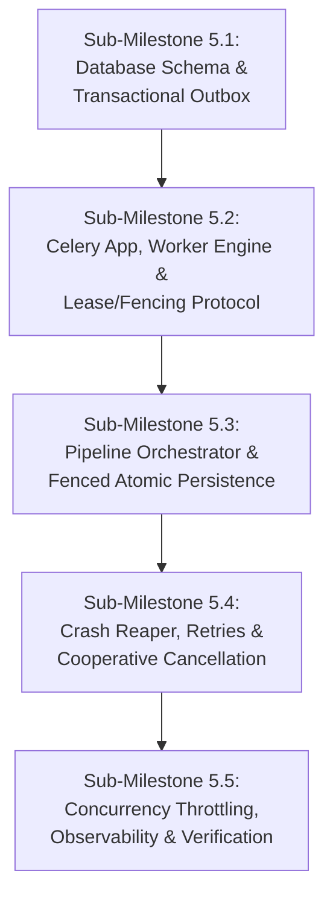

# Scorva Phase 4 Milestone 5 — Celery Evaluation Orchestrator, Worker Leases & Fault Tolerance Plan

**Document Version:** 1.3  
**Date:** October 26, 2026  
**Status:** **SUB-MILESTONES 5.1, 5.2, & 5.3 IMPLEMENTED & VERIFIED — SUB-MILESTONES 5.4–5.5 PENDING AUTHORIZATION**  
**Milestone 5 Implementation Status:** **Sub-Milestones 5.1, 5.2, & 5.3 Complete; 5.4–5.5 Blocked & Pending Explicit Authorization**  
**Author:** Lead Software Architect & Systems Engineer  
**Reference Verification:** `apps/api/tests/test_evaluation_outbox_m5_1.py` (20/20 Passed), `apps/api/tests/test_worker_engine_m5_2.py` (12/12 Passed), `apps/api/tests/test_pipeline_m5_3.py` (11/11 Passed)

---

## 1. Executive Summary & Objectives

### 1.1 Objective
Milestone 5 builds the asynchronous background evaluation execution engine for Scorva. It bridges the gap between the synchronous Web API and the compute-heavy, multi-stage evaluation pipeline developed in Milestones 1 through 4:
- **Milestone 1:** Dynamic RBAC, multi-tenant schemas, centralized configuration.
- **Milestone 2:** Deterministic `Decimal` scoring calculator, rubric versions, and evaluation models.
- **Milestone 3:** Safe GitHub archive streaming, zero-code-execution extraction, and XML evidence indexing.
- **Milestone 4:** Provider-neutral AI engine, Profile B SSRF guard, incremental chunk streaming, and Pydantic structured output validation.

Milestone 5 operationalizes this foundation into an industrial-grade, fault-tolerant background worker system powered by **Celery 5.4**, **Redis 7**, and **PostgreSQL 16**.

### 1.2 Core Architectural Invariants
1. **At-Least-Once Delivery with Fenced Atomic Persistence:** Task queues (Celery/Redis) guarantee at-least-once delivery; exactly-once execution is physically impossible in distributed systems with worker failures. Therefore, correctness is enforced at the database tier via **monotonic fencing tokens (`lock_version`)** and **atomic multi-table CAS result transactions**.
2. **Dual-Write Elimination via Transactional Outbox:** Job creation in PostgreSQL and task publication to Redis must never be uncoordinated. An `evaluation_job_outbox` table guarantees that a task is published if and only if the job transaction commits.
3. **Zero-Trust Task Payloads:** Task messages carry only the immutable identifier `job_id`. Workers rehydrate state directly from PostgreSQL within a tenant-scoped read transaction. Task messages never carry authority, tokens, or untrusted mutable state.
4. **Authoritative Database Time for Distributed Leases:** Worker system clocks drift. All lease expiration decisions, heartbeats, and reaper timeouts use PostgreSQL server time (`CURRENT_TIMESTAMP`), completely eliminating clock skew vulnerabilities.
5. **Two-Tier Retry Separation:** Model formatting errors are retried inside the worker (up to 1 schema correction prompt as established in M4). Infrastructure, timeout, and connection errors are managed by the task orchestrator with exponential backoff and jitter. Security policy violations (SSRF, path traversal, archive bombs) are strictly non-retryable and fail terminal immediately.
6. **Decoupled Scoring Engine & Zero Code Execution:** Evaluator workers run in isolated processes with no compiler, interpreter, or runtime execution permissions. Models award raw criterion scores; final weights and formulas are calculated deterministically by [`scoring_calculator.py`](file:///home/shubh/scorva/apps/api/modules/evaluations/scoring_calculator.py).

---

## 2. Scope & Non-Goals

### 2.1 In Scope for Milestone 5
- **Task Orchestration Infrastructure:** Celery application configuration, Redis broker integration, queue routing, and worker process lifecycle.
- **Transactional Outbox Engine:** `evaluation_job_outbox` table, relay worker loop, and reliable Redis dispatch.
- **State Machine Engine:** Explicit job states (`queued`, `running`, `completed`, `failed`, `cancelled`), validated transitions, and terminal locking.
- **Renewable Distributed Lease Manager:** Atomic claim via `FOR UPDATE`, background thread heartbeat renewal, configurable TTL, and monotonic fencing generations.
- **End-to-End Evaluation Pipeline Worker:** Sequential execution of stages:
  `repo_acquisition` $\rightarrow$ `safe_extraction` $\rightarrow$ `evidence_indexing` $\rightarrow$ `model_evaluation` $\rightarrow$ `output_validation` $\rightarrow$ `score_calculation` $\rightarrow$ `persistence`.
- **Atomic Result Commitment:** Atomic persistence of `evaluation_results`, `evaluation_criterion_scores`, and `evidence_references` guarded by CAS fencing token verification.
- **Fault Recovery & Crash Reaper:** Celery Beat scheduled task scanning for stalled jobs, releasing expired claims, and requeuing retryable failures.
- **Tenant Concurrency Throttling:** Distributed Redis semaphore bounding concurrent active evaluations per organization.
- **Cooperative Cancellation:** Cancellation request detection and mid-flight abort handling.
- **Structured Observability:** Contextual structured logging with correlation IDs, secret redacting, and operational health metrics.

### 2.2 Explicit Exclusions (Non-Goals)
- **Tenant API Endpoints:** No public HTTP endpoints for triggering evaluations or viewing results (deferred to Milestone 6).
- **Judge Review Workflow:** No manual human judge score adjustment APIs or review drawer endpoints (deferred to Milestone 6).
- **Frontend User Interface:** No React/Next.js dashboard components, progress bars, or admin screens (deferred to Milestone 7).
- **Dynamic Code Sandboxing:** Zero dynamic code execution (Firecracker/gVisor); analysis remains 100% static as established in ADR-01.

---

## 3. Prerequisites & Existing Asset Baseline

### 3.1 Verified System Capabilities
Before Milestone 5 can begin, the following capabilities have been established and verified in the repository:

| Capability | Component Reference | Status |
| :--- | :--- | :---: |
| **Multi-Tenant Schemas** | [`apps/api/modules/evaluations/models.py`](file:///home/shubh/scorva/apps/api/modules/evaluations/models.py) | Verified (M1/M2) |
| **Deterministic Scoring** | [`apps/api/modules/evaluations/scoring_calculator.py`](file:///home/shubh/scorva/apps/api/modules/evaluations/scoring_calculator.py) | Verified (M2) |
| **Safe Repo Ingestion** | [`apps/api/modules/evaluations/github_client.py`](file:///home/shubh/scorva/apps/api/modules/evaluations/github_client.py), `safe_extractor.py` | Verified (M3) |
| **XML Evidence Indexing** | [`apps/api/modules/evaluations/evidence_indexer.py`](file:///home/shubh/scorva/apps/api/modules/evaluations/evidence_indexer.py) | Verified (M3) |
| **Provider Abstraction** | [`apps/api/modules/evaluations/ai_provider.py`](file:///home/shubh/scorva/apps/api/modules/evaluations/ai_provider.py) | Verified (M4) |
| **Profile B SSRF Guard** | [`apps/api/core/ssrf_guard.py`](file:///home/shubh/scorva/apps/api/core/ssrf_guard.py) | Verified (M4) |
| **Structured Output Validator** | [`apps/api/modules/evaluations/output_validator.py`](file:///home/shubh/scorva/apps/api/modules/evaluations/output_validator.py) | Verified (M4) |
| **Centralized Config Catalog**| [`apps/api/modules/configuration/catalog.py`](file:///home/shubh/scorva/apps/api/modules/configuration/catalog.py) | Verified (M1/M4) |
| **RBAC Outbox Pattern** | [`apps/api/modules/rbac/outbox.py`](file:///home/shubh/scorva/apps/api/modules/rbac/outbox.py) | Verified (M1) |

### 3.2 Existing Infrastructure
- **PostgreSQL 16:** Running on `localhost:5432` (`scorva` database), healthchecked and operational.
- **Redis 7:** Running on `localhost:6379`, healthchecked and operational.
- **Ollama Node:** Running on `http://localhost:11434` in local Docker network.

---

## 4. Implementation Sequencing (Sub-Milestones)

To minimize risk and maintain comprehensive testability at every stage, Milestone 5 is broken into five discrete, reviewable sub-milestones:

---

### Sub-Milestone 5.1: Database Schema & Transactional Outbox (4-State Relay) — [COMPLETED & VERIFIED]
- **Status:** **IMPLEMENTED & VERIFIED** (18/18 tests passing in `apps/api/tests/test_evaluation_outbox_m5_1.py`)
- **Scope Implemented:**
  - Alembic migration `9e37b1c1921d_m5_1_evaluation_outbox_and_idempotency.py` adding `lease_expires_at`, `idempotency_key`, `request_fingerprint`, `reevaluation_of_job_id`, `dispatch_generation`, and `cancellation_requested` to `evaluation_jobs` along with global unique index `uq_eval_jobs_organization_idempotency_key` on `(organization_id, idempotency_key) WHERE idempotency_key IS NOT NULL`.
  - Created `evaluation_job_outbox` table with formal 4-state machine: `status` enum/varchar (`pending`, `processing`, `delivered`, `dead_lettered`), two-phase lease columns (`relay_claim_token`, `relay_claimed_at`, `relay_expires_at`, `claim_count`, `publish_attempts`, `dispatch_generation`, `last_error`, `processed_at`, `dead_lettered_at`, `dead_letter_reason`), and indexes:
    - `uq_eval_job_outbox_active_dispatch` on `(job_id) WHERE status IN ('pending', 'processing')`.
    - `ix_eval_job_outbox_claimable` on `(status, claim_count, relay_expires_at, id) WHERE dead_lettered_at IS NULL AND processed_at IS NULL`.
    - `ix_eval_job_outbox_quarantine` on `(id ASC) WHERE status = 'processing' AND claim_count >= 5 AND dead_lettered_at IS NULL`.
  - Implemented `EvaluationOutboxService` in `apps/api/modules/evaluations/outbox.py` with Two-Phase Persisted Relay Lease Protocol (Approach 2):
    - Unified atomic candidate query selecting both new `pending` rows and crashed/expired `processing` rows whose lease has lapsed, incrementing `claim_count` on claim.
    - Decoupled out-of-transaction Redis publishing with bounded socket timeouts (2.0s).
    - Token-fenced atomic settlement verifying `id`, `relay_claim_token`, `status = 'processing'`, and `processed_at IS NULL`, incrementing `publish_attempts`.
    - Periodic background quarantine sweep marking retry-exhausted expired `processing` rows as `dead_lettered` and clearing relay claim tokens with audit event emission.
    - Authorized operator replay API and function resetting `status = 'pending'`, clearing error fields, and emitting audit event.
  - Implemented `dispatch_evaluation_job_atomic` and `reevaluate_submission_atomic` in `apps/api/modules/evaluations/service.py`.
  - Implemented REST API routes in `apps/api/modules/evaluations/router.py` mounted in `apps/api/main.py`.
  - Comprehensive automated test suite in `apps/api/tests/test_evaluation_outbox_m5_1.py` with 18 automated tests passing on PostgreSQL 16.
- **Exclusions:** Celery worker daemon setup; pipeline execution.
- **Files to Modify/Create:**
  - `apps/api/alembic/versions/xxxx_m5_evaluation_outbox_and_leases.py` (New migration)
  - `apps/api/modules/evaluations/models.py` (Update `EvaluationJob`, add `EvaluationJobOutbox`)
  - `apps/api/modules/evaluations/outbox.py` (New outbox relay service)
  - `apps/api/tests/test_evaluation_outbox.py` (New test suite)
- **Acceptance Criteria:**
  - DB transaction rollback discards both `evaluation_jobs` row and outbox record.
  - Outbox relay successfully claims batch via `FOR UPDATE SKIP LOCKED` (reclaiming both `pending` and expired `processing` rows), commits claim immediately, publishes to Redis with bounded timeout, and settles row with `clock_timestamp()`.
  - Stale relay attempts to settle after lease expiry and reclaim are fenced (0 rows updated).
  - Background quarantine sweep dead-letters retry-exhausted rows without blocking healthy pending traffic.

---

### Sub-Milestone 5.2: Celery Worker Engine & Lease/Fencing Protocol — [COMPLETED & VERIFIED]
- **Status:** **IMPLEMENTED & VERIFIED** (12/12 tests passing in `apps/api/tests/test_worker_engine_m5_2.py`)
- **Scope Implemented:**
  - Configured Celery 5.6 application in [`apps/api/workers/celery_app.py`](file:///home/shubh/scorva/apps/api/workers/celery_app.py) with Redis broker (`settings.REDIS_URL`), JSON serialization, UTC timezone, `task_acks_late=True`, `task_reject_on_worker_lost=True`, `evaluations.default` queue, and prefetch multiplier 1.
  - Implemented dedicated synchronous SQLAlchemy 2.0 database engine in [`apps/api/workers/database.py`](file:///home/shubh/scorva/apps/api/workers/database.py) using psycopg2 with bounded `QueuePool` (size 5, overflow 10, recycle 1800s, pre-ping), fork safety via Celery's `worker_process_init` signal, and short-lived `@contextmanager def worker_session_scope()` ensuring zero connection holding during non-DB operations.
  - Implemented `WorkerLeaseManager` in [`apps/api/workers/lease_manager.py`](file:///home/shubh/scorva/apps/api/workers/lease_manager.py):
    - Atomic SQL claim via `UPDATE evaluation_jobs SET status = 'running', claim_token = :claim_token, lock_version = lock_version + 1, attempts_count = attempts_count + 1, started_at = clock_timestamp(), last_heartbeat_at = clock_timestamp(), lease_expires_at = clock_timestamp() + (:lease_seconds || ' seconds')::interval WHERE id = :job_id AND status = 'queued' AND cancellation_requested = false AND attempts_count < max_attempts RETURNING ...`.
    - Atomic SQL heartbeat lease renewal requiring `status = 'running'`, `claim_token = :claim_token`, `lock_version = :lock_version`, and unexpired lease `lease_expires_at > clock_timestamp()`, rejecting late heartbeats and detecting cooperative cancellation (`cancellation_requested`).
    - Both synchronous (`claim_job_sync`, `renew_lease_sync`) and async (`claim_job_async`, `renew_lease_async`) methods.
    - `HeartbeatController` background daemon thread periodically renewing lease with short-lived transactions and detecting cancellation.
  - Implemented Celery evaluation task consumer `evaluate_submission` in [`apps/api/workers/tasks.py`](file:///home/shubh/scorva/apps/api/workers/tasks.py) accepting minimal payload (`job_id` string only, zero secrets or repo contents), safely discarding duplicate deliveries for non-queued jobs.
  - Comprehensive automated integration tests in [`apps/api/tests/test_worker_engine_m5_2.py`](file:///home/shubh/scorva/apps/api/tests/test_worker_engine_m5_2.py) covering atomic claims, duplicate message discard, terminal/cancelled rejection, 5-thread concurrent claim racing against PostgreSQL, valid heartbeat renewal, expired-lease rejection, stale token rejection, lock-version mismatch, cancellation race detection, session cleanup/rollback, and Celery task payload idempotence.

---

### Sub-Milestone 5.3: Pipeline Orchestrator & Fenced Atomic Persistence [COMPLETED & VERIFIED]
- **Scope:**
  - Implement `EvaluationPipelineOrchestrator` coordinating M3/M4 modules:
    1. `repo_acquisition`: Fetch repo snapshot via GitHub client.
    2. `safe_extraction`: Zero-code-execution tarball extraction.
    3. `evidence_indexing`: Structural XML evidence indexing.
    4. `model_evaluation`: Ollama provider invocation with JSON Schema grammar.
    5. `output_validation`: Pydantic structured output validation.
    6. `score_calculation`: Deterministic `scoring_calculator` execution.
    7. `persistence`: Atomic multi-table persistence.
  - Implement the 7-step atomic result persistence protocol in a single database transaction using pessimistic row locking (`SELECT ... FOR UPDATE`), in-lock guard verification against `clock_timestamp()`, committing `evaluation_results`, `evaluation_criterion_scores`, `evidence_references`, and updating `evaluation_jobs` status to `completed` while incrementing `lock_version`.
- **Exclusions:** Scheduled crash reaper daemon.
- **Files to Modify/Create:**
  - `apps/api/workers/tasks.py` (Celery evaluation task)
  - `apps/api/workers/pipeline.py` (Pipeline stage orchestrator)
  - `apps/api/modules/evaluations/service.py` (Result persistence service)
  - `apps/api/tests/test_evaluation_orchestration.py` (End-to-end worker tests)
- **Acceptance Criteria:**
  - Complete evaluation runs end-to-end using `MockAIProviderClient` offline and `OllamaProviderClient` against live test server.
  - Full results, criterion scores, and verified line citations are committed atomically.
  - Simulated crash mid-pipeline leaves zero partial result rows in `evaluation_results`.

---

### Sub-Milestone 5.4: Crash Reaper, Retries & Cooperative Cancellation [COMPLETED & VERIFIED]
- **Scope:**
  - Implemented Expired-Job Reaper Engine in [`apps/api/workers/reaper.py`](file:///home/shubh/scorva/apps/api/workers/reaper.py) (`reap_stalled_evaluation_jobs_sync`, `reap_stalled_evaluation_jobs_async`, and periodic Celery Beat task `reap_stalled_evaluation_jobs_task` scheduled every 15s in [`apps/api/workers/celery_app.py`](file:///home/shubh/scorva/apps/api/workers/celery_app.py)).
  - Identifies jobs in `running` status where `lease_expires_at < clock_timestamp()` using `SELECT ... FOR UPDATE SKIP LOCKED` for concurrent multi-reaper sweeps.
  - Requeues jobs with `attempts_count < max_attempts`: atomically updates `status = 'queued', claim_token = NULL, last_heartbeat_at = NULL, lease_expires_at = clock_timestamp() + backoff, lock_version = lock_version + 1, dispatch_generation = dispatch_generation + 1`.
  - Re-dispatches retry attempts durably via `evaluation_job_outbox` after superseding prior active outbox dispatches (`dead_lettered` with `SUPERSEDED_BY_RETRY`), avoiding unique index violations (`uq_eval_job_outbox_active_dispatch`).
  - Implemented bounded exponential backoff retry scheduling with proportional jitter: delay = `min(max_seconds, base_seconds * 2^(attempts - 1)) + jitter`. Worker claim queries enforce backoff via `AND (lease_expires_at IS NULL OR lease_expires_at <= clock_timestamp())`.
  - Marks terminal `failed` with `WORKER_LEASE_TIMEOUT_EXHAUSTED` and dead-letters outbox rows when `attempts_count >= max_attempts`.
  - Implemented cooperative cancellation system across all states:
    - Queued cancellation (`status = 'queued'`): aborts before worker claim, transitions directly to `cancelled`, dead-letters outbox entries, logs audit event.
    - Running cancellation (`status = 'running'`): sets `cancellation_requested = True`. Heartbeat controller and pipeline stage boundaries detect the flag and abort cooperatively (`JobCancelledError`). Result commit transaction aborts in-lock with zero writes and updates status to `cancelled`.
    - Abandoned cancellation: if worker dies while cancellation is requested, reaper finalizes job to terminal `cancelled` upon lease expiry without requeuing.
    - Cancellation vs Completion race synchronization: pessimistic row locking (`SELECT ... FOR UPDATE`) guarantees serialized resolution. If completion commits first, cancellation returns HTTP 409 `CANNOT_CANCEL_COMPLETED`.
    - Idempotent API endpoint in [`apps/api/modules/evaluations/router.py`](file:///home/shubh/scorva/apps/api/modules/evaluations/router.py): `POST /organizations/{org_id}/evaluations/{job_id}/cancel`.
- **Files Modified/Created:**
  - `apps/api/workers/reaper.py` (Reaper engine and Celery task)
  - `apps/api/workers/celery_app.py` (Periodic Celery Beat beat_schedule registration)
  - `apps/api/workers/lease_manager.py` (Backoff-aware claim predicate & parameter binding)
  - `apps/api/workers/pipeline.py` (Cancellation-aware result persistence & pipeline abort)
  - `apps/api/modules/evaluations/service.py` (Atomic cancellation service methods)
  - `apps/api/modules/evaluations/router.py` (Cancellation endpoint)
  - `apps/api/tests/test_reaper_m5_4.py` (18 comprehensive automated integration tests)
- **Acceptance Criteria & Verification:**
  - 18/18 Sub-Milestone 5.4 automated integration tests pass cleanly against PostgreSQL 16.
  - 61/61 combined M5.1–M5.4 tests pass cleanly.
  - Full suite regression check: 326/326 tests pass with 0 failures across the entire Scorva backend.

---

### Sub-Milestone 5.5: Concurrency Throttling, Observability & Hardening [COMPLETED & VERIFIED]
- **Scope:**
  - Implemented distributed tenant evaluation concurrency governor in [`apps/api/workers/throttling.py`](file:///home/shubh/scorva/apps/api/workers/throttling.py) enforcing `eval.tenant_max_concurrent_jobs` (default 3, configurable per organization via configuration catalog in [`apps/api/modules/configuration/catalog.py`](file:///home/shubh/scorva/apps/api/modules/configuration/catalog.py)) using atomic Redis Lua scripts (`ZREMRANGEBYSCORE`, `ZSCORE`, `ZCARD`, `ZADD`, `ZREM`).
  - Strict tenant isolation: each organization has a dedicated Redis key (`scorva:eval:concurrency:{org_id}`).
  - Fenced slot ownership: each slot is identified by a unique `slot_token`, preventing workers from releasing each other's capacity.
  - Automatic crashed-worker recovery: expired slots are pruned via sliding window scores without manual intervention.
  - Fail-closed behavior: Redis disconnection or timeout raises `RedisUnavailableError`, reverting jobs to `queued` with backoff delay without burning retry attempts budget, preventing unbounded concurrency storms.
  - Duplicate task delivery safety: idempotent slot refresh prevents duplicate message consumption of tenant slots.
  - Implemented low-cardinality, thread-safe operational metrics collector in [`apps/api/core/metrics.py`](file:///home/shubh/scorva/apps/api/core/metrics.py) with standard Prometheus text export (`text/plain; version=0.0.4`) and structured JSON export.
  - Zero sensitive data and zero high-cardinality labels: strictly bounded label sets (`status`, `provider`, `reason`, `action`, `operation`), never UUIDs, emails, tokens, repo contents, or prompts.
  - Exposed operational endpoints: `GET /metrics` and `GET /api/v1/metrics`.
  - Upgraded health check probes in [`apps/api/modules/health/router.py`](file:///home/shubh/scorva/apps/api/modules/health/router.py) to distinguish PostgreSQL database, live Redis ping, Celery broker availability, and core API status, returning HTTP 503 on dependency failure.
  - Full pipeline integration in [`apps/api/workers/pipeline.py`](file:///home/shubh/scorva/apps/api/workers/pipeline.py) with guaranteed slot release on completion, failure, cancellation, and unexpected exceptions.
- **Files Modified/Created:**
  - `apps/api/workers/throttling.py` (Tenant concurrency governor & atomic Lua scripts)
  - `apps/api/core/metrics.py` (Operational metrics collector & Prometheus exporter)
  - `apps/api/modules/configuration/catalog.py` (Registered `eval.tenant_max_concurrent_jobs` setting)
  - `apps/api/workers/pipeline.py` (Integrated throttling & metrics into pipeline lifecycle)
  - `apps/api/workers/reaper.py` (Integrated metrics into reaper sweeps and recovery actions)
  - `apps/api/modules/evaluations/outbox.py` (Integrated metrics into outbox settlement, error, and quarantine)
  - `apps/api/modules/health/router.py` (Upgraded dependency probes & metrics endpoint)
  - `apps/api/main.py` (Mounted root `/metrics` route)
  - `apps/api/tests/test_concurrency_and_observability_m5_5.py` (14 comprehensive automated integration tests)
- **Acceptance Criteria & Verification:**
  - 14/14 Sub-Milestone 5.5 automated integration tests pass cleanly against live PostgreSQL 16 and Redis.
  - 75/75 combined M5.1–M5.5 tests pass cleanly.
  - Full suite regression check: 340/340 tests pass with 0 failures across the entire Scorva backend.

---

## 5. Acceptance Gates & Verification Standards

To transition Milestone 5 from planned to complete, the following gates must be satisfied:

1. **Deterministic Concurrency Tests:** Live PostgreSQL concurrency tests must prove that competing worker claims, expired heartbeats, and stale writes never produce duplicate or corrupted results.
2. **Crash Resilience Verification:** Injected process kills (`kill -9`) before, during, and after AI inference must be cleanly recovered by the reaper task without manual operator intervention.
3. **Zero Milestone 4 Regression:** All M4 boundaries (Profile B SSRF, XML attribute escaping, downstream validator assertions, deterministic scoring) must remain 100% passing.
4. **Zero Live Code Execution:** Extractor static analysis invariants must remain strictly enforced across worker processes.
5. **Independent Security Audit:** Final read-only audit report verifying all acceptance criteria before Milestone 6 authorization.
