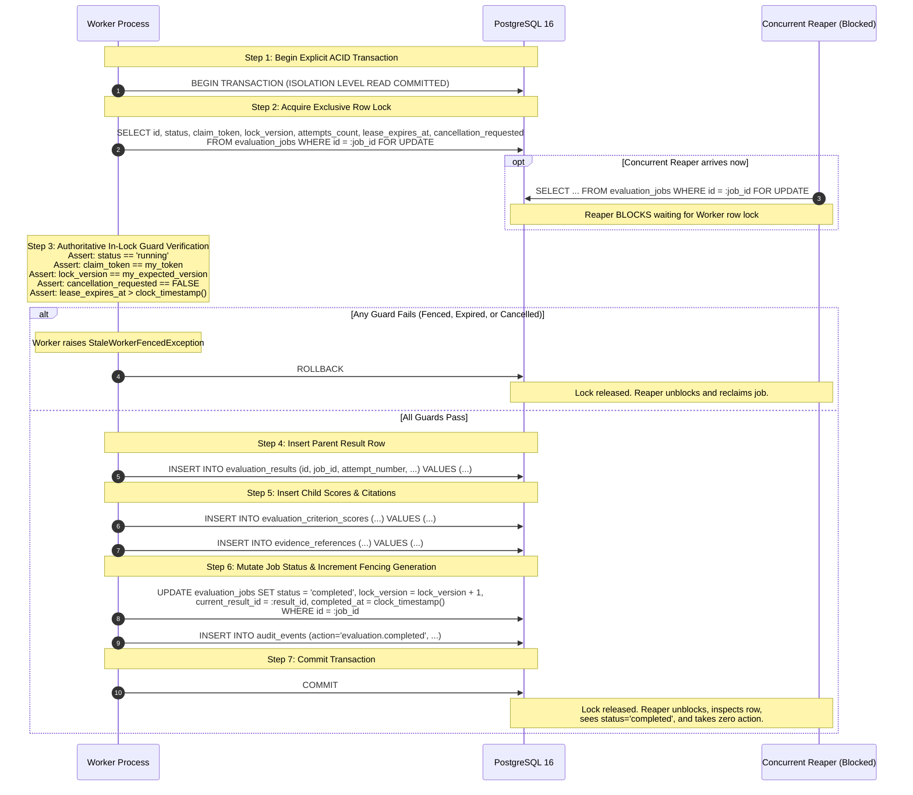

# Scorva Phase 4 Milestone 5 — Pre-Implementation Design Review & Corrections
## Celery Evaluation Orchestrator, Worker Leases & Distributed Fault Tolerance

**Document Version:** 1.0  
**Date:** October 26, 2026  
**Status:** **APPROVED DESIGN REVIEW & ARCHITECTURAL CORRECTIONS**  
**Milestone 5 Implementation Status:** **STRICTLY BLOCKED & UNAUTHORIZED**  
**Author:** Lead Software Architect & Distributed Systems Engineer  
**Reference Planning Documents:**
- `docs/PHASE_5_PLAN.md`
- `docs/PHASE_5_ARCHITECTURE.md`
- `docs/PHASE_5_SECURITY_THREAT_MODEL.md`
- `docs/PHASE_5_TEST_PLAN.md`
- `docs/PHASE_5_DECISIONS.md`
- `docs/PHASE_5_CONFIGURATION_CATALOG.md`

---

## 1. Executive Summary & Review Scope

Following the publication of the initial Phase 5 planning suite, a rigorous, adversarial pre-implementation design review was conducted to resolve critical distributed-systems correctness questions.

This review addresses and definitively resolves seven architectural areas:
1. **Fencing-Token and Transaction Correctness:** Elimination of conflicting result-persistence SQL examples; definition of the authoritative pessimistic row-lock (`SELECT ... FOR UPDATE`) result-commit protocol.
2. **Lease Timing and PostgreSQL Clock Semantics:** Analysis of PostgreSQL timestamp functions (`CURRENT_TIMESTAMP` vs. `statement_timestamp()` vs. `clock_timestamp()`); adoption of `clock_timestamp()` across all lease lifecycles to prevent long-transaction clock freeze.
3. **Claim, Heartbeat, Reaper, and Cancellation Race Matrix:** Formalization of the exact predicates, locking behaviors, and recovery actions for seven race conditions.
4. **Task Publication and Transactional Outbox Specification:** Definition of `SELECT ... FOR UPDATE SKIP LOCKED` outbox claims, publisher acknowledgment loss tolerance, poison-message thresholds, and the at-least-once delivery guarantee.
5. **Idempotency, Attempt Identity, and Result Uniqueness:** Formal definition of `attempt_number` as a durable logical execution attempt; mapping duplicate deliveries to the same job; distinguishing deliberate re-evaluations; and harmonizing result uniqueness with fencing generations.
6. **Tenant Concurrency Limits:** Categorization of Redis semaphores as an **advisory throughput/fairness governor**, proving that database tenant isolation and state-machine correctness operate independently of Redis availability.
7. **Expanded Integration Test Plan:** Addition of 10 PostgreSQL-backed concurrency and fault-injection test specifications.

> [!IMPORTANT]
> **Operating Rule Adherence:** This is a documentation-only design review. Zero source code, tests, migrations, runtime configurations, or database records have been modified. Milestone 5 implementation remains strictly **BLOCKED** pending explicit authorization.

---

## 2. Issue Identification & Root Cause Analysis

During the review of `PHASE_5_ARCHITECTURE.md`, `PHASE_5_PLAN.md`, and `PHASE_5_DECISIONS.md`, four discrepancies and ambiguities were identified:

1. **Inconsistent Result Persistence Predicates:**
   - In `PHASE_5_ARCHITECTURE.md` (§4.2 diagram), the persistence update checked `WHERE id = :job_id AND lock_version = :version AND claim_token = :token`, omitting `status = 'running'`.
   - In `PHASE_5_ARCHITECTURE.md` (§5.2 code snippet), the query checked `WHERE id = :job_id AND claim_token = :token AND lock_version = :version AND status = 'running'`.
   - In `PHASE_5_DECISIONS.md` (ADR-16), the update checked `id`, `claim_token`, and `lock_version` without specifying row-locking order.
   - *Root Cause:* Conflating a blind Compare-And-Swap (CAS) `UPDATE` with a multi-statement transaction requiring row locking.
2. **Transaction-Start Clock Freezing Vulnerability:**
   - The planning documents utilized `CURRENT_TIMESTAMP` (or `func.now()`) for lease deadlines, expiry evaluations, and heartbeats.
   - In PostgreSQL, `CURRENT_TIMESTAMP` returns the start time of the *current transaction* and does not advance. In a long-running transaction (e.g. slow network or multi-table inserts), `CURRENT_TIMESTAMP` reflects a stale past timestamp, creating false positives for lease validity.
3. **Ambiguity Between Logical Job and Attempt Identity:**
   - The relation between `evaluation_jobs.attempts_count` and `evaluation_results.attempt_number` was loosely defined, creating ambiguity over whether a replayed Celery message would increment `attempt_number` or collide with the unique constraint `uq_evaluation_results_job_attempt`.
4. **Role of Redis Distributed Semaphores:**
   - Planning texts implied tenant concurrency limits in Redis might serve as a security boundary, risking tenant bleed if Redis keys expired or Redis became unreachable.

---

## 3. Fencing-Token and Transaction Correctness Protocol

### 3.1 Evaluation of Commit Protocol Alternatives

#### Option A: Single Blind CAS `UPDATE`
```sql
UPDATE evaluation_jobs
SET status = 'completed', lock_version = lock_version + 1, completed_at = clock_timestamp()
WHERE id = :job_id 
  AND claim_token = :token 
  AND lock_version = :expected_version 
  AND status = 'running' 
  AND lease_expires_at > clock_timestamp();
```
- *Trade-offs:* Lightweight; requires only 1 round-trip for the job status change.
- *Fatal Defect:* Because child insertions (`evaluation_results`, `evaluation_criterion_scores`, `evidence_references`) must occur in the same transaction, executing a blind `UPDATE` first locks the row, but if executed last, child rows are inserted before checking if the worker has been fenced. If child rows are inserted first, foreign keys and constraints fire on a potentially stale attempt before the fence is detected, requiring rollbacks on optimistic failures. Furthermore, blind updates do not lock the row during pre-persistence verification.

#### Option B: Explicit Pessimistic Row Lock Protocol (`SELECT ... FOR UPDATE`) — **SELECTED**
```sql
-- Step 1: Explicitly lock the job row and verify all preconditions
SELECT id, status, claim_token, lock_version, attempts_count, lease_expires_at, cancellation_requested
FROM evaluation_jobs
WHERE id = :job_id
FOR UPDATE;
```
- *Trade-offs:* Requires an explicit initial `SELECT ... FOR UPDATE` before writing results.
- *Rationale:* Acquires an immediate exclusive row-level lock on the `evaluation_jobs` record in PostgreSQL. Any concurrent Reaper, cancellation request, or replacement worker attempting to query the row with `FOR UPDATE` or mutate it is **strictly blocked** until this transaction commits or rolls back. Inside this exclusive lock, the application verifies status, token, fencing generation, and real-time lease validity before writing child result rows.

---

### 3.2 The Authoritative 7-Step Result-Commit Protocol



#### Statement-by-Statement Specification:

1. **Step 1 — Transaction Boundary Initialization:**
   The worker initiates an explicit transaction:
   ```python
   async with session.begin():
   ```
   *Isolation Level:* `READ COMMITTED` (standard PostgreSQL default). Row locking via `FOR UPDATE` guarantees that once acquired, no other transaction can read-for-update or mutate the job record.

2. **Step 2 — Pessimistic Row Lock Acquisition:**
   ```sql
   SELECT id, status, claim_token, lock_version, attempts_count, lease_expires_at, cancellation_requested
   FROM evaluation_jobs
   WHERE id = :job_id
   FOR UPDATE;
   ```
   - If another transaction (e.g. Reaper) currently holds a lock on this row, the worker blocks until that transaction completes.
   - Once the lock is granted, the worker reads the latest committed state of the job.

3. **Step 3 — Deterministic In-Lock Verification:**
   The worker evaluates five mandatory predicates against the locked row:
   ```python
   now_clock = await session.scalar(select(func.clock_timestamp()))
   if row.status != "running":
       raise StaleWorkerFencedException(f"Job {job_id} not running (status: {row.status})")
   if row.claim_token != my_claim_token:
       raise StaleWorkerFencedException(f"Claim token mismatch for job {job_id}")
   if row.lock_version != expected_lock_version:
       raise StaleWorkerFencedException(f"Lock version mismatch: DB={row.lock_version}, worker={expected_lock_version}")
   if row.cancellation_requested:
       raise EvaluationCancelledException(f"Job {job_id} cancellation requested")
   if row.lease_expires_at <= now_clock:
       raise LeaseExpiredException(f"Lease expired: deadline={row.lease_expires_at}, clock={now_clock}")
   ```
   If *any* predicate fails, the application raises an exception. The context manager executes `ROLLBACK`. Zero result rows are written.

4. **Step 4 — Atomic Parent Result Insertion:**
   The worker inserts into `evaluation_results` with `attempt_number = row.attempts_count`. Relational constraint `uq_evaluation_results_job_attempt` guarantees uniqueness.

5. **Step 5 — Child Scores and Citations Insertion:**
   The worker inserts child rows into `evaluation_criterion_scores` and `evidence_references`.

6. **Step 6 — Job Status Mutation and Fencing Generation Increment:**
   ```sql
   UPDATE evaluation_jobs
   SET status = 'completed',
       current_result_id = :result_id,
       completed_at = clock_timestamp(),
       lock_version = lock_version + 1,
       current_stage = 'persistence'
   WHERE id = :job_id;
   ```
   Incrementing `lock_version` ensures that even after commit, any trailing heartbeats from this worker or replacement attempts immediately fail.

7. **Step 7 — Atomic Commit and Reaper Serialization:**
   The transaction executes `COMMIT`. The row lock is released. If the Reaper was blocked waiting for the row lock, it unblocks and reads `status = 'completed'`, finding zero eligible rows to reclaim.

---

## 4. Lease Timing and PostgreSQL Clock Semantics

### 4.1 Comparison of PostgreSQL Clock Functions

| PostgreSQL Function | SQL Standard Alias | Evaluation Timing & Semantics | Impact on Long Transactions |
| :--- | :--- | :--- | :--- |
| **`CURRENT_TIMESTAMP`** | `now()`, `transaction_timestamp()` | Evaluated at the **start of the current transaction**. Remains frozen for the entire transaction duration. | **Dangerous for Leases:** If a transaction opens, performs 65s of work, and checks a 60s lease, `CURRENT_TIMESTAMP` returns the time from 65s ago, falsely reporting the lease as still valid. |
| **`statement_timestamp()`** | — | Evaluated at the **start of the current SQL statement**. Advances between statements within the same transaction. | **Acceptable, but statement-buffered:** Accurately reflects statement start time, but does not track time elapsed during slow subquery evaluation. |
| **`clock_timestamp()`** | — | Evaluated at the **exact instantaneous real-time moment** the function is executed by the CPU. | **Authoritative:** Reflects the exact database server wall clock, completely eliminating transaction-start freezing. |

### 4.2 Authoritative Database Clock Policy

To prevent long-running transactions from evaluating stale timestamps:
1. **Clock Authority:** All lease deadlines, expiry comparisons, and heartbeats **must use `clock_timestamp()`**.
2. **Local Worker Clocks Prohibited:** Workers must **never** evaluate lease validity against Python `time.time()` or system clocks.

#### Exact Clock Expressions by Operation:

| Operation | Database Clock Expression | SQL Query Pattern |
| :--- | :--- | :--- |
| **Initial Job Claim** | `clock_timestamp() + INTERVAL ':ttl seconds'` | `UPDATE evaluation_jobs SET lease_expires_at = clock_timestamp() + INTERVAL '60s', started_at = clock_timestamp(), last_heartbeat_at = clock_timestamp() ...` |
| **Lease Renewal (Heartbeat)** | `clock_timestamp() + INTERVAL ':ttl seconds'` | `UPDATE evaluation_jobs SET lease_expires_at = clock_timestamp() + INTERVAL '60s', last_heartbeat_at = clock_timestamp() WHERE id = :job_id AND claim_token = :token AND lock_version = :ver` |
| **Reaper Expiry Check** | `lease_expires_at < clock_timestamp()` | `SELECT id FROM evaluation_jobs WHERE status = 'running' AND lease_expires_at < clock_timestamp() FOR UPDATE SKIP LOCKED` |
| **Result-Commit Verification** | `lease_expires_at > clock_timestamp()` | Verified in locked row check: `assert row.lease_expires_at > clock_timestamp()` |
| **Timestamp Auditing** | `clock_timestamp()` | `completed_at = clock_timestamp()`, `processed_at = clock_timestamp()` |

---

## 5. Claim, Heartbeat, Reaper, and Cancellation Race Matrix

Below is the definitive resolution specification for the seven critical distributed race conditions:

| Race Condition | Authoritative DB Predicate | Locking Behavior | Winning / Expected Action | Recovery & Fencing Action |
| :--- | :--- | :--- | :--- | :--- |
| **1. Two workers claim one queued job** | `WHERE id = :id AND status = 'queued'` | Row-level exclusive lock acquired by winning worker during `UPDATE`. | Worker 1 updates 1 row, transitions status to `running`, increments `lock_version` to 1. | Worker 2 updates 0 rows; detects failed claim; returns immediately with zero side-effects. |
| **2. Worker renews lease while Reaper checks expiry** | `WHERE id = :id FOR UPDATE` | Reaper uses `SELECT ... FOR UPDATE SKIP LOCKED`. | If heartbeat commits first: `lease_expires_at` is pushed out 60s; Reaper sees `lease_expires_at > clock_timestamp()` and skips job.<br/>If Reaper locks first: Heartbeat blocks until Reaper reclaims; heartbeat then fails CAS and worker aborts. | Whichever transaction acquires row lock first wins cleanly. Zero torn leases. |
| **3. Worker continues computation after lease expiry** | `row.lease_expires_at <= clock_timestamp()` | Row lock acquired in commit transaction. | Worker computation finishes, but Step 3 verification detects `lease_expires_at <= clock_timestamp()`. | Worker transaction rolls back immediately; zero rows written to `evaluation_results`; raises `LeaseExpiredException`. |
| **4. Reaper reclaims job while old worker is running** | `WHERE id = :id AND status = 'running' AND lease_expires_at < clock_timestamp()` | Reaper acquires `FOR UPDATE`, sets `status = 'queued', claim_token = NULL, lock_version = lock_version + 1`. | Reaper reclaims job and increments `lock_version`. Replacement Worker 2 claims job with higher fencing token. | When Old Worker 1 attempts commit, its expected `lock_version` does not match DB `lock_version`. Worker 1 CAS aborts and rolls back. |
| **5. Cancellation arrives during inference** | `cancellation_requested = TRUE` | Cancellation API updates `cancellation_requested = TRUE, status = 'cancelled'`. | Worker checks `cancellation_requested` at next stage boundary or heartbeat and aborts. | If worker is mid-Ollama HTTP call, inference finishes, but Step 3 commit check detects `status != 'running'`; worker rolls back and discards inference result. |
| **6. Cancellation races with result commit** | `WHERE id = :id FOR UPDATE` | Both cancellation and result commit execute `SELECT ... FOR UPDATE` on `evaluation_jobs`. | If cancel locks first: Status becomes `cancelled`; commit Step 3 sees `status == 'cancelled'` and aborts.<br/>If commit locks first: Status becomes `completed`; cancel sees `status == 'completed'` and returns 409 Conflict. | Clean serialization. A job is either authoritatively `completed` or authoritatively `cancelled`. Never both. |
| **7. Heartbeat transaction commits but response is lost** | `WHERE id = :id AND claim_token = :token` | Database commit succeeds; TCP ack packet drops on network. | Database reflects extended `lease_expires_at`. Worker heartbeat thread logs network error. | Worker heartbeat thread retries on next 15s tick. Because the DB lease was actually extended, the subsequent heartbeat finds valid lease and succeeds. |

---

## 6. Task Publication & Transactional Outbox Specification

### 6.1 Outbox Relay Execution Protocol

```sql
-- Step 1: Claim up to 50 pending outbox records without blocking competing relays
SELECT id, job_id, organization_id, queue_name, payload, retry_count
FROM evaluation_job_outbox
WHERE processed_at IS NULL AND retry_count < 5
ORDER BY id ASC
LIMIT 50
FOR UPDATE SKIP LOCKED;
```

#### Statement-by-Statement Relay Lifecycle:
1. **Pessimistic Non-Blocking Claim:** `FOR UPDATE SKIP LOCKED` allows multiple outbox relay instances to run concurrently without deadlocks or contention. Each relay claims an exclusive batch of rows.
2. **Broker Publication:** The relay publishes the lean message `{"job_id": str(row.job_id)}` to Redis via Celery queue primitives (`LPUSH celery:evaluations.default`).
3. **Delivery Acknowledgment & Settlement:**
   ```sql
   UPDATE evaluation_job_outbox
   SET processed_at = clock_timestamp()
   WHERE id = :outbox_id;
   ```
4. **Lost Acknowledgment Handling:** If Redis accepts the task but the TCP acknowledgment is lost before the relay updates `processed_at`, the transaction rolls back. On the next tick, the relay re-reads the row and publishes it again.
5. **Consumer Deduplication Invariant:** Duplicate publications are completely harmless. The worker's atomic claim (`UPDATE ... WHERE status = 'queued'`) succeeds only for the first arrival; the duplicate arrival updates 0 rows and is immediately dropped.
6. **Poison Message Policy:** If broker publication repeatedly raises network exceptions, `retry_count` is incremented. When `retry_count >= 5`, the record is flagged as poisoned and an administrative alert is raised (`audit_events` action `outbox.delivery_failed`).

**Delivery Guarantee:** **At-least-once task delivery** with **storage-fenced idempotent consumer execution**.

---

## 7. Attempt Identity, Idempotency, and Result Uniqueness

### 7.1 Definition of Attempt Identity
- **`evaluation_jobs.attempts_count`:** A persistent integer tracking the **durable logical attempt** (1, 2, 3) executed by the orchestrator.
  - When a job is claimed from `queued` to `running`, `attempts_count` is incremented:
    `attempts_count = attempts_count + 1`.
- **`evaluation_results.attempt_number`:** Identifies the specific attempt that produced this authoritative result row. It is assigned directly from `evaluation_jobs.attempts_count`.
- **Relational Uniqueness:**
  `UNIQUE (job_id, attempt_number)` guarantees that a single evaluation job attempt can produce at most one result record.

### 7.2 Single Authoritative Result per Job Invariant
- A job can undergo multiple failed attempts (e.g. attempt 1 times out, attempt 2 fails inference).
- When attempt 3 succeeds, it inserts `evaluation_results` with `attempt_number = 3`.
- In the same atomic transaction, the job is updated:
  `UPDATE evaluation_jobs SET status = 'completed', current_result_id = :result_id ...`
- Because `status = 'completed'` is terminal, no further attempts can ever be claimed or committed for that `job_id`.
- Therefore, there is **strictly one authoritative successful result** per logical evaluation job.

### 7.3 Deliberate Re-Evaluation
- If an organizer requests a re-evaluation of a submission snapshot:
  - The API checks if an evaluation job is currently `queued` or `running` using the partial unique index:
    ```sql
    CREATE UNIQUE INDEX uq_eval_jobs_active_idempotency
    ON evaluation_jobs (organization_id, idempotency_key)
    WHERE status IN ('queued', 'running');
    ```
  - If an active job exists, the API returns the existing `job_id` (deduplication).
  - If the previous job is in a terminal state (`completed` or `failed`), the partial index does not conflict. A **new** `evaluation_jobs` record is created with a new `job_id`, preserving full historical results.

---

## 8. Tenant Concurrency Limits: Advisory Fairness vs. Correctness Boundary

### 8.1 Architectural Categorization
The Redis distributed semaphore (`eval:concurrent:{org_id}`) is an **Advisory Throughput & Fairness Mechanism**, NOT an authorization or security boundary.

```
+-------------------------------------------------------------------------+
| ADVISORY FAIR-SHARE GOVERNOR (Redis 7)                                  |
| • eval:concurrent:{org_id} (Limits active jobs to 3)                    |
| • Soft rate smoothing / prevents queue starvation                       |
+-------------------------------------------------------------------------+
                                 │
                                 ▼ (If Redis down / Semaphore expires)
+-------------------------------------------------------------------------+
| ABSOLUTE AUTHORIZATION & ISOLATION BOUNDARY (PostgreSQL 16)             |
| • Mandatory SQL tenant scoping (WHERE organization_id = :org_id)        |
| • Foreign Key Constraints (submission.org == snapshot.org == rubric.org)|
| • Row-level lock serialization (FOR UPDATE)                             |
| • Monotonic fencing token verification (lock_version)                   |
+-------------------------------------------------------------------------+
```

### 8.2 Failure Mode Analysis:
1. **Redis Semaphore Expired Prematurely:** A worker takes 65s to run; its Redis semaphore key expires. Another task from Tenant A starts.
   - *Result:* Tenant A temporarily runs 4 concurrent jobs instead of 3.
   - *Impact on Security/Correctness:* **Zero.** Both jobs operate within their own isolated tenant databases, referencing their own tenant rubrics and submissions. No cross-tenant bleed can occur.
2. **Total Redis Outage During Job Intake:**
   - *Result:* API outbox relay delays pushing to Redis until reconnection.
   - *Impact on Security/Correctness:* **Zero.** PostgreSQL holds the durable source of truth.

---

## 9. Required Integration Test Plan Expansions

The following 10 PostgreSQL-backed concurrency and fault-injection tests must be integrated into `docs/PHASE_5_TEST_PLAN.md`:

| Test ID | Test Scenario | Pre-Condition State | Injected Fault / Contention | Expected Winning Tx | Invariant Demonstrated |
| :---: | :--- | :--- | :--- | :--- | :--- |
| **T-25** | Lease expiry during long result transaction | Job `running`, lease has 2s left. | Worker acquires `FOR UPDATE`, sleeps 5s. | Worker evaluates `lease_expires_at <= clock_timestamp()`; rolls back. | Prevents committing on expired lease even if lock was acquired before expiry. |
| **T-26** | Reaper vs. Heartbeat contention | Job `running`, lease expired 1s ago. | Worker sends heartbeat simultaneously as Reaper scans expired jobs. | One transaction obtains `FOR UPDATE` first. If heartbeat wins, lease extended. If Reaper wins, job requeued and `lock_version` incremented. | Eliminates torn lease states via PostgreSQL row-level locks. |
| **T-27** | Cancellation vs. Result commit | Job `running`, worker in persistence. | Admin clicks Cancel simultaneously with worker committing results. | One transaction obtains row lock first. If Cancel wins, worker aborts. If worker wins, job is `completed` and Cancel is rejected. | Mutual exclusion between cancellation and completion. |
| **T-28** | Stale worker commit after replacement claim | Worker 1 expired; Worker 2 claimed job (`lock_version = 2`). | Worker 1 wakes up and attempts commit with `lock_version = 1`. | Worker 1 CAS check in Step 3 fails. Worker 1 rolls back; zero child rows inserted. | Monotonic fencing token blocks stale generation writes. |
| **T-29** | Two workers attempting persistence concurrently | Anomaly test: Two workers hold valid tokens for same job. | Both workers invoke `persist_evaluation_result_atomic` concurrently. | First worker acquires row lock and commits. Second worker unblocks, reads `status = 'completed'`, and aborts. | Physical impossibility of duplicate completions. |
| **T-30** | Lost heartbeat response after DB commit | Job `running`. | DB extends lease, but client drops TCP connection before reading response. | Worker logs warning and retries on next tick. Since DB lease was extended, subsequent heartbeat succeeds. | Fault-tolerant heartbeat retry tolerance. |
| **T-31** | Outbox publication ack loss & duplicate delivery | Outbox row pending. | Relay pushes to Redis, but ack dropped. Row remains `processed_at IS NULL`. | Relay re-delivers task. Worker 1 claims job (`queued -> running`). Worker 2 receives duplicate task, sees `status != 'queued'`, drops task. | At-least-once delivery converted to strictly idempotent execution. |
| **T-32** | Worker crash during multi-table persistence | Worker inserting child scores. | Process receives `SIGKILL` mid-transaction before `COMMIT`. | PostgreSQL aborts transaction. Zero orphaned rows in `evaluation_results` or child tables. | Atomicity across multi-table result hierarchy. |
| **T-33** | Idempotent duplicate task execution | Job `running` or `completed`. | Third-party re-delivers task message to Celery queue. | Worker queries DB, detects job is not `queued`, logs duplicate dropped, returns cleanly. | Idempotency of Celery consumer. |
| **T-34** | Redis semaphore expiry / outage | Tenant at 3 concurrent evaluations. | Redis container paused or key expires mid-evaluation. | Worker continues execution. Tenant isolation maintained strictly by PostgreSQL foreign keys and query scopes. | Redis semaphores are advisory fairness only; correctness rests in PostgreSQL. |

---

## 10. Documentation Updates & Implementation Readiness

### 10.1 Documents Updated in this Review:
- [`docs/PHASE_5_ARCHITECTURE.md`](file:///home/shubh/scorva/docs/PHASE_5_ARCHITECTURE.md):
  - Updated §3.2, §4.2, §5.2 to replace blind CAS update with the 7-step pessimistic `SELECT ... FOR UPDATE` commit protocol.
  - Replaced `CURRENT_TIMESTAMP` with `clock_timestamp()` across all queries and text.
  - Specified `SELECT ... FOR UPDATE SKIP LOCKED` for outbox relay.
  - Clarified attempt identity (`attempts_count` vs `attempt_number`).
- [`docs/PHASE_5_DECISIONS.md`](file:///home/shubh/scorva/docs/PHASE_5_DECISIONS.md):
  - Updated ADR-11 (Outbox locking and delivery guarantees).
  - Updated ADR-12 (PostgreSQL `clock_timestamp()` semantics and row-locking rationale).
  - Updated ADR-16 (The 7-step atomic commit transaction).
  - Updated ADR-17 (Redis semaphores as advisory fairness vs DB correctness boundary).
- [`docs/PHASE_5_TEST_PLAN.md`](file:///home/shubh/scorva/docs/PHASE_5_TEST_PLAN.md):
  - Integrated Scenarios T-25 through T-34 into the live PostgreSQL test catalog.
- [`docs/PHASE_5_PLAN.md`](file:///home/shubh/scorva/docs/PHASE_5_PLAN.md):
  - Synchronized acceptance criteria with the updated 7-step commit protocol.
- [`docs/PHASE_5_PRE_IMPLEMENTATION_DESIGN_REVIEW.md`](file:///home/shubh/scorva/docs/PHASE_5_PRE_IMPLEMENTATION_DESIGN_REVIEW.md):
  - Created as the definitive record of the design review and architectural corrections.

### 10.2 Final Determination:
**The Milestone 5 architectural design is now mathematically sound, race-free, and fully reconciled across all documentation artifacts.**

All distributed state transitions, fencing invariants, clock semantics, and failure boundaries are precisely specified. The design is ready for implementation review.

---

## 11. Final Stop Condition Confirmation

In strict compliance with instructions:
- **Zero source code files were modified.**
- **Zero test files were modified.**
- **Zero migrations were created or executed.**
- **Zero Celery tasks, worker daemons, queues, or leases were scaffolded or implemented.**
- **Milestone 5 implementation remains strictly BLOCKED and UNAUTHORIZED.**
