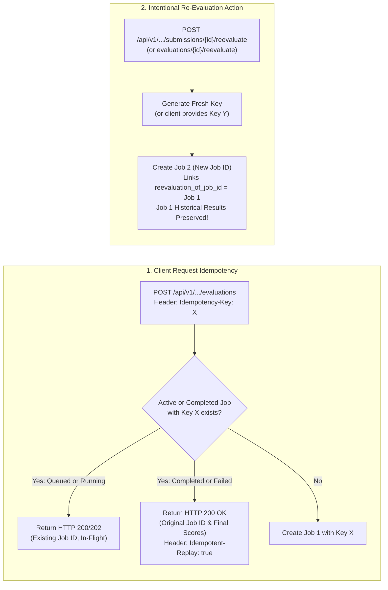
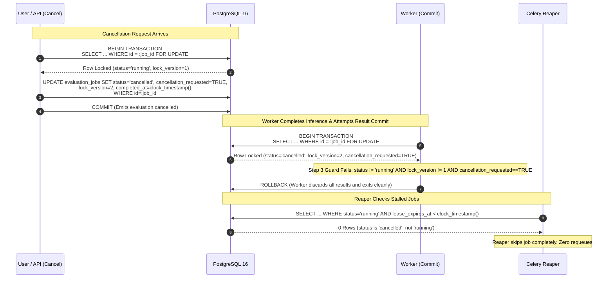

# Scorva Phase 4 Milestone 5 — Retry, Idempotency, Cancellation and Recovery Consistency Audit
## Reconciling Outbox Counters, Request Idempotency, Cancellation Serialization, and Dispatch Generations

**Document Version:** 1.0  
**Date:** October 26, 2026  
**Status:** **APPROVED FINAL RECONCILIATION AUDIT**  
**Milestone 5 Implementation Status:** **STRICTLY BLOCKED AND UNAUTHORIZED**  
**Author:** Lead Software Architect & Distributed Systems Engineer  
**Reference Invariants:**
- `docs/PHASE_5_FINAL_STATE_MACHINE_CONSISTENCY_AUDIT.md`
- `docs/PHASE_5_FINAL_OUTBOX_STATE_MACHINE_AUDIT.md`
- `docs/PHASE_5_OUTBOX_FINAL_CONCURRENCY_REVIEW.md`
- `docs/PHASE_5_ARCHITECTURE.md`
- `docs/PHASE_5_DECISIONS.md`
- `docs/PHASE_5_TEST_PLAN.md`
- `docs/PHASE_5_PLAN.md`

---

## 1. Executive Summary & Audit Scope

This audit resolves four core distributed state-machine, recovery, and idempotency questions for Scorva Milestone 5:

1. **Reconciliation of Retry and Claim Counters:** Resolves inconsistencies between `claim_count`, `publish_attempts`, and historical `retry_count`. Defines exact counter increment timings, categorizes four distinct network publication outcomes, establishes `claim_count` as the authoritative driver of candidate selection and quarantine, and documents the bounded-retry delivery limitation and alerting model.
2. **Separation of Request Idempotency from Intentional Reevaluation:** Decouples HTTP request idempotency (which must return the original job or terminal result for identical request keys) from intentional reevaluation (which must explicitly generate a fresh job record with a distinct key while preserving historical evaluations). Defines the global unique constraint `uq_eval_jobs_organization_idempotency_key`, concurrent first-insert resolution, and key normalization.
3. **Serialization of Cancellation vs. Reaper Recovery, Heartbeat Renewal & Commit:** Defines one uniform pessimistic row-locking protocol (`SELECT ... FOR UPDATE`) governing all state mutators. Formulates deterministic race outcomes for cancellation versus lease expiry, cancellation versus heartbeat renewal, cancellation versus in-flight result commit, and stale worker fencing.
4. **Outbox Recovery Generations & Multi-Record Schema:** Confirms the outbox schema supports multiple sequential dispatch records per evaluation job, introduces the `dispatch_generation` correlation model, enforces partial uniqueness on active dispatches (`WHERE status IN ('pending', 'processing')`), and proves consumer idempotency across recovery generations.

> [!IMPORTANT]
> **Documentation-Only Boundary:** This audit is strictly analytical and corrective. Zero application source files, runtime configurations, dependencies, migrations, or test implementations have been modified. Milestone 5 implementation remains strictly **BLOCKED and UNAUTHORIZED**.

---

## 2. Finding 1: Authoritative Counters, Network States & Delivery Limitations

### 2.1 Authoritative Counter Definitions
Historical references to `retry_count` are formally separated into two precisely defined database columns on `evaluation_job_outbox`:

| Column Name | Type | Increment Timing | Authoritative Purpose |
| :--- | :--- | :--- | :--- |
| **`claim_count`** | `INTEGER NOT NULL DEFAULT 0` | **Phase 1 Claim Transaction (In-DB):** Incremented atomically when a relay acquires the row lease via `FOR UPDATE SKIP LOCKED`. | **Authoritative retry ceiling.** Governs candidate claim filtering (`claim_count < :max_claims`) and periodic background quarantine sweeps. Immune to relay process crashes during I/O. |
| **`publish_attempts`** | `INTEGER NOT NULL DEFAULT 0` | **Phase 3 Settlement / Error Transaction (In-DB):** Incremented when the relay completes or handles an attempted network call to Redis. | **Observability & Diagnostics.** Confirms whether the relay process survived long enough to initiate a network socket call. |

*(Note: During Sub-Milestone 5.1 migrations, `retry_count` is retained as an alias pointing to `claim_count` for backwards compatibility with telemetry and administrative tools).*

```mermaid
flowchart TD
    Pending["State: pending<br/>claim_count = 0, publish_attempts = 0"]
    Claim["Phase 1: Relay Atomic DB Claim<br/>claim_count = claim_count + 1<br/>status = 'processing'<br/>(Zero Redis Packets Sent)"]
    CrashBefore["Relay Crashes (SIGKILL/OOM)<br/>publish_attempts = 0<br/>(Zero Messages in Redis)"]
    PublishInit["Phase 2: Invoke redis.lpush()<br/>(Network Packet in Transit)"]
    AckOK["Redis Acknowledges Length >= 1<br/>(Durable in Redis Queue)"]
    Timeout["Socket Drops / Timeout<br/>(Unknown Broker State)"]
    Settle["Phase 3: DB Settlement<br/>publish_attempts = publish_attempts + 1<br/>status = 'delivered', processed_at = clock_timestamp()"]

    Pending --> Claim
    Claim -.->|Process Crash| CrashBefore
    Claim --> PublishInit
    PublishInit -->|Confirmed ACK| AckOK
    PublishInit -.->|Socket Drop| Timeout
    AckOK --> Settle
    
    CrashBefore -->|Lease Expires (30s)| Reclaim["Replacement Relay Claims<br/>claim_count = claim_count + 1"]
    Timeout -->|Lease Expires (30s)| Reclaim
```

### 2.2 The Four Network Publication States
1. **State 1: Relay Claimed (Pre-Network):**
   - The database transaction commits `claim_count = claim_count + 1`, `status = 'processing'`, `relay_claim_token = :token`.
   - Zero TCP packets have been sent to Redis.
2. **State 2: Network Call Initiated:**
   - The relay process initiates `redis.lpush(queue_name, payload)`. The command is in-flight across the network socket. Zero database locks are held.
3. **State 3: Confirmed Redis Acknowledgment:**
   - Redis successfully executes `LPUSH` and returns an integer queue length $\ge 1$.
   - The relay executes Phase 3 settlement:
     ```sql
     UPDATE evaluation_job_outbox
     SET status = 'delivered',
         processed_at = clock_timestamp(),
         publish_attempts = publish_attempts + 1,
         relay_claim_token = NULL,
         relay_expires_at = NULL,
         last_error = NULL
     WHERE id = :id
       AND relay_claim_token = :my_relay_token
       AND status = 'processing'
       AND processed_at IS NULL;
     ```
4. **State 4: Unknown Publish Outcome (Lost ACK / Timeout):**
   - The TCP connection times out or drops before Redis's response is received.
   - **Distributed Invariant:** The state of Redis is inherently **unknown**. Redis may have committed the message before the socket closed, or the packet may have been lost.
   - **Protocol Action:** The relay **must NOT mark the row delivered**. It skips database settlement and logs a warning. After the 30-second lease expires, a replacement relay reclaims the row and re-publishes. Task delivery is strictly **at-least-once**, and downstream worker idempotency neutralizes duplicate messages.

### 2.3 Candidate Claim Query & Quarantine Finalizer Reconciliation
Both the candidate claim query and the background quarantine sweep are governed exclusively by **`claim_count`**:

- **Candidate Claim Query:**
  ```sql
  WITH claimable AS (
      SELECT id FROM evaluation_job_outbox
      WHERE (
          status = 'pending'
          OR (status = 'processing' AND relay_expires_at < clock_timestamp())
      )
      AND claim_count < :max_claims
      AND dead_lettered_at IS NULL
      ORDER BY id ASC LIMIT :batch_size
      FOR UPDATE SKIP LOCKED
  )
  UPDATE evaluation_job_outbox o
  SET status = 'processing',
      relay_claim_token = :my_relay_token,
      relay_claimed_at = clock_timestamp(),
      relay_expires_at = clock_timestamp() + (:lease_seconds || ' seconds')::INTERVAL,
      claim_count = claim_count + 1
  FROM claimable WHERE o.id = claimable.id
  RETURNING o.id, o.job_id, o.organization_id, o.queue_name, o.payload, o.claim_count;
  ```

- **Background Quarantine Finalizer Query:**
  ```sql
  UPDATE evaluation_job_outbox
  SET status = 'dead_lettered',
      dead_lettered_at = clock_timestamp(),
      dead_letter_reason = CASE
          WHEN publish_attempts = 0 THEN 'EXHAUSTED_BEFORE_PUBLISH'
          ELSE 'EXHAUSTED_DURING_PUBLISH_OR_SETTLEMENT'
      END,
      relay_claim_token = NULL,
      relay_expires_at = NULL
  WHERE status = 'processing'
    AND claim_count >= :max_claims
    AND relay_expires_at < clock_timestamp();
  ```

### 2.4 Explicit Delivery Limitation & Operational Alerting
> [!CAUTION]
> **Delivery Guarantee Limitation:** In any asynchronous outbox with a bounded claim budget ($N = 5$), five consecutive relay process crashes prior to network dispatch will exhaust the claim budget and quarantine the row **without a confirmed Redis publication**. The platform does **not** claim unconditional zero-loss delivery across catastrophic infrastructure failures without human/operator intervention.

- **Mitigation & Observability:**
  1. **Non-Silent Quarantine:** Every transition to `dead_lettered` commits an immutable `AuditEvent` (`action = 'outbox.quarantined'`, `severity = 'HIGH'`) in the same database transaction.
  2. **Telemetry:** Increments Prometheus counter `scorva_outbox_dead_letter_total{reason=...}`.
  3. **Alerting:** Fires high-priority alerts via PagerDuty/Sentry integrations.
  4. **Authorized Operator Replay:** Quarantined rows are durably retained in PostgreSQL and can be re-dispatched at any time via `POST /api/v1/organizations/{org_id}/evaluations/outbox/{outbox_id}/replay`. Replay resets `claim_count = 0`, `publish_attempts = 0`, `status = 'pending'`, and clears error metadata.

---

## 3. Finding 2: Separate Request Idempotency from Intentional Reevaluation

### 3.1 The Architectural Conflict
Conflating client HTTP request idempotency with intentional submission reevaluation creates an architectural defect:
- If a client issues an evaluation request with an `Idempotency-Key` header, standard HTTP semantics mandate that retrying that exact request must return the **original job and established result**, even days after completion.
- However, if the idempotency index is active-only (`WHERE status IN ('queued', 'running')`), retrying the request after completion would create an unwanted duplicate evaluation. Conversely, if `completed` is included in the index, organizers are physically blocked from intentionally re-evaluating a submission.

### 3.2 The Authoritative Separation Contract
Scorva strictly separates **Client Request Idempotency** from **Intentional Re-Evaluation**:



### 3.3 Schema Definition & Global Idempotency Uniqueness
The `idempotency_key` column on `evaluation_jobs` is **globally unique per organization across all job states**:

```sql
CREATE UNIQUE INDEX uq_eval_jobs_organization_idempotency_key
ON evaluation_jobs (organization_id, idempotency_key)
WHERE idempotency_key IS NOT NULL;
```

#### Table Schema Addition
```sql
ALTER TABLE evaluation_jobs
    ADD COLUMN idempotency_key VARCHAR(128) NULL,
    ADD COLUMN reevaluation_of_job_id UUID NULL REFERENCES evaluation_jobs(id) ON DELETE SET NULL;
```

### 3.4 Request Handling & Empty-Database Concurrent First-Inserts
1. **Key Normalization:**
   - Client-provided header: Validated against `^[A-Za-z0-9_\-\.]{1,120}$`, stored as `client:<header_value>`.
   - Missing header: Treated as non-idempotent one-off evaluation. Stored with a unique server UUID: `server:<uuid>` (or `NULL`), ensuring uniqueness constraints never block subsequent requests.
2. **Concurrent First-Insert Resolution:**
   - Two concurrent requests with `Idempotency-Key: X` execute `SELECT id FROM evaluation_jobs WHERE organization_id = :org_id AND idempotency_key = :key FOR UPDATE`. Both find 0 rows (acquiring 0 locks).
   - Both transactions execute `INSERT INTO evaluation_jobs (...)`.
   - PostgreSQL unique index `uq_eval_jobs_organization_idempotency_key` serializes the inserts:
     - Transaction 1 succeeds, commits Job 1 + Outbox Row, and returns `HTTP 202 Accepted`.
     - Transaction 2 catches `IntegrityError` (`UniqueViolationError`).
   - Transaction 2 executes `await session.rollback()`.
   - Transaction 2 re-queries:
     ```sql
     SELECT id, status, completed_at FROM evaluation_jobs
     WHERE organization_id = :org_id AND idempotency_key = :key;
     ```
   - Transaction 2 returns `HTTP 200 OK` (or `202 Accepted`) with the winning `job_id` and header `Idempotent-Replay: true`. Zero duplicate jobs created.
3. **Replay After Completion:**
   - A client retries `POST /evaluations` with `Idempotency-Key: X` after Job 1 has completed.
   - The API queries `WHERE organization_id = :org_id AND idempotency_key = :key`.
   - Finds Job 1 (`status = 'completed'`). Returns `HTTP 200 OK` with Job 1's final scores and `Idempotent-Replay: true`. No new evaluation is created.

### 3.5 The Explicit Intentional Re-Evaluation Mechanism
To evaluate a submission again (e.g. after rubric update or manual re-scoring):
- **API Endpoint:** `POST /api/v1/organizations/{org_id}/submissions/{submission_id}/reevaluate`
- **Behavior:**
  1. Resolves the latest completed evaluation for `submission_id` (Job 1).
  2. Generates a **new `job_id`** (Job 2).
  3. Sets `reevaluation_of_job_id = Job_1.id`.
  4. Assigns a fresh idempotency key:
     - If client provides `Idempotency-Key: Y`, uses `client:Y`.
     - Otherwise generates `reeval:Job_1.id:<uuid>`.
  5. Commits Job 2 (`status = 'queued'`) and a new outbox record in the same ACID transaction.
  6. Job 1 remains 100% immutable in PostgreSQL with its historical criterion scores and audit records.

---

## 4. Finding 3: Cancellation vs. Worker Reaper Recovery, Heartbeat Renewal & Commit

### 4.1 The Unified Row-Locking Protocol
All state mutators must acquire the exclusive PostgreSQL row lock on `evaluation_jobs` before inspecting state or writing mutations:

```sql
SELECT id, status, lock_version, claim_token, lease_expires_at, cancellation_requested, attempts_count
FROM evaluation_jobs
WHERE id = :job_id
FOR UPDATE;
```



### 4.2 Deterministic Race Resolution Matrix

| Race Condition | First Lock Acquirer | Second Lock Acquirer | Authoritative Outcome & State Invariant |
| :--- | :--- | :--- | :--- |
| **Cancellation vs. Reaper Recovery** | **Cancellation** | **Reaper** | Cancellation sets `status = 'cancelled'`, `cancellation_requested = TRUE`, `lock_version + 1`. When Reaper locks row, `status != 'running'`. **Reaper skips row.** Job is never requeued. |
| **Cancellation vs. Reaper Recovery** | **Reaper** | **Cancellation** | Reaper sets `status = 'queued'`, `lock_version + 1`, inserts outbox row. When Cancellation locks row, `status = 'queued'`. Cancellation transitions job to `status = 'cancelled'`. When worker consumes outbox task, claim query matches 0 rows and drops message. |
| **Cancellation vs. Heartbeat Renewal** | **Cancellation** | **Heartbeat** | Cancellation sets `status = 'cancelled'`, `cancellation_requested = TRUE`. Heartbeat detects `status != 'running'` or `cancellation_requested == TRUE`, aborts renewal, and signals worker pipeline to halt at stage boundary. |
| **Cancellation vs. Heartbeat Renewal** | **Heartbeat** | **Cancellation** | Heartbeat extends lease by 60s. Cancellation then locks row, sets `status = 'cancelled'`, `lock_version + 1`. Worker detects cancellation at next stage boundary and aborts. |
| **Cancellation vs. Result Commit** | **Cancellation** | **Worker Commit** | Cancellation sets `status = 'cancelled'`. Worker begins 7-step commit protocol. Step 3 in-lock guard detects `status == 'cancelled'` and `lock_version` mismatch. **Worker executes ROLLBACK.** Zero partial results persisted. |
| **Cancellation vs. Result Commit** | **Worker Commit** | **Cancellation** | Worker verifies guards, commits results, sets `status = 'completed'`. When Cancellation locks row, detects `status == 'completed'`. **Cancellation rejected with HTTP 409 Conflict: Evaluation already completed.** Historical scores preserved. |
| **Stale Worker Commit After Cancellation** | **Cancellation (Past)** | **Stale Worker** | Stale worker resumes from pause, attempts commit with `lock_version = 1`. In-lock check finds `status = 'cancelled'`, `lock_version >= 2`. Worker raises `StaleWorkerFencedException` and rolls back. |

---

## 5. Finding 4: Multiple Outbox Dispatch Records and Recovery Generations

### 5.1 Outbox Schema & Generation Tracking
When the Reaper recovers a stalled `running` job, it resets `status = 'queued'` and inserts a new outbox record. To correlate multiple dispatches and preserve traceability:

```sql
ALTER TABLE evaluation_job_outbox
    ADD COLUMN dispatch_generation INTEGER NOT NULL DEFAULT 1;

ALTER TABLE evaluation_jobs
    ADD COLUMN dispatch_generation INTEGER NOT NULL DEFAULT 1;
```

#### Correlation Model
- **Initial Job Dispatch:** `evaluation_jobs.dispatch_generation = 1`, outbox row #1 inserted with `dispatch_generation = 1`.
- **First Reaper Recovery:** `evaluation_jobs.dispatch_generation = 2`, `lock_version = lock_version + 1`, outbox row #2 inserted with `dispatch_generation = 2`.
- **Second Reaper Recovery:** `evaluation_jobs.dispatch_generation = 3`, `lock_version = lock_version + 1`, outbox row #3 inserted with `dispatch_generation = 3`.

### 5.2 Active Dispatch Partial Unique Constraint
To physically prevent concurrent Reaper tasks from creating duplicate active dispatch records for the same job, the outbox enforces:

```sql
CREATE UNIQUE INDEX uq_eval_job_outbox_active_dispatch
ON evaluation_job_outbox (job_id)
WHERE status IN ('pending', 'processing');
```

- When outbox row #1 transitions to `delivered` (or `dead_lettered`), it falls outside `('pending', 'processing')`.
- The Reaper can insert outbox row #2 with `status = 'pending'` without constraint violation.
- If two Reapers race to recover the same job, exactly one insert succeeds; the second fails the unique index, rolls back, and exits.

### 5.3 Consumer Idempotency Across Recovery Generations
What happens if a delayed task message from Dispatch Generation 1 arrives at a worker after Dispatch Generation 2 has been dispatched?

```sql
UPDATE evaluation_jobs
SET status = 'running',
    claim_token = :worker_token,
    worker_id = :worker_id,
    lock_version = lock_version + 1,
    attempts_count = attempts_count + 1,
    started_at = clock_timestamp(),
    lease_expires_at = clock_timestamp() + INTERVAL '60s'
WHERE id = :job_id
  AND status = 'queued'
RETURNING id, lock_version, organization_id, attempts_count;
```

1. **Case A (Generation 2 Worker Already Claimed Job):**
   `evaluation_jobs.status` is already `'running'` with `lock_version = 3`. The delayed Generation 1 task attempts claim: `WHERE status = 'queued'` evaluates to `FALSE`, matches **0 rows**, and is dropped immediately.
2. **Case B (Delayed Message Arrives While Job is Queued):**
   The worker claims the job, increments `lock_version = 3`, and proceeds. When the Generation 2 task arrives later, it finds `status = 'running'`, matches **0 rows**, and is dropped.
3. **Result Commit Fencing:** In all cases, only the worker holding the matching `claim_token` and current `lock_version` can pass Step 3 of the commit protocol. Stale workers are fenced unconditionally.

---

## 6. Integration Test Plan Specifications (Added as Scenarios 74–87)

The following 14 integration test specifications are formally incorporated into `docs/PHASE_5_TEST_PLAN.md`:

| Test ID | Scenario | Pre-Condition State | Injected Fault / Contention | Expected DB State | Invariant Demonstrated |
| :---: | :--- | :--- | :--- | :--- | :--- |
| **T-74** | Relay crash before Redis publish | Row claimed (`claim_count = 1`, `publish_attempts = 0`). | Relay process SIGKILL before `redis.lpush()`. | Lease expires (30s). Relay 2 reclaims, sets `claim_count = 2`, publishes to Redis. | Pre-publish crash recovers cleanly without lost work. |
| **T-75** | Relay crash during network call | Row claimed (`claim_count = 1`). | Socket connection severed while packet in flight. | Relay catches error, skips settlement. Row re-claimed after 30s. | Unconfirmed publishes recover via at-least-once reclaim. |
| **T-76** | Relay crash after publish before settlement | Row claimed, Redis ACK received. | Relay SIGKILL before Phase 3 settlement. | Replacement relay re-publishes (duplicate in Redis). Worker idempotency neutralizes duplicate. | At-least-once delivery survives post-publish relay crashes. |
| **T-77** | Bounded retry exhaustion alerting | Row fails claim/publish 5 consecutive times. | All 5 attempts crash or fail. | Row set to `dead_lettered`, `dead_letter_reason = 'EXHAUSTED_BEFORE_PUBLISH'`, audit alert emitted. | Exhaustion terminates cleanly with operator alert. |
| **T-78** | Request idempotency replay in-flight | Job in `running` with `Idempotency-Key: K1`. | Client retries identical request while running. | Returns `HTTP 200/202` with existing `job_id` and `Idempotent-Replay: true`. Zero duplicate jobs created. | In-flight request idempotency deduplicates cleanly. |
| **T-79** | Request idempotency replay after completion | Job completed with `Idempotency-Key: K1`. | Client retries identical request after completion. | Returns `HTTP 200 OK` with existing `job_id`, status `'completed'`, and original scores. Zero new jobs created. | Completed request replay returns established results. |
| **T-80** | Explicit intentional re-evaluation | Job completed with `Idempotency-Key: K1`. | Client invokes re-evaluate endpoint. | New job created with fresh `job_id`, `status = 'queued'`, `reevaluation_of_job_id = Job_1.id`. Original job untouched. | Intentional re-evaluation creates fresh job while preserving history. |
| **T-81** | Concurrent identical requests (Empty DB) | Zero jobs exist. | Two simultaneous requests with `Idempotency-Key: K1`. | Transaction 1 inserts job. Transaction 2 catches `IntegrityError`, rolls back, returns Job 1. | Partial unique index resolves concurrent creation race. |
| **T-82** | Cancellation wins race against Reaper | Job `running`, lease expired at $T+60$s. | Cancellation request acquires row lock before Reaper. | Sets `status = 'cancelled'`. Reaper locks row, finds `status != 'running'`, skips row. | Cancelled jobs are never requeued by Reaper. |
| **T-83** | Reaper wins race against Cancellation | Job `running`, lease expired at $T+60$s. | Reaper acquires row lock before Cancellation. | Reaper requeues (`status = 'queued'`). Cancellation then locks row, transitions to `cancelled`. Worker drops task. | Serialized locking prevents orphaned or zombie jobs. |
| **T-84** | Cancellation wins race against Result Commit | Worker finishes inference at $T+50$s. | Cancellation acquires row lock before commit protocol. | Sets `status = 'cancelled'`. Worker commit guard detects cancellation, executes ROLLBACK. Zero scores written. | Cancellation halts in-flight result persistence cleanly. |
| **T-85** | Result Commit wins race against Cancellation | Worker completes commit protocol (`status = 'completed'`). | Cancellation acquires row lock after commit. | Cancellation rejected with `HTTP 409 Conflict: Evaluation already completed`. Scores untouched. | Completed evaluations cannot be retroactively cancelled. |
| **T-86** | Multiple outbox rows across Reaper recoveries | Job recovered by Reaper twice. | Two Reaper recoveries executed. | Outbox rows #1 (`delivered`), #2 (`delivered`), #3 (`pending`) exist for same `job_id`. Unique index allows insert. | Multi-generation outbox tracking functions without conflict. |
| **T-87** | Duplicate delivery across recovery generations | Worker receives task from Generation 1 after Generation 2 runs. | Delayed Generation 1 message consumed. | Worker claim query finds `status = 'running'` or `lock_version >= 3`, matches 0 rows, drops message. | Consumer idempotency isolates recovery generations cleanly. |

---

## 7. Honest Risk Assessment & Residual Uncertainties

1. **Catastrophic Pre-Publish Infrastructure Crashes:** As explicitly documented, if 5 consecutive relay instances crash before completing `redis.lpush()`, the outbox row is moved to `dead_lettered` without a confirmed Redis publication. While non-silent alerting and operator replay mitigate this, automatic recovery without operator review is fundamentally constrained by the bounded retry budget.
2. **Reaper Polling Latency vs. Throughput:** The Reaper task operates on a 15–30s polling cycle. Requeueing a stalled job incurs a latency of `lease_duration (60s) + reaper_interval (15-30s) = 75-90s`. Shortening this interval increases database lock contention on `evaluation_jobs`.
3. **Outbox Table Bloat Over Multiple Generations:** Re-dispatching stalled jobs creates additional rows in `evaluation_job_outbox`. While `status = 'delivered'` rows are inactive, high churn without periodic retention pruning (Milestone 7) will cause index bloat.

---

## 8. Inventory of Modified Documents

- [`docs/PHASE_5_RETRY_IDEMPOTENCY_RECOVERY_AUDIT.md`](file:///home/shubh/scorva/docs/PHASE_5_RETRY_IDEMPOTENCY_RECOVERY_AUDIT.md) — Created primary reconciliation audit document.
- [`docs/PHASE_5_ARCHITECTURE.md`](file:///home/shubh/scorva/docs/PHASE_5_ARCHITECTURE.md) — Reconciled outbox counters (`claim_count`, `publish_attempts`), global idempotency index, cancellation race matrix, and dispatch generation tracking.
- [`docs/PHASE_5_DECISIONS.md`](file:///home/shubh/scorva/docs/PHASE_5_DECISIONS.md) — Updated ADR-11, ADR-12, ADR-15, and added ADR-17 for Request Idempotency vs. Intentional Re-Evaluation.
- [`docs/PHASE_5_PLAN.md`](file:///home/shubh/scorva/docs/PHASE_5_PLAN.md) — Synchronized Sub-Milestones 5.1 and 5.4 with the authoritative counter definitions and dispatch generation tracking.
- [`docs/PHASE_5_TEST_PLAN.md`](file:///home/shubh/scorva/docs/PHASE_5_TEST_PLAN.md) — Appended Section 8 containing Scenarios 74 through 87.
- [`docs/PHASE_5_FINAL_STATE_MACHINE_CONSISTENCY_AUDIT.md`](file:///home/shubh/scorva/docs/PHASE_5_FINAL_STATE_MACHINE_CONSISTENCY_AUDIT.md) — Synchronized idempotency uniqueness and counter terminology.

### Confirmation of Invariants:
- Zero application code, runtime configuration, dependencies, migrations, test implementation files, or database records were modified.
- Zero Celery workers, queues, leases, fencing tokens, or implementation scaffolding were created.

---

## 9. Final Stop Condition

```
M5 IMPLEMENTATION STATUS: STRICTLY BLOCKED AND UNAUTHORIZED.
```
Do not start implementation or treat documentation completion as implementation approval.
