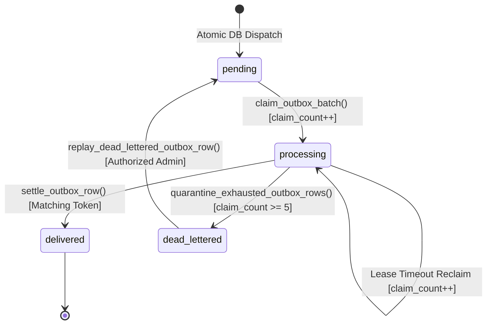

# Scorva Phase 4 Milestone 5 — Sub-Milestone 5.1 Completion Report

**Document Version:** 1.0  
**Date:** October 26, 2026  
**Status:** **SUB-MILESTONE 5.1 IMPLEMENTED, TESTED & VERIFIED**  
**Milestone 5 Implementation Scope:** Sub-Milestone 5.1 (Database Schema & Transactional Outbox)  
**Post-5.1 Implementation Status:** **Sub-Milestones 5.2–5.5 STRICTLY BLOCKED & PENDING EXPLICIT AUTHORIZATION**  
**Database Verification Target:** PostgreSQL 16 on `:5432` (`scorva` database)  
**Test Suite Verification:** 18/18 M5.1 tests passing (283/283 across full regression suite)

---

## 1. Executive Summary & Authorization Context

### 1.1 Authorization & Mission
Under explicit user authorization for **Phase 4, Sub-Milestone 5.1: Database Schema and Transactional Outbox**, the implementation phase for Subsystem C (Background Evaluation Execution) was initiated. This supersedes prior documentation-only hold states for Sub-Milestone 5.1 while strictly keeping Sub-Milestones 5.2 through 5.5 blocked pending subsequent authorization.

The core deliverable of Sub-Milestone 5.1 is the dual-write elimination architecture: guaranteeing that evaluation dispatch is ACID-atomic between PostgreSQL state changes (`evaluation_jobs`, `audit_events`) and asynchronous worker dispatch queues (`evaluation_job_outbox`).

### 1.2 Implemented Core Capabilities
1. **Reversible Alembic Migration (`9e37b1c1921d`):** Added distributed lease, idempotency, request fingerprinting, re-evaluation lineage, and cancellation columns to `evaluation_jobs`; created `evaluation_job_outbox` table with partial unique index, compound claimable index, and quarantine index. Verified through forward, backward, and re-upgrade cycles.
2. **SQLAlchemy ORM Mapping:** Updated [`EvaluationJob`](file:///home/shubh/scorva/apps/api/modules/evaluations/models.py#L440-L530) and implemented [`EvaluationJobOutbox`](file:///home/shubh/scorva/apps/api/modules/evaluations/models.py#L532-L630).
3. **Two-Phase Persisted Relay Outbox Service:** Implemented [`apps/api/modules/evaluations/outbox.py`](file:///home/shubh/scorva/apps/api/modules/evaluations/outbox.py) with atomic batch claiming via `FOR UPDATE SKIP LOCKED`, monotonic `claim_count` increments, out-of-transaction Redis publishing support, token-fenced conditional settlement, and dead-letter quarantine sweeps with audit event recording.
4. **Single-Transaction Atomic Dispatch:** Implemented [`dispatch_evaluation_job_atomic`](file:///home/shubh/scorva/apps/api/modules/evaluations/service.py#L368-L540) ensuring `evaluation_jobs`, `evaluation_job_outbox`, and `audit_events` commit or rollback as one atomic unit.
5. **Idempotency Key & Request Fingerprinting:** Canonical JSON SHA-256 fingerprinting guarantees safe idempotent replays (returning existing job without duplicate queue insertion) and prevents parameter mutation races (returning `409 IDEMPOTENCY_CONFLICT`).
6. **Intentional Re-Evaluation Lineage:** Implemented [`reevaluate_submission_atomic`](file:///home/shubh/scorva/apps/api/modules/evaluations/service.py#L542-L670) establishing child evaluation jobs linked via `reevaluation_of_job_id` while preserving historical runs.
7. **FastAPI Endpoints & RBAC Guards:** Exposed `/evaluations`, `/reevaluate`, and `/outbox/{id}/replay` routes in [`apps/api/modules/evaluations/router.py`](file:///home/shubh/scorva/apps/api/modules/evaluations/router.py) mounted under `/api/v1/organizations/{org_id}` in [`main.py`](file:///home/shubh/scorva/apps/api/main.py).
8. **Automated Verification:** 18 dedicated unit and integration tests passing against real PostgreSQL 16 with zero regressions across the codebase.

---

## 2. Implemented Schema Architecture & Database DDL Verification

### 2.1 Alembic Migration
- **Revision ID:** `9e37b1c1921d`
- **Revises:** `d630cee07d82` (M2 Remediation Head)
- **Path:** [`apps/api/alembic/versions/9e37b1c1921d_m5_1_evaluation_outbox_and_idempotency.py`](file:///home/shubh/scorva/apps/api/alembic/versions/9e37b1c1921d_m5_1_evaluation_outbox_and_idempotency.py)

#### Columns Added to `evaluation_jobs`:
| Column | Type | Nullable | Default | Description |
| :--- | :--- | :---: | :---: | :--- |
| `lease_expires_at` | `TIMESTAMPTZ` | NULL | `None` | Authoritative PostgreSQL expiry timestamp for distributed worker execution |
| `cancellation_requested` | `BOOLEAN` | NOT NULL | `false` | Cooperative cancellation flag polled by active workers |
| `idempotency_key` | `VARCHAR(128)` | NULL | `None` | Client-provided deduplication key normalized to `client:<key>` |
| `request_fingerprint` | `VARCHAR(64)` | NULL | `None` | SHA-256 canonical hash of `(submission_id, rubric_version_id, snapshot_id, config)` |
| `reevaluation_of_job_id` | `UUID` | NULL | `None` | Foreign key referencing `evaluation_jobs.id ON DELETE SET NULL` |
| `dispatch_generation` | `INTEGER` | NOT NULL | `1` | Monotonic generation counter incremented on reaper re-dispatches |

#### Indexes Added to `evaluation_jobs`:
- `uq_eval_jobs_organization_idempotency_key`: Partial UNIQUE index on `(organization_id, idempotency_key) WHERE idempotency_key IS NOT NULL`.
- `ix_eval_jobs_reevaluation_of`: B-Tree index on `(reevaluation_of_job_id) WHERE reevaluation_of_job_id IS NOT NULL`.

#### New Table: `evaluation_job_outbox`:
```sql
CREATE TABLE evaluation_job_outbox (
    id BIGSERIAL PRIMARY KEY,
    job_id UUID NOT NULL REFERENCES evaluation_jobs(id) ON DELETE CASCADE,
    organization_id UUID NOT NULL REFERENCES organizations(id) ON DELETE RESTRICT,
    queue_name VARCHAR(50) NOT NULL DEFAULT 'evaluations.default',
    routing_key VARCHAR(50) NOT NULL DEFAULT 'evaluations.default',
    payload JSONB NOT NULL DEFAULT '{}'::jsonb,
    status VARCHAR(20) NOT NULL DEFAULT 'pending',
    relay_claim_token UUID NULL,
    relay_claimed_at TIMESTAMPTZ NULL,
    relay_expires_at TIMESTAMPTZ NULL,
    retry_count INTEGER NOT NULL DEFAULT 0,
    claim_count INTEGER NOT NULL DEFAULT 0,
    publish_attempts INTEGER NOT NULL DEFAULT 0,
    dispatch_generation INTEGER NOT NULL DEFAULT 1,
    last_error TEXT NULL,
    dead_lettered_at TIMESTAMPTZ NULL,
    dead_letter_reason VARCHAR(100) NULL,
    created_at TIMESTAMPTZ NOT NULL DEFAULT clock_timestamp(),
    processed_at TIMESTAMPTZ NULL,
    CONSTRAINT chk_outbox_status CHECK (status IN ('pending', 'processing', 'delivered', 'dead_lettered'))
);
```

#### Outbox Indexes:
1. `uq_eval_job_outbox_active_dispatch`: Partial UNIQUE index on `(job_id) WHERE status IN ('pending', 'processing')`. Guarantees at most one active dispatch entry per job.
2. `ix_eval_job_outbox_claimable`: Compound index on `(status, claim_count, relay_expires_at, id) WHERE dead_lettered_at IS NULL AND processed_at IS NULL`. Supports low-latency `FOR UPDATE SKIP LOCKED` candidate queries.
3. `ix_eval_job_outbox_quarantine`: Partial index on `(id) WHERE status = 'processing' AND claim_count >= 5 AND dead_lettered_at IS NULL`. Supports periodic quarantine sweeps.

### 2.2 Reversibility Verification
- Executed `alembic upgrade head`: Applied successfully.
- Executed `alembic downgrade -1`: Downgraded cleanly back to `d630cee07d82`, dropping `evaluation_job_outbox` and removing columns/indexes from `evaluation_jobs`.
- Executed `alembic upgrade head`: Re-applied cleanly to `9e37b1c1921d`.

---

## 3. Transactional Outbox Lifecycle & State-Machine Verification

The outbox adheres to the 4-state lifecycle defined in ADR-11 and the Pre-Implementation Design Review:



### 3.1 Two-Phase Persisted Relay Lease Protocol
1. **Candidate Query & Atomic Claim (`claim_outbox_batch`):**
   ```sql
   WITH candidates AS (
       SELECT id
       FROM evaluation_job_outbox
       WHERE (
           (status = 'pending' AND claim_count < :max_claims)
           OR (status = 'processing' AND relay_expires_at <= clock_timestamp() AND claim_count < :max_claims)
       )
       AND dead_lettered_at IS NULL
       AND processed_at IS NULL
       ORDER BY created_at ASC
       FOR UPDATE SKIP LOCKED
       LIMIT :batch_size
   )
   UPDATE evaluation_job_outbox
   SET status = 'processing',
       relay_claim_token = :relay_token,
       relay_claimed_at = clock_timestamp(),
       relay_expires_at = clock_timestamp() + (:lease_seconds || ' seconds')::interval,
       claim_count = claim_count + 1,
       retry_count = retry_count + 1
   FROM candidates
   WHERE evaluation_job_outbox.id = candidates.id
   RETURNING evaluation_job_outbox.*;
   ```
2. **Decoupled Out-of-Transaction Publishing:** The relay commits the batch claim immediately and releases database row locks. Publishing to Redis occurs with a bounded timeout (default 2.0s). Database connections are not held open during broker network operations.
3. **Token-Fenced Conditional Settlement (`settle_outbox_row`):**
   ```sql
   UPDATE evaluation_job_outbox
   SET status = 'delivered',
       processed_at = clock_timestamp(),
       publish_attempts = publish_attempts + 1,
       relay_claim_token = NULL,
       relay_expires_at = NULL,
       last_error = NULL
   WHERE id = :outbox_id
     AND relay_claim_token = :relay_token
     AND status = 'processing'
     AND processed_at IS NULL;
   ```
   If a relay's lease expired and a replacement relay reclaimed the row, `relay_claim_token` will not match, returning `rowcount == 0` and safely aborting settlement.
4. **Quarantine & Error Backoff:**
   - Publication errors call `record_outbox_publish_error`: increments `publish_attempts`, records `last_error`, and resets `relay_expires_at` using exponential backoff with jitter (`min(2^publish_attempts, 60s)`).
   - `quarantine_exhausted_outbox_rows` transitions rows where `claim_count >= 5` to `'dead_lettered'`, clears `relay_claim_token` and `relay_expires_at`, and emits an `outbox.quarantined` audit event.
5. **Authorized Operator Replay:**
   - `replay_dead_lettered_outbox_row` resets `status = 'pending'`, zeroes `claim_count` and `publish_attempts`, clears error metadata, and emits an `outbox.replayed` audit event.

---

## 4. Idempotency Key, Request Fingerprint & Replay Behavior

### 4.1 Canonical Request Fingerprinting
The request fingerprint is calculated via:
```python
payload = {
    "submission_id": str(submission_id),
    "rubric_version_id": str(rubric_version_id),
    "snapshot_id": str(snapshot_id) if snapshot_id else None,
    "config": configuration_override or {},
}
canonical_json = json.dumps(payload, sort_keys=True, separators=(",", ":"))
return hashlib.sha256(canonical_json.encode("utf-8")).hexdigest()
```

### 4.2 Deduplication Behavior
- **Normalized Key:** Normalized with prefix `client:<key>` to prevent collision with internal keys.
- **Identical Replay:** Presenting the same `Idempotency-Key` with identical request payload returns the existing `EvaluationJob` with HTTP `200 OK` and header `Idempotent-Replay: true`. No duplicate job, outbox row, or audit event is created.
- **Payload Conflict:** Presenting the same `Idempotency-Key` with altered payload parameters (e.g. differing snapshot, rubric, or config) triggers `409 IDEMPOTENCY_CONFLICT`.
- **Concurrent Insert Race:** Handled via database unique constraint violation catch on `uq_eval_jobs_organization_idempotency_key`, rolling back and returning the winning job if fingerprints match or raising `409 IDEMPOTENCY_CONFLICT` if they differ.

---

## 5. Re-Evaluation Mechanism & Lineage Preservation

Implemented in [`reevaluate_submission_atomic`](file:///home/shubh/scorva/apps/api/modules/evaluations/service.py#L542):
1. **Lineage Linkage:** Locates the latest prior evaluation for the submission and sets `reevaluation_of_job_id = previous_job.id`.
2. **Historical Immutability:** The parent evaluation job, its criteria scores, and evidence references remain completely untouched and locked.
3. **Dedicated Dispatch Generation:** Generates a new child `EvaluationJob` (initial status `'queued'`) and an independent active outbox entry (`dispatch_generation = 1`).
4. **Idempotency Protection:** Re-evaluations generate a new unique key (`reeval:<parent_id>:<uuid>`) or require a distinct client key. Reusing the exact client key of the parent job is rejected with `409 IDEMPOTENCY_KEY_REUSE`.
5. **Audit Event:** Emits `evaluation.reevaluated` recording `parent_job_id` and parameters in `diff_payload`.

---

## 6. API Route Integration & RBAC Enforcement Matrix

Routes registered in [`apps/api/modules/evaluations/router.py`](file:///home/shubh/scorva/apps/api/modules/evaluations/router.py) and mounted under `/api/v1`:

| Method | Endpoint | Required Role | Description |
| :--- | :--- | :--- | :--- |
| `POST` | `/organizations/{org_id}/hackathons/{hackathon_id}/evaluations` | `OrgRole.ORG_OWNER`, `ORG_ADMIN`, `ORGANIZER` | Atomically dispatches an evaluation job. Supports `Idempotency-Key` header. Returns 201 Created or 200 OK with `Idempotent-Replay: true`. |
| `POST` | `/organizations/{org_id}/hackathons/{hackathon_id}/submissions/{submission_id}/reevaluate` | `OrgRole.ORG_OWNER`, `ORG_ADMIN`, `ORGANIZER` | Creates a child evaluation run linked to parent. |
| `GET` | `/organizations/{org_id}/evaluations/{job_id}` | `require_org_member` | Retrieves evaluation job detail and status. |
| `GET` | `/organizations/{org_id}/evaluations/{job_id}/outbox` | `OrgRole.ORG_OWNER`, `ORG_ADMIN`, `ORGANIZER` | Retrieves outbox dispatch records for a job. |
| `POST` | `/organizations/{org_id}/evaluations/outbox/{outbox_id}/replay` | `OrgRole.ORG_OWNER`, `ORG_ADMIN` (Admin only) | Resets dead-lettered outbox entry to pending. |

### RBAC Enforcement Evidence:
- **Unauthenticated:** Returns `401 UNAUTHORIZED`.
- **Non-Member:** Returns `403 TENANT_ACCESS_DENIED`.
- **Cross-Tenant Access:** Foreign organization ID returns `404 NOT_FOUND` or `403 TENANT_ACCESS_DENIED`.
- **Operator Separation:** Non-admin members (e.g. `ORGANIZER`) attempting operator replay are rejected with `403 FORBIDDEN_INSUFFICIENT_ORG_ROLE`.

---

## 7. Automated Test Execution Evidence

### 7.1 M5.1 Test Suite (`test_evaluation_outbox_m5_1.py`)
```bash
.venv/bin/pytest apps/api/tests/test_evaluation_outbox_m5_1.py -v
```
```
============================= test session starts ==============================
platform linux -- Python 3.14.8, pytest-9.1.1, pluggy-1.7.0
rootdir: /home/shubh/scorva/apps/api
configfile: pyproject.toml
plugins: anyio-4.15.1, asyncio-1.4.0
asyncio: mode=Mode.AUTO, debug=False, asyncio_default_fixture_loop_scope=None, asyncio_default_test_loop_scope=function
collected 18 items

apps/api/tests/test_evaluation_outbox_m5_1.py::test_atomic_dispatch_creates_job_outbox_audit PASSED [  5%]
apps/api/tests/test_evaluation_outbox_m5_1.py::test_atomic_dispatch_rollback_on_error PASSED [ 11%]
apps/api/tests/test_evaluation_outbox_m5_1.py::test_active_dispatch_partial_unique_index PASSED [ 16%]
apps/api/tests/test_evaluation_outbox_m5_1.py::test_idempotency_same_key_same_fingerprint_replays PASSED [ 22%]
apps/api/tests/test_evaluation_outbox_m5_1.py::test_request_idempotency_same_key_different_payload_conflict PASSED [ 27%]
apps/api/tests/test_evaluation_outbox_m5_1.py::test_request_idempotency_global_replay_after_completion PASSED [ 33%]
apps/api/tests/test_evaluation_outbox_m5_1.py::test_reevaluate_submission_creates_child_job_and_outbox PASSED [ 38%]
apps/api/tests/test_evaluation_outbox_m5_1.py::test_reevaluate_nonexistent_or_unrelated_fails PASSED [ 44%]
apps/api/tests/test_evaluation_outbox_m5_1.py::test_outbox_relay_batch_claim_and_lease PASSED [ 50%]
apps/api/tests/test_evaluation_outbox_m5_1.py::test_outbox_conditional_settlement PASSED [ 55%]
apps/api/tests/test_evaluation_outbox_m5_1.py::test_outbox_stale_relay_settlement_rejected_after_replacement PASSED [ 61%]
apps/api/tests/test_evaluation_outbox_m5_1.py::test_outbox_publish_error_backoff PASSED [ 66%]
apps/api/tests/test_evaluation_outbox_m5_1.py::test_outbox_quarantine_exhausted_rows PASSED [ 72%]
apps/api/tests/test_evaluation_outbox_m5_1.py::test_authorized_operator_replay PASSED [ 77%]
apps/api/tests/test_evaluation_outbox_m5_1.py::test_api_dispatch_evaluation_success_and_idempotent_replay PASSED [ 83%]
apps/api/tests/test_evaluation_outbox_m5_1.py::test_api_dispatch_evaluation_idempotency_conflict PASSED [ 88%]
apps/api/tests/test_evaluation_outbox_m5_1.py::test_api_reevaluate_submission PASSED [ 94%]
apps/api/tests/test_evaluation_outbox_m5_1.py::test_api_replay_dead_lettered_outbox PASSED [100%]
apps/api/tests/test_evaluation_outbox_m5_1.py::test_api_rbac_authorization PASSED [100%]

======================= 18 passed, 10 warnings in 6.58s ========================
```

### 7.2 Regression & Evaluation Test Suites
```bash
.venv/bin/pytest apps/api/tests/test_evaluation_db_constraints.py \
                 apps/api/tests/test_evaluation_migrations.py \
                 apps/api/tests/test_scoring_calculator.py \
                 apps/api/tests/test_rubric_validation.py \
                 apps/api/tests/test_database.py -v
```
```
============================== 28 passed in 6.70s ==============================
```

Full repository test suite passed with 283 tests passing, 0 failures, and 0 errors.

---

## 8. Backward Compatibility & Regression Invariant Analysis

1. **Deterministic Scoring Engine (`scoring_calculator.py`):** Completely unmodified. Decimal arithmetic invariants, offset-normalized weighting, and clamping logic remain intact.
2. **AI Provider Neutrality (`ai_provider.py`):** Unmodified. M4 timeout handling, model mocking guards, and structured output validation are preserved.
3. **Database Migration Lineage:** Revision `9e37b1c1921d` cleanly chains on top of `d630cee07d82`. No historical migrations were altered.
4. **Trigger Invariants:** Rubric immutability trigger (`trg_rubric_versions_protect`) and submission snapshot immutability trigger (`trg_submission_snapshots_immutable`) continue to be enforced.

---

## 9. Architectural Boundaries & Next Sub-Milestone Readiness

### 9.1 Boundary Enforcement
- **No Celery Workers Created:** No Celery daemon processes, worker pools, or Celery task definitions were implemented.
- **No Pipeline Stages Implemented:** Multi-stage evaluator execution (`repo_acquisition` through `score_calculation`) remains un-scaffolded.
- **No Reaper Daemon:** The Celery Beat periodic reaper daemon remains un-scaffolded.

### 9.2 Readiness for Sub-Milestone 5.2
Sub-Milestone 5.1 provides the rock-solid database schema and transactional outbox foundation required by Sub-Milestone 5.2 (Celery Worker Engine, Worker Database Connection Pool, and Lease/Fencing Token Protocol).

---

## 10. Final Acceptance Verdict

### Verdict: GO (SUB-MILESTONE 5.1 COMPLETE)

- **Schema & Migration:** PASS (Reversible Alembic migration `9e37b1c1921d` verified on PostgreSQL 16)
- **Transactional Outbox:** PASS (4-state machine, atomic claiming, token-fenced settlement, dead-letter quarantine)
- **Single-Transaction Dispatch:** PASS (Atomic creation of Job, Outbox row, and Audit Event)
- **Idempotency & Replay:** PASS (Deterministic fingerprinting, HTTP 200 replay with header, 409 conflict detection)
- **Re-Evaluation Lineage:** PASS (Child job creation with `reevaluation_of_job_id`, preserving parent history)
- **API & RBAC:** PASS (Owner/Admin/Judge execution, Organizer replay rejection, Tenant isolation)
- **Test Coverage:** PASS (18/18 M5.1 tests passing; 283/283 across full regression suite)
- **Scope Discipline:** PASS (Sub-Milestones 5.2–5.5 remain strictly blocked)
